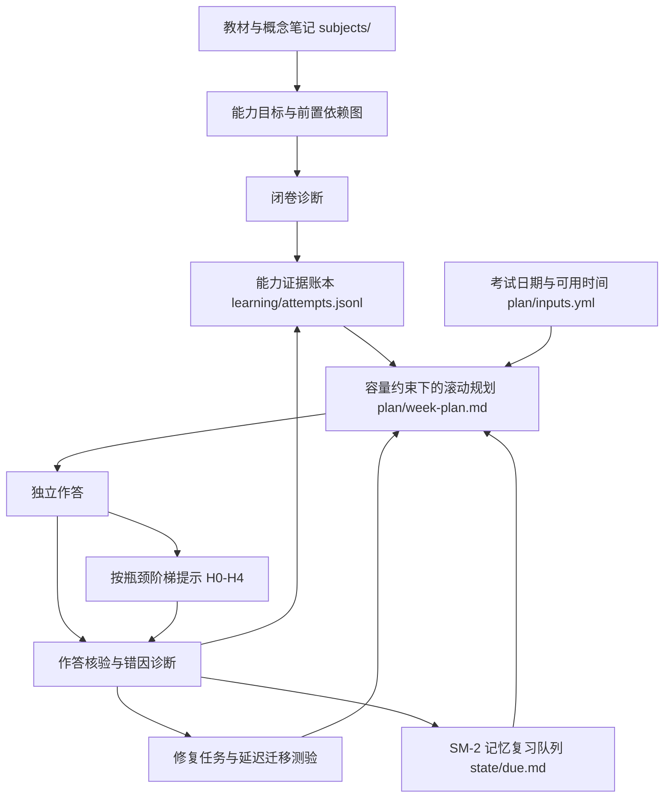

# 架构说明（v2：以"独立表现证据"为中心）

> 2026-09-23 升级。核心转向：**收集"你在没有帮助时能做什么"的证据，并据此安排下一次学习。**
> 本文件是设计落地的凝练版；参数（时间比例、提示阈值、验收次数）均为可调整的工程初值，不是认知科学常数。

## 总览

## 一个知识底座、两套状态模型、三条任务队列、一个导师

- 知识底座：`subjects/NN-课程/topics/*/*.md` 概念笔记（带稳定 id 的原子卡；Obsidian 桥接为后续选项）。
- 两套状态（分离，不混用同一分数）：
  - 记忆状态（`state/`，SM-2）：这个抽测项何时容易忘——ef/interval/reps/due。
  - 能力状态（`learning/learner-state.json`，派生）：能否选对方法、独立推导、应对条件变化——闭卷作答、提示使用、错误位置、题型变化、延迟表现。
- 三条队列（`tools/plan-week.py`，竞争同一时间预算）：记忆维护 / 能力建设 / 修复与再测。
- 一个导师（`.tutor/core/skills/capability-session/SKILL.md`）：学习/测验/示例学习三模式，H0-H4 提示梯度按瓶颈升级。

## 能力账本（记录证据，不记录印象）

| 维度 | 验收示例 |
|------|---------|
| 概念与条件 | 说清定义、适用域与失效情形 |
| 方法选择 | 未标题型问题中解释为何选此方法 |
| 推导执行 | 独立完成关键变换 |
| 自我核验 | 查量纲、符号、极限、边界条件 |
| 迁移 | 改变表征或条件后仍能处理 |

等级（参数见 `learning/policy.yml`，工程初值可调）：未测 → 需支持 → 曾独立完成 → 延迟通过 → 迁移通过。
"有稳定证据" = 不同日期的无提示通过数 ≥ min_dates，且未见变式通过数 ≥ min_variant_passes（≠ 永久掌握）。

独立通过 = final_result=correct 且 max_hint_level∈{0,null} 且 solution_seen=false 且 mode≠worked-example
**且 closed_book=true**（开卷通过单独记入 open_book_pass_dates，不计等级）。
未见变式通过（防曝光绕过的三层条件）：
1. 题目曝光按**整份日志全局**计算——该题在任何目标下被作答过即已曝光，此后任何目标都不得计"未见变式"；
2. 题目在**事件所引版本**的 kind∈{delayed-variant,mixed}（升版换类别不顶替旧事件）；
3. 本次为独立通过。
**辅导后做对（hint>0）是学习进展，不是独立掌握证据。**

## 数据层约束

- 内容稳定（题目/知识卡）、事件追加（attempts.jsonl）、状态可重建（learner-state.json 是派生视图）。
- 事件由程序校验（tools/validate_attempts.py）：唯一 event_id、枚举合法、测验禁提示、
  target_ids 必须是题目在事件所引版本下声明目标的非空子集（防无关能力计分）。
- 题目升版：旧 frontmatter 存入 learning/tasks/history/<id>.v<N>.md；
  - 有历史元数据 → 按该版本解释（成绩不与当前版本直接比较，warning 提示）；
  - 无元数据 → 事件保留但不用于升级（unknown_version_events）。
- 修复按 (题目, 目标) 粒度追踪：一次通过只关闭它实际覆盖的目标。
- 计划与仪表盘是派生视图，不作为事实来源。

## 教学协议（按需给信息，保留认知工作）

独立尝试 → 定位瓶颈 → 最小充分提示 → 学习者继续推导 → 撤去支持 → 延迟变式检验。
H0 澄清目标/条件/卡点 → H1 提醒相关概念或检查方向 → H2 指出局部结构或策略方向 →
H3 给待补全的式子/子问题 → H4 示范当前瓶颈一步或讲更简单的类似例题 → 示例学习模式（明确请求）。
提示级别针对当前瓶颈；独立跨过一个瓶颈后，下一个瓶颈从低支持重新开始。

## 动态规划（固定容量，浮动范围）

- 规划单位 = 在一个学习块内完成一个明确能力目标并产生可用于决策的证据。
- 周容量：Σ承诺任务 ≤ (1-b) × 周专注预算，b 起步 25%~35%；超了输出"容量不足"，靠缩减范围而不是加任务。
- 阶段时间比例（plan/inputs.yml 可调）：概念输入+例题自解释 / 独立手推+方法选择 / 闭卷抽测+延迟复习 / 归因与规划。
- 检查点代替强制中断：35~45 分钟后判断（新推理 / 原地打转 / 缺前置 / 疲劳），保存"已完成什么+失败原因+当前障碍+下次先做什么"。

## 每周四指标（learning/weekly-review.md）

延迟无提示通过率 · 未见变式表现 · 提示依赖 · 时间成本。原题与新题分开看，不同难度不直接比较。

## 证据边界（诚实声明）

- 检索练习、间隔练习、自我解释、数学交错练习有研究支持；但这些不能直接证明本工作区的组合对大学理论力学/电动力学有效。
- 本系统不声称已验证能改善学习效果；是否有效以你自己的延迟独立表现数据为准。
- Prompt 本身不能强制保证不泄题；宿主侧已做到：模式与提示级别落盘、事件程序校验、参考解答与学生可见内容分离约定——但 LLM 审核不是绝对保证。
