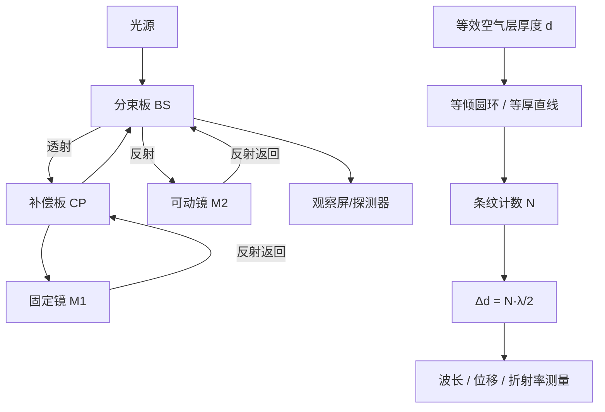

---
tags:
  - 物理光学
  - 干涉计量
  - 迈克耳孙干涉仪
  - 波长测量
  - 折射率测量
aliases:
  - Michelson干涉仪精密测量
  - 等倾干涉圆环计数测长
created: 2026-01-27
updated: 2026-01-27
---

> [!summary] 核心认知先验
> 迈克耳孙干涉仪将两路相干光等效为**厚度可连续变化的空气平板**的反射干涉。通过精确计数干涉条纹中心涌出或吞入的数目 $N$，即可反推可动镜位移 $\Delta d = N \cdot \frac{\lambda}{2}$，进而实现波长、微小位移及气体折射率的高精度测量。白光干涉的可见性严格依赖两臂玻璃基底的光程补偿。

---

## 一、推导机理与核心数学定义

### 1.1 光路拓扑与等效空气层模型

迈克耳孙干涉仪的核心光路由以下元件构成：

- **分束板 (Beam Splitter, BS)**：与入射光成 $45^\circ$ 放置的玻璃平板，其前表面镀半透半反膜，将入射光分为振幅近似相等的透射臂与反射臂。
- **补偿板 (Compensator, CP)**：与分束板基底**完全相同厚度、完全相同折射率**的裸玻璃平板，平行放置于透射臂中，用以补偿反射臂中光束两次穿越分束板基底引入的额外光程。
- **固定镜 $M_1$**：反射透射臂光束，位置固定。
- **可动镜 $M_2$**：反射反射臂光束，可沿光轴精密平移。

设分束板基底厚度为 $t$、折射率为 $n_g$。若不放置补偿板，则：

- 反射臂光束（经 $M_2$ 返回）在往返过程中**两次**穿越分束板基底，引入附加光程 $2 n_g t$；
- 透射臂光束（经 $M_1$ 返回）仅在分束板表面反射，**不穿越**基底。

两臂由此产生固有程差 $\Delta_0 = 2 n_g t$。由于玻璃折射率 $n_g(\lambda)$ 随波长变化（色散），该固有程差对不同波长取值不同，导致白光照明时各波长干涉条纹错位叠加，条纹对比度急剧下降乃至完全消融。

**补偿板的作用**：在透射臂中插入与分束板基底同材质、同厚度的玻璃板，使透射臂光束往返也穿越两次相同玻璃厚度，两臂玻璃引入的色散光程完全抵消，剩余程差仅由空气路径差决定。

### 1.2 等效空气层与等倾干涉

经补偿后，干涉仪可等效为：**厚度为 $d$ 的平行空气平板**夹在两反射镜之间，其中 $d$ 为 $M_1$ 的虚像 $M_1'$ 与 $M_2$ 之间的空气间距。

当 $M_1' \parallel M_2$ 时，形成**等倾干涉**。对于入射角为 $i$ 的光线，两束反射光的光程差为：

$$
\Delta = 2 d \cos i
$$

其中 $d$ 为等效空气层厚度。产生亮纹的条件为：

$$
2 d \cos i = m \lambda, \quad m = 0, 1, 2, \ldots
$$

在透镜焦平面上观察时，同一倾角 $i$ 的光线汇聚在同一圆环上，形成**同心圆环条纹**（等倾条纹）。中心处 $i = 0$，对应最大光程差 $2d$。

### 1.3 可动镜位移与条纹计数

当 $M_2$ 平移 $\Delta d$ 时，等效空气层厚度变化 $\Delta d$，光程差变化 $2\Delta d$。中心处每涌出或吞入一个条纹（即中心亮纹级数 $m$ 变化 1），对应光程差变化恰好一个波长：

$$
2 \Delta d = \lambda
$$

若中心处涌出（$d$ 增大）或吞入（$d$ 减小）$N$ 个条纹，则可动镜位移为：

$$
\Delta d = N \cdot \frac{\lambda}{2}
$$

此式是迈克耳孙干涉仪一切精密测量的核心定量关系。

### 1.4 气体折射率测量原理

在透射臂（或反射臂）中放置长度为 $L$ 的真空样品池。当池内充入折射率为 $n$ 的气体时，该臂光程增加 $(n-1)L$（往返为 $2(n-1)L$，但若采用单次穿越设计则光程变化为 $(n-1)L$；标准教材约定以单臂单次穿越计）。

设充气过程中中心条纹涌出/吞入 $N$ 条，则：

$$
(n - 1) L = N \cdot \frac{\lambda}{2}
$$

由此解得：

$$
n = 1 + \frac{N \lambda}{2L}
$$

### 1.5 微小线膨胀位移测量

将待测样品（如金属棒）与可动镜 $M_2$ 机械耦合。样品受热膨胀 $\Delta L$ 推动 $M_2$ 平移 $\Delta L$，通过计数条纹变化数 $N$，由 $\Delta L = N \lambda / 2$ 精确测定线膨胀量。

---

## 二、⚠️ 致命失分陷阱与临界边界

### 陷阱 1：补偿板缺失导致白光条纹消融

**这是本知识点最核心的失分点。** 若未放置补偿板，反射臂光束往返两次穿越分束板基底（光程 $2n_g t$），而透射臂光束不穿越基底。由于 $n_g$ 是波长的函数，不同波长的光获得不同的附加相位延迟。白光包含连续波长成分，各波长成分的零级条纹位置不再重合，叠加后条纹对比度趋近于零，**白光干涉条纹完全不可见**。

**临界边界**：补偿板必须与分束板基底采用**完全相同厚度**与**完全相同光学折射率**的玻璃，且平行放置。仅当 $t_{CP} = t_{BS}$ 且 $n_{CP}(\lambda) = n_{BS}(\lambda)$ 对所有波长成立时，两臂玻璃色散效应才完全抵消。

### 陷阱 2：单色光下补偿板非必需但不可省略

使用单色激光时，由于仅涉及单一波长，色散效应不显现，理论上不放置补偿板也能观察到清晰条纹。但若后续切换为白光光源（如寻找零光程差位置），无补偿板则无法观察到白光条纹。**考试中若问及白光干涉条件，必须强调补偿板的必要性。**

### 陷阱 3：$\Delta d = N\lambda/2$ 中 $N$ 的计数方向

- $M_2$ 远离 $M_1'$（$d$ 增大）：中心处**涌出**条纹，$N$ 取正值；
- $M_2$ 靠近 $M_1'$（$d$ 减小）：中心处**吞入**条纹，$N$ 取正值但 $\Delta d$ 为负。

**切勿混淆涌出与吞入的符号约定。** 位移方向由条纹运动方向唯一确定。

### 陷阱 4：等倾条纹与等厚条纹的判别

- $M_1' \parallel M_2$（严格平行）：等倾干涉，圆环条纹；
- $M_1'$ 与 $M_2$ 有微小夹角 $\alpha$：等厚干涉，近似直线条纹（楔形空气层）。

**临界边界**：当 $d = 0$（零光程差）且两镜有微小夹角时，白光照射下仅在楔形零厚度处出现一条暗纹（或亮纹），两侧为彩色条纹，且彩色条纹数目极少（通常仅数条）。这是寻找零光程差位置的标准方法。

### 陷阱 5：折射率测量中样品池长度 $L$ 的往返因子

若样品池位于反射臂且光束往返两次穿越样品池，则光程变化为 $2(n-1)L$，对应关系为：

$$
2(n-1)L = N\lambda \quad \Rightarrow \quad (n-1)L = N \cdot \frac{\lambda}{2}
$$

若样品池仅单次穿越（特殊光路设计），则光程变化为 $(n-1)L$，对应：

$$
(n-1)L = N\lambda
$$

**必须根据题目光路图判断样品池被穿越的次数**，不可机械套用公式。

### 陷阱 6：$d = 0$ 时的奇异性

当 $M_2$ 移动到与 $M_1'$ 重合（$d = 0$）时，等倾圆环退化为均匀视场。此时若继续移动 $M_2$，条纹从中心重新涌出，但亮暗分布反转（因半波损失条件可能改变）。**在 $d=0$ 附近，条纹级数 $m$ 的绝对值最小，白光干涉仅在此附近可见。**

---

## 三、经典范例手把手演算

### 范例 1：单色激光波长测量

**题目**：用钠黄光照射迈克耳孙干涉仪，缓慢移动可动镜 $M_2$，观察到中心处涌出 1000 个条纹时，可动镜位移了 $0.2945 \text{ mm}$。求钠黄光波长。

**解**：

由核心关系式：

$$
\Delta d = N \cdot \frac{\lambda}{2}
$$

代入数据 $N = 1000$，$\Delta d = 0.2945 \times 10^{-3} \text{ m}$：

$$
0.2945 \times 10^{-3} = 1000 \cdot \frac{\lambda}{2}
$$

$$
\lambda = \frac{2 \times 0.2945 \times 10^{-3}}{1000} = \frac{0.589 \times 10^{-3}}{1000} = 5.89 \times 10^{-7} \text{ m}
$$

$$
\lambda = 589 \text{ nm}
$$

**验算**：反代 $\Delta d = 1000 \times \frac{589 \times 10^{-9}}{2} = 1000 \times 2.945 \times 10^{-4} = 0.2945 \text{ mm}$，与题设一致。

### 范例 2：气体折射率测定

**题目**：在迈克耳孙干涉仪一臂中放置长度为 $L = 5.00 \text{ cm}$ 的真空样品池（光束单次穿越）。用波长 $\lambda = 632.8 \text{ nm}$ 的 He-Ne 激光照明。缓慢向池内充入某种气体至压强为 $1 \text{ atm}$，观察到中心处吞入 42 个条纹。求该气体在 $1 \text{ atm}$ 下的折射率。

**解**：

光束单次穿越样品池，充气后该臂光程增加 $(n-1)L$。吞入条纹意味着该臂光程增大（等效空气层厚度减小），故：

$$
(n - 1)L = N \cdot \frac{\lambda}{2}
$$

代入 $L = 0.0500 \text{ m}$，$N = 42$，$\lambda = 632.8 \times 10^{-9} \text{ m}$：

$$
(n - 1) \times 0.0500 = 42 \times \frac{632.8 \times 10^{-9}}{2}
$$

$$
(n - 1) \times 0.0500 = 42 \times 3.164 \times 10^{-7} = 1.32888 \times 10^{-5}
$$

$$
n - 1 = \frac{1.32888 \times 10^{-5}}{0.0500} = 2.65776 \times 10^{-4}
$$

$$
n = 1 + 2.65776 \times 10^{-4} = 1.0002658
$$

**验算**：反代 $(n-1)L = 2.65776 \times 10^{-4} \times 0.0500 = 1.32888 \times 10^{-5} \text{ m}$，而 $N\lambda/2 = 42 \times 3.164 \times 10^{-7} = 1.32888 \times 10^{-5} \text{ m}$，一致。

### 范例 3：白光零光程差定位与微小位移测量

**题目**：先用白光找到零光程差位置（此时视场中呈现中央暗纹两侧对称彩色条纹），然后移开白光光源换用单色光，记下此时中心条纹级数。推动可动镜 $M_2$ 直至中心再次变为同样级数的亮纹，共数得涌出 250 个条纹。已知单色光波长 $\lambda = 550 \text{ nm}$，求 $M_2$ 的位移。

**解**：

白光零光程差位置对应 $d = 0$。换用单色光后，中心亮纹条件为 $2d = m\lambda$。推动 $M_2$ 使中心再次出现同级别亮纹，意味着 $d$ 从 0 增大到 $d'$ 且满足 $2d' = m'\lambda$，其中 $m'$ 为整数。涌出 250 个条纹表明 $m' = 250$。

由 $\Delta d = N \cdot \frac{\lambda}{2}$：

$$
\Delta d = 250 \times \frac{550 \times 10^{-9}}{2} = 250 \times 2.75 \times 10^{-7} = 6.875 \times 10^{-5} \text{ m}
$$

$$
\Delta d = 68.75 \text{ μm}
$$

**验算**：$2\Delta d = 1.375 \times 10^{-4} \text{ m}$，而 $250 \times 550 \times 10^{-9} = 1.375 \times 10^{-4} \text{ m}$，光程差变化恰为 250 个波长，对应 250 个条纹级数变化，正确。

---

## 四、出处与纸质笔记坐标

**教材出处**：Pedrotti, *Introduction to Optics*, Ch.8 §1–§3 (P192–P198)

- §1 (P192–P194)：迈克耳孙干涉仪结构与光路分析，补偿板原理
- §2 (P194–P196)：等倾圆环条纹推导，$\Delta d = N\lambda/2$ 关系
- §3 (P196–P198)：白光干涉、零光程差定位、折射率测量应用

**纸质活页留痕槽位**：[活页-PED-09]

- 左页：光路拓扑手绘图（标注 BS、CP、$M_1$、$M_2$ 及虚像 $M_1'$）
- 右页：$\Delta d = N\lambda/2$ 推导全过程 + 范例 1–3 演算 + 错题订正区

**全景图挂载**：

---

*本卡片依据 Pedrotti Ch.8 编写，所有公式推导均保留完整代数步骤，供纸质笔记对照誊写。*

---
**知识图谱导航**：[[00_Pedrotti光学_学习全景图]]
