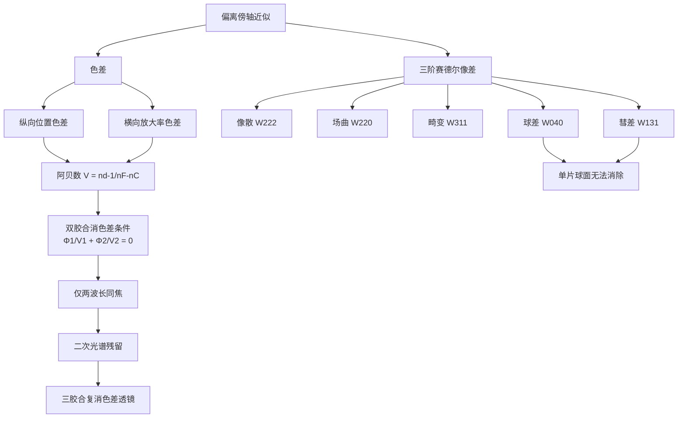

---
tags:
  - 光学/像差理论
  - 光学/几何光学
  - 光学/色差
  - 概念卡
aliases:
  - 三阶赛德尔像差
  - Seidel Aberrations
  - 消色差双胶合透镜
  - 阿贝数
created: 2026-01-27
updated: 2026-01-27
---

> [!summary] 核心认知先验
> 傍轴光学（一阶近似）假定 $\sin\theta \approx \theta$，从而保证物像共轭的严格点对点成像。三阶像差理论将 $\sin\theta$ 展开至 $\theta^3$ 项，揭示实际光学系统偏离理想成像的五个单色几何像差模式（球差、彗差、像散、场曲、畸变），以及由折射率色散导致的独立于几何像差的两类色差。**单色像差源于几何光程差，色差源于材料色散，二者物理机制独立，不可混为一谈。**

---

## 一、推导机理与核心数学定义

### 1.1 从傍轴近似到三阶展开

实际光线追迹中，折射定律 $n\sin i = n'\sin i'$ 中的正弦项需展开为幂级数：

$$
\sin\theta = \theta - \frac{\theta^3}{3!} + \frac{\theta^5}{5!} - \cdots
$$

傍轴光学仅保留首项 $\sin\theta \approx \theta$，得到理想成像。保留至 $\theta^3$ 项时，光程函数（波像差）的展开式中出现与孔径坐标和视场坐标四次方相关的项，对应五种独立的单色像差模式——赛德尔像差。

### 1.2 五种单色赛德尔像差的物理机制

设光学系统为旋转对称，以 $h$ 表示物高（视场），$\rho$ 表示孔径坐标。波像差展开至四阶（对应光线三阶）可写为五项之和：

$$
W(h, \rho, \cos\phi) = W_{040}\,\rho^4 + W_{131}\,h\rho^3\cos\phi + W_{222}\,h^2\rho^2\cos^2\phi + W_{220}\,h^2\rho^2 + W_{311}\,h^3\rho\cos\phi
$$

各项物理含义如下：

| 系数 | 像差名称 | 物理机制 | 与视场/孔径的依赖关系 |
|:---:|:---:|:---|:---|
| $W_{040}$ | **球差** | 孔径边缘光线与近轴光线焦点不重合，与视场无关 | 仅随孔径 $\rho^4$ |
| $W_{131}$ | **彗差** | 不同孔径环带成像高度不同，点物成像呈彗星状弥散斑 | 随视场一次方、孔径三次方 |
| $W_{222}$ | **像散** | 子午面与弧矢面内光线聚焦位置不同，点物成两条焦线 | 随视场平方、孔径平方 |
| $W_{220}$ | **场曲** | 像面非平面，平面物成像于弯曲的匹兹伐(Petzval)曲面 | 随视场平方、孔径平方 |
| $W_{311}$ | **畸变** | 像高与理想像高不成比例，像发生桶形或枕形变形 | 随视场三次方、孔径一次方 |

### 1.3 球差的定量描述

单球面折射系统的球差可用三级展开表示为：

$$
\delta s' = A_1 h^2 + A_2 h^4 + \cdots
$$

其中 $h$ 为入射高度，$A_1$ 为三阶球差系数。对单球面折射面，三阶球差系数为：

$$
A_1 = \frac{n'}{2s'^2}\left(\frac{s'+r}{s'-r}\right)^2 \cdot \frac{n'-n}{n'} \cdot \frac{1}{s^2} \cdot \frac{s'^2}{n'}
$$

化简后，单球面折射面的球差与折射率差、曲率半径及物像位置密切相关。**关键结论：对单个球面折射面，无论选择何种折射率材料，均存在非零球差，仅可通过选择特定曲率半径使某孔径带的球差为零，但无法使所有孔径带同时为零。**

### 1.4 色差与阿贝数

色差源于折射率随波长变化（色散）。定义**阿贝数**（V数）：

$$
V_d = \frac{n_d - 1}{n_F - n_C}
$$

其中 $n_d$、$n_F$、$n_C$ 分别为氦d线（587.56 nm）、氢F线（486.13 nm）和氢C线（656.27 nm）处的折射率。阿贝数越大，色散越弱。

**纵向（位置）色差**：不同波长光线的像方焦点沿光轴方向分离：

$$
\Delta s'_{FC} = s'_F - s'_C
$$

**横向（放大率）色差**：不同波长光线的像高不同：

$$
\Delta y'_{FC} = y'_F - y'_C
$$

### 1.5 双胶合消色差透镜的配比条件

设双胶合薄透镜由折射率分别为 $n_1, n_2$、阿贝数分别为 $V_1, V_2$ 的两种玻璃构成，两透镜光焦度分别为 $\Phi_1, \Phi_2$，总光焦度为 $\Phi = \Phi_1 + \Phi_2$。

消色差条件要求两透镜的色差相互抵消。对薄透镜系统，色差系数正比于 $\Phi/V$，故消色差条件为：

$$
\frac{\Phi_1}{V_1} + \frac{\Phi_2}{V_2} = 0
$$

即：

$$
\Phi_1 = -\frac{V_1}{V_2}\Phi_2
$$

结合总光焦度 $\Phi = \Phi_1 + \Phi_2$，解得：

$$
\Phi_1 = \frac{V_1}{V_1 - V_2}\Phi, \qquad \Phi_2 = -\frac{V_2}{V_1 - V_2}\Phi
$$

由于 $V_1 > 0$ 且 $V_2 > 0$，若 $V_1 > V_2$（冕牌玻璃在前），则 $\Phi_1 > 0$（正透镜），$\Phi_2 < 0$（负透镜），即**正负透镜胶合**。若 $V_1 = V_2$，则方程无有限解——**两种色散相同的材料无法消色差**。

---

## 二、⚠️ 致命失分陷阱与临界边界

### 陷阱 1：单片球面透镜无法消除球差

**无论选择何种折射率材料、何种曲率半径组合，单片球面透镜均存在非零三阶球差。** 球差系数 $A_1$ 的表达式表明，仅当物点位于特定位置（如球面顶点或曲率中心）时球差为零，但这些位置不构成实际成像场景。非球面（如抛物面）可消除球差，但球面系统必须通过多透镜组合校正。

### 陷阱 2：单色像差与色差机制完全独立

- **单色像差**：由几何光程差引起，与波长无关（在固定折射率下）。
- **色差**：由折射率随波长变化引起，与孔径和视场无关（一阶色差）。

**二者不可混淆**：一个系统可以完全无色差但仍存在严重球差（如使用单色光时），也可以完全无单色像差但仍存在色差（理想化的消单色像差系统）。

### 陷阱 3：消色差双胶合透镜的局限性

双胶合透镜的消色差条件 $\Phi_1/V_1 + \Phi_2/V_2 = 0$ 仅保证**两个特定波长**（通常为F线和C线）的焦点重合。其他波长的焦点仍与这两个波长不同，产生**二次光谱（Secondary Spectrum）**：

$$
\Delta s'_{d} = s'_d - \frac{s'_F + s'_C}{2} \neq 0
$$

二次光谱的大小取决于玻璃的部分色散比 $P_{gF} = (n_g - n_F)/(n_F - n_C)$ 的差异。**仅用两种玻璃无法同时校正三个波长的色差**，需使用三胶合透镜（复消色差透镜，Apochromat）使三个波长同焦。

### 陷阱 4：消色差条件中 $V_1 = V_2$ 的奇异情形

若两透镜使用相同色散材料（$V_1 = V_2$），消色差方程退化为 $\Phi_1 + \Phi_2 = 0$，即总光焦度为零——系统无聚焦能力。**同种材料无法消色差**。

### 陷阱 5：畸变的桶形与枕形判据

- **桶形畸变**：像高小于理想像高（$y' < y'_{ideal}$），放大率随视场增大而减小，负畸变。
- **枕形畸变**：像高大于理想像高（$y' > y'_{ideal}$），放大率随视场增大而增大，正畸变。

畸变不破坏像的清晰度（各点仍锐利），仅改变像的几何形状。

---

## 三、经典范例手把手演算

### 范例：双胶合消色差薄透镜设计

**题目**：设计一个焦距 $f' = 100\ \text{mm}$ 的双胶合消色差薄透镜。选用冕牌玻璃 BK7（$n_d = 1.5168$，$V_d = 64.17$）和火石玻璃 SF5（$n_d = 1.6727$，$V_d = 32.25$）。求两透镜的光焦度与焦距。

**第一步：写出消色差条件与总光焦度方程**

设 $\Phi_1$ 为 BK7 透镜光焦度，$\Phi_2$ 为 SF5 透镜光焦度。总光焦度：

$$
\Phi = \Phi_1 + \Phi_2 = \frac{1}{f'} = \frac{1}{0.1\ \text{m}} = 10\ \text{D}
$$

消色差条件：

$$
\frac{\Phi_1}{V_1} + \frac{\Phi_2}{V_2} = 0
$$

**第二步：代入数值求解**

由消色差条件：

$$
\frac{\Phi_1}{64.17} + \frac{\Phi_2}{32.25} = 0
$$

$$
\Phi_2 = -\frac{32.25}{64.17}\Phi_1 = -0.5026\,\Phi_1
$$

代入总光焦度方程：

$$
\Phi_1 - 0.5026\,\Phi_1 = 10\ \text{D}
$$

$$
0.4974\,\Phi_1 = 10\ \text{D}
$$

$$
\Phi_1 = \frac{10}{0.4974} = 20.10\ \text{D}
$$

$$
\Phi_2 = -0.5026 \times 20.10 = -10.10\ \text{D}
$$

**第三步：换算为焦距**

$$
f'_1 = \frac{1}{\Phi_1} = \frac{1}{20.10\ \text{D}} = 0.04975\ \text{m} = 49.75\ \text{mm}
$$

$$
f'_2 = \frac{1}{\Phi_2} = \frac{1}{-10.10\ \text{D}} = -0.09901\ \text{m} = -99.01\ \text{mm}
$$

**第四步：终解反代验算**

验证总光焦度：

$$
\Phi_1 + \Phi_2 = 20.10 + (-10.10) = 10.00\ \text{D} \quad \checkmark
$$

验证消色差条件：

$$
\frac{\Phi_1}{V_1} + \frac{\Phi_2}{V_2} = \frac{20.10}{64.17} + \frac{-10.10}{32.25} = 0.3132 - 0.3132 = 0 \quad \checkmark
$$

**结论**：BK7 正透镜焦距 $f'_1 = 49.75\ \text{mm}$，SF5 负透镜焦距 $f'_2 = -99.01\ \text{mm}$，胶合后系统焦距 $f' = 100\ \text{mm}$，F线与C线焦点重合。

**注意**：此设计仅保证F、C两线消色差。d线焦点与F、C线焦点的偏离（二次光谱）约为焦距的 $1/2000$，即约 $0.05\ \text{mm}$，需三胶合透镜进一步消除。

---

## 四、出处与纸质笔记坐标

### 教材出处

| 内容 | 教材坐标 | 页码 |
|:---|:---|:---|
| 球差、彗差、像散的几何光学分析 | Pedrotti, *Introduction to Optics*, Ch. 3 §2 | P58-P60 |
| 赛德尔像差完整理论 | Pedrotti, Ch. 20 §1-§4 | P440-P455 |
| 色差、阿贝数、消色差透镜 | Pedrotti, Ch. 20 §5-§8 | P455-P465 |

### 纸质活页留痕槽位

- **当前卡片对应槽位**：`[活页-PED-03]`
- 建议在活页中完成以下手写推导：
  1. 单球面折射球差系数 $A_1$ 的完整推导（从光程函数出发）
  2. 双胶合消色差条件 $\Phi_1/V_1 + \Phi_2/V_2 = 0$ 的薄透镜矩阵推导
  3. 二次光谱的定量估算（利用部分色散比 $P_{gF}$）
  4. 自绘五种赛德尔像差的光路示意图与弥散斑形态

### 知识全景图

---

*本卡片依据 Pedrotti《Introduction to Optics》第三版编写，对应光学设计基础理论模块。建议配合 ZEMAX 或 OSLO 软件仿真验证赛德尔系数。*

---
**知识图谱导航**：[[00_Pedrotti光学_学习全景图]]
