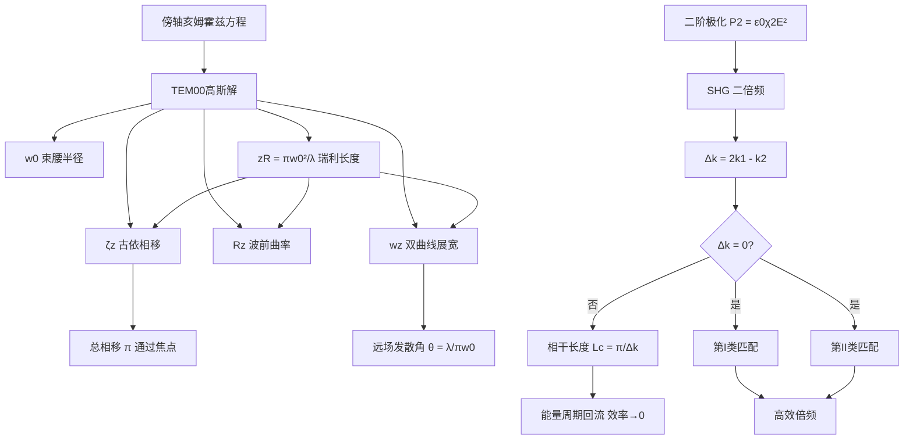

---
tags:
  - 高斯光束
  - 傍轴波动方程
  - 瑞利长度
  - 古依相移
  - 非线性光学
  - 二倍频
  - 相位匹配
  - 概念卡
aliases:
  - 高斯光束传播与SHG
  - TEM00解析解与相位匹配
created: 2026-01-27
updated: 2026-01-27
---

> [!summary] 核心认知先验
> 高斯光束是傍轴亥姆霍兹方程的最低阶（基模）解析解，其横向场分布保持高斯函数形式，但宽度沿传播轴按双曲线规律展宽。非线性二倍频的效率受制于介质色散导致的动量失配，必须借助双折射晶体的相位匹配技术补偿 $\Delta k$，否则能量在相干长度内周期性回流，宏观转换效率趋零。

---

## 一、推导机理与核心数学定义

### 1.1 傍轴亥姆霍兹方程与基模高斯解

标量波动方程在单色场假设下化为亥姆霍兹方程：

$$
\nabla^2 \tilde{E} + k^2 \tilde{E} = 0
$$

其中 $k = \omega / c = 2\pi / \lambda$。设场沿 $z$ 轴传播，引入慢变复振幅 $U(x,y,z)$，使 $\tilde{E}(x,y,z) = U(x,y,z) e^{-ikz}$。代入后，在傍轴近似下（忽略 $\partial^2 U / \partial z^2$），得到**傍轴亥姆霍兹方程**：

$$
\nabla_T^2 U - 2ik \frac{\partial U}{\partial z} = 0
$$

其中 $\nabla_T^2 = \partial^2 / \partial x^2 + \partial^2 / \partial y^2$ 为横向拉普拉斯算子。

基模（TEM$_{00}$）高斯光束的复振幅解析解为：

$$
U(r, z) = E_0 \frac{w_0}{w(z)} \exp\left[ -\frac{r^2}{w^2(z)} \right] \exp\left[ -ikz - ik\frac{r^2}{2R(z)} + i\zeta(z) \right]
$$

其中 $r^2 = x^2 + y^2$。

### 1.2 束腰半径与光斑展宽规律

定义**束腰半径** $w_0$ 为 $z=0$ 处场振幅降至峰值 $1/e$ 处的径向距离。光斑截面半径沿光轴按双曲线规律展宽：

$$
w(z) = w_0 \sqrt{1 + \left( \frac{z}{z_R} \right)^2}
$$

### 1.3 瑞利长度与远场发散角

**瑞利长度**定义为光斑面积翻倍（即 $w(z_R) = \sqrt{2} w_0$）的传播距离：

$$
z_R = \frac{\pi w_0^2}{\lambda}
$$

在远场极限 $z \gg z_R$ 下，$w(z) \approx w_0 z / z_R$，由此定义**远场半发散角**：

$$
\theta = \lim_{z \to \infty} \frac{w(z)}{z} = \frac{w_0}{z_R} = \frac{\lambda}{\pi w_0}
$$

### 1.4 等相位波前曲率半径

高斯光束的等相位面为球面，其曲率半径为：

$$
R(z) = z \left[ 1 + \left( \frac{z_R}{z} \right)^2 \right]
$$

在 $z = z_R$ 处，$R(z)$ 取极小值 $|R|_{\min} = 2z_R$；在束腰处 $R \to \infty$（平面波前）；在远场 $R \to z$（近似球面波）。

### 1.5 古依相移

高斯光束在传播过程中，相对于理想平面波额外积累的相位称为**古依相移**：

$$
\zeta(z) = \arctan\left( \frac{z}{z_R} \right)
$$

### 1.6 非线性二阶极化与二倍频

在非线性介质中，二阶非线性极化强度为：

$$
P^{(2)}(t) = \varepsilon_0 \chi^{(2)} E^2(t)
$$

设基波场 $E(t) = E_0 \cos(\omega t)$，则：

$$
P^{(2)}(t) = \varepsilon_0 \chi^{(2)} E_0^2 \cos^2(\omega t) = \frac{1}{2} \varepsilon_0 \chi^{(2)} E_0^2 \left[ 1 + \cos(2\omega t) \right]
$$

其中频率为 $2\omega$ 的分量即为**二倍频（SHG）**信号源。该极化场作为辐射源，在介质中激发出频率为 $2\omega$ 的倍频波。

### 1.7 相位匹配条件

设基波波矢 $k_1 = n_1 \omega / c$，倍频波波矢 $k_2 = n_2 (2\omega) / c$。动量失配定义为：

$$
\Delta k = 2k_1 - k_2 = \frac{2\omega}{c}(n_1 - n_2)
$$

**第I类相位匹配**：基波为 o 光，倍频为 e 光（或反之），通过调节晶体角度使 $n_e(2\omega) = n_o(\omega)$，实现 $\Delta k = 0$。

**第II类相位匹配**：两基波光子分别取 o 光和 e 光偏振，倍频为 e 光（或 o 光），条件为 $n_o(\omega) + n_e(\omega) = 2n_e(2\omega)$（或对应组合）。

---

## 二、⚠️ 致命失分陷阱与临界边界

### 2.1 古依相移的累积总量

**陷阱**：误认为古依相移在传播中持续线性增长。

**临界事实**：高斯光束从 $z = -\infty$ 传播至 $z = +\infty$，古依相移的总变化量为：

$$
\zeta(+\infty) - \zeta(-\infty) = \frac{\pi}{2} - \left( -\frac{\pi}{2} \right) = \pi
$$

即**通过束腰焦点区总共产生 $\pi$ 的额外相移**。这一相移在谐振腔模式频率计算和光学参量过程中不可忽略。

### 2.2 相干长度与能量回流

**陷阱**：认为只要介质有非线性系数 $\chi^{(2)} \neq 0$，倍频效率就随晶体长度单调增长。

**临界事实**：当 $\Delta k \neq 0$ 时，基波与倍频波之间产生周期性相位滑移。在传播距离 $L_c = \pi / \Delta k$（**相干长度**）内，倍频光强先增长后衰减，能量从倍频波回流至基波。若不进行相位匹配，宏观上倍频转换效率在 $L \gg L_c$ 时退化为零（实际受吸收和边界效应限制，趋近于一个极小值）。

### 2.3 束腰处波前曲率半径的奇异性

**陷阱**：将 $R(z) = z[1 + (z_R/z)^2]$ 在 $z=0$ 处直接代入得 $R(0) = 0$，误认为波前为点源。

**临界事实**：$z \to 0$ 时 $R(z) \to \infty$，束腰处波前为理想平面。公式在 $z=0$ 处存在形式上的 $0 \cdot \infty$ 型不定式，必须取极限：

$$
\lim_{z \to 0} z \left[ 1 + \frac{z_R^2}{z^2} \right] = \lim_{z \to 0} \left( z + \frac{z_R^2}{z} \right) = \infty
$$

### 2.4 发散角公式的适用条件

**陷阱**：将 $\theta = \lambda / (\pi w_0)$ 直接用于近场区域计算光斑大小。

**临界事实**：该公式仅在远场极限（$z \gg z_R$）下严格成立。在近场区域必须使用完整的双曲线公式 $w(z) = w_0\sqrt{1 + (z/z_R)^2}$。

### 2.5 相位匹配的角度敏感性

**陷阱**：忽略相位匹配对角度和温度的极端敏感性。

**临界事实**：双折射晶体的折射率随角度变化，$\Delta k = 0$ 的匹配角精度通常在毫弧度量级。角度偏差 $\delta\theta$ 导致 $\Delta k \neq 0$，相干长度急剧缩短，效率骤降。

---

## 三、经典范例手把手演算

### 3.1 范例一：高斯光束参数计算

**题目**：一氦氖激光器输出 $\lambda = 632.8\ \text{nm}$ 的高斯光束，束腰半径 $w_0 = 0.5\ \text{mm}$。求：(a) 瑞利长度 $z_R$；(b) 在 $z = 2\ \text{m}$ 处的光斑半径；(c) 远场半发散角 $\theta$；(d) 从束腰传播至 $z = 2z_R$ 处累积的古依相移。

**解**：

(a) 瑞利长度：

$$
z_R = \frac{\pi w_0^2}{\lambda} = \frac{\pi \times (0.5 \times 10^{-3})^2}{632.8 \times 10^{-9}} = \frac{\pi \times 2.5 \times 10^{-7}}{6.328 \times 10^{-7}} = \frac{7.854 \times 10^{-7}}{6.328 \times 10^{-7}} \approx 1.241\ \text{m}
$$

(b) 在 $z = 2\ \text{m}$ 处，$z/z_R = 2/1.241 \approx 1.612$：

$$
w(2) = w_0 \sqrt{1 + (1.612)^2} = 0.5 \times 10^{-3} \times \sqrt{1 + 2.599} = 0.5 \times 10^{-3} \times \sqrt{3.599}
$$

$$
w(2) = 0.5 \times 10^{-3} \times 1.897 \approx 0.949\ \text{mm}
$$

(c) 远场半发散角：

$$
\theta = \frac{\lambda}{\pi w_0} = \frac{632.8 \times 10^{-9}}{\pi \times 0.5 \times 10^{-3}} = \frac{6.328 \times 10^{-7}}{1.571 \times 10^{-3}} \approx 4.03 \times 10^{-4}\ \text{rad} \approx 0.0231^\circ
$$

(d) 古依相移在 $z = 2z_R$ 处：

$$
\zeta(2z_R) = \arctan(2) \approx 1.107\ \text{rad}
$$

**验算**：在 $z = z_R$ 处，$\zeta = \arctan(1) = \pi/4$，光斑 $w(z_R) = \sqrt{2}w_0$，$R(z_R) = 2z_R$，均与理论一致。

### 3.2 范例二：二倍频相干长度与相位匹配

**题目**：KDP 晶体中，基波 $\lambda_1 = 1064\ \text{nm}$（$n_1 = 1.494$），倍频 $\lambda_2 = 532\ \text{nm}$（$n_2 = 1.513$，未匹配时）。求：(a) 动量失配 $\Delta k$；(b) 相干长度 $L_c$；(c) 若通过角度调谐实现 $n_2 = n_1$，求匹配后的相干长度。

**解**：

(a) 动量失配：

$$
\Delta k = \frac{2\omega}{c}(n_1 - n_2) = \frac{2 \times 2\pi c / \lambda_1}{c}(n_1 - n_2) = \frac{4\pi}{\lambda_1}(n_1 - n_2)
$$

$$
\Delta k = \frac{4\pi}{1064 \times 10^{-9}} \times (1.494 - 1.513) = \frac{4\pi}{1.064 \times 10^{-6}} \times (-0.019)
$$

$$
\Delta k = \frac{12.566}{1.064 \times 10^{-6}} \times (-0.019) = -1.181 \times 10^7 \times 0.019 \approx -2.244 \times 10^5\ \text{m}^{-1}
$$

(b) 相干长度：

$$
L_c = \frac{\pi}{|\Delta k|} = \frac{\pi}{2.244 \times 10^5} \approx 1.40 \times 10^{-5}\ \text{m} = 14.0\ \mu\text{m}
$$

(c) 相位匹配后 $\Delta k = 0$，理论上 $L_c \to \infty$。实际受晶体吸收、走离效应和角度带宽限制，有效相互作用长度受限于孔径长度 $L_a = d / \rho$（$d$ 为光束直径，$\rho$ 为走离角），典型值为厘米量级。

**验算**：未匹配时，倍频光在 $14\ \mu\text{m}$ 内达到峰值后即开始回流，$1\ \text{mm}$ 厚的晶体中经历约 71 个相干长度周期，净转换效率趋近于零。匹配后效率随晶体长度近似二次增长（小信号近似下 $\eta \propto L^2$）。

---

## 四、出处与纸质笔记坐标

### 4.1 教材出处

- **高斯光束部分**：Pedrotti, *Introduction to Optics*, 3rd ed., Ch.24 §1–§4, pp.526–536
  - §1 傍轴波动方程与高斯解
  - §2 束腰与瑞利长度
  - §3 发散角与曲率半径
  - §4 古依相移
- **非线性二倍频部分**：Pedrotti, Ch.28 §1–§4, pp.600–618
  - §1 非线性极化率与二阶极化
  - §2 二倍频耦合波方程
  - §3 相位匹配与相干长度
  - §4 双折射晶体角度调谐

### 4.2 纸质活页留痕槽位

**活页-PED-26**

| 槽位 | 内容 | 完成状态 |
|------|------|----------|
| 左页 | 高斯光束 $w(z)$、$R(z)$、$\zeta(z)$ 三曲线手绘草图 | ☐ |
| 左页 | 束腰处波前平面与远场球面波前对比示意 | ☐ |
| 右页 | 范例 3.1 完整推导誊写 | ☐ |
| 右页 | 范例 3.2 相干长度计算与能量回流图示 | ☐ |
| 附页 | 第I/II类相位匹配几何构型（o/e 偏振路径图） | ☐ |

### 4.3 知识全景图

---

*本卡片依据 Pedrotti Ch.24 §1-§4 与 Ch.28 §1-§4 编写，覆盖高斯光束全部核心参数及其物理边界条件，以及二倍频相位匹配的完整逻辑链。*

---
**知识图谱导航**：[[00_Pedrotti光学_学习全景图]]

### 纸质活页留痕槽位：[活页-PED-26]
- 请在此处记录推导手稿与疑难反思。
