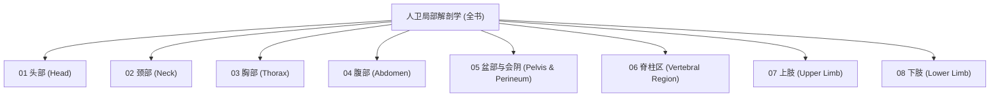

# 🗺️ 人卫第九版《局部解剖学》全书学习全景图 (Regional Anatomy Master Atlas)

> [!summary] 认知先验与全局架构
> 本知识库依据**人卫第九版《局部解剖学》（崔慧先、李瑞锡主编）**与开源医学标准 **MedSchoolAtlas** 深度重构。
> 全书共涵盖 **8 大解剖局部、56 张高精度医学解剖卡片、56 幅公版权威原版解剖图谱与配套费曼默写活页**。
> 采用“层次架构 -> 间隙腔室 -> 血管神经束 -> 临床手术入路与危险盲区”的四维透视法，构建图文强对齐、立体空间闭环的临床外科学解剖自学体系。

---

## 🧭 一、全书八大局部知识导航 (Book Structure)

---

## 🖼️ 二、全书八大局部核心解剖图谱与卡片总表

### 01、头部篇 (Head)

| 图号 | 解剖图版 (点击放大预览) | 关联核心卡片 | 核心解剖观察要点与临床意义 |
| :---: | :---: | :--- | :--- |
| **图 01-01** | ![[images/Scalp_and_calvaria_layers.png\|140]] **颅顶额顶枕区SCALP层** | [[形态_颅顶额顶枕区SCALP层次与腱膜下间隙]] | 颅顶软组织五层构造（S-Skin皮肤、C-Connective tissue致密结缔组织、A-Aponeurosis帽状腱膜与枕额肌、L-Loose connective tissue疏松结缔组织/腱膜下间隙、P-Pericranium颅骨外膜） |
| **图 01-02** | ![[images/Facial_nerve_and_vessels.png\|140]] **面部浅层表情肌面神经腮腺** | [[空间_面部浅层表情肌面神经腮腺丛与面静脉]] | 面肌（眼轮匝肌、口周围肌、颊肌）特征 |
| **图 01-03** | ![[images/Parotid_region_and_duct.png\|140]] **腮腺咬肌区层次与穿行血管** | [[空间_腮腺咬肌区层次与穿行血管神经解剖]] | 腮腺咬肌区境界 |
| **图 01-04** | ![[images/Infratemporal_fossa_and_mandibular_nerve.png\|140]] **面侧深区翼下颌间隙上颌动** | [[空间_面侧深区翼下颌间隙上颌动脉与下颌神经]] | 面侧深区位于下颌支深面与颅底之间 |
| **图 01-05** | ![[images/Internal_base_of_skull_foramina.png\|140]] **颅底内面三颅窝孔裂交通与** | [[空间_颅底内面三颅窝孔裂交通与神经血管通道]] | 前颅窝（鸡冠、筛板筛孔穿嗅神经CN I） |
| **图 01-06** | ![[images/Pterion_middle_meningeal_and_danger_triangle.png\|140]] **翼点区骨折脑膜中动脉血肿** | [[临床_翼点区骨折脑膜中动脉血肿与面部危险三角]] | 翼点(Pterion)解剖位置（额骨、顶骨、颞骨、蝶骨大翼汇合形成的'H'形骨缝区，位于颧弓中点上方约两横指） |

---

### 02、颈部篇 (Neck)

| 图号 | 解剖图版 (点击放大预览) | 关联核心卡片 | 核心解剖观察要点与临床意义 |
| :---: | :---: | :--- | :--- |
| **图 02-01** | ![[images/Neck_surface_landmarks.png\|140]] **颈部表面解剖体表标志与骨** | [[形态_颈部表面解剖体表标志与骨性软骨投影]] | 舌骨(C3)、甲状软骨喉结(C4-C5)、环状软骨(C6)与Chassaignac颈动脉结节 |
| **图 02-02** | ![[images/Cervical_fascia_and_spaces_cross_section.png\|140]] **颈筋膜三层构造与筋膜间隙** | [[空间_颈筋膜三层构造与筋膜间隙交通解剖]] | 封套层、气管前层、椎前层；咽后间隙与危险间隙下通后纵隔坏死性感染 |
| **图 02-03** | ![[images/Triangles_of_the_neck_overview.png\|140]] **颈前区解剖三角分区与层次** | [[空间_颈前区解剖三角分区与层次关系]] | 颈前三角、二腹肌三角、颏下三角、颈动脉三角与肌三角分界 |
| **图 02-04** | ![[images/Carotid_triangle_and_neurovascular_bundle.png\|140]] **颈动脉三角解剖境界与神经** | [[空间_颈动脉三角解剖境界与神经血管鞘内排列]] | 颈总动脉分叉(C4)、颈内静脉外侧、迷走神经后沟内与颈动脉窦感受器 |
| **图 02-05** | ![[images/Muscular_triangle_and_thyroid_gland.png\|140]] **肌三角与甲状腺外侧毗邻及** | [[空间_肌三角与甲状腺外侧毗邻及神经血管走形]] | 甲状腺侧叶外邻颈动脉鞘；上极贴血管结扎、下极贴腺体结扎保护喉返神经 |
| **图 02-06** | ![[images/Sternocleidomastoid_region_and_cervical_plexus.png\|140]] **胸锁乳突肌区与颈后三角神** | [[空间_胸锁乳突肌区与颈后三角神经血管束]] | SCM后缘Erb神经点(颈丛皮支阻滞点)、副神经穿行与膈神经前斜角肌表面走向 |
| **图 02-07** | ![[images/Scalene_gap_and_subclavian_artery.png\|140]] **斜角肌间隙解剖境界与锁骨** | [[空间_斜角肌间隙解剖境界与锁骨下动脉及臂丛]] | 前中斜角肌夹角狭窄通道、锁骨下动脉第二段、臂丛三干与胸廓出口综合征 |
| **图 02-08** | ![[images/Anterior_cervical_approach_Smith_Robinson.png\|140]] **颈前路Smith-Rob** | [[临床_颈前路Smith-Robinson手术解剖入路与多层次危险盲区]] | 血管鞘向外/内脏鞘向内分离间隙；食管穿孔与喉返神经过度牵拉规避 |
| **图 02-09** | ![[images/Posterior_cervical_approach_and_lateral_mass.png\|140]] **颈后路椎板切除与侧块置钉** | [[临床_颈后路椎板切除与侧块置钉解剖危险区与置钉参数]] | 项韧带乏血管间隙；Magerl侧块置钉(外偏25度/头倾30度)避让椎管与横突孔 |

---

### 03、胸部篇 (Thorax)

| 图号 | 解剖图版 (点击放大预览) | 关联核心卡片 | 核心解剖观察要点与临床意义 |
| :---: | :---: | :--- | :--- |
| **图 03-01** | ![[images/Intercostal_space_and_neurovascular_bundle.png\|140]] **胸壁层次肋间隙结构与肋间** | [[形态_胸壁层次肋间隙结构与肋间神经血管排列]] | 胸壁软组织层次（皮肤、浅筋膜、胸肌深筋膜、胸大肌/胸小肌/前锯肌、肋间肌、胸内筋膜、壁胸膜） |
| **图 03-02** | ![[images/Pleural_cavity_and_costodiaphragmatic_recess.png\|140]] **胸膜腔境界与肋膈隐窝胸腔** | [[空间_胸膜腔境界与肋膈隐窝胸腔穿刺安全区]] | 壁胸膜四部（胸膜顶突入颈根部高出锁骨内侧1/3上方2-3cm、肋胸膜、纵隔胸膜、膈胸膜） |
| **图 03-03** | ![[images/Lung_hilar_structures_and_bronchopulmonary_segments.png\|140]] **肺形态分叶肺段划分与肺门** | [[形态_肺形态分叶肺段划分与肺门管道三维排列]] | 肺形态（一尖、一底、两面、三缘） |
| **图 03-04** | ![[images/Superior_mediastinum_and_aortic_arch.png\|140]] **上纵隔器官层次与主动脉弓** | [[空间_上纵隔器官层次与主动脉弓三大分支及毗邻]] | 纵隔分界（胸骨柄胸骨角与第4胸椎体下缘水平线分为上下纵隔） |
| **图 03-05** | ![[images/Posterior_mediastinum_esophagus_and_thoracic_duct.png\|140]] **后纵隔器官管道毗邻食管胸** | [[空间_后纵隔器官管道毗邻食管胸段与胸导管走行]] | 后纵隔前界心包后壁、后界第5-12胸椎体 |
| **图 03-06** | ![[images/Pericardial_sinuses_and_cardiac_projection.png\|140]] **心包心包腔隐窝窦与心脏大** | [[空间_心包心包腔隐窝窦与心脏大血管体表投影]] | 心包构成（外层纤维心包、内层浆膜心包壁层与脏层/心外膜） |
| **图 03-07** | ![[images/Thoracic_drainage_safe_triangle_and_hilum_trap.png\|140]] **胸腔闭式引流安全三角与开** | [[临床_胸腔闭式引流安全三角与开胸肺门离断盲区]] | 胸部微创引流'安全三角区'(Safe triangle of chest)边界（前界胸大肌侧外缘、后界背阔肌前缘、下界第5肋间水平乳头连线、顶为腋窝顶点），此区域胸壁肌层菲薄避开胸背胸外侧及肋间主干血管 |

---

### 04、腹部篇 (Abdomen)

| 图号 | 解剖图版 (点击放大预览) | 关联核心卡片 | 核心解剖观察要点与临床意义 |
| :---: | :---: | :--- | :--- |
| **图 04-01** | ![[images/Abdominal_wall_layers_and_rectus_sheath.png\|140]] **腹前外侧壁层次肌性腱膜与** | [[形态_腹前外侧壁层次肌性腱膜与腹直肌鞘结构]] | 腹前外侧壁由浅入深层次（皮肤、浅筋膜Camper脂肪层与Scarpa膜性层、腹外斜肌腱膜、腹内斜肌、腹横肌、腹横筋膜、腹膜外脂肪、壁腹膜） |
| **图 04-02** | ![[images/Inguinal_canal_and_hernia_anatomy.png\|140]] **腹股沟区腹股沟管两口四壁** | [[空间_腹股沟区腹股沟管两口四壁与直疝斜疝鉴别]] | 腹股沟区解剖薄弱本质（腹壁下部缺少骨性支撑与肌层退化） |
| **图 04-03** | ![[images/Omental_bursa_epiploic_foramen_and_hepatoduodenal.png\|140]] **网膜囊解剖四壁网膜孔与第** | [[空间_网膜囊解剖四壁网膜孔与第一肝门解剖阻断]] | 网膜囊(Omental bursa, 小腹膜腔)四壁解剖（前壁为小网膜/胃后壁/胃结肠韧带，后壁为覆胰腺横结肠系膜腹膜后大血管的壁腹膜，上壁为肝尾状叶及膈下腹膜，下壁为大网膜前两层与后两层愈合部） |
| **图 04-04** | ![[images/Stomach_blood_supply_and_vagus_innervation.png\|140]] **结肠上区胃血供淋巴引流与** | [[空间_结肠上区胃血供淋巴引流与迷走神经胃支解剖]] | 胃五大动脉血供来源（胃左动脉起自腹腔干、胃右动脉起自肝固有动脉，沿胃小弯吻合形成小弯动脉弓 |
| **图 04-05** | ![[images/Duodenum_pancreas_and_splenic_pedicle.png\|140]] **结肠上区十二指肠胰腺毗邻** | [[空间_结肠上区十二指肠胰腺毗邻与脾蒂解剖关系]] | 十二指肠四部分部（上部十二指肠球溃疡好发、降部后内侧壁十二指肠大乳头为胆总管与胰管开口、水平部跨越L3前方夹于腹主动脉与肠系膜上动静脉之间、升部在屈氏韧带Treitz韧带悬吊下移行于空肠） |
| **图 04-06** | ![[images/Liver_segments_and_calot_triangle.png\|140]] **肝脏Couinaud八段** | [[形态_肝脏Couinaud八段划分肝门结构与胆囊三角]] | 肝脏膈面与脏面解剖标志（镰状韧带、冠状韧带、三角韧带、肝圆韧带裂、静脉韧带裂、胆囊窝、腔静脉沟构成'H'形沟） |
| **图 04-07** | ![[images/Mesentery_appendix_and_paracolic_gutters.png\|140]] **结肠下区空回肠系膜阑尾根** | [[空间_结肠下区空回肠系膜阑尾根部与结肠旁沟引流]] | 空肠与回肠解剖鉴别（空肠管径粗、管壁厚、血管丰富、动脉弓1-2级直达血管长、粘膜环状襞密 |
| **图 04-08** | ![[images/Retroperitoneum_kidney_pedicle_and_ureter.png\|140]] **腹膜后隙肾三层被膜肾蒂管** | [[空间_腹膜后隙肾三层被膜肾蒂管道与输尿管走行]] | 腹膜后隙境界与内容 |
| **图 04-09** | ![[images/Laparoscopic_cholecystectomy_calot_and_appendix_traps.png\|140]] **腹腔镜胆囊切除Calot** | [[临床_腹腔镜胆囊切除Calot三角变异与阑尾切除陷阱]] | LC术中'医源性胆管损伤'四大解剖陷阱（盲目牵拉过度将胆总管误判为胆囊管夹闭切断 |

---

### 05、盆部与会阴篇 (Pelvis and Perineum)

| 图号 | 解剖图版 (点击放大预览) | 关联核心卡片 | 核心解剖观察要点与临床意义 |
| :---: | :---: | :--- | :--- |
| **图 05-01** | ![[images/Pelvic_diaphragm_and_perineal_membranes.png\|140]] **骨盆韧带盆底肌群盆膈与尿** | [[形态_骨盆韧带盆底肌群盆膈与尿生殖膈层次结构]] | 骨盆界线与大/小骨盆区分 |
| **图 05-02** | ![[images/Pelvic_viscera_rectum_and_peritoneal_pouches.png\|140]] **盆腔脏器排列直肠筋膜与直** | [[空间_盆腔脏器排列直肠筋膜与直肠子宫膀胱陷凹]] | 盆腔脏器自前向后排列（男性：膀胱/前列腺-直肠 |
| **图 05-03** | ![[images/Uterine_ligaments_and_uterine_artery_ureter_cross.png\|140]] **子宫阔韧带韧带复合体与子** | [[空间_子宫阔韧带韧带复合体与子宫动脉输尿管交叉]] | 子宫固定四组韧带功能机制（子宫阔韧带限制向两侧移动，分输卵管系膜/卵巢系膜/子宫系膜 |
| **图 05-04** | ![[images/Ischiorectal_fossa_and_pudendal_canal.png\|140]] **坐骨直肠窝解剖境界阴部管** | [[空间_坐骨直肠窝解剖境界阴部管与阴部神经血管束]] | 坐骨直肠窝(Ischiorectal fossa / Ischioanal fossa)立体形态与边界（底为会阴皮肤，顶为盆膈下筋膜与闭孔筋膜汇合角，内侧壁为肛门外括约肌/肛提肌下筋膜，外侧壁为坐骨结节及闭孔内肌筋膜，前界尿生殖膈后缘，后界臀大肌下缘及骶结节韧带） |
| **图 05-05** | ![[images/TME_pelvic_splanchic_nerve_protection_and_tears.png\|140]] **全直肠系膜切除TME盆内** | [[临床_全直肠系膜切除TME盆内脏神经保护与难产裂伤]] | 直肠癌全直肠系膜切除术(Total Mesorectal Excision, TME)解剖精髓（沿直肠固有筋膜与壁层骨盆筋膜之间的无血管胚胎融合间隙'神圣平面Holy Plane'锐性分离，完整切除直肠及其淋巴脂肪系膜包套） |

---

### 06、脊柱区篇 (Vertebral Region)

| 图号 | 解剖图版 (点击放大预览) | 关联核心卡片 | 核心解剖观察要点与临床意义 |
| :---: | :---: | :--- | :--- |
| **图 06-01** | ![[images/Back_muscles_erector_spinae_layers.png\|140]] **背部浅深层肌群层次竖脊肌** | [[形态_背部浅深层肌群层次竖脊肌与横突棘肌排列]] | 背部软组织层次（皮肤厚韧皮脂腺丰富、浅筋膜纤维坚韧富含脂肪、深筋膜与胸腰筋膜） |
| **图 06-02** | ![[images/Suboccipital_triangle_and_vertebral_artery.png\|140]] **枕下区解剖枕下三角边界椎** | [[空间_枕下区解剖枕下三角边界椎动脉水平段与枕下神经]] | 枕下区解剖暴露深面 |
| **图 06-03** | ![[images/Spinal_canal_epidural_space_and_cauda_equina.png\|140]] **椎管容腔硬脊膜外隙蛛网膜** | [[空间_椎管容腔硬脊膜外隙蛛网膜下隙与脊髓马尾对应]] | 椎管壁构成（前壁为椎体后缘/椎间盘/后纵韧带，侧壁为椎弓根与椎间孔，后壁为椎板与黄韧带） |
| **图 06-04** | ![[images/Lumbar_puncture_layers_and_disc_herniation_trap.png\|140]] **腰椎穿刺解剖进针层次与椎** | [[临床_腰椎穿刺解剖进针层次与椎间盘脱出神经根受压]] | 腰穿(Lumbar puncture)解剖定位（双侧髂嵴最高点连线Jacoby线平平齐L4棘突或L3-L4棘间隙，选L3-L4或L4-L5穿刺绝不伤及脊髓实质） |

---

### 07、上肢篇 (Upper Limb)

| 图号 | 解剖图版 (点击放大预览) | 关联核心卡片 | 核心解剖观察要点与临床意义 |
| :---: | :---: | :--- | :--- |
| **图 07-01** | ![[images/Axillary_fossa_boundaries_and_clavipectoral_fascia.png\|140]] **腋窝四壁顶底解剖境界与锁** | [[空间_腋窝四壁顶底解剖境界与锁胸筋膜层次]] | 腋窝为上臂内侧与胸壁上部之间的锥形腔隙 |
| **图 07-02** | ![[images/Brachial_plexus_cords_branches_and_axillary_vessels.png\|140]] **臂丛锁骨下分支根干股束三** | [[空间_臂丛锁骨下分支根干股束三维排列与腋血管毗邻]] | 臂丛(C5-T1前支)锁骨下部分布（通过腋动脉第2段周围形成外侧束、内侧束、后束） |
| **图 07-03** | ![[images/Trilateral_and_quadrilateral_spaces.png\|140]] **肩胛区肌间隙三边孔四边孔** | [[空间_肩胛区肌间隙三边孔四边孔与旋肱后动脉及腋神经]] | 肩胛区深层肌性间隙 |
| **图 07-04** | ![[images/Cubital_fossa_and_brachial_neurovascular_bundle.png\|140]] **臂部肌间隙与肘窝解剖境界** | [[空间_臂部肌间隙与肘窝解剖境界深浅神经血管走向]] | 臂前区与臂后区骨筋膜室 |
| **图 07-05** | ![[images/Forearm_flexor_layers_median_ulnar_nerves.png\|140]] **前臂前区屈肌群层次正中神** | [[形态_前臂前区屈肌群层次正中神经尺神经血管束走形]] | 前臂前群肌9块按四层排列（第一层自外向内：肱桡肌、旋前圆肌、桡侧腕屈肌、掌长肌、尺侧腕屈肌 |
| **图 07-06** | ![[images/Forearm_extensor_layers_and_supinator_canal.png\|140]] **前臂后区伸肌群层次与旋后** | [[形态_前臂后区伸肌群层次与旋后肌管桡神经深支]] | 前臂后区伸肌10块分深浅两层（浅层：桡侧腕长伸肌、桡侧腕短伸肌、指伸肌、小指伸肌、尺侧腕伸肌 |
| **图 07-07** | ![[images/Carpal_tunnel_flexor_retinaculum_and_palmar_spaces.png\|140]] **腕管解剖构造屈肌支持带内** | [[空间_腕管解剖构造屈肌支持带内容物与手掌筋膜间隙]] | 腕管(Carpal tunnel)骨纤维管道构成（由腕骨沟与屈肌支持带/腕横韧带共同围成） |
| **图 07-08** | ![[images/Upper_limb_nerve_compression_wrist_drop_claw_hand.png\|140]] **上肢神经骨折卡压综合征垂** | [[临床_上肢神经骨折卡压综合征垂腕爪形手与猿手解剖机制]] | 上肢三大主干神经受损的骨折部位与畸形机制鉴别：1. 桡神经(Radial nerve)：肱骨中下1/3交界骨折累及桡神经沟或夜间睡眠压迫致垂腕(Wrist drop)、伸指伸拇无力、虎口区'手背第1骨间区'感觉麻木 |

---

### 08、下肢篇 (Lower Limb)

| 图号 | 解剖图版 (点击放大预览) | 关联核心卡片 | 核心解剖观察要点与临床意义 |
| :---: | :---: | :--- | :--- |
| **图 08-01** | ![[images/Femoral_triangle_femoral_sheath_and_canal.png\|140]] **股前内侧区股三角解剖境界** | [[空间_股前内侧区股三角解剖境界股鞘三腔室与股管]] | 股三角(Femoral triangle)解剖边界（上界为腹股沟韧带，外侧界为缝匠肌内侧缘，内侧界为长收肌内侧缘，底为髂腰肌、耻骨肌、长收肌及其筋膜，顶为阔筋膜/筛筋膜） |
| **图 08-02** | ![[images/Adductor_canal_hunter_and_saphenous_nerve.png\|140]] **收肌管解剖四壁内容物与隐** | [[空间_收肌管解剖四壁内容物与隐神经大隐静脉走形]] | 收肌管(Adductor canal / Hunter's canal)解剖三壁管道（前内侧壁为缝匠肌深面收肌腱板，前外侧壁为股内侧肌，后壁为大收肌与长收肌） |
| **图 08-03** | ![[images/Gluteal_region_supra_infrapiriform_foramina.png\|140]] **臀区肌群层次梨状肌上孔与** | [[空间_臀区肌群层次梨状肌上孔与梨状肌下孔穿行结构]] | 臀肌分三层（浅层：臀大肌、阔筋膜张肌 |
| **图 08-04** | ![[images/Popliteal_fossa_and_neurovascular_bundle.png\|140]] **腘窝解剖境界菱形四壁与神** | [[空间_腘窝解剖境界菱形四壁与神经血管深浅排列]] | 腘窝(Popliteal fossa)为膝后区菱形凹陷 |
| **图 08-05** | ![[images/Anterior_leg_compartment_deep_peroneal_nerve.png\|140]] **小腿前外侧区骨筋膜室胫前** | [[形态_小腿前外侧区骨筋膜室胫前动静脉与腓深浅神经]] | 小腿深筋膜及其向深部发出的骨间隔与胫腓骨围成小腿三个骨筋膜鞘（前骨筋膜室、外侧骨筋膜室、后骨筋膜室深浅层） |
| **图 08-06** | ![[images/Posterior_leg_compartment_tibial_nerve_vessels.png\|140]] **小腿后区深浅肌群胫后神经** | [[形态_小腿后区深浅肌群胫后神经动静脉穿比目鱼肌腱弓]] | 小腿后区肌群层次 |
| **图 08-07** | ![[images/Tarsal_tunnel_flexor_retinaculum_contents.png\|140]] **踝管解剖境界屈肌支持带内** | [[空间_踝管解剖境界屈肌支持带内容物排列与足底神经]] | 踝管(Tarsal tunnel)骨纤维通道构成（由内踝、跟骨内侧面与屈肌支持带/分裂韧带共同封闭围成） |
| **图 08-08** | ![[images/Corona_mortis_compartment_syndrome_peroneal_trap.png\|140]] **死亡之冠CoronaMo** | [[临床_死亡之冠CoronaMortis变异骨筋膜室综合征与腓总神经卡压]] | 下肢创伤与急诊三大解剖死角：1. '死亡之冠'(Corona Mortis)变异：腹壁下动脉发出异常闭孔动脉跨过耻骨上支/腔隙韧带深面（发生率约20%-30%），股疝手术切开腔隙韧带减压或骨盆骨折前后路钢板螺钉固定时若误伤将导致盆壁深处汹涌喷射性大出血极难止血致死 |

---

## ⚠️ 三、全书最高危外科解剖警示总则 (Surgical Pitfalls)
1. **颅内逆行感染**：面部危险三角静脉无瓣膜，严禁挤压疖痈以防海绵窦化脓性栓塞；
2. **后纵隔下通感染**：颈部危险间隙(Danger space)直通后纵隔，颈深脓肿可迅速下延致致死性纵隔脓肿；
3. **胸壁穿刺肋间神经血管**：穿刺必须沿肋骨上缘进针，严格避让肋下缘肋沟内'V-A-N'走形；
4. **胆管与副肝管误切**：腹腔镜胆囊切除术严禁盲目施夹，必须解剖出'关键安全视角'(CVS)确认胆囊板；
5. **输尿管'桥下流水'交叉**：全子宫切除术结扎子宫动脉必须紧贴宫颈，防止误扎外下方输尿管；
6. **腰椎穿刺穿刺窗**：成人生理脊髓终止于 L1 下缘，腰穿必须选 L3-L4 或 L4-L5 间隙以策安全；
7. **死亡之冠(Corona Mortis)**：股疝切开腔隙韧带与骨盆手术需警惕异常闭孔动脉，破裂出血凶猛致命；
8. **神经损伤畸形鉴别**：上肢桡神经(垂腕)、正中神经(猿手)、尺神经(爪形手)；下肢腓总神经(足下垂跨阈步态)。

---
**原著教材**：人民卫生出版社《局部解剖学》（第九版，崔慧先、李瑞锡主编）
