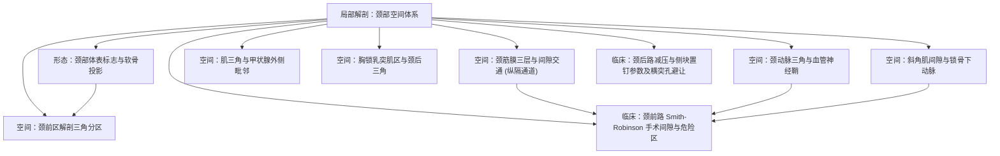

# 🗺️ 人卫局部解剖学·头部与颈部（颈部局部解剖）学习全景图

> [!summary] 认知先验与全局架构
> 本知识库依据**人卫第九版《局部解剖学》头部与颈部篇**与开源医学标准 **MedSchoolAtlas** 深度重构。系统解构**颈部表面标志、深筋膜三层间隙交通、颈前三角与颈后三角、颈动脉三角与神经血管鞘、斜角肌间隙、以及颈前路 Smith-Robinson 与颈后路侧块置钉**的手术解剖与误伤盲区，提供从浅入深、图文并茂的临床解剖自学体系。

---

## 🧭 一、空间层次与结构脉络 (Spatial Hierarchy)

---

## 🖼️ 二、核心解剖图谱画廊 (Anatomical Plates Gallery)

| 图号 | 解剖图版 (点击放大预览) | 关联核心卡片 | 核心解剖观察要点 |
| :---: | :---: | :--- | :--- |
| **图 2-01** | ![[images/Neck_surface_landmarks.png\|140]] **颈部体表标志与投影** | [[形态_颈部表面解剖体表标志与骨性软骨投影]] | 舌骨(C3)、甲状软骨喉结(C4-C5)、环状软骨(C6)与Chassaignac颈动脉结节 |
| **图 2-02** | ![[images/Cervical_fascia_and_spaces_cross_section.png\|140]] **颈部筋膜层横断面** | [[空间_颈筋膜三层构造与筋膜间隙交通解剖]] | 封套层、气管前层、椎前层；咽后间隙与危险间隙下通后纵隔坏死性感染 |
| **图 2-03** | ![[images/Triangles_of_the_neck_overview.png\|140]] **颈部分区与解剖三角** | [[空间_颈前区解剖三角分区与层次关系]] | 颈前三角、二腹肌三角、颏下三角、颈动脉三角与肌三角分界 |
| **图 2-04** | ![[images/Carotid_triangle_and_neurovascular_bundle.png\|140]] **颈动脉三角与血管神经** | [[空间_颈动脉三角解剖境界与神经血管鞘内排列]] | 颈总动脉分叉(C4)、颈内静脉外侧、迷走神经后沟内与颈动脉窦感受器 |
| **图 2-05** | ![[images/Muscular_triangle_and_thyroid_gland.png\|140]] **肌三角与甲状腺毗邻** | [[空间_肌三角与甲状腺外侧毗邻及神经血管走形]] | 甲状腺侧叶外邻颈动脉鞘；上极贴血管结扎、下极贴腺体结扎保护喉返神经 |
| **图 2-06** | ![[images/Sternocleidomastoid_region_and_cervical_plexus.png\|140]] **胸锁乳突肌区与颈丛** | [[空间_胸锁乳突肌区与颈后三角神经血管束]] | SCM后缘Erb神经点(颈丛皮支阻滞点)、副神经穿行与膈神经前斜角肌表面走向 |
| **图 2-07** | ![[images/Scalene_gap_and_subclavian_artery.png\|140]] **斜角肌间隙与锁骨下动脉** | [[空间_斜角肌间隙解剖境界与锁骨下动脉及臂丛]] | 前中斜角肌夹角狭窄通道、锁骨下动脉第二段、臂丛三干与胸廓出口综合征 |
| **图 2-08** | ![[images/Anterior_cervical_approach_Smith_Robinson.png\|140]] **颈前路解剖层次与毗邻** | [[临床_颈前路Smith-Robinson手术解剖入路与多层次危险盲区]] | 血管鞘向外/内脏鞘向内分离间隙；食管穿孔与喉返神经过度牵拉规避 |
| **图 2-09** | ![[images/Posterior_cervical_approach_and_lateral_mass.png\|140]] **枕下区与深层后路解剖** | [[临床_颈后路椎板切除与侧块置钉解剖危险区与置钉参数]] | 项韧带乏血管间隙；Magerl侧块置钉(外偏25度/头倾30度)避让椎管与横突孔 |

---

## 📚 三、核心知识卡片索引总表 (Core Knowledge Cards)

### 1. 表面解剖形态卡 (Morphology Cards)
- [[形态_颈部表面解剖体表标志与骨性软骨投影]] - 舌骨、喉结、环状软骨定位与紧急环甲膜穿刺基准

### 2. 空间毗邻与间隙卡 (Spatial Cards)
- [[空间_颈筋膜三层构造与筋膜间隙交通解剖]] - 颈筋膜横断面套管体系、咽后间隙与纵隔感染扩散
- [[空间_颈前区解剖三角分区与层次关系]] - 颈前三角四大子三角解剖境界与皮下神经血管
- [[空间_颈动脉三角解剖境界与神经血管鞘内排列]] - 颈动脉鞘立体关系、颈总动脉分叉、迷走神经与颈交感干
- [[空间_肌三角与甲状腺外侧毗邻及神经血管走形]] - 甲状腺侧叶被膜、喉上神经外支与喉返神经走形
- [[空间_胸锁乳突肌区与颈后三角神经血管束]] - Erb点阻滞、副神经走向与膈神经走行保护
- [[空间_斜角肌间隙解剖境界与锁骨下动脉及臂丛]] - 前中斜角肌狭窄间隙、锁骨下动脉与臂丛三干

### 3. 临床手术与入路陷阱卡 (Clinical & Surgical Cards)
- [[临床_颈前路Smith-Robinson手术解剖入路与多层次危险盲区]] - ACDF入路自然间隙、食管破裂、喉返神经与交感干防护
- [[临床_颈后路椎板切除与侧块置钉解剖危险区与置钉参数]] - 侧块置钉安全参数、横突孔椎动脉损伤规避与脊髓防误穿

---

## ⚠️ 四、临床高危警示汇总 (Clinical Danger Zones)
1. **坏死性纵隔炎感染通道**：咽后间隙与危险间隙穿透后，脓液直入后纵隔，必须尽早行颈侧开窗引流并排查纵隔；
2. **喉返神经牵拉瘫痪**：颈前路自固定牵开器必须间歇放松，套囊不可过度充盈，防止缺血性声带麻痹；
3. **侧块置钉内陷与前穿**：置钉严禁内偏或头倾不足，必须严格维持外偏 25°，严防打入椎管戳伤脊髓或钻入横突孔穿破椎动脉。

---

## 📑 五、原著教材与手绘活页总坐标
- **主选教材**：人卫九版《局部解剖学》（崔慧先、李瑞锡主编）P28-P60
- **手绘活页总槽位**：`[活页-局部解剖-00]`
