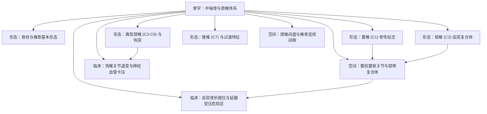

# 🗺️ 人卫系统解剖学·骨学（中轴骨与颈椎解剖）学习全景图

> [!summary] 认知先验与全局架构
> 本知识库依据**人卫第九版《系统解剖学》骨学篇**与开源医学标准 **MedSchoolAtlas** 深度重构。全面聚焦**脊柱中轴骨与颈椎解剖学**，从基本骨性标志、特殊颈椎构造（寰椎、枢椎、隆椎）、寰枢与椎间连结复合体，到齿突骨折与钩突增生卡压神经血管的临床误伤区，形成图文强对齐、立体空间闭环的自学网络。

---

## 🧭 一、空间层次与结构脉络 (Spatial Hierarchy)

---

## 🖼️ 二、核心解剖图谱画廊 (Anatomical Plates Gallery)

| 图号 | 解剖图版 (点击放大预览) | 关联核心卡片 | 核心解剖观察要点 |
| :---: | :---: | :--- | :--- |
| **图 1-01** | ![[images/Vertebrae_and_nerves.png\|140]] **脊柱与脊神经整体观** | [[形态_脊柱整体架构与椎骨基本形态]] | 脊柱整体节段、神经根分支与各段生理弯曲力线 |
| **图 1-02** | ![[images/Atlas_C1_vertebra_superior_view.png\|140]] **寰椎 (C1) 上面观** | [[形态_寰椎解剖学特征与骨性标志]] | 寰椎无椎体环形构造、前弓齿突凹、侧块与后弓椎动脉沟 |
| **图 1-03** | ![[images/Axis_C2_vertebra_dens_view.png\|140]] **枢椎 (C2) 齿突观** | [[形态_枢椎形态构造与齿突复合体]] | 齿突圆锥体、基底解剖缩窄、宽平上关节面与分叉棘突 |
| **图 1-04** | ![[images/Typical_cervical_vertebra_C3_C6.png\|140]] **典型颈椎 (C3-C6)** | [[形态_典型颈椎C3-C6形态与钩突结构]] | 椎体钩突(Uncus)、横突孔(椎动脉通道)与脊神经沟 |
| **图 1-05** | ![[images/Vertebra_prominens_C7.png\|140]] **隆椎 (C7) 上面观** | [[形态_隆椎C7形态特征与过渡骨性标志]] | 细长水平不分叉棘突、骨性计数基准、小横突孔与颈肋鉴别 |
| **图 1-06** | ![[images/Atlantoaxial_ligament_complex.png\|140]] **寰枢关节韧带复合体** | [[空间_寰枕与寰枢关节连结及韧带稳定复合体]] | 寰椎横韧带(约束齿突)、翼状韧带(限旋转)、覆膜与十字韧带 |
| **图 1-07** | ![[images/Cervical_intervertebral_joints_and_disc.png\|140]] **颈椎椎间盘与正中矢状面** | [[空间_颈椎椎骨连结间隙与椎间盘复合体]] | 髓核、纤维环后外薄弱区、前后纵韧带与黄韧带空间折叠 |
| **图 1-08** | ![[images/Dens_fracture_and_atlantoaxial_dislocation.png\|140]] **齿突与枕颈矢状解剖关系** | [[临床_齿突骨折脱位与高位颈脊髓延髓受压危险区]] | Anderson-D'Alonzo II型基底缺血骨折、ADI>3mm判定与延髓压迫 |
| **图 1-09** | ![[images/Uncovertebral_joint_arthrosis_compression.png\|140]] **钩椎关节与椎动脉走行** | [[临床_钩椎关节退变增生与神经血管卡压病理机制]] | 钩突骨赘向外挤压椎动脉(眩晕)、向后外嵌顿神经根(上肢放射痛) |

---

## 📚 三、核心知识卡片索引总表 (Core Knowledge Cards)

### 1. 形态结构卡 (Morphology Cards)
- [[形态_脊柱整体架构与椎骨基本形态]] - 脊柱四段生理弯曲、椎骨通用构造与椎孔椎管
- [[形态_寰椎解剖学特征与骨性标志]] - 寰椎前弓、后弓、侧块与椎动脉沟
- [[形态_枢椎形态构造与齿突复合体]] - 齿突枢轴旋转、基底血供与粗大分叉棘突
- [[形态_典型颈椎C3-C6形态与钩突结构]] - 椎体钩突、钩椎关节、横突孔与脊神经沟
- [[形态_隆椎C7形态特征与过渡骨性标志]] - 隆椎长棘突体表计数、横突孔变异与颈肋压迫

### 2. 空间毗邻与间隙卡 (Spatial & Ligament Cards)
- [[空间_寰枕与寰枢关节连结及韧带稳定复合体]] - 寰齿关节、寰椎横韧带、翼状韧带及力学稳定性
- [[空间_颈椎椎骨连结间隙与椎间盘复合体]] - 颈段椎间盘前厚后薄、前后纵韧带与黄韧带

### 3. 临床手术与病理陷阱卡 (Clinical & Surgical Cards)
- [[临床_齿突骨折脱位与高位颈脊髓延髓受压危险区]] - Anderson-D'Alonzo分型、延髓猝死危险区与转运禁忌
- [[临床_钩椎关节退变增生与神经血管卡压病理机制]] - Luschka关节骨赘、椎动脉供血不足与Spurling征

---

## ⚠️ 四、临床高危警示汇总 (Clinical Danger Zones)
1. **椎动脉后弓沟撕裂盲区**：寰椎后弓剥离骨膜距中线不可超过 15mm，否则直击椎动脉第三段致喷射性大出血；
2. **齿突 II 型骨折缺血坏死**：齿突基底部供血脆弱，不愈合率达 40%~70%，禁忌盲目手法仰头复位；
3. **钩突外侧骨皮质穿透**：行颈前路 ACDF 磨削钩突骨赘时，严禁突破外侧壁磨入横突孔损伤椎动脉。

---

## 📑 五、原著教材与手绘活页总坐标
- **主选教材**：人卫九版《系统解剖学》（丁文龙、柏树令主编）P34-P75
- **手绘活页总槽位**：`[活页-系统解剖-00]`
