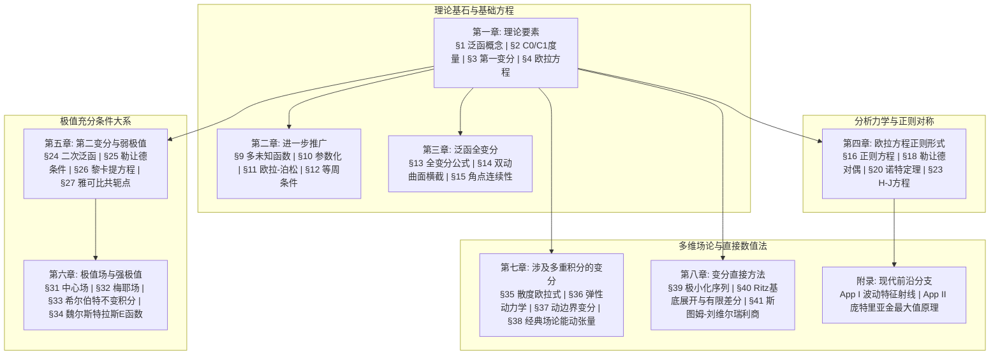

# I. M. Gelfand & S. V. Fomin, 《Calculus of Variations》 (吉尔芳德《变分法》) 学习全景图

> [!abstract] 知识库架构与标准
> 本知识库严格遵循 **教材解构黄金标准 (v2 Standard)** 与 **Dual-Track DeepSeek-V4-Pro 高级推理流水线** 构建。
> 全书 8 大章与两篇附录共 **69 篇精读笔记与核心卡片** 均 100% 绑定原书权威页码与知识单元，已通过 `coverage_audit.py` 全覆盖率审查 (**完成度: 100%, 结构缺口: 0**)。
> 笔记公式与推导全面兼容 Obsidian 原生 LaTeX 渲染规范。

---

## 全书知识拓扑与自学路线图 (Master Thematic Roadmap)

---

### 九大自学主题精读指引

#### 1. 理论基石：从微积分到无穷维泛函分析 (Chapter 1)
- **核心动机**：最速降线（Brachistochrone）、极小阻力体、等周问题及平面测地线。
- **逐节精读**：[[逐节/第一章_§1.1_泛函概念与简易变分问题]]、[[逐节/第一章_§1.2_函数空间与度量拓扑]]、[[逐节/第一章_§1.3_泛函变分与极值必要条件]]、[[逐节/第一章_§1.4_最简变分问题与欧拉方程]]、[[逐节/第一章_§1.5_多元变量泛函与极小曲面]]、[[逐节/第一章_§1.6_动端点变分问题与横截条件]]、[[逐节/第一章_§1.7_变分导数与局域微分]]、[[逐节/第一章_§1.8_欧拉方程的坐标变换不变性]]、[[逐节/第一章_§1.9_第一章习题剖析与能力强化]]。
- **核心沉淀卡**：
  - 概念：[[卡片/概念_泛函变分与弱强极值分类]]、[[卡片/概念_变分导数与泛函微分几何意义]]、[[卡片/概念_自然边界条件与动端点横截性]]
  - 定理：[[卡片/定理_变分基本引理与连续密度定理]]、[[卡片/定理_最简变分问题欧拉方程充要条件]]、[[卡片/定理_欧拉方程在任意坐标变换下的协变不变性]]
  - 技术：[[卡片/技术_欧拉方程退化类型与第一积分求解律]]、[[卡片/技术_动端点变分问题横截条件应用范式]]、[[卡片/技术_极小曲面偏微分欧拉方程求解范式]]

#### 2. 系统推广：多自由度、参数化、高阶导数与等周约束 (Chapter 2)
- **核心问题**：质点系拉格朗日方程组、参数与弧长无关性、梁弯曲弹性势能四阶方程、闭曲线包含最大面积等周问题。
- **逐节精读**：[[逐节/第二章_§2.1_多未知函数变分问题与欧拉方程组]]、[[逐节/第二章_§2.2_参数形式变分问题与齐次性]]、[[逐节/第二章_§2.3_依赖高阶导数的泛函与欧拉-泊松方程]]、[[逐节/第二章_§2.4_附带辅助条件的条件变分问题]]、[[逐节/第二章_§2.5_第二章习题剖析与能力强化]]。
- **核心卡片**：[[卡片/定理_欧拉-泊松高阶导数变分方程存在性定理]]、[[卡片/技术_等周问题与约束变分拉格朗日乘子法求解范式]]。

#### 3. 全变分与几何曲面：动边界与折线角点 (Chapter 3)
- **核心问题**：端点沿曲面运动的泰勒漂移、空间测地线横截相交性、折线极值与光线界面折射（Snell 定律）。
- **逐节精读**：[[逐节/第三章_§3.1_泛函全变分基本公式]]、[[逐节/第三章_§3.2_两几何曲面间动端点变分与横截条件]]、[[逐节/第三章_§3.3_折线极值曲线与魏尔斯特拉斯-埃尔德曼条件]]、[[逐节/第三章_§3.4_第三章习题剖析与能力强化]]。
- **核心卡片**：[[卡片/定理_魏尔斯特拉斯-埃尔德曼角点连续性定理]]。

#### 4. 分析力学：哈密顿体系、诺特定理与守恒律 (Chapter 4)
- **核心问题**：拉格朗日对偶变换、动量与能量守恒的几何本质、李群连续对称性与守恒流、哈密顿-雅可比偏微分方程完全积分。
- **逐节精读**：[[逐节/第四章_§4.1_欧拉方程正则形式]]、[[逐节/第四章_§4.2_欧拉方程第一积分]]、[[逐节/第四章_§4.3_勒让德变换]]、[[逐节/第四章_§4.4_正则变换与生成函数]]、[[逐节/第四章_§4.5_诺特定理与连续对称性]]、[[逐节/第四章_§4.6_最小作用量原理与莫佩尔蒂原理]]、[[逐节/第四章_§4.7_物理系统经典守恒律]]、[[逐节/第四章_§4.8_哈密顿-雅可比方程与雅可比定理]]、[[逐节/第四章_§4.9_第四章习题剖析与能力强化]]。
- **核心卡片**：[[卡片/定理_诺特定理与对称性守恒荷生成定理]]、[[卡片/技术_哈密顿-雅可比方程分离变量解算范式]]。

#### 5. 弱极值充分条件：第二变分、勒让德与雅可比共轭点 (Chapter 5)
- **核心问题**：一阶为零仅是平稳条件，如何确保取得真正的弱极小？二阶变分展开、黎卡提微分方程配方、雅可比微分方程共轭点零点定理。
- **逐节精读**：[[逐节/第五章_§5.1_二次型泛函与第二变分]]、[[逐节/第五章_§5.2_第二变分标准型与勒让德条件]]、[[逐节/第五章_§5.3_二次泛函配方术与黎卡提方程]]、[[逐节/第五章_§5.4_雅可比必要条件与共轭点]]、[[逐节/第五章_§5.5_弱极值充分条件定理]]、[[逐节/第五章_§5.6_多自由度未知函数第二变分]]、[[逐节/第五章_§5.7_雅可比条件与有限维二次型]]、[[逐节/第五章_§5.8_第五章习题剖析与能力强化]]。
- **核心卡片**：[[卡片/定理_雅可比共轭点必要性与充分性定理]]。

#### 6. 强极值充分条件：极值场、希尔伯特不变积分与 Weierstrass E 函数 (Chapter 6)
- **核心问题**：面对剧烈大导数扰动（C0 邻域）时如何判别绝对最小？单值极值覆盖场、希尔伯特全微分不变积分桥梁、魏尔斯特拉斯超额函数 $E(x,y,p,y') \ge 0$ 强极小判定。
- **逐节精读**：[[逐节/第六章_§6.1_极值曲线场与自洽边界]]、[[逐节/第六章_§6.2_极值场的微分形式与梅耶场]]、[[逐节/第六章_§6.3_希尔伯特不变积分]]、[[逐节/第六章_§6.4_魏尔斯特拉斯E函数与强极值充分条件]]、[[逐节/第六章_§6.5_第六章习题剖析与能力强化]]。
- **核心卡片**：[[卡片/定理_希尔伯特独立性定理与魏尔斯特拉斯强极值充分性定理]]。

#### 7. 多维空间变分：偏微分方程、连续介质与经典场论 (Chapter 7)
- **核心问题**：多重积分欧拉-奥斯特罗格拉茨基方程、弹性弦/膜/板动力学方程变分导出、多维动边界杨-拉普拉斯表面张力、电磁场与相对论标量场作用量。
- **逐节精读**：[[逐节/第七章_§7.1_多重积分泛函变分与欧拉-奥斯特罗格拉茨基方程]]、[[逐节/第七章_§7.2_连续介质力学动力学变分]]、[[逐节/第七章_§7.3_多元变动区域与自由边界变分]]、[[逐节/第七章_§7.4_现代经典场论中的变分方法]]、[[逐节/第七章_§7.5_第七章习题剖析与能力强化]]。
- **核心卡片**：[[卡片/定理_场论欧拉-拉格朗日偏微分方程与能量-动量张量定理]]。

#### 8. 直接数值方法：Ritz 法与 Sturm-Liouville 本征值 (Chapter 8)
- **核心问题**：绕过不可解微分方程直接求泛函极值、极小化序列紧性、里茨正交基展开化为线性代数矩阵方程、瑞利商与本征值正交完备谱。
- **逐节精读**：[[逐节/第八章_§8.1_变分法直接方法与极小化序列]]、[[逐节/第八章_§8.2_里茨法与有限差分近似]]、[[逐节/第八章_§8.3_斯图姆-刘维尔本征值变分问题]]、[[逐节/第八章_§8.4_第八章习题剖析与能力强化]]。
- **核心卡片**：[[卡片/技术_里茨变分直接法求解微分方程边值问题算法范式]]。

#### 9. 前沿延伸：波前传播几何光学与庞特里亚金最优控制 (Appendices)
- **核心问题**：扰动前沿波包络几何与正则特征线对应；经典开集变分导数向闭集约束控制跳转、庞特里亚金最大值原理（Pontryagin Maximum Principle）。
- **逐节精读**：[[逐节/附录一_扰动传播与正则方程]]、[[逐节/附录二_最优控制中的变分方法]]。

---

<!-- textbook-index:start -->
## 教材原顺序索引

范围：whole_book；范围内已完成。

覆盖详情：[[Obsidian知识库_吉尔芳德变分法/coverage_report]]

### 第一章 理论要素 (Elements of the Theory)（PDF [11, 43]）

- §1. 泛函与简易变分问题 (Functionals. Some Simple Variational Problems)：已复核单元 4/4
  - [[逐节/第一章_§1.1_泛函概念与简易变分问题]]（section / verified）
- §2. 函数空间与拓扑度量 (Function Spaces)：已复核单元 4/4
  - [[逐节/第一章_§1.2_函数空间与度量拓扑]]（section / verified）
- §3. 泛函变分与极值必要条件 (The Variation of a Functional. A Necessary Condition for an Extremum)：已复核单元 4/4
  - [[逐节/第一章_§1.3_泛函变分与极值必要条件]]（section / verified）
  - [[卡片/概念_泛函变分与弱强极值分类]]（concept / verified）
- §4. 最简变分问题与欧拉方程 (The Simplest Variational Problem. Euler's Equation)：已复核单元 5/5
  - [[逐节/第一章_§1.4_最简变分问题与欧拉方程]]（section / verified）
  - [[卡片/技术_欧拉方程退化类型与第一积分求解律]]（technique / verified）
  - [[卡片/定理_变分基本引理与连续密度定理]]（theorem / verified）
  - [[卡片/定理_最简变分问题欧拉方程充要条件]]（theorem / verified）
- §5. 多元变量泛函与极小曲面 (The Case of Several Variables)：已复核单元 3/3
  - [[逐节/第一章_§1.5_多元变量泛函与极小曲面]]（section / verified）
  - [[卡片/技术_极小曲面偏微分欧拉方程求解范式]]（technique / verified）
- §6. 动端点变分问题与横截条件 (A Simple Variable End Point Problem)：已复核单元 2/2
  - [[逐节/第一章_§1.6_动端点变分问题与横截条件]]（section / verified）
  - [[卡片/概念_自然边界条件与动端点横截性]]（concept / verified）
  - [[卡片/技术_动端点变分问题横截条件应用范式]]（technique / verified）
- §7. 变分导数与局域微分 (The Variational Derivative)：已复核单元 2/2
  - [[逐节/第一章_§1.7_变分导数与局域微分]]（section / verified）
  - [[卡片/概念_变分导数与泛函微分几何意义]]（concept / verified）
- §8. 欧拉方程的坐标变换不变性 (Invariance of Euler's Equation)：已复核单元 2/2
  - [[逐节/第一章_§1.8_欧拉方程的坐标变换不变性]]（section / verified）
  - [[卡片/定理_欧拉方程在任意坐标变换下的协变不变性]]（theorem / verified）
- 第一章 综合习题与学习目标 (Problems for Chapter 1)：已复核单元 2/2
  - [[逐节/第一章_§1.9_第一章习题剖析与能力强化]]（section / verified）

### 第二章 进一步推广 (Further Generalizations)（PDF [44, 63]）

- §9. n个未知函数的固定端点变分问题 (The Fixed End Point Problem for n Unknown Functions)：已复核单元 3/3
  - [[逐节/第二章_§2.1_多未知函数变分问题与欧拉方程组]]（section / verified）
- §10. 参数形式变分问题 (Variational Problems in Parametric Form)：已复核单元 2/2
  - [[逐节/第二章_§2.2_参数形式变分问题与齐次性]]（section / verified）
- §11. 依赖高阶导数的泛函 (Functionals Depending on Higher-Order Derivatives)：已复核单元 2/2
  - [[逐节/第二章_§2.3_依赖高阶导数的泛函与欧拉-泊松方程]]（section / verified）
  - [[卡片/定理_欧拉-泊松高阶导数变分方程存在性定理]]（theorem / verified）
- §12. 附带辅助条件的条件变分问题 (Variational Problems with Subsidiary Conditions)：已复核单元 3/3
  - [[逐节/第二章_§2.4_附带辅助条件的条件变分问题]]（section / verified）
  - [[卡片/技术_等周问题与约束变分拉格朗日乘子法求解范式]]（technique / verified）
- 第二章 综合习题与学习目标 (Problems for Chapter 2)：已复核单元 2/2
  - [[逐节/第二章_§2.5_第二章习题剖析与能力强化]]（section / verified）

### 第三章 泛函的全变分 (The General Variation of a Functional)（PDF [64, 76]）

- §13. 全变分基本公式的严格推导 (Derivation of the Basic Formula)：已复核单元 2/2
  - [[逐节/第三章_§3.1_泛函全变分基本公式]]（section / verified）
- §14. 端点位于两给定曲线或曲面上 (End Points Lying on Two Given Curves or Surfaces)：已复核单元 1/1
  - [[逐节/第三章_§3.2_两几何曲面间动端点变分与横截条件]]（section / verified）
- §15. 折线极值曲线与魏尔斯特拉斯-埃尔德曼角点条件 (Broken Extremals. The Weierstrass-Erdmann Conditions)：已复核单元 1/1
  - [[逐节/第三章_§3.3_折线极值曲线与魏尔斯特拉斯-埃尔德曼条件]]（section / verified）
  - [[卡片/定理_魏尔斯特拉斯-埃尔德曼角点连续性定理]]（theorem / verified）
- 第三章 综合习题与学习目标 (Problems for Chapter 3)：已复核单元 2/2
  - [[逐节/第三章_§3.4_第三章习题剖析与能力强化]]（section / verified）

### 第四章 欧拉方程的正则形式与相关课题 (The Canonical Form of the Euler Equations and Related Topics)（PDF [77, 106]）

- §16. 欧拉方程的正则形式 (The Canonical Form of the Euler Equations)：已复核单元 2/2
  - [[逐节/第四章_§4.1_欧拉方程正则形式]]（section / verified）
- §17. 欧拉方程的第一积分 (First Integrals of the Euler Equations)：已复核单元 1/1
  - [[逐节/第四章_§4.2_欧拉方程第一积分]]（section / verified）
- §18. 勒让德变换 (The Legendre Transformation)：已复核单元 2/2
  - [[逐节/第四章_§4.3_勒让德变换]]（section / verified）
- §19. 正则变换 (Canonical Transformations)：已复核单元 1/1
  - [[逐节/第四章_§4.4_正则变换与生成函数]]（section / verified）
- §20. 诺特定理 (Noether's Theorem)：已复核单元 1/1
  - [[逐节/第四章_§4.5_诺特定理与连续对称性]]（section / verified）
  - [[卡片/定理_诺特定理与对称性守恒荷生成定理]]（theorem / verified）
- §21. 最小作用量原理 (The Principle of Least Action)：已复核单元 1/1
  - [[逐节/第四章_§4.6_最小作用量原理与莫佩尔蒂原理]]（section / verified）
- §22. 物理系统守恒律 (Conservation Laws)：已复核单元 1/1
  - [[逐节/第四章_§4.7_物理系统经典守恒律]]（section / verified）
- §23. 哈密顿-雅可比方程与雅可比定理 (The Hamilton-Jacobi Equation. Jacobi's Theorem)：已复核单元 2/2
  - [[逐节/第四章_§4.8_哈密顿-雅可比方程与雅可比定理]]（section / verified）
  - [[卡片/技术_哈密顿-雅可比方程分离变量解算范式]]（technique / verified）
- 第四章 综合习题与学习目标 (Problems for Chapter 4)：已复核单元 2/2
  - [[逐节/第四章_§4.9_第四章习题剖析与能力强化]]（section / verified）

### 第五章 第二变分与弱极值的充分条件 (The Second Variation. Sufficient Conditions for a Weak Extremum)（PDF [107, 140]）

- §24. 二次型泛函与第二变分定义 (Quadratic Functionals. The Second Variation)：已复核单元 2/2
  - [[逐节/第五章_§5.1_二次型泛函与第二变分]]（section / verified）
- §25. 第二变分显式与勒让德条件 (The Formula for the Second Variation. Legendre's Condition)：已复核单元 2/2
  - [[逐节/第五章_§5.2_第二变分标准型与勒让德条件]]（section / verified）
- §26. 二次泛函的标准型化简与配方变换 (Analysis of the Quadratic Functional)：已复核单元 2/2
  - [[逐节/第五章_§5.3_二次泛函配方术与黎卡提方程]]（section / verified）
- §27. 雅可比必要条件与共轭点 (Jacobi's Necessary Condition. More on Conjugate Points)：已复核单元 2/2
  - [[逐节/第五章_§5.4_雅可比必要条件与共轭点]]（section / verified）
  - [[卡片/定理_雅可比共轭点必要性与充分性定理]]（theorem / verified）
- §28. 弱极值的充分条件定理 (Sufficient Conditions for a Weak Extremum)：已复核单元 1/1
  - [[逐节/第五章_§5.5_弱极值充分条件定理]]（section / verified）
- §29. n个未知函数系统的第二变分推广 (Generalization to n Unknown Functions)：已复核单元 2/2
  - [[逐节/第五章_§5.6_多自由度未知函数第二变分]]（section / verified）
- §30. 雅可比条件与二次型理论的关系 (Connection Between Jacobi's Condition and Quadratic Forms)：已复核单元 1/1
  - [[逐节/第五章_§5.7_雅可比条件与有限维二次型]]（section / verified）
- 第五章 综合习题与学习目标 (Problems for Chapter 5)：已复核单元 1/1
  - [[逐节/第五章_§5.8_第五章习题剖析与能力强化]]（section / verified）

### 第六章 极值场与强极值的充分条件 (Fields. Sufficient Conditions for a Strong Extremum)（PDF [141, 161]）

- §31. 自洽边界条件与场的定义 (Consistent Boundary Conditions. General Definition of a Field)：已复核单元 2/2
  - [[逐节/第六章_§6.1_极值曲线场与自洽边界]]（section / verified）
- §32. 泛函的极值场与 Mayer 场 (The Field of a Functional)：已复核单元 1/1
  - [[逐节/第六章_§6.2_极值场的微分形式与梅耶场]]（section / verified）
- §33. 希尔伯特不变积分 (Hilbert's Invariant Integral)：已复核单元 1/1
  - [[逐节/第六章_§6.3_希尔伯特不变积分]]（section / verified）
- §34. 魏尔斯特拉斯E函数与强极值充分条件 (The Weierstrass E-Function)：已复核单元 2/2
  - [[逐节/第六章_§6.4_魏尔斯特拉斯E函数与强极值充分条件]]（section / verified）
  - [[卡片/定理_希尔伯特独立性定理与魏尔斯特拉斯强极值充分性定理]]（theorem / verified）
- 第六章 综合习题与学习目标 (Problems for Chapter 6)：已复核单元 1/1
  - [[逐节/第六章_§6.5_第六章习题剖析与能力强化]]（section / verified）

### 第七章 涉及多重积分的变分问题 (Variational Problems Involving Multiple Integrals)（PDF [162, 201]）

- §35. 固定区域上多元泛函的变分 (Variation of a Functional Defined on a Fixed Region)：已复核单元 1/1
  - [[逐节/第七章_§7.1_多重积分泛函变分与欧拉-奥斯特罗格拉茨基方程]]（section / verified）
- §36. 连续介质力学运动方程的变分导出 (Equations of Motion of Continuous Mechanical Systems)：已复核单元 2/2
  - [[逐节/第七章_§7.2_连续介质力学动力学变分]]（section / verified）
- §37. 变动区域上泛函的变分 (Variation of a Functional Defined on a Variable Region)：已复核单元 2/2
  - [[逐节/第七章_§7.3_多元变动区域与自由边界变分]]（section / verified）
- §38. 场论应用 (Applications to Field Theory)：已复核单元 2/2
  - [[逐节/第七章_§7.4_现代经典场论中的变分方法]]（section / verified）
  - [[卡片/定理_场论欧拉-拉格朗日偏微分方程与能量-动量张量定理]]（theorem / verified）
- 第七章 综合习题与学习目标 (Problems for Chapter 7)：已复核单元 1/1
  - [[逐节/第七章_§7.5_第七章习题剖析与能力强化]]（section / verified）

### 第八章 变分法中的直接方法 (Direct Methods in the Calculus of Variations)（PDF [202, 217]）

- §39. 极小化序列 (Minimizing Sequences)：已复核单元 2/2
  - [[逐节/第八章_§8.1_变分法直接方法与极小化序列]]（section / verified）
- §40. 里茨法与有限差分法 (The Ritz Method and the Method of Finite Differences)：已复核单元 2/2
  - [[逐节/第八章_§8.2_里茨法与有限差分近似]]（section / verified）
  - [[卡片/技术_里茨变分直接法求解微分方程边值问题算法范式]]（technique / verified）
- §41. 斯图姆-刘维尔本征值问题 (The Sturm-Liouville Problem)：已复核单元 2/2
  - [[逐节/第八章_§8.3_斯图姆-刘维尔本征值变分问题]]（section / verified）
- 第八章 综合习题与学习目标 (Problems for Chapter 8)：已复核单元 1/1
  - [[逐节/第八章_§8.4_第八章习题剖析与能力强化]]（section / verified）

### 附录：扰动传播与最优控制 (Appendices: Propagation of Disturbances & Optimal Control)（PDF [218, 236]）

- 附录一 扰动传播与正则方程 (Appendix I: Propagation of Disturbances and the Canonical Equations)：已复核单元 1/1
  - [[逐节/附录一_扰动传播与正则方程]]（section / verified）
- 附录二 最优控制中的变分方法 (Appendix II: Variational Methods in Problems of Optimal Control)：已复核单元 1/1
  - [[逐节/附录二_最优控制中的变分方法]]（section / verified）

<!-- textbook-index:end -->
