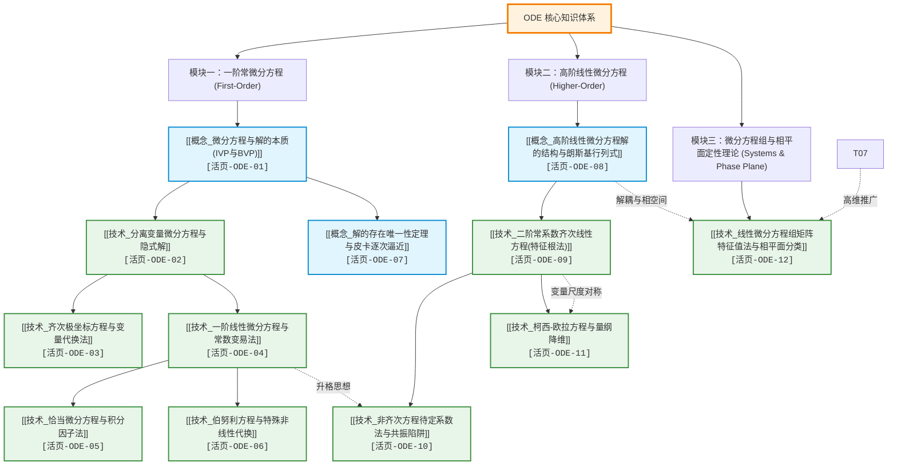

---
tags:
  - 数学/常微分方程
  - 知识图谱
  - MOC
  - 学习路径
aliases:
  - 常微分方程学习全景图
  - 常微分方程全景图
  - ODE MOC
  - Ordinary Differential Equations Roadmap
created: 2026-09-06
updated: 2026-09-08
---

# 常微分方程 (ODE) 核心知识体系与全景图谱 (Master MOC)

> [!summary] 知识库架构与研读指引
> 本知识库严格遵循 **textbook-to-obsidian** 知识解构标准规范，以两部经典权威教材为知识锚点深度重构：
> 1. **C. Constanda**: *Differential Equations: A Primer for Scientists and Engineers*（清晰严谨的工程与计算求解范式）；
> 2. **E.A. Coddington**: *An Introduction to Ordinary Differential Equations*（深刻严密的分析与存在性理论公理）。
>
> 整个知识体系包含 **1 张全景拓扑图（MOC）** 与 **12 张核心双链卡片（3 张核心概念卡 + 9 张硬核技术求解卡）**。每张卡片严格按照四进阶黄金范式铸造：
> 1. **推导机理与规范求解工作流**（包含数学机理、流程图及高亮公式）；
> 2. **⚠️ 致命失分陷阱与临界边界**（2~4 个具象反例与临界条件剖析）；
> 3. **经典范例手把手演算与反代验算**（含完整的一阶/二阶导数反求与代回闭环验算）；
> 4. **出处与纸质笔记坐标**（双教材章节页码精准锚定与活页留痕槽位 `[活页-ODE-01]` 至 `[活页-ODE-12]`）。

---

## 一、知识拓扑图谱与逻辑依赖演进

---

## 二、全量知识卡片总览索引表

| 活页编码 | 核心卡片链接 | 类型 | 对应教材坐标 (Constanda / Coddington) | 核心求解/认知机理 | 重点避坑点 |
| :--- | :--- | :--- | :--- | :--- | :--- |
| `[活页-ODE-01]` | [[概念_微分方程与解的本质(IVP与BVP)]] | 概念卡 | Constanda §1.2-1.4 (P15-25) Coddington Ch.0 (P1-10) | 通解自由度 $n$、初始条件定特解、奇解包络线机理 | 奇解不是通解特化；BVP 无解/无穷解陷阱 |
| `[活页-ODE-02]` | [[技术_分离变量微分方程与隐式解]] | 技术卡 | Constanda §2.1 (P26-30) Coddington Ch.1 (P11-20) | 标准型 $y' = g(x)h(y)$ 分离变量直接对积 | 除以零因子 $h(y)=0$ 漏掉水平常数平衡解 |
| `[活页-ODE-03]` | [[技术_齐次极坐标方程与变量代换法]] | 技术卡 | Constanda §2.3 (P28-31) Coddington Ch.1 (P21-25) | 零次齐次式设 $y=xv$，极坐标变换消除耦合 | 复合导数展开漏项；最后忘记把 $v$ 代回 $y/x$ |
| `[活页-ODE-04]` | [[技术_一阶线性微分方程与常数变易法]] | 技术卡 | Constanda §2.2 (P31-35) Coddington Ch.1 (P26-35) | 积分因子 $I(x)=e^{\int P dx}$ 与变易假设 $y=u(x)y_h$ | 未化首一式提取 $P(x)$ 导致指数严重计算失真 |
| `[活页-ODE-05]` | [[技术_恰当微分方程与积分因子法]] | 技术卡 | Constanda §2.6 (P42-47) Coddington Ch.1 (P36-45) | 全微分充要条件 $\partial M/\partial y = \partial N/\partial x$，偏积分重构势函数 | 偏积分后误对 $x$ 求导；单变量积分因子判据写反 |
| `[活页-ODE-06]` | [[技术_伯努利方程与特殊非线性代换]] | 技术卡 | Constanda §2.4-2.5 (P38-42) Coddington Ch.1 (P46-52) | 伯努利代换 $z=y^{1-n}$；黎卡提代换 $y=y_1+1/u$ | 链式求导符号漏负号；遗漏平凡解 $y=0$ |
| `[活页-ODE-07]` | [[概念_解的存在唯一性定理与皮卡逐次逼近]] | 概念卡 | Constanda §2.7 (P47-51) Coddington Ch.1 & Ch.5 | 皮卡-林德洛夫定理，Lipschitz 连续性保证唯一 | 连续只能保证存在；非 Lipschitz 点产生解分叉奇解 |
| `[活页-ODE-08]` | [[概念_高阶线性微分方程解的结构与朗斯基行列式]] | 概念卡 | Constanda §4.3 (P78-83) Coddington Ch.2 (P65-78) | 解空间 $n$ 维向量空间基底，Wronskian 与 Abel 恒等式 | Wronskian 为零在非常系数/非线性方程不保证线性相关 |
| `[活页-ODE-09]` | [[技术_二阶常系数齐次线性方程(特征根法)]] | 技术卡 | Constanda §4.4 (P84-92) Coddington Ch.2 (P79-88) | 特征多项式 $ar^2+br+c=0$，实异/重根/共轭复根模态 | 重根漏乘 $x$ 因子；共轭复根频率角速度漏除 $2a$ |
| `[活页-ODE-10]` | [[技术_非齐次方程待定系数法与共振陷阱]] | 技术卡 | Constanda §4.5 (P93-107) Coddington Ch.2 (P89-105) | 待定多项式、指数、三角特解，共振乘因子 $x^s$ | 忽视外力频率与固有频率重合引发的共振灾难；符号错漏 |
| `[活页-ODE-11]` | [[技术_柯西-欧拉方程与量纲降维]] | 技术卡 | Constanda §4.6 (P108-111) Coddington Ch.3 (P115-125) | 算子恒等式 $x^2 D_x^2 = D(D-1)$，指数换元化常系数 | 辅助方程漏移位项误写为 $am^2+bm+c=0$；负轴漏绝对值 |
| `[活页-ODE-12]` | [[技术_线性微分方程组矩阵特征值法与相平面分类]] | 技术卡 | Constanda §7.3-7.5 (P161-187) Coddington Ch.6 (P220-250) | 谱分解 $A\mathbf{v}=\lambda\mathbf{v}$，迹-行列式 $(T,D)$ 相平面分类 | 亏损矩阵漏求广义特征向量；焦点旋转顺/逆时针误判 |

---

## 三、推荐自学与复习路径

### 路径 A：考研与大学期末应试突破路径 (Core Exam Mastery Route)
> 目标：快速掌握解题范式、套路识别、反代验算与避坑技能，杜绝非受迫性失误。

1. **一阶标准技术通关**：
   - 研读 [[技术_分离变量微分方程与隐式解]]（必须关注零因子平衡解）。
   - 研读 [[技术_一阶线性微分方程与常数变易法]]（掌握积分因子推导与公式）。
   - 研读 [[技术_恰当微分方程与积分因子法]]（掌握偏积分与双变量积分因子测试）。
   - 研读 [[技术_伯努利方程与特殊非线性代换]]（掌握 $z=y^{1-n}$ 降维操作）。
2. **高阶线性方程与算子技巧**：
   - 研读 [[概念_高阶线性微分方程解的结构与朗斯基行列式]]（吃透通解结构定理与齐次+特解叠加）。
   - 研读 [[技术_二阶常系数齐次线性方程(特征根法)]]（三种判别式情况熟记于心）。
   - 研读 [[技术_非齐次方程待定系数法与共振陷阱]]（重点攻克共振因子 $x^s$ 与常数变易法求积）。
   - 研读 [[技术_柯西-欧拉方程与量纲降维]]（死记 $m(m-1)$ 算子展开，切忌直接写 $m^2$）。
3. **方程组与初值代入**：
   - 研读 [[技术_线性微分方程组矩阵特征值法与相平面分类]]（掌握特征值、特征向量与亏损矩阵的广义特征向量解算）。

---

### 路径 B：数学分析与物理动力学进阶路径 (Physics & Theoretical Route)
> 目标：深刻理解微分方程背后的向量场、解流形、几何对称性与动力系统演化。

1. **分析基础与存在唯一性**：
   - 研读 [[概念_微分方程与解的本质(IVP与BVP)]]（探索解曲线的几何切线场与 BVP 的谱特征）。
   - 研读 [[概念_解的存在唯一性定理与皮卡逐次逼近]]（掌握压缩映射不动点原理、Lipschitz 边界与皮卡级数逼近）。
2. **算子代数与对称群**：
   - 研读 [[技术_齐次极坐标方程与变量代换法]]（切线角与尺度变换的不变量）。
   - 研读 [[技术_柯西-欧拉方程与量纲降维]]（理解尺度伸缩群不变量与对数平移对称性）。
3. **线性代数几何化与动力学系统**：
   - 研读 [[概念_高阶线性微分方程解的结构与朗斯基行列式]]（研究 Abel 恒等式与能量积分衰减）。
   - 研读 [[技术_二阶常系数齐次线性方程(特征根法)]]（对比欠阻尼、过阻尼与临界阻尼的振荡能量流）。
   - 研读 [[技术_非齐次方程待定系数法与共振陷阱]]（分析受迫振动中的稳态响应与共振拍频现象）。
   - 研读 [[技术_线性微分方程组矩阵特征值法与相平面分类]]（精通迹-行列式平面 $(T,D)$，研究鞍点流形、焦点螺旋与中心轨线的拓扑稳定性）。

---

## 四、教材原始语料与纸质活页笔记规范

### 4.1 本地教材原始语料库位
- **C. Constanda**: `常微分方程/C. Constanda.pdf` 及 `mineru_output/C. Constanda/auto/C. Constanda.md`
  - 核心解析篇章：Chapter 1（导引与初值）、Chapter 2（一阶方程）、Chapter 4（二阶线性方程）、Chapter 7（线性方程组与相平面）。
- **E.A. Coddington**: `常微分方程/E.A.  Coddington.pdf` 及 `mineru_output/E.A.  Coddington/ocr/E.A.  Coddington.md`
  - 核心解析篇章：Chapter 1（一阶方程与存在性）、Chapter 2（常系数高阶方程）、Chapter 3（正则奇异点与欧拉方程）、Chapter 5（存在唯一定理严格证明）、Chapter 6（二维线性系统相平面）。

### 4.2 纸质活页笔记留痕规范
每张知识卡片对应纸质活页笔记本的一个标准双页留痕槽位（`[活页-ODE-01]` 至 `[活页-ODE-12]`）：
- **左页（机理与算式骨架）**：抄录本卡片核心定义、算子恒等式推导、工作流 Mermaid 核心步骤，并用红笔框出核心公式。
- **右页（避坑与范例验算）**：手抄经典错题与临界反例，完整独立手算一遍范例中的全流程步骤，并完成一阶/二阶导数反代验算，用绿笔写下反代抵消的闭环记录。
