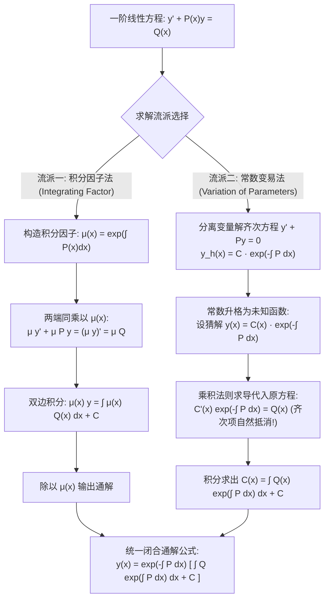

---
tags:
  - 数学/常微分方程
  - 求解技术
  - 技术卡
  - 一阶线性方程
  - 常数变易法
  - 积分因子
  - 叠加原理
aliases:
  - 一阶线性微分方程与常数变易法
  - 一阶线性方程
  - 常数变易法
  - 积分因子法
  - First-Order Linear ODEs
  - Variation of Parameters and Integrating Factor
created: 2026-09-06
updated: 2026-09-08
---

> [!summary] 技术核心论断
> 一阶线性常微分方程 $y' + P(x)y = Q(x)$ 是连接初等微积分与近代动力系统分析的第一道枢纽大门。其全部奥秘在于**利用导数乘积法则将微分算子与零阶函数项坍缩为一个全导数**。**积分因子法**通过引入辅助乘子 $\mu(x) = e^{\int P dx}$ 将左侧重塑为 $(\mu y)'$，进而通过直接求积给出闭合通解；而**常数变易法（Variation of Parameters）**则更为深刻——它从齐次方程的对称自由度出发，将常数 $C$“解冻升格”为动态未知函数 $C(x)$，通过吸收非齐次外部驱动项 $Q(x)$，实现了动力学响应与固有模态的代数解耦。两条道路殊途同归，共同孕育了近代高阶方程与杜阿梅尔 (Duhamel) 脉冲响应原理的雏形。

---

## 一、推导机理与规范求解工作流

### 1.1 标准型与存在唯一性定理

一阶线性常微分方程的标准显式形式为：

$$\boxed{\frac{dy}{dx} + P(x) y = Q(x)}$$

- **齐次 (Homogeneous) 情形**：当 $Q(x) \equiv 0$ 时，方程退化为自由振荡/耗散系统；
- **非齐次 (Nonhomogeneous) 情形**：$Q(x) \not\equiv 0$，物理上代表外部施加的持续外力源或信号激励；
- **柯丁顿 (Coddington) 存在唯一性定理**：若系数函数 $P(x)$ 与非齐次源项 $Q(x)$ 在开区间 $I = (a, b)$ 内处处连续，则对该区间内任意初值点 $(x_0, y_0) \in I \times \mathbb{R}$，初值问题不仅**在全区间 $I$ 上存在唯一全局解**，而且解永远不会发生有限时间内的非线性爆炸！

---

### 1.2 方案 A：积分因子法 (Integrating Factor Method) 严格推导

目标：寻找非零可微函数 $\mu(x) > 0$，使得两端同乘 $\mu(x)$ 后，左端恰好等于乘积的全导数：
$$\mu(x) y' + \mu(x) P(x) y = (\mu(x) y)' = \mu(x) y' + \mu'(x) y$$
对比两端未知项系数，要求：
$$\mu'(x) = \mu(x) P(x) \implies \frac{1}{\mu} \frac{d\mu}{dx} = P(x)$$
两边积分（只需寻找一个特解，取常数 $C_0 = 0$）：
$$\ln \mu(x) = \int P(x) dx \implies \boxed{\mu(x) = e^{\int P(x) dx}}$$
代回方程：
$$\frac{d}{dx} \left[ e^{\int P(x) dx} y \right] = Q(x) e^{\int P(x) dx}$$
两边关于 $x$ 进行不定积分：
$$e^{\int P(x) dx} y = \int Q(x) e^{\int P(x) dx} dx + C$$
两端同乘 $e^{-\int P(x) dx}$，立即导出经典的**一阶线性通解公式**：

$$\boxed{y(x) = e^{-\int P(x) dx} \left[ \int Q(x) e^{\int P(x) dx} dx + C \right]}$$

---

### 1.3 方案 B：常数变易法 (Variation of Parameters) 思想跃迁

1. **第一步：求解齐次自由解**：
   $$\frac{dy}{dx} + P(x) y = 0 \implies \frac{dy}{y} = -P(x) dx \implies y_h(x) = C e^{-\int P(x) dx}$$
2. **第二步：参数变易假设**：
   将常数 $C$ 替换为关于 $x$ 的待定连续可微函数 $C(x)$：
   $$y(x) = C(x) e^{-\int P(x) dx}$$
3. **第三步：求导代回与代数抵消**：
   由莱布尼茨求导乘积法则：
   $$y'(x) = C'(x) e^{-\int P(x) dx} + C(x) \left[ -P(x) e^{-\int P(x) dx} \right] = C'(x) e^{-\int P(x) dx} - P(x) y(x)$$
   将 $y'(x)$ 代入原非齐次方程 $y' + P(x)y = Q(x)$：
   $$\left[ C'(x) e^{-\int P(x) dx} - P(x) y \right] + P(x) y = Q(x)$$
   **代数神迹抵消**：含有 $P(x)$ 的两项严格抵消为零！留存：
   $$C'(x) e^{-\int P(x) dx} = Q(x) \implies C'(x) = Q(x) e^{\int P(x) dx}$$
4. **第四步：直接积分确定 $C(x)$**：
   $$C(x) = \int Q(x) e^{\int P(x) dx} dx + C$$
   代回假设式，得出与积分因子法完全一模一样的结果！

---

### 1.4 初值问题与因果脉冲响应定积分表达

给定初始条件 $y(x_0) = y_0$，将积分下限固定为 $x_0$：
$$\boxed{y(x) = y_0 e^{-\int_{x_0}^x P(s) ds} + \int_{x_0}^x Q(t) e^{-\int_t^x P(s) ds} dt}$$

- **第一项**：$y_{\text{zi}}(x) = y_0 e^{-\int_{x_0}^x P(s) ds}$，为**零输入响应 (Zero-Input Response)**，描述系统仅在初始状态作用下的固有衰减；
- **第二项**：$y_{\text{zs}}(x) = \int_{x_0}^x Q(t) G(x, t) dt$，为**零状态响应 (Zero-State Response)**，其中核函数 $G(x, t) = e^{-\int_t^x P(s) ds}$ 正是系统的因果**格林函数 (Green's Function)**！

---

## 二、⚠️ 致命失分陷阱与临界边界

> [!warning] 陷阱 1：积分因子中的符号混淆——把 $e^{+\int P dx}$ 与 $e^{-\int P dx}$ 颠倒
> 必须时刻牢记两者的正负号分工：
> 1. 乘入方程内部的**积分因子 $\mu(x)$ 是正指数**：$\mu(x) = e^{+\int P(x) dx}$；
> 2. 最终求解 $y(x)$ 移项除到右侧的**系数是负指数**：$e^{-\int P(x) dx}$！
> 极高频粗心失误：直接套公式时把内外指数的正负号搞反，导致全题崩溃。

> [!caution] 陷阱 2：积分常数 $C$ 的括号归属——漏乘外部衰减因子
> 正确公式中，常数 $C$ 是包含在积分方括号**内部**与非齐次积分并列的：
> $$y(x) = e^{-\int P dx} \left[ \int Q e^{\int P dx} dx + C \right] = e^{-\int P dx} \int Q e^{\int P dx} dx + C e^{-\int P dx}$$
> **毁灭性经典错误**：算完积分后随手在最外面加个 $+C$：
> 错误写法：$y(x) = e^{-\int P dx} \int Q e^{\int P dx} dx + C$。
> 此时常数项失去了衰减因子 $e^{-\int P dx}$，代入方程检验必然无法消去非齐次项！

> [!danger] 陷阱 3：标准化形前未将 $y'$ 前的系数化为 1
> 方程若以 $x y' + 2y = \cos x$ 给出：
> 此时 $P(x)$ 绝对不是 $2$，必须先两边除以 $x$ 化为标准型：
> $$y' + \frac{2}{x} y = \frac{\cos x}{x}$$
> 此时 $P(x) = \frac{2}{x}, Q(x) = \frac{\cos x}{x}$。若直接把 $2$ 当作 $P(x)$，全盘皆错。

---

## 三、经典范例手把手演算与反代验算

### 3.1 经典例题：一阶线性变系数初值问题规范解算
**题目（Constanda 教材 §2.2 核心例题，工程信号响应模型）**：
求解一阶线性常微分方程的初值问题：
$$x \frac{dy}{dx} - 2y = x^4 \sin x, \qquad y(\pi) = 0 \quad (x > 0) \tag{1}$$

#### 第一步：化为首一标准型
因 $x > 0$，两端同除以 $x$：
$$\frac{dy}{dx} - \frac{2}{x} y = x^3 \sin x \tag{2}$$
识别标准系数：
$$P(x) = -\frac{2}{x}, \qquad Q(x) = x^3 \sin x$$

#### 第二步：计算积分因子 $\mu(x)$
$$\int P(x) dx = \int \left(-\frac{2}{x}\right) dx = -2 \ln|x| = -2 \ln x = \ln(x^{-2})$$
积分因子为：
$$\mu(x) = e^{\int P(x) dx} = e^{\ln(x^{-2})} = x^{-2} = \frac{1}{x^2}$$

#### 第三步：两端同乘积分因子并构建全导数
将 $\mu(x) = \frac{1}{x^2}$ 乘入标准方程 (2)：
$$\frac{1}{x^2} \frac{dy}{dx} - \frac{2}{x^3} y = \frac{1}{x^2} (x^3 \sin x)$$
左端严格契合乘积导数：
$$\frac{d}{dx} \left[ \frac{1}{x^2} y \right] = x \sin x$$

#### 第四步：双边不定积分（分部积分法）
两端对 $x$ 积分：
$$\frac{1}{x^2} y = \int x \sin x dx + C$$
使用分部积分法计算 $\int x \sin x dx$：
$$\int x \sin x dx = \int x d(-\cos x) = -x \cos x - \int (-\cos x) dx = -x \cos x + \sin x$$
代入得：
$$\frac{1}{x^2} y = -x \cos x + \sin x + C$$

#### 第五步：解出通解并代入初值
两端同乘以 $x^2$：
$$y(x) = x^2 (-x \cos x + \sin x + C) = -x^3 \cos x + x^2 \sin x + C x^2 \tag{3}$$
代入初值条件 $y(\pi) = 0$：
$$y(\pi) = -\pi^3 \cos(\pi) + \pi^2 \sin(\pi) + C \pi^2 = 0$$
已知 $\cos\pi = -1, \sin\pi = 0$：
$$-\pi^3 (-1) + 0 + C \pi^2 = 0 \implies \pi^3 + C \pi^2 = 0 \implies C = -\pi$$
特解显式表达式为：
$$\boxed{y(x) = -x^3 \cos x + x^2 \sin x - \pi x^2 = x^2(\sin x - x \cos x - \pi)}$$

#### 第六步：反代微分方程自洽核验
1. **检验初值**：
   $$y(\pi) = \pi^2 (\sin\pi - \pi \cos\pi - \pi) = \pi^2 (0 - \pi(-1) - \pi) = \pi^2 (\pi - \pi) = 0$$
   初值 $y(\pi) = 0$ 严格吻合！
2. **计算导数代入原微分方程 (1)**：
   求一阶导数：
   $$\begin{aligned}
   y'(x) &= 2x (\sin x - x \cos x - \pi) + x^2 (\cos x - \cos x + x \sin x) \\
   &= 2x \sin x - 2x^2 \cos x - 2\pi x + x^3 \sin x
   \end{aligned}$$
   代入原方程左端 $x y' - 2y$：
   $$\begin{aligned}
   x y' - 2y &= x (2x \sin x - 2x^2 \cos x - 2\pi x + x^3 \sin x) - 2 (x^2 \sin x - x^3 \cos x - \pi x^2) \\
   &= (2x^2 \sin x - 2x^3 \cos x - 2\pi x^2 + x^4 \sin x) - (2x^2 \sin x - 2x^3 \cos x - 2\pi x^2) \\
   &= x^4 \sin x
   \end{aligned}$$
   左端代数化简后分毫不差地等于原方程右端 $x^4 \sin x$！验证完满闭合自洽！

---

## 四、出处与纸质笔记坐标

- **权威教材出处**：
  - **C. Constanda**: *Differential Equations: A Primer for Scientists and Engineers*
    - Chapter 2: First-Order Equations
    - §2.2 Linear Equations (原书 P31-P35, Examples 2.5-2.10)
  - **E.A. Coddington**: *An Introduction to Ordinary Differential Equations*
    - Chapter 1: Linear Equations of First Order (原书 P26-P34)
- **对应全景图**：[[00_常微分方程_学习全景图]]
- **纸质活页定位**：`[活页-ODE-04]`