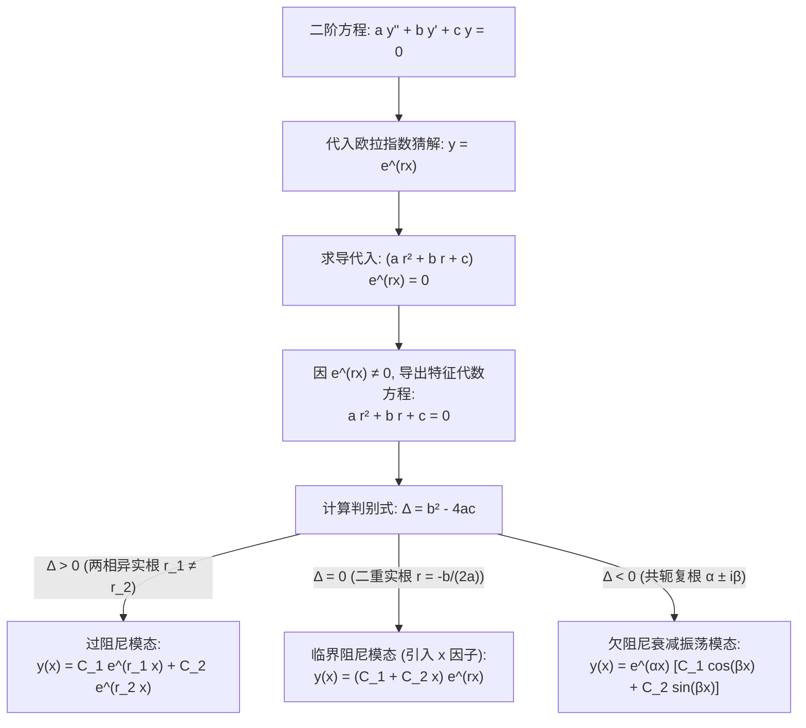

---
tags:
  - 数学/常微分方程
  - 求解技术
  - 技术卡
  - 二阶常系数
  - 特征根法
  - 阻尼振动
  - 达朗贝尔降阶
aliases:
  - 二阶常系数齐次线性方程(特征根法)
  - 特征根法
  - 二阶常系数线性微分方程
  - 阻尼简谐振动
  - Second-Order Linear Equations with Constant Coefficients
  - Characteristic Equation Method
created: 2026-09-06
updated: 2026-09-08
---

> [!summary] 技术核心论断
> 二阶常系数齐次线性微分方程 $a y'' + b y' + c y = 0$ 是理论物理与动力工程中最经典、最普适的“数学母机”（从弹簧振子、阻尼摆动到 RLC 交流电路）。其求解本质是通过欧拉指数试探解 $y = e^{rx}$，将复杂的**连续微分算子完全代数化**为一元二次**特征方程（Characteristic Equation）**。判别式 $\Delta = b^2 - 4ac$ 的正、负、零，在物理世界中精准对应着**过阻尼（Overdamped）、临界阻尼（Critically Damped）与欠阻尼振荡（Underdamped Oscillation）**三种截然不同的动力学相态；而在重根临界点涌现出的因式 $x e^{rx}$，更是达朗贝尔降阶与微扰极限在代数中的绝妙展现。

---

## 一、推导机理与规范求解工作流

### 1.1 特征方程的严格推导

考虑二阶实常系数齐次线性微分方程：
$$\boxed{a \frac{d^2 y}{dx^2} + b \frac{dy}{dx} + c y = 0 \quad (a, b, c \in \mathbb{R}, \; a \ne 0)}$$

#### 推导步骤
由于指数函数对求导具有完美的自相似形状保持性（$\frac{d}{dx} e^{rx} = r e^{rx}$），猜测方程拥有指数形态特解 $y = e^{rx}$。
代入方程：
$$a (r^2 e^{rx}) + b (r e^{rx}) + c e^{rx} = 0 \implies (a r^2 + b r + c) e^{rx} = 0$$
因指数函数 $e^{rx} \ne 0$ 恒成立，两端约去后，得到一元二次**特征方程**：

$$\boxed{a r^2 + b r + c = 0}$$

其根由求根公式给出：
$$r_{1, 2} = \frac{-b \pm \sqrt{b^2 - 4ac}}{2a} = \frac{-b \pm \sqrt{\Delta}}{2a}$$

---

### 1.2 三大特征根情形与通解显式结构

#### 情形一：$\Delta = b^2 - 4ac > 0$（两个不相等的实特征根）
特征方程拥有两个互异实根 $r_1 \ne r_2$。
- 特解为 $y_1 = e^{r_1 x}, y_2 = e^{r_2 x}$；
- 计算朗斯基行列式：
  $$W(y_1, y_2)(x) = \begin{vmatrix} e^{r_1 x} & e^{r_2 x} \\ r_1 e^{r_1 x} & r_2 e^{r_2 x} \end{vmatrix} = (r_2 - r_1) e^{(r_1 + r_2)x} \ne 0$$
  两解处处严格线性无关，构成基本解组；
- **通解公式**：
  $$\boxed{y(x) = C_1 e^{r_1 x} + C_2 e^{r_2 x}}$$

---

#### 情形二：$\Delta = b^2 - 4ac = 0$（二重实特征根与 $x$ 因子的涌现）
此时方程仅能给出单一实根 $r = -\frac{b}{2a}$，从而仅获得一个指数特解 $y_1(x) = e^{rx}$。
**第二个线性无关特解 $y_2(x)$ 的严格推导（达朗贝尔降阶法）**：
原首一方程为 $y'' + \frac{b}{a} y' + \frac{c}{a} y = 0$。由降阶求积公式：
$$y_2(x) = y_1(x) \int \frac{\exp\left( -\int \frac{b}{a} dx \right)}{y_1^2(x)} dx$$
分子为 $e^{-\frac{b}{a} x}$；而分母为 $(e^{rx})^2 = e^{2rx} = e^{2\left(-\frac{b}{2a}\right)x} = e^{-\frac{b}{a} x}$！
分子分母指数完全抵消：
$$y_2(x) = e^{rx} \int \frac{e^{-\frac{b}{a} x}}{e^{-\frac{b}{a} x}} dx = e^{rx} \int 1 dx = x e^{rx}$$
自然涌现出多项式因子 $x$！
- 验证两解独立性：$W(e^{rx}, x e^{rx}) = e^{rx}(e^{rx} + r x e^{rx}) - r e^{rx}(x e^{rx}) = e^{2rx} \ne 0$；
- **通解公式**：
  $$\boxed{y(x) = (C_1 + C_2 x) e^{rx} = C_1 e^{rx} + C_2 x e^{rx}}$$

---

#### 情形三：$\Delta = b^2 - 4ac < 0$（一对共轭复特征根）
设两共轭复根为：
$$r_{1, 2} = \alpha \pm i \beta, \qquad \alpha = -\frac{b}{2a}, \quad \beta = \frac{\sqrt{4ac - b^2}}{2a} > 0$$
在复数域内，两基本解为 $z_1 = e^{(\alpha + i\beta)x}$ 与 $z_2 = e^{(\alpha - i\beta)x}$。
利用欧拉公式展开：
$$e^{(\alpha \pm i\beta)x} = e^{\alpha x} (\cos\beta x \pm i \sin\beta x)$$
由线性叠加原理，取实部与虚部构造实数域基本解：
$$y_1(x) = \frac{z_1 + z_2}{2} = e^{\alpha x} \cos(\beta x), \qquad y_2(x) = \frac{z_1 - z_2}{2i} = e^{\alpha x} \sin(\beta x)$$
- 计算朗斯基行列式：$W(y_1, y_2) = \beta e^{2\alpha x} \ne 0$；
- **通解公式**：
  $$\boxed{y(x) = e^{\alpha x} [C_1 \cos(\beta x) + C_2 \sin(\beta x)]}$$
*(亦可写作振幅-初相形式 $y(x) = A e^{\alpha x} \cos(\beta x - \phi)$)*。

---

### 1.3 物理映射：阻尼谐振子三大响应相态

机械阻尼振动方程 $m x'' + \gamma x' + k x = 0$（$m > 0, \gamma \ge 0, k > 0$）：

| 状态类型 | 判别式条件 | 特征根形态 | 动力学时域轨迹行为 |
| :--- | :--- | :--- | :--- |
| **过阻尼 (Overdamped)** | $\gamma^2 > 4mk$ | 两个负实根 $r_1 < r_2 < 0$ | 阻力极大，质点单调指数衰减回到平衡点，无任何振荡。 |
| **临界阻尼 (Critically Damped)** | $\gamma^2 = 4mk$ | 重根 $r = -\gamma/(2m)$ | 质点以**最快速度**平稳贴回平衡点，不产生往复振荡。工程仪器指针最优设计点。 |
| **欠阻尼 (Underdamped)** | $\gamma^2 < 4mk$ | 复根 $-\frac{\gamma}{2m} \pm i\omega_d$ | 质点在指数包络线 $\pm A e^{-\alpha t}$ 约束下进行振幅不断衰减的周期性阻尼振荡。 |

---

## 二、⚠️ 致命失分陷阱与临界边界

> [!warning] 陷阱 1：重根情形遗漏乘积因子 $x$
> 当 $\Delta = 0$ 时，很多学生误写通解为 $y = C_1 e^{rx} + C_2 e^{rx} = (C_1 + C_2) e^{rx} = C e^{rx}$。
> 这仅包含一个自由常数，根本无法满足由初值条件确定的二阶自由度（如同时指定 $y(0)$ 与 $y'(0)$）！
> **第二项必须严格乘以自变量 $x$**：$y = (C_1 + C_2 x)e^{rx}$。

> [!caution] 陷阱 2：复特征根角频率 $\beta$ 忘记除以 $2a$
> 计算共轭复根时：
> 错误写法：$\beta = \sqrt{4ac - b^2}$；
> 正确写法：整个求根公式必须统一除以分母 $2a$，即 **$\beta = \frac{\sqrt{4ac - b^2}}{2a}$**。若漏除 $2a$，三角函数的高频振荡速度将被严重放大。

> [!danger] 陷阱 3：初值问题求导时忘记对复根外层指数 $e^{\alpha x}$ 求导
> 对 $y(x) = e^{\alpha x}(C_1 \cos\beta x + C_2 \sin\beta x)$ 求导代入 $y'(0)$ 时：
> 必须使用乘积法则：$y'(0) = \alpha C_1 + \beta C_2$。
> 许多初学者脑子一热误写为 $y'(0) = \beta C_2$（漏算了外层指数导数贡献的 $\alpha C_1$），直接导致常数定错。

---

## 三、经典范例手把手演算与反代验算

### 3.1 经典例题：欠阻尼振动初值问题全流程解算
**题目（Constanda 教材 §4.4 经典例题，机械振动标准模型）**：
求解二阶常系数齐次线性微分方程的初值问题：
$$y'' + 2y' + 5y = 0, \qquad y(0) = 2, \quad y'(0) = -4 \tag{1}$$

#### 第一步：构建特征方程并求解特征根
由微分算子映射，特征方程为：
$$r^2 + 2r + 5 = 0$$
计算判别式：
$$\Delta = b^2 - 4ac = 2^2 - 4(1)(5) = 4 - 20 = -16 < 0$$
因 $\Delta < 0$，特征根为一对共轭复数：
$$r_{1, 2} = \frac{-2 \pm \sqrt{-16}}{2(1)} = \frac{-2 \pm 4i}{2} = -1 \pm 2i$$
提取实部与虚部参数：
$$\alpha = -1, \qquad \beta = 2$$

#### 第二步：写出通用通解表达式
对应的实基本解系为 $e^{-x}\cos(2x)$ 与 $e^{-x}\sin(2x)$。
齐次通解为：
$$\boxed{y(x) = e^{-x} [C_1 \cos(2x) + C_2 \sin(2x)] \tag{2}}$$

#### 第三步：对通解求一阶导数表达式
应用乘积法则：
$$\begin{aligned}
y'(x) &= \frac{d}{dx}[e^{-x}] \cdot [C_1 \cos(2x) + C_2 \sin(2x)] + e^{-x} \cdot \frac{d}{dx}[C_1 \cos(2x) + C_2 \sin(2x)] \\
&= -e^{-x} [C_1 \cos(2x) + C_2 \sin(2x)] + e^{-x} [-2C_1 \sin(2x) + 2C_2 \cos(2x)] \\
&= e^{-x} [ (2C_2 - C_1) \cos(2x) - (2C_1 + C_2) \sin(2x) ] \tag{3}
\end{aligned}$$

#### 第四步：代入初值精确锁定常数 $C_1, C_2$
1. 代入第一个初值 $y(0) = 2$ 到式 (2)：
   $$y(0) = e^0 [C_1 \cos(0) + C_2 \sin(0)] = 1 \cdot [C_1(1) + 0] = C_1 = 2 \implies C_1 = 2$$
2. 代入第二个初值 $y'(0) = -4$ 到式 (3)：
   $$y'(0) = e^0 [ (2C_2 - C_1) \cos(0) - 0 ] = 2C_2 - C_1 = -4$$
   将 $C_1 = 2$ 代入：
   $$2C_2 - 2 = -4 \implies 2C_2 = -2 \implies C_2 = -1$$
锁定常数：$C_1 = 2, C_2 = -1$。

#### 第五步：写出确定特解
代入通解：
$$\boxed{y(x) = e^{-x} [2\cos(2x) - \sin(2x)]}$$

#### 第六步：全方位反代验算
1. **初值验算**：
   - $y(0) = e^0 [2\cos 0 - \sin 0] = 1 [2(1) - 0] = 2$（符合）；
   - $y'(0) = e^0 [ (2(-1) - 2) \cos 0 ] = -2 - 2 = -4$（符合）。
2. **微分方程逐项求导反代**：
   一阶导数：
   $$y'(x) = e^{-x} [ (2(-1) - 2)\cos(2x) - (2(2) + (-1))\sin(2x) ] = e^{-x} [ -4\cos(2x) - 3\sin(2x) ]$$
   二阶导数：
   $$\begin{aligned}
   y''(x) &= -e^{-x} [ -4\cos(2x) - 3\sin(2x) ] + e^{-x} [ 8\sin(2x) - 6\cos(2x) ] \\
   &= e^{-x} [ (4 - 6)\cos(2x) + (3 + 8)\sin(2x) ] = e^{-x} [ -2\cos(2x) + 11\sin(2x) ]
   \end{aligned}$$
   代入原方程左侧 $y'' + 2y' + 5y$：
   $$\begin{aligned}
   y'' + 2y' + 5y &= e^{-x} \Big[ (-2\cos 2x + 11\sin 2x) + 2(-4\cos 2x - 3\sin 2x) + 5(2\cos 2x - \sin 2x) \Big] \\
   &= e^{-x} \Big[ (-2 - 8 + 10)\cos(2x) + (11 - 6 - 5)\sin(2x) \Big] \\
   &= e^{-x} [ 0 \cos(2x) + 0 \sin(2x) ] = 0
   \end{aligned}$$
   系数严格抵消为 0！微分方程恒等满足！演算完满闭环！

---

## 四、出处与纸质笔记坐标

- **权威教材出处**：
  - **C. Constanda**: *Differential Equations: A Primer for Scientists and Engineers*
    - Chapter 4: Second-Order Linear Equations
    - §4.4 Homogeneous Equations with Constant Coefficients (原书 P84-P92, Examples 4.11-4.16)
  - **E.A. Coddington**: *An Introduction to Ordinary Differential Equations*
    - Chapter 2: Linear Equations with Constant Coefficients (原书 P79-P88)
- **对应全景图**：[[00_常微分方程_学习全景图]]
- **纸质活页定位**：`[活页-ODE-09]`