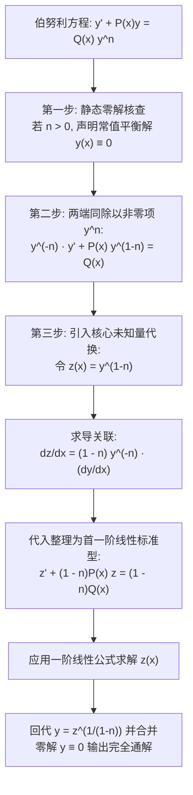
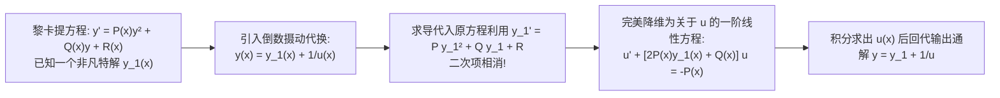

---
tags:
  - 数学/常微分方程
  - 求解技术
  - 技术卡
  - 伯努利方程
  - 黎卡提方程
  - 非线性代换
  - 降维线性化
aliases:
  - 伯努利方程与特殊非线性代换
  - 伯努利微分方程
  - 黎卡提微分方程
  - 非线性代换法
  - Bernoulli Differential Equations
  - Riccati Equations and Nonlinear Reductions
created: 2026-09-06
updated: 2026-09-08
---

> [!summary] 技术核心论断
> 绝大多数非线性常微分方程无法用初等函数求积表达，但在微分代数结构中，存在两座极其耀眼的经典非线性明珠——**伯努利方程（Bernoulli Equation）**与**黎卡提方程（Riccati Equation）**。伯努利方程凭借其精妙的幂次构造，通过非线性变换 $z = y^{1-n}$ 能够一键剥离非线性项，将其**绝对精确地线性化（Exact Linearization）**为标准一阶线性方程；而黎卡提方程作为具有二次非线性项的最简非线性动力模型，一旦已知其任意一个特解 $y_1(x)$，通过摄动倒数变换 $y = y_1 + \frac{1}{u}$ 便能神奇降维为一阶线性方程。掌握这两类代换是突破非线性壁垒的关键飞跃。

---

## 一、推导机理与规范求解工作流

### 1.1 伯努利方程 (Bernoulli Equation) 的标准型与线性化机制

#### 标准型定义
$$\boxed{\frac{dy}{dx} + P(x) y = Q(x) y^n \quad (n \in \mathbb{R}, \; n \ne 0, 1)}$$

- 当 $n = 0$ 时，退化为标准一阶非线性微分方程 $y' + Py = Q$；
- 当 $n = 1$ 时，退化为可分离变量方程 $y' + (P - Q)y = 0$；
- 当 $n \ne 0, 1$ 时，右端的 $y^n$ 引入了非线性耦合。

#### 严格推导推演（非线性项降幂对消）
1. **两端同除以 $y^n$**（设 $y \ne 0$）：
   $$y^{-n} \frac{dy}{dx} + P(x) y^{1-n} = Q(x)$$
2. **定义新未知变量**：令 $z = y^{1-n}$；
3. **链式法则微分**：
   $$\frac{dz}{dx} = (1 - n) y^{-n} \frac{dy}{dx} \implies y^{-n} \frac{dy}{dx} = \frac{1}{1 - n} \frac{dz}{dx}$$
4. **代回方程**：
   $$\frac{1}{1 - n} \frac{dz}{dx} + P(x) z = Q(x)$$
   两端同乘 $(1 - n)$，立即蜕变为**首一阶线性常微分方程**：

   $$\boxed{\frac{dz}{dx} + (1 - n) P(x) z = (1 - n) Q(x)}$$

5. **求解与回代**：直接套用一阶线性通解公式求出 $z(x)$ 后，通过 $y(x) = [z(x)]^{\frac{1}{1-n}}$ 还原原未知函数。

---

### 1.2 黎卡提方程 (Riccati Equation) 与已知特解的降维破局

#### 标准型定义
$$\boxed{\frac{dy}{dx} = P(x) y^2 + Q(x) y + R(x)}$$
*(若 $P(x) \equiv 0$，退化为一阶线性方程；若 $R(x) \equiv 0$，退化为伯努利方程 $n=2$)*。

#### 核心定理（刘维尔非可积性定理与已知特解降维）
一般形式的黎卡提方程**无法通过有限次初等微积分求积求解**。然而：
**定理**：若已通过物理直觉、因式观察或边界猜测找到了原方程的**一个已知特解 $y_1(x)$**，则方程的通解必定能通过一阶线性方程求解！

#### 变换推导过程
令 $y(x) = y_1(x) + \frac{1}{u(x)}$（其中 $u(x)$ 为新待定函数）。求导得：
$$y'(x) = y_1'(x) - \frac{u'(x)}{u^2(x)}$$
代入原方程左侧与右侧：
$$y_1' - \frac{u'}{u^2} = P(x) \left( y_1 + \frac{1}{u} \right)^2 + Q(x) \left( y_1 + \frac{1}{u} \right) + R(x)$$
展开右端平方项：
$$y_1' - \frac{u'}{u^2} = \left[ P(x) y_1^2 + Q(x) y_1 + R(x) \right] + \frac{2P(x)y_1 + Q(x)}{u} + \frac{P(x)}{u^2}$$
因 $y_1(x)$ 是原方程特解，方括号内的项与左端的 $y_1'$ **严格相等抵消**！留存：
$$-\frac{u'}{u^2} = \frac{2P(x)y_1 + Q(x)}{u} + \frac{P(x)}{u^2}$$
两端同乘以 $-u^2$：

$$\boxed{\frac{du}{dx} + [2P(x) y_1(x) + Q(x)] u = -P(x)}$$

方程瞬间降维为标准的一阶线性常微分方程！

---

## 二、⚠️ 致命失分陷阱与临界边界

> [!warning] 陷阱 1：伯努利方程两端除以 $y^n$ 时彻底漏掉零解 $y(x) \equiv 0$
> 当幂指数 $n > 0$ 时，常值函数 $y(x) \equiv 0$ 显然恒等满足原方程 $\frac{d(0)}{dx} + P(0) = Q(0)^n \equiv 0$。
> 但在最终通过 $y = z^{1/(1-n)}$ 回代通解时：
> 若积分常数 $C$ 无法取任何实数值使得 $y \equiv 0$（例如当 $n=2$ 时 $y = \frac{1}{z}$，零解对应 $z \to \infty$），则 **$y \equiv 0$ 是独立的奇解 / 特解**！
> 考试若未在开头或结尾明确补齐 $y(x) \equiv 0$，必扣漏解分。

> [!caution] 陷阱 2：伯努利方程开奇数次方根与偶数次方根的定义域陷阱
> 设求出 $z(x) = y^{1-n}$。当 $1 - n$ 为偶数时（例如 $n = 3 \implies z = y^{-2} = 1/y^2$）：
> 解出 $z(x)$ 后，$y^2 = 1/z(x)$ 要求 $z(x) > 0$！
> 此时显式解包含正负两个互不相交的连续分支：$y(x) = \pm \frac{1}{\sqrt{z(x)}}$。
> 必须根据初值条件给定的符号严格选择单一分支，不可写带 $\pm$ 号的非函数多值式。

> [!danger] 陷阱 3：盲目把未知特解的黎卡提方程套用积分公式
> 黎卡提方程 $y' = P y^2 + Q y + R$ 若未给出特解，且常系数试探（如猜常数特解 $y = c$、多项式 $y = ax+b$、指数 $y = e^{kx}$）全部失败，则该方程**绝对不能套用初等微积分求解**，其本质等价于二阶变系数线性方程，需通过级数解或特殊函数（如贝塞尔函数、艾里函数）表达。

---

## 三、经典范例手把手演算与反代验算

### 3.1 经典例题：伯努利微分方程初值问题的标准解法与全域验证
**题目（Constanda 教材 §2.4 典型考题，生物群体对流阻尼模型）**：
求解非线性伯努利常微分方程的初值问题：
$$\frac{dy}{dx} - \frac{1}{x} y = -x y^2, \qquad y(1) = 1 \quad (x > 0) \tag{1}$$

#### 第一步：判定类型与零解分析
方程具有标准伯努利形式：$P(x) = -\frac{1}{x}, Q(x) = -x$。
幂次 $n = 2$。
因 $n = 2 > 0$，$y(x) \equiv 0$ 是方程的一个平衡解。但初值 $y(1) = 1 \ne 0$，因此目标特解位于非零区域。

#### 第二步：两边除以 $y^2$
在 $y \ne 0$ 时，两端同乘以 $y^{-2}$：
$$y^{-2} \frac{dy}{dx} - \frac{1}{x} y^{-1} = -x \tag{2}$$

#### 第三步：引入线性化代换
令：
$$z = y^{1 - n} = y^{1 - 2} = y^{-1} = \frac{1}{y}$$
对 $x$ 求导：
$$\frac{dz}{dx} = -y^{-2} \frac{dy}{dx} \implies y^{-2} \frac{dy}{dx} = -\frac{dz}{dx}$$
代入式 (2)：
$$-\frac{dz}{dx} - \frac{1}{x} z = -x$$
两端同乘以 $-1$，化为**首一阶线性标准型**：
$$\frac{dz}{dx} + \frac{1}{x} z = x \tag{3}$$

#### 第四步：求解关于 $z(x)$ 的线性方程
对式 (3) 构造积分因子 $\mu(x)$（$x > 0$）：
$$\mu(x) = e^{\int \frac{1}{x} dx} = e^{\ln x} = x$$
两端同乘以 $x$：
$$x \frac{dz}{dx} + z = x^2 \implies \frac{d}{dx}[x z] = x^2$$
两边对 $x$ 积分：
$$x z = \int x^2 dx = \frac{1}{3} x^3 + C$$
解出 $z(x)$：
$$z(x) = \frac{1}{3} x^2 + \frac{C}{x} \tag{4}$$

#### 第五步：初值转换锁定常数 $C$
原初值条件为 $y(1) = 1$。
转换至 $z(x)$ 的初始值：
$$z(1) = \frac{1}{y(1)} = \frac{1}{1} = 1$$
代入式 (4)：
$$z(1) = \frac{1}{3}(1)^2 + \frac{C}{1} = 1 \implies \frac{1}{3} + C = 1 \implies C = \frac{2}{3}$$
因此：
$$z(x) = \frac{1}{3} x^2 + \frac{2}{3x} = \frac{x^3 + 2}{3x}$$

#### 第六步：回代求出原未知函数 $y(x)$
由 $y = \frac{1}{z}$：
$$\boxed{y(x) = \frac{3x}{x^3 + 2} \quad (x > 0)}$$
由于 $x > 0 \implies x^3 + 2 > 2 > 0$，分母在正半轴永不为零，特解在全正实轴 $(0, +\infty)$ 上光滑存在。

#### 第七步：反代微分方程自洽核验
1. **检验初始值**：
   $$y(1) = \frac{3(1)}{(1)^3 + 2} = \frac{3}{3} = 1$$
   初值 $y(1) = 1$ 严格吻合！
2. **计算一阶导数代入原方程 (1)**：
   求商式导数：
   $$\frac{dy}{dx} = \frac{3(x^3 + 2) - 3x(3x^2)}{(x^3 + 2)^2} = \frac{3x^3 + 6 - 9x^3}{(x^3 + 2)^2} = \frac{6 - 6x^3}{(x^3 + 2)^2}$$
   计算原方程左端项 $\frac{dy}{dx} - \frac{1}{x} y$：
   $$\begin{aligned}
   \frac{dy}{dx} - \frac{1}{x} y &= \frac{6 - 6x^3}{(x^3 + 2)^2} - \frac{1}{x} \left( \frac{3x}{x^3 + 2} \right) = \frac{6 - 6x^3}{(x^3 + 2)^2} - \frac{3}{x^3 + 2} \\
   &= \frac{(6 - 6x^3) - 3(x^3 + 2)}{(x^3 + 2)^2} = \frac{6 - 6x^3 - 3x^3 - 6}{(x^3 + 2)^2} = -\frac{9x^3}{(x^3 + 2)^2}
   \end{aligned}$$
   计算原方程右端项 $-x y^2$：
   $$-x y^2 = -x \left( \frac{3x}{x^3 + 2} \right)^2 = -x \cdot \frac{9x^2}{(x^3 + 2)^2} = -\frac{9x^3}{(x^3 + 2)^2}$$
   两端代数完全恒等！解法严谨完满自洽！

---

## 四、出处与纸质笔记坐标

- **权威教材出处**：
  - **C. Constanda**: *Differential Equations: A Primer for Scientists and Engineers*
    - Chapter 2: First-Order Equations
    - §2.4 Bernoulli Equations (原书 P38-P40, Examples 2.18-2.19)
    - §2.5 Riccati Equations (原书 P40-P42, Examples 2.20-2.21)
  - **E.A. Coddington**: *An Introduction to Ordinary Differential Equations*
    - Chapter 1: Linear Equations of First Order (原书 P44-P48)
- **对应全景图**：[[00_常微分方程_学习全景图]]
- **纸质活页定位**：`[活页-ODE-06]`