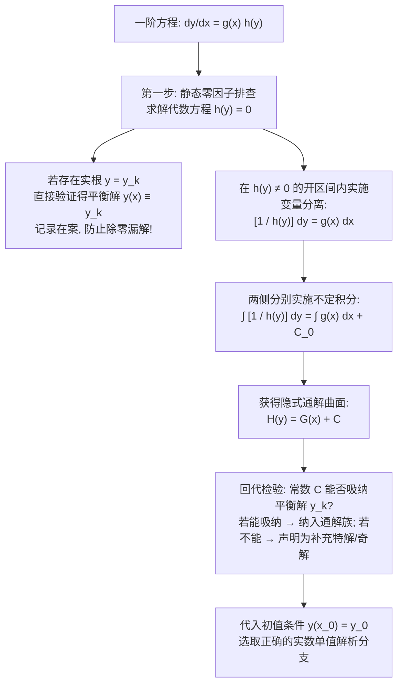

---
tags:
  - 数学/常微分方程
  - 求解技术
  - 技术卡
  - 一阶微分方程
  - 分离变量法
  - 隐式解
  - 平衡解与奇解
aliases:
  - 分离变量微分方程与隐式解
  - 分离变量法
  - 可分离变量方程
  - 隐式解与平衡解
  - Separable Differential Equations
  - Implicit Solutions and Equilibrium Solutions
created: 2026-09-06
updated: 2026-09-08
---

> [!summary] 技术核心论断
> 分离变量法（Separation of Variables）是常微分方程求解体系中最古老、最基础却又最易滋生漏洞的基石技术。其代数实质是将方程 $y' = g(x)h(y)$ 视作**两个独立的一维一阶全微分形式之间的代数等式**，通过形式上的除法将空间构型解耦为 $\frac{1}{h(y)}dy = g(x)dx$，进而两侧分别实施不定积分。**该技术的全部数学凶险集中于代数除法的合法性**：若代数方程 $h(y) = 0$ 存在实根 $y = y_k$，则在划分除式时将发生非法除零；常值函数 $y(x) \equiv y_k$ 是原方程的真正解（**平衡解 / 奇解**），但往往彻底游离于积分通解公式之外。不加检验的盲目分离，是初学者错失临界奇解的最高频重灾区。

---

## 一、推导机理与规范求解工作流

### 1.1 标准型与分离判定准则

一阶微分方程若能通过代数因式分解化为如下形式：
$$\boxed{\frac{dy}{dx} = g(x) h(y) \quad \text{或写为对称微分形式} \quad M_1(x) N_1(y) dx + M_2(x) N_2(y) dy = 0}$$
其中 $g(x)$ 与 $h(y)$ 在各自开区间内连续，则称其为**可分离变量微分方程 (Separable ODE)**。

---

### 1.2 标准解题四步流水线 (Four-Step Canonical Pipeline)

#### 第一步：零因子静态扫描（排查平衡解）
在做任何两边除法前，必须优先令 $h(y) = 0$：
- 设其所有实根为 $y = y_1, y_2, \dots, y_m$；
- 直接检验：对常值函数 $y(x) \equiv y_k$，其导数 $\frac{dy}{dx} = 0$，而右端 $g(x)h(y_k) = g(x) \cdot 0 = 0$。两端恒等相等！
- 因此，每个常值实根均构成原微分方程的**平衡解 (Equilibrium Solution / Constant Solution)**。必须单独摘录保存。

#### 第二步：在非零区域严密实施变量分离
在 $h(y) \ne 0$ 的各个连通区间内，两边同除以 $h(y)$ 并乘以 $dx$：
$$\frac{1}{h(y)} dy = g(x) dx$$

#### 第三步：双边积分与独立常数归一
对左端关于 $y$、右端关于 $x$ 分别执行不定积分：
$$\int \frac{1}{h(y)} dy = \int g(x) dx$$
设 $H(y)$ 为 $\frac{1}{h(y)}$ 的原函数，$G(x)$ 为 $g(x)$ 的原函数：
$$\boxed{H(y) = G(x) + C \quad (C \in \mathbb{R})}$$
此二元代数关系式即为方程的**隐式通解 (Implicit General Solution)**。

#### 第四步：解的完备性闭环与分支选取
1. **奇解吸纳性检验**：考察当常数 $C \to \pm\infty$ 或取特殊极限时，通解公式是否能退化为第一步所提取的平衡解 $y = y_k$？若能，则平衡解被通解包含；若无论 $C$ 取何值均无法表示，则该平衡解必须作为独立特解或奇解并列写入终极答案；
2. **显式分支解构**：由隐函数定理解出显式函数 $y = \phi(x)$。若出现多根式（如平方根），必须依据初值约束所处的象限严格判定正负号。

---

## 二、⚠️ 致命失分陷阱与临界边界

> [!warning] 陷阱 1：无视零因子除零，直接丢失孤立平衡解（漏解必失分）
> 求解方程 $y' = y^2 - 1$：
> 若直接分离变量：$\int \frac{dy}{y^2-1} = \int dx \implies \frac{1}{2}\ln\left|\frac{y-1}{y+1}\right| = x + C$；
> 解出显式解：$y(x) = \frac{1 + A e^{2x}}{1 - A e^{2x}}$（其中 $A = \pm e^{2C} \ne 0$）。
> 当 $A = 0$ 时得到 $y \equiv 1$；
> 但常值解 **$y(x) \equiv -1$ 无论常数 $A$ 取何有限实数均绝对无法获得**（对应于 $A \to \infty$）！
> 若未在第一步写出 $y^2 - 1 = 0 \implies y = \pm 1$，则特解 $y \equiv -1$ 将彻底遗失。

> [!caution] 陷阱 2：对数绝对值丢弃导致的解有效定义域严重缩窄
> 在积分 $\int \frac{dy}{y} = \int dx$ 中，严禁草率写为 $\ln y = x + C$！
> 正确表达式必须保留绝对值：$\ln|y| = x + C \implies |y| = e^C e^x$。
> 去除绝对值后常数升格为非零任意常数 $A = \pm e^C$：$y = A e^x$ ($A \ne 0$)。
> 结合平衡解 $y \equiv 0$（对应 $A = 0$），通解才完满扩展为全体实数 $A \in \mathbb{R}$。若丢弃绝对值，解曲线将被腰斩仅剩下半个上半平面。

> [!danger] 陷阱 3：隐式解开方时忽视初值决定的几何单值分支
> 由圆方程隐式解 $x^2 + y^2 = C$ 给出显式解时：
> 若给定初值 $y(0) = -3$，代入得 $C = 9 \implies x^2 + y^2 = 9$。
> 显式解**绝不能写为 $y = \pm\sqrt{9 - x^2}$**！因为微分方程的解必须是单值可导函数，符号的正负由初值点的纵坐标符号决定：
> 唯一正解必须且只能是下半圆弧：$\boxed{y(x) = -\sqrt{9 - x^2}, \quad x \in (-3, 3)}$。

---

## 三、经典范例手把手演算与反代验算

### 3.1 经典例题：非线性分离变量方程的初值破局与全域验算
**题目（Constanda 教材 §2.1 经典考题，考研经典模型）**：
求解一阶非线性微分方程的初值问题：
$$\frac{dy}{dx} = 2x(y^2 - 4), \qquad y(0) = 0 \tag{1}$$

#### 第一步：零因子静态排查
令分母因子 $h(y) = y^2 - 4 = 0$：
解得两个平衡常值解：
$$y_1(x) \equiv 2, \qquad y_2(x) \equiv -2$$
代入初值 $y(0) = 0$ 检验：$y_1(0) = 2 \ne 0$，$y_2(0) = -2 \ne 0$。
因此，虽然 $y \equiv \pm 2$ 是原方程的合法解，但它们均不满足此初值问题。特解必位于开区间 $y \in (-2, 2)$ 之内。

#### 第二步：变量分离与拆分部分分式
在 $y \in (-2, 2)$ 区域内，$y^2 - 4 \ne 0$，实施变量分离：
$$\frac{dy}{y^2 - 4} = 2x dx$$
对左端进行部分分式展开：
$$\frac{1}{y^2 - 4} = \frac{1}{(y - 2)(y + 2)} = \frac{1}{4}\left( \frac{1}{y - 2} - \frac{1}{y + 2} \right)$$
代入方程：
$$\frac{1}{4}\left( \frac{1}{y - 2} - \frac{1}{y + 2} \right) dy = 2x dx$$
两端同乘以 4：
$$\left( \frac{1}{y - 2} - \frac{1}{y + 2} \right) dy = 8x dx$$

#### 第三步：双边积分与化简
两边积分：
$$\int \left( \frac{1}{y - 2} - \frac{1}{y + 2} \right) dy = \int 8x dx$$
$$\ln|y - 2| - \ln|y + 2| = 4x^2 + C_0$$
利用对数运算法则合并：
$$\ln\left| \frac{y - 2}{y + 2} \right| = 4x^2 + C_0$$
两边取自然指数：
$$\left| \frac{y - 2}{y + 2} \right| = e^{C_0} e^{4x^2}$$
令 $A = \pm e^{C_0} \ne 0$：
$$\frac{y - 2}{y + 2} = A e^{4x^2} \tag{2}$$

#### 第四步：代入初值精确锁定常数 $A$
将 $x = 0, y = 0$ 代入式 (2)：
$$\frac{0 - 2}{0 + 2} = A e^{4(0)^2} \implies \frac{-2}{2} = A \cdot 1 \implies A = -1$$
代回式 (2)：
$$\frac{y - 2}{y + 2} = -e^{4x^2}$$

#### 第五步：解出显式特解函数
交叉相乘去分母：
$$y - 2 = -e^{4x^2}(y + 2) = -y e^{4x^2} - 2e^{4x^2}$$
移项提取公因式 $y$：
$$y(1 + e^{4x^2}) = 2 - 2e^{4x^2} = 2(1 - e^{4x^2})$$
由于对任意实数 $x$ 恒有 $1 + e^{4x^2} \ge 2 > 0$，分母永不为零，解在全实轴 $\mathbb{R}$ 上光滑无界存在：
$$\boxed{y(x) = \frac{2(1 - e^{4x^2})}{1 + e^{4x^2}} = 2 \frac{1 - e^{4x^2}}{1 + e^{4x^2}}}$$
*(亦可写作双曲正切形式 $y(x) = -2\tanh(2x^2)$)*。

#### 第六步：全方位反代验算
1. **检验初值满足性**：
   $$y(0) = 2 \frac{1 - e^0}{1 + e^0} = 2 \frac{1 - 1}{1 + 1} = 0$$
   初值 $y(0) = 0$ 严格吻合！
2. **导数直接代入原微分方程核验**：
   计算 $y'(x)$（商法则）：
   $$y'(x) = 2 \frac{(-4 \cdot 2x e^{4x^2})(1 + e^{4x^2}) - (1 - e^{4x^2})(4 \cdot 2x e^{4x^2})}{(1 + e^{4x^2})^2}$$
   提取公因子 $-16x e^{4x^2}$：
   $$y'(x) = -16x e^{4x^2} \frac{(1 + e^{4x^2}) + (1 - e^{4x^2})}{(1 + e^{4x^2})^2} = -16x e^{4x^2} \frac{2}{(1 + e^{4x^2})^2} = -\frac{32x e^{4x^2}}{(1 + e^{4x^2})^2}$$
   计算原方程右端 $2x(y^2 - 4)$：
   $$y^2 - 4 = \left[ 2 \frac{1 - e^{4x^2}}{1 + e^{4x^2}} \right]^2 - 4 = 4 \left[ \frac{(1 - e^{4x^2})^2 - (1 + e^{4x^2})^2}{(1 + e^{4x^2})^2} \right]$$
   利用平方差公式 $(a-b)^2 - (a+b)^2 = -4ab$：
   $$y^2 - 4 = 4 \left[ \frac{-4 e^{4x^2}}{(1 + e^{4x^2})^2} \right] = -\frac{16 e^{4x^2}}{(1 + e^{4x^2})^2}$$
   代入右端：
   $$2x(y^2 - 4) = 2x \left[ -\frac{16 e^{4x^2}}{(1 + e^{4x^2})^2} \right] = -\frac{32x e^{4x^2}}{(1 + e^{4x^2})^2}$$
   左右两端完全恒等相等！解法正确无误！

---

## 四、出处与纸质笔记坐标

- **权威教材出处**：
  - **C. Constanda**: *Differential Equations: A Primer for Scientists and Engineers*
    - Chapter 2: First-Order Equations
    - §2.1 Separable Equations (原书 P26-P30, Examples 2.1-2.4)
  - **E.A. Coddington**: *An Introduction to Ordinary Differential Equations*
    - Chapter 1: Linear Equations of First Order (原书 P15-P22)
- **对应全景图**：[[00_常微分方程_学习全景图]]
- **纸质活页定位**：`[活页-ODE-02]`