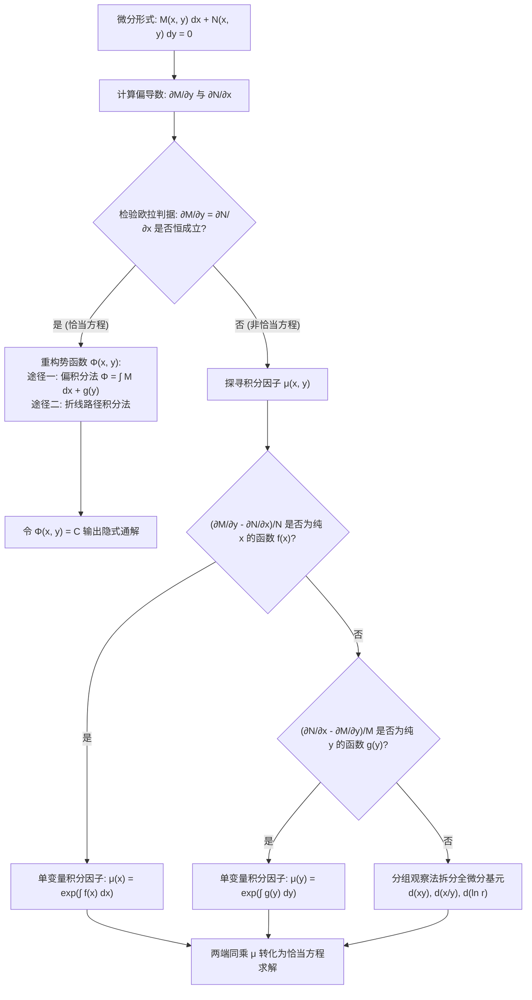

---
tags:
  - 数学/常微分方程
  - 求解技术
  - 技术卡
  - 恰当方程
  - 全微分方程
  - 势函数
  - 积分因子
aliases:
  - 恰当微分方程与积分因子法
  - 恰当方程
  - 全微分方程
  - 积分因子法
  - Exact Differential Equations
  - Integrating Factors and Potential Functions
created: 2026-09-06
updated: 2026-09-08
---

> [!summary] 技术核心论断
> 恰当微分方程（全微分方程，Exact ODE）是微分形式与多变量微积分势能场理论在微分方程中的至美交汇。当微分形式 $M(x, y)dx + N(x, y)dy = 0$ 恰好构成某个二元标量函数 $\Phi(x, y)$ 的**全微分（Total Differential）** $d\Phi = 0$ 时，方程的求解过程即化解为由保守力场重构**势函数（Potential Function）**的线积分问题，其全部解曲线天然凝固在等势线族 $\Phi(x, y) = C$ 之上。若微分形式非恰当，通过寻找辅助乘子——**积分因子（Integrating Factor）** $\mu(x, y)$，能赋予原微分形式以完美的无旋守恒性，是求解复杂变系数非线性一阶方程的普适利器。

---

## 一、推导机理与规范求解工作流

### 1.1 恰当微分方程的数学定义与欧拉充要判据

设一阶微分方程表示为对称微分形式：
$$\boxed{M(x, y) dx + N(x, y) dy = 0}$$
若在某个平面单连通区域 $D$ 内存在具有二阶连续偏导数的二元势函数 $\Phi(x, y)$，使得其全微分恰好满足：
$$d\Phi(x, y) = \frac{\partial \Phi}{\partial x} dx + \frac{\partial \Phi}{\partial y} dy = M(x, y) dx + N(x, y) dy$$
则称该方程为区域 $D$ 内的**恰当微分方程（全微分方程）**。
此时方程等价于 $d\Phi = 0$，其隐式通解直接由等势线给出：
$$\boxed{\Phi(x, y) = C \quad (C \in \mathbb{R})}$$

#### 欧拉判据（施瓦茨混合偏导数相等定理的必然推论）
**定理**：设 $M(x, y), N(x, y)$ 及其一阶偏导数在**单连通区域 $D$** 内连续。方程 $M dx + N dy = 0$ 为恰当方程的**充要条件**是：

$$\boxed{\frac{\partial M}{\partial y} = \frac{\partial N}{\partial x}}$$

- **必要性证明**：若方程恰当，则 $M = \frac{\partial \Phi}{\partial x}, N = \frac{\partial \Phi}{\partial y}$。
  由克莱罗-施瓦茨定理（二阶连续偏导数与求导次序无关）：
  $$\frac{\partial M}{\partial y} = \frac{\partial}{\partial y}\left( \frac{\partial \Phi}{\partial x} \right) = \frac{\partial^2 \Phi}{\partial y \partial x} = \frac{\partial^2 \Phi}{\partial x \partial y} = \frac{\partial}{\partial x}\left( \frac{\partial \Phi}{\partial y} \right) = \frac{\partial N}{\partial x}$$
  等式必然恒成立！

---

### 1.2 势函数 $\Phi(x, y)$ 的两大重构范式

#### 范式一：偏不定积分与待定函数法（最常用规范解法）
1. 由 $\frac{\partial \Phi}{\partial x} = M(x, y)$，将 $y$ 视作常数，对 $x$ 求不定积分：
   $$\Phi(x, y) = \int M(x, y) dx + g(y)$$
   其中 $g(y)$ 为关于 $y$ 的待定可微函数（充当“积分常数”）；
2. 两端关于 $y$ 求偏导，并强制令其等于 $N(x, y)$：
   $$\frac{\partial \Phi}{\partial y} = \frac{\partial}{\partial y}\left[ \int M(x, y) dx \right] + g'(y) = N(x, y)$$
3. 解出 $g'(y)$：
   $$g'(y) = N(x, y) - \frac{\partial}{\partial y}\left[ \int M(x, y) dx \right]$$
   *(由充要条件，右端必然不含变量 $x$，纯为 $y$ 的函数！)*
4. 对 $y$ 积分求出 $g(y)$，代回 $\Phi(x, y) = C$ 即可。

#### 范式二：基准点折线连续路径积分法
选定基准参考点 $(x_0, y_0)$，构造从 $(x_0, y_0)$ 到 $(x, y)$ 的平行坐标轴两段折线回路：
$$\boxed{\Phi(x, y) = \int_{x_0}^x M(t, y_0) dt + \int_{y_0}^y N(x, s) ds = C}$$
在第一段积分中令 $y = y_0$，在第二段积分中令 $x$ 保持为目标值，一步写出闭合初等解！

---

### 1.3 积分因子 $\mu(x, y)$ 的生成机制与判据准则

若 $\frac{\partial M}{\partial y} \ne \frac{\partial N}{\partial x}$，原式非恰当。两边同乘非零可微函数 $\mu(x, y)$，要求 $(\mu M) dx + (\mu N) dy = 0$ 恰当：
$$\frac{\partial (\mu M)}{\partial y} = \frac{\partial (\mu N)}{\partial x} \iff \mu \frac{\partial M}{\partial y} + M \frac{\partial \mu}{\partial y} = \mu \frac{\partial N}{\partial x} + N \frac{\partial \mu}{\partial x}$$
整理得到**积分因子一阶偏微分主方程**：
$$M \frac{\partial \mu}{\partial y} - N \frac{\partial \mu}{\partial x} = \mu \left( \frac{\partial N}{\partial x} - \frac{\partial M}{\partial y} \right)$$

#### 两大常用单变量特例判据
1. **纯 $x$ 依赖型积分因子 $\mu = \mu(x)$**：
   此时 $\frac{\partial \mu}{\partial y} = 0, \frac{\partial \mu}{\partial x} = \frac{d\mu}{dx}$。代入整理：
   $$\frac{1}{\mu} \frac{d\mu}{dx} = \frac{\frac{\partial M}{\partial y} - \frac{\partial N}{\partial x}}{N}$$
   **充要判据**：若比值 $\frac{\frac{\partial M}{\partial y} - \frac{\partial N}{\partial x}}{N} = f(x)$ 仅为自变量 $x$ 的函数（不含 $y$），则：
   $$\boxed{\mu(x) = e^{\int f(x) dx} = \exp\left( \int \frac{\frac{\partial M}{\partial y} - \frac{\partial N}{\partial x}}{N} dx \right)}$$

2. **纯 $y$ 依赖型积分因子 $\mu = \mu(y)$**：
   此时 $\frac{\partial \mu}{\partial x} = 0, \frac{\partial \mu}{\partial y} = \frac{d\mu}{dy}$。代入整理：
   $$\frac{1}{\mu} \frac{d\mu}{dy} = \frac{\frac{\partial N}{\partial x} - \frac{\partial M}{\partial y}}{M}$$
   **充要判据**：若比值 $\frac{\frac{\partial N}{\partial x} - \frac{\partial M}{\partial y}}{M} = g(y)$ 仅为自变量 $y$ 的函数（不含 $x$），则：
   $$\boxed{\mu(y) = e^{\int g(y) dy} = \exp\left( \int \frac{\frac{\partial N}{\partial x} - \frac{\partial M}{\partial y}}{M} dy \right)}$$

---

## 二、⚠️ 致命失分陷阱与临界边界

> [!warning] 陷阱 1：在非单连通域中盲目应用欧拉判据——多值势能陷阱
> 考查经典旋涡力场方程：
> $$\frac{-y}{x^2 + y^2} dx + \frac{x}{x^2 + y^2} dy = 0$$
> 计算偏导数：
> $\frac{\partial M}{\partial y} = \frac{-(x^2+y^2) - (-y)(2y)}{(x^2+y^2)^2} = \frac{y^2 - x^2}{(x^2+y^2)^2}$
> $\frac{\partial N}{\partial x} = \frac{(x^2+y^2) - x(2x)}{(x^2+y^2)^2} = \frac{y^2 - x^2}{(x^2+y^2)^2}$
> 在全平面除原点外处处满足 $\frac{\partial M}{\partial y} = \frac{\partial N}{\partial x}$！
> **致命陷阱**：直接声称方程在包含原点的环路内恰当。
> **真相**：原点 $(0, 0)$ 是奇异点，挖去原点的平面**不再单连通**！沿环绕原点的单位圆闭路积分：
> $\oint_{|z|=1} (M dx + N dy) = \int_0^{2\pi} d\theta = 2\pi \ne 0$！
> 势函数 $\Phi(x, y) = \arctan(y/x) = \theta$ 是多值函数，在全域不存在单值势函数。

> [!caution] 陷阱 2：单变量积分因子判据中分母与符号倒置
> 极其多学生将两套公式混淆：
> 1. 除以 $N$ 时，分子是 **$\frac{\partial M}{\partial y} - \frac{\partial N}{\partial x}$**；
> 2. 除以 $M$ 时，分子是 **$\frac{\partial N}{\partial x} - \frac{\partial M}{\partial y}$**（多了一个负号！）。
> 搞错负号将导致求出的 $\mu(x)$ 或 $\mu(y)$ 倒置，使原本简单的方程变得极为诡异发散。

> [!danger] 陷阱 3：同乘积分因子引入伪解或丢失临界特解
> 两端乘以 $\mu(x, y)$ 时：
> 1. 若 $\mu(x, y) = 0$ 存在实曲线解，该曲线代入方程可能根本不是原微分方程的解（称为**增根伪解**）；
> 2. 若积分因子在某处发散 $\mu \to \infty$（即 $1/\mu = 0$），原方程在除零点处可能隐藏着真正的特解（称为**漏解**）！求解完毕后必须单独检验 $\mu = 0$ 与分母零点。

---

## 三、经典范例手把手演算与反代验算

### 3.1 经典例题：非恰当方程积分因子判据与势函数全景求解
**题目（Constanda 教材 §2.6 核心经典例题，考研必考大题）**：
求解一阶微分方程：
$$(3x y + y^2) dx + (x^2 + xy) dy = 0 \tag{1}$$
满足初始条件 $y(1) = 1$。

#### 第一步：欧拉判据检验
识别系数函数：
$$M(x, y) = 3xy + y^2, \qquad N(x, y) = x^2 + xy$$
计算交叉偏导数：
$$\frac{\partial M}{\partial y} = \frac{\partial}{\partial y}(3xy + y^2) = 3x + 2y$$
$$\frac{\partial N}{\partial x} = \frac{\partial}{\partial x}(x^2 + xy) = 2x + y$$
偏导数之差：
$$\frac{\partial M}{\partial y} - \frac{\partial N}{\partial x} = (3x + 2y) - (2x + y) = x + y \ne 0$$
因偏导不相等，原方程在全平面**非恰当**。

#### 第二步：应用判据寻找单变量积分因子
1. **测试是否为纯 $x$ 的函数**：
   $$\frac{\frac{\partial M}{\partial y} - \frac{\partial N}{\partial x}}{N} = \frac{x + y}{x^2 + xy} = \frac{x + y}{x(x + y)} = \frac{1}{x}$$
   因式严格相消！结果仅为自变量 $x$ 的函数 $f(x) = \frac{1}{x}$。
2. **计算积分因子 $\mu(x)$**：
   $$\mu(x) = e^{\int \frac{1}{x} dx} = e^{\ln|x|} = |x|$$
   由于初值 $x = 1 > 0$，取主值正分支：
   $$\boxed{\mu(x) = x}$$

#### 第三步：构造等价恰当方程
两端同乘以 $\mu(x) = x$：
$$\tilde{M}(x, y) dx + \tilde{N}(x, y) dy = 0$$
其中：
$$\tilde{M}(x, y) = x(3xy + y^2) = 3x^2 y + x y^2$$
$$\tilde{N}(x, y) = x(x^2 + xy) = x^3 + x^2 y$$
再验算欧拉充要条件：
$$\frac{\partial \tilde{M}}{\partial y} = 3x^2 + 2xy, \qquad \frac{\partial \tilde{N}}{\partial x} = 3x^2 + 2xy$$
两式完全相等，新方程在全平面严格恰当！

#### 第四步：重构势函数 $\Phi(x, y)$
由全微分定义，$\frac{\partial \Phi}{\partial x} = \tilde{M} = 3x^2 y + x y^2$。
对 $x$ 偏积分：
$$\Phi(x, y) = \int (3x^2 y + x y^2) dx = x^3 y + \frac{1}{2} x^2 y^2 + g(y)$$
将 $\Phi(x, y)$ 对 $y$ 求偏导，并令其等于 $\tilde{N}$：
$$\frac{\partial \Phi}{\partial y} = x^3 + x^2 y + g'(y) = x^3 + x^2 y$$
两边消去相同项：
$$g'(y) = 0 \implies g(y) = C_0$$
取 $C_0 = 0$，得到势函数：
$$\Phi(x, y) = x^3 y + \frac{1}{2} x^2 y^2$$
方程隐式通解为：
$$x^3 y + \frac{1}{2} x^2 y^2 = C_1 \implies 2x^3 y + x^2 y^2 = C \tag{2}$$

#### 第五步：代入初值确定常数 $C$
将初值条件 $x = 1, y = 1$ 代入式 (2)：
$$2(1)^3(1) + (1)^2(1)^2 = 2(1) + 1 = 3 \implies C = 3$$
特解隐式代数方程为：
$$\boxed{2x^3 y + x^2 y^2 = 3}$$

#### 第六步：全微分反代验算
对隐式特解 $F(x, y) = 2x^3 y + x^2 y^2 - 3 = 0$ 求隐函数全微分：
$$dF = \frac{\partial F}{\partial x} dx + \frac{\partial F}{\partial y} dy = 0$$
计算偏导数：
$$\frac{\partial F}{\partial x} = 6x^2 y + 2x y^2 = 2x(3xy + y^2)$$
$$\frac{\partial F}{\partial y} = 2x^3 + 2x^2 y = 2x(x^2 + xy)$$
代入全微分方程：
$$2x(3xy + y^2) dx + 2x(x^2 + xy) dy = 0$$
在 $x \ne 0$ 的物理区域，两端同除以公因式 $2x$：
$$(3xy + y^2) dx + (x^2 + xy) dy = 0$$
原方程 (1) 完整重现！初值代入 $2(1) + 1 = 3$ 亦严丝合缝！求解正确！

---

## 四、出处与纸质笔记坐标

- **权威教材出处**：
  - **C. Constanda**: *Differential Equations: A Primer for Scientists and Engineers*
    - Chapter 2: First-Order Equations
    - §2.6 Exact Equations (原书 P42-P47, Examples 2.22-2.26)
  - **E.A. Coddington**: *An Introduction to Ordinary Differential Equations*
    - Chapter 1: Linear Equations of First Order (原书 P35-P43)
- **对应全景图**：[[00_常微分方程_学习全景图]]
- **纸质活页定位**：`[活页-ODE-05]`