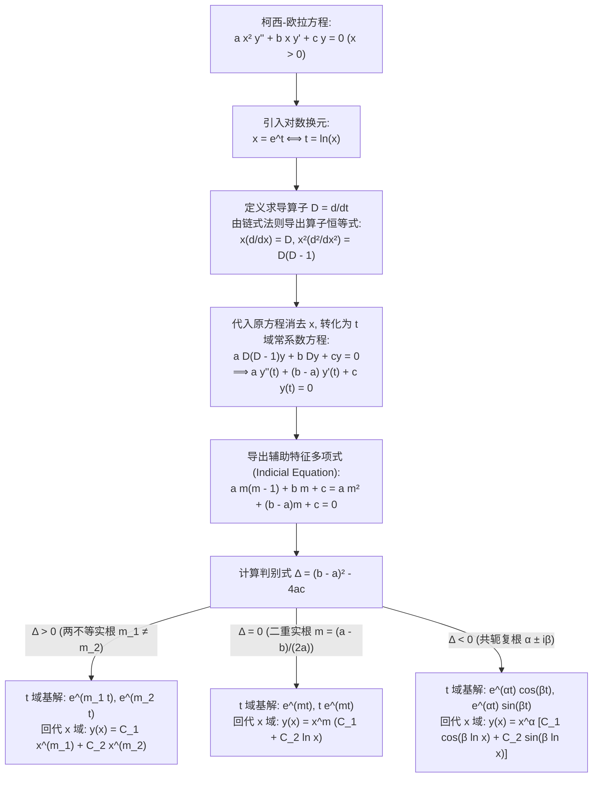

---
tags:
  - 数学/常微分方程
  - 求解技术
  - 技术卡
  - 变系数方程
  - 柯西-欧拉方程
  - 算子代数
  - 降维常系数化
aliases:
  - 柯西-欧拉方程与量纲降维
  - 柯西-欧拉方程
  - Euler-Cauchy方程
  - 等维微分方程
  - Cauchy-Euler Equations
  - Equidimensional Equation
created: 2026-09-06
updated: 2026-09-08
---

> [!summary] 技术核心论断
> 柯西-欧拉方程（Cauchy-Euler Equation，亦称等维线性方程）是数学物理与连续介质力学中**唯一一类可通过自变量对数换元精确化为常系数线性方程的变系数二阶（及高阶）方程**。其本质在于方程具有自洽的“量纲齐次性”——每一项中自变量的幂次 $x^k$ 恰好精确抵消求导算子 $\frac{d^k}{dx^k}$ 的量纲倒数。通过引入变换 $x = e^t$（即 $t = \ln x$）以及微分算子代数恒等式 $x^k \frac{d^k}{dx^k} = D(D-1)\cdots(D-k+1)$，原方程中所有显含的变系数 $x$ 被完全吸收，方程无缝降维退化为标准常系数线性方程，从而全面复用特征多项式理论。

---

## 一、推导机理与规范求解工作流

### 1.1 算子代数与自变量指数换元的严格推导

标准二阶柯西-欧拉齐次微分方程定义为：
$$\boxed{a x^2 \frac{d^2 y}{dx^2} + b x \frac{dy}{dx} + c y = 0 \quad (a, b, c \in \mathbb{R}, \; a \ne 0)}$$
其中默认在区间 $x > 0$ 内讨论（$x < 0$ 的处理详见第二节陷阱剖析）。

#### 链式法则与算子恒等式推导
设 $x = e^t$，即 $t = \ln x$。记 $D = \frac{d}{dt}$。
1. **一阶微分算子**：
   $$\frac{dy}{dx} = \frac{dy}{dt} \frac{dt}{dx} = \frac{dy}{dt} \frac{1}{x} \implies x \frac{dy}{dx} = \frac{dy}{dt} = Dy$$
   即算子关系：
   $$\boxed{x \frac{d}{dx} = D}$$

2. **二阶微分算子**：
   对一阶导数关于 $x$ 再次求导：
   $$\begin{aligned}
   \frac{d^2 y}{dx^2} &= \frac{d}{dx} \left( \frac{1}{x} \frac{dy}{dt} \right) = \left( -\frac{1}{x^2} \right) \frac{dy}{dt} + \frac{1}{x} \frac{d}{dx} \left( \frac{dy}{dt} \right) \\
   &= -\frac{1}{x^2} \frac{dy}{dt} + \frac{1}{x} \left[ \frac{d}{dt}\left( \frac{dy}{dt} \right) \frac{dt}{dx} \right] \\
   &= -\frac{1}{x^2} \frac{dy}{dt} + \frac{1}{x} \left( \frac{d^2 y}{dt^2} \frac{1}{x} \right) \\
   &= \frac{1}{x^2} \left( \frac{d^2 y}{dt^2} - \frac{dy}{dt} \right)
   \end{aligned}$$
   两端同乘 $x^2$：
   $$x^2 \frac{d^2 y}{dx^2} = \frac{d^2 y}{dt^2} - \frac{dy}{dt} = (D^2 - D)y = D(D-1)y$$
   即算子关系：
   $$\boxed{x^2 \frac{d^2}{dx^2} = D(D-1)}$$

3. **高阶一般推广**：
   通过数学归纳法可严格证明对于任意正整数 $k$：
   $$\boxed{x^k \frac{d^k}{dx^k} = D(D-1)(D-2)\cdots(D-k+1)}$$

---

### 1.2 辅助特征方程与三大解结构

将算子关系代入原方程 $a x^2 y'' + b x y' + c y = 0$：
$$a D(D-1)y + b D y + c y = 0 \implies \left[ a D^2 + (b-a) D + c \right] y = 0$$
在自变量 $t$ 的新空间中，这是一元常系数齐次线性微分方程！
令 $y(t) = e^{mt}$（等价于原空间中欧拉猜解 $y(x) = x^m$），代入得到**指标方程（Indicial Equation / 辅助特征方程）**：
$$\boxed{a m(m-1) + b m + c = a m^2 + (b-a)m + c = 0}$$

判别式为 $\Delta = (b-a)^2 - 4ac$。根据根的代数性质，通解在 $x > 0$ 域内呈现三种经典结构：

#### 情形一：$\Delta > 0$（两个互异实根 $m_1 \ne m_2$）
$t$ 域基解为 $e^{m_1 t}$ 与 $e^{m_2 t}$。代回 $t = \ln x$：
$$e^{m t} = e^{m \ln x} = (e^{\ln x})^m = x^m$$
- **通解公式**：
  $$\boxed{y(x) = C_1 x^{m_1} + C_2 x^{m_2}}$$

#### 情形二：$\Delta = 0$（二重实特征根 $m_1 = m_2 = m = \frac{a-b}{2a}$）
在 $t$ 域中常系数方程的二重根对应的第二个线性无关解为 $t e^{mt}$。
代回 $t = \ln x$：
$$t e^{mt} = (\ln x) \cdot x^m = x^m \ln x$$
- 计算两解朗斯基行列式：
  $$W(x^m, x^m \ln x) = \begin{vmatrix} x^m & x^m \ln x \\ m x^{m-1} & x^{m-1}(1 + m \ln x) \end{vmatrix} = x^{2m-1} \ne 0 \quad (x > 0)$$
  两解处处线性无关。
- **通解公式**：
  $$\boxed{y(x) = x^m (C_1 + C_2 \ln x)}$$

#### 情形三：$\Delta < 0$（一对共轭复根 $m_{1, 2} = \alpha \pm i \beta, \; \beta > 0$）
在 $t$ 域中实基解为 $e^{\alpha t} \cos(\beta t)$ 与 $e^{\alpha t} \sin(\beta t)$。
代回 $t = \ln x$：
$$e^{\alpha t} = x^\alpha, \qquad \cos(\beta t) = \cos(\beta \ln x), \qquad \sin(\beta t) = \sin(\beta \ln x)$$
- **通解公式**：
  $$\boxed{y(x) = x^\alpha \left[ C_1 \cos(\beta \ln x) + C_2 \sin(\beta \ln x) \right]}$$

---

### 1.3 量纲对称性与自相似本质

柯西-欧拉方程之所以能通过 $x = e^t$ 彻底脱去自变量，其物理机制是**尺度变换群（Dilation Invariance）的不变量**。
考虑坐标缩放变换 $x \to \lambda x$（$\lambda > 0$）：
导数按比例缩放 $\frac{d}{d(\lambda x)} = \frac{1}{\lambda}\frac{d}{dx}$，二阶导数 $\frac{d^2}{d(\lambda x)^2} = \frac{1}{\lambda^2}\frac{d^2}{dx^2}$。
因此：
$$(\lambda x)^2 \frac{d^2 y}{d(\lambda x)^2} = \lambda^2 x^2 \frac{1}{\lambda^2}\frac{d^2 y}{dx^2} = x^2 \frac{d^2 y}{dx^2}$$
每一阶项在伸缩变换下保持**绝对不变性**！这种齐次对称性在对数坐标 $t = \ln x$ 下正好化为**平移对称性**（Translation Invariance），而常系数线性微分方程正是平移对称群的代数表现。

---

## 二、⚠️ 致命失分陷阱与临界边界

> [!danger] 陷阱 1：辅助方程写错（直接将 $x^2 y''$ 映射为 $m^2$ 导致丢项）
> **典型错误**：初学者受常系数方程惯性误导，将 $a x^2 y'' + b x y' + c y = 0$ 随手写成 $a m^2 + b m + c = 0$。
> **致命根源**：忽略了算子展开中出现的移位项 $-am$！根据算子推导，$x^2 \frac{d^2}{dx^2} = D(D-1) = D^2 - D$。
> **严格规范**：辅助特征方程必须是 **$a m(m-1) + b m + c = a m^2 + (b-a)m + c = 0$**。
> *反例*：对 $x^2 y'' - 2x y' + 2y = 0$：
> - 错误特征方程：$m^2 - 2m + 2 = 0 \implies m = 1 \pm i$（完全算错！）；
> - 正确特征方程：$m(m-1) - 2m + 2 = m^2 - 3m + 2 = (m-1)(m-2) = 0 \implies m_1 = 1, m_2 = 2$。解的性质从复振荡突变为了纯多项式！

> [!warning] 陷阱 2：定义域负半轴 $x < 0$ 的绝对值遗漏
> 若题目未声明 $x > 0$，或者求解区间处于负半轴 $x < 0$：
> 对数换元必须修正为：
> $$t = \ln(-x) = \ln|x| \quad (x < 0)$$
> 经过严格计算，求导负号由于平方和链式法则二次翻转而完全抵消，得到的指标方程形式完全一致。
> 但最终通解中的自变量必须严格带上**绝对值符号 $|x|$**：
> - 实异根：$y = C_1 |x|^{m_1} + C_2 |x|^{m_2}$；
> - 二重根：$y = |x|^m (C_1 + C_2 \ln|x|)$；
> - 复共轭根：$y = |x|^\alpha [C_1 \cos(\beta \ln|x|) + C_2 \sin(\beta \ln|x|)]$。
> 特别注意：**$x = 0$ 是方程的正则奇异点（Regular Singular Point）**，解在 $x = 0$ 处通常无定义或发散，区间绝不可跨越原点。

> [!caution] 陷阱 3：二重根与复根的自变量形式混淆
> 1. **重根漏对数**：误将第二解写为 $x \cdot x^m = x^{m+1}$（混淆了常系数中的乘 $x$ 与欧拉方程中的乘 $\ln x$）。欧拉方程的重根修正因子是 **$\ln x$** 而不是 $x$！
> 2. **复根三角函数内漏对数**：误将 $\cos(\beta \ln x)$ 写成 $\cos(\beta x)$。如果漏掉对数，周期性将变成均匀周期，而欧拉方程的复根解在接近原点 $x \to 0^+$ 时，振荡频率随着 $\ln x \to -\infty$ 趋向于**无穷大（无限剧烈振荡）**！

> [!danger] 陷阱 4：非齐次方程换元时右端项的漏变与缩放错误
> 求解非齐次方程 $a x^2 y'' + b x y' + c y = f(x)$ 时：
> 1. **在 $t$ 域求解**：原方程变换为 $a \frac{d^2 y}{dt^2} + (b-a) \frac{dy}{dt} + c y = f(e^t)$。右端函数必须完整代入 $x = e^t$。
> 2. **在 $x$ 域使用常数变易法**：必须首先将方程化为**首一标准型**：
>    $$y'' + \frac{b}{a x} y' + \frac{c}{a x^2} y = \frac{f(x)}{a x^2}$$
>    此时外力项是 **$F(x) = \frac{f(x)}{a x^2}$**，绝不可直接代入 $f(x)$，否则常数变易求积结果将相差 $x^2$ 因子！

---

## 三、经典范例手把手演算与反代验算

### 3.1 经典例题：含重根与初值条件的柯西-欧拉方程全流程解算
**题目（Constanda 教材 §4.6 经典范例）**：
求解二阶柯西-欧拉微分方程的初值问题：
$$x^2 y'' - 3x y' + 4y = 0 \quad (x > 0), \qquad y(1) = 2, \quad y'(1) = 7 \tag{1}$$

#### 第一步：建立指标特征方程并求解
由标准柯西-欧拉算子恒等式，设试探解 $y(x) = x^m$（或换元 $x = e^t$）：
$$a = 1, \quad b = -3, \quad c = 4$$
辅助特征方程为：
$$m(m-1) - 3m + 4 = 0$$
展开并整理：
$$m^2 - m - 3m + 4 = 0 \implies m^2 - 4m + 4 = 0$$
因式分解：
$$(m - 2)^2 = 0$$
方程具有**二重实特征根**：
$$m_1 = m_2 = 2$$

#### 第二步：构造线性无关基本解组并写出通解
因为是二重实根 $m = 2$：
- 第一个特解：$y_1(x) = x^2$；
- 第二个线性无关特解需乘上对数因子：$y_2(x) = x^2 \ln x$。
因此通解为：
$$\boxed{y(x) = C_1 x^2 + C_2 x^2 \ln x = x^2 (C_1 + C_2 \ln x) \tag{2}}$$

#### 第三步：对通解求一阶导数
应用乘积法则求导：
$$\begin{aligned}
y'(x) &= \frac{d}{dx}\left[ C_1 x^2 + C_2 x^2 \ln x \right] \\
&= 2 C_1 x + C_2 \left( 2x \ln x + x^2 \cdot \frac{1}{x} \right) \\
&= 2 C_1 x + C_2 (2x \ln x + x) \\
&= (2C_1 + C_2) x + 2 C_2 x \ln x \tag{3}
\end{aligned}$$

#### 第四步：代入初值精确解出任意常数 $C_1, C_2$
将初值条件 $x = 1$ 代入式 (2) 与式 (3)（利用 $\ln 1 = 0$）：
1. 由 $y(1) = 2$：
   $$y(1) = 1^2 (C_1 + C_2 \ln 1) = C_1(1) + 0 = C_1 = 2 \implies C_1 = 2$$
2. 由 $y'(1) = 7$：
   $$y'(1) = (2C_1 + C_2)(1) + 2C_2(1)\ln 1 = 2C_1 + C_2 = 7$$
   将 $C_1 = 2$ 代入：
   $$2(2) + C_2 = 7 \implies 4 + C_2 = 7 \implies C_2 = 3$$
完全锁定常数：$C_1 = 2, C_2 = 3$。

#### 第五步：写出特解表达式
代入通解公式：
$$\boxed{y(x) = 2x^2 + 3x^2 \ln x = x^2 (2 + 3\ln x)}$$

#### 第六步：严密反代验算
1. **验算初始状态**：
   - $y(1) = 1^2 [2 + 3\ln 1] = 2$（与初值吻合）；
   - $y'(1) = (2 \times 2 + 3)(1) + 2(3)(1)\ln 1 = 7$（与初值吻合）。
2. **微分方程逐项求导反代**：
   一阶导数：
   $$y'(x) = 2(2)x + 3(2x \ln x + x) = 4x + 6x \ln x + 3x = 7x + 6x \ln x$$
   二阶导数：
   $$y''(x) = 7 + 6\left( \ln x + x \cdot \frac{1}{x} \right) = 7 + 6\ln x + 6 = 13 + 6\ln x$$
   计算方程各项：
   - $x^2 y'' = x^2 (13 + 6\ln x) = 13x^2 + 6x^2 \ln x$；
   - $-3x y' = -3x (7x + 6x \ln x) = -21x^2 - 18x^2 \ln x$；
   - $+4y = 4(2x^2 + 3x^2 \ln x) = 8x^2 + 12x^2 \ln x$。
   代入原方程左边：
   $$\begin{aligned}
   x^2 y'' - 3x y' + 4y &= (13 - 21 + 8) x^2 + (6 - 18 + 12) x^2 \ln x \\
   &= 0 x^2 + 0 x^2 \ln x \equiv 0
   \end{aligned}$$
   代数项与对数项双双精确抵消为 0！验算完全闭环无误！

---

### 3.2 补充典型：共轭复特征根演练
求解通解：
$$x^2 y'' + x y' + 9y = 0 \quad (x > 0)$$
- 辅助方程：$m(m-1) + m + 9 = 0 \implies m^2 + 9 = 0$；
- 特征根为纯虚数：$m = \pm 3i$（即 $\alpha = 0, \beta = 3$）；
- 立即写出实通解：
  $$\boxed{y(x) = C_1 \cos(3\ln x) + C_2 \sin(3\ln x)}$$
  *(当 $x \to 0^+$ 时，$\ln x \to -\infty$，函数在原点邻域产生无限密集的剧烈角振荡)*。

---

## 四、出处与纸质笔记坐标

- **权威教材出处**：
  - **C. Constanda**: *Differential Equations: A Primer for Scientists and Engineers*
    - Chapter 4: Second-Order Linear Equations
    - §4.6 Euler's Equation (原书 P108-P111, Examples 4.22-4.24)
  - **E.A. Coddington**: *An Introduction to Ordinary Differential Equations*
    - Chapter 3: Linear Equations with Regular Singular Points
    - §3.1-3.2 The Euler Equation (原书 P115-P125)
- **对应全景图**：[[00_常微分方程_学习全景图]]
- **纸质活页定位**：`[活页-ODE-11]`