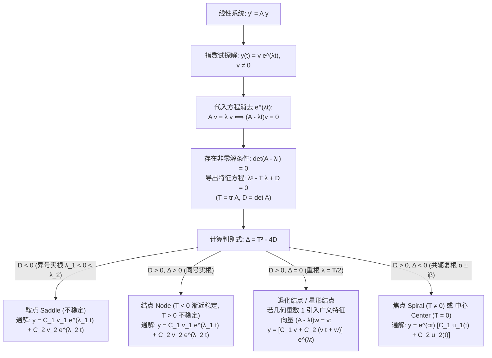

---
tags:
  - 数学/常微分方程
  - 求解技术
  - 技术卡
  - 线性微分方程组
  - 矩阵特征值法
  - 相平面
  - 奇点分类
  - 动力系统稳定性
aliases:
  - 线性微分方程组矩阵特征值法与相平面分类
  - 矩阵特征值法与相平面分类
  - 线性微分方程组
  - 相平面分析
  - 迹-行列式平面
  - Linear Systems of Differential Equations
  - Matrix Eigenvalue Method
  - Phase Plane Analysis
  - Trace-Determinant Plane
created: 2026-09-06
updated: 2026-09-08
---

> [!summary] 技术核心论断
> 一阶常系数齐次线性微分方程组 $\mathbf{y}' = A\mathbf{y}$（$A \in \mathbb{R}^{2\times 2}$）是连接线性代数谱理论与非线性动力系统几何定性理论的“枢纽桥梁”。其代数本质在于**通过矩阵对角化或 Jordan 标准型将多维耦合方程完全解耦**；其几何本质则是将抽象的**特征值谱映射为相平面（Phase Plane）上轨线（Trajectories）拓扑流形**。由矩阵的**迹（Trace）$T$** 与**行列式（Determinant）$D$** 构成的 $(T, D)$ 参数平面，彻底将系统平衡点的拓扑结构归纳为**鞍点（Saddle）、结点（Node）、焦点（Spiral/Focus）与中心（Center）**四大基元，而系统的李雅普诺夫渐近稳定性充要条件简洁地浓缩为 $T < 0$ 且 $D > 0$。

---

## 一、推导机理与规范求解工作流

### 1.1 矩阵特征值法的严格推导

考察平面一阶常系数齐次线性微分方程组：
$$\boxed{\frac{d\mathbf{y}}{dt} = A \mathbf{y}, \qquad A = \begin{pmatrix} a & b \\ c & d \end{pmatrix} \in \mathbb{R}^{2\times 2}, \quad \mathbf{y}(t) = \begin{pmatrix} y_1(t) \\ y_2(t) \end{pmatrix}}$$

#### 推导步骤
1. **代数化假定**：类似于标量方程 $y' = ay$ 的指数解 $y = Ce^{at}$，猜测向量系统拥有同步指数衰减/增长解：
   $$\mathbf{y}(t) = \mathbf{v} e^{\lambda t} \quad (\mathbf{v} \in \mathbb{C}^2 \setminus \{\mathbf{0}\})$$
2. **算子作用代换**：
   $$\frac{d\mathbf{y}}{dt} = \lambda \mathbf{v} e^{\lambda t}, \qquad A \mathbf{y} = A (\mathbf{v} e^{\lambda t}) = (A\mathbf{v}) e^{\lambda t}$$
   代入方程并利用标量指数因子 $e^{\lambda t} \ne 0$ 恒成立，两端约去后得到：
   $$A \mathbf{v} = \lambda \mathbf{v} \iff \boxed{(A - \lambda I)\mathbf{v} = \mathbf{0}}$$
3. **特征多项式展开**：
   该齐次线性方程组存在非零解向量 $\mathbf{v}$ 的充要条件是矩阵奇异，即行列式为零：
   $$\det(A - \lambda I) = \begin{vmatrix} a - \lambda & b \\ c & d - \lambda \end{vmatrix} = (a-\lambda)(d-\lambda) - bc = 0$$
   展开即得**二次特征方程**：
   $$\boxed{\lambda^2 - T \lambda + D = 0}$$
   其中两个不变量为：
   - **迹 (Trace)**：$T = \text{tr}(A) = a + d = \lambda_1 + \lambda_2$；
   - **行列式 (Determinant)**：$D = \det(A) = ad - bc = \lambda_1 \lambda_2$。
4. **特征根求根公式**：
   $$\lambda_{1, 2} = \frac{T \pm \sqrt{T^2 - 4D}}{2}, \qquad \Delta = T^2 - 4D$$

---

### 1.2 亏损矩阵与广义特征向量严格推导

当判别式 $\Delta = T^2 - 4D = 0$ 时，方程拥有重特征根 $\lambda = \frac{T}{2}$（代数重数 $m_a = 2$）。
- **情形 A：几何重数 $m_g = 2$（非亏损）**：
  矩阵 $A - \lambda I = 0$，即 $A = \lambda I$ 为标量矩阵。任意非共线非零向量都是特征向量，轨线为径向射线的**纯星形结点（Proper/Star Node）**，通解为 $\mathbf{y}(t) = (C_1 \mathbf{v}_1 + C_2 \mathbf{v}_2)e^{\lambda t}$。
- **情形 B：几何重数 $m_g = 1$（亏损矩阵 Defective Matrix）**：
  此时方程组 $(A - \lambda I)\mathbf{v} = \mathbf{0}$ 仅存在一个线性无关的特征向量 $\mathbf{v}_1$。系统仅能提供一个基解 $\mathbf{y}_1(t) = \mathbf{v}_1 e^{\lambda t}$。
  **寻找第二个线性无关解**：
  受标量重根 $t e^{\lambda t}$ 启发，设试探解为：
  $$\mathbf{y}_2(t) = (\mathbf{v} t + \mathbf{w}) e^{\lambda t}$$
  对 $\mathbf{y}_2(t)$ 关于 $t$ 求导：
  $$\mathbf{y}_2'(t) = \mathbf{v} e^{\lambda t} + \lambda (\mathbf{v} t + \mathbf{w}) e^{\lambda t} = [ \lambda \mathbf{v} t + (\mathbf{v} + \lambda \mathbf{w}) ] e^{\lambda t}$$
  代入系统右侧：
  $$A \mathbf{y}_2(t) = A (\mathbf{v} t + \mathbf{w}) e^{\lambda t} = [ (A\mathbf{v}) t + A\mathbf{w} ] e^{\lambda t}$$
  对比 $t$ 项系数与常数项系数：
  $$\begin{cases} A \mathbf{v} = \lambda \mathbf{v} \implies (A - \lambda I)\mathbf{v} = \mathbf{0} & (\text{说明 } \mathbf{v} \text{ 是普通特征向量}) \\ A \mathbf{w} = \mathbf{v} + \lambda \mathbf{w} \implies \boxed{(A - \lambda I)\mathbf{w} = \mathbf{v}} & (\text{说明 } \mathbf{w} \text{ 是 1 阶广义特征向量}) \end{cases}$$
  因此，通解完全由普通特征向量 $\mathbf{v}$ 与广义特征向量 $\mathbf{w}$ 确定：
  $$\boxed{\mathbf{y}(t) = C_1 \mathbf{v} e^{\lambda t} + C_2 (\mathbf{v} t + \mathbf{w}) e^{\lambda t}}$$

---

### 1.3 相平面与迹-行列式 $(T, D)$ 拓扑分类全景

假设原点 $(0,0)$ 是系统唯一的孤立平衡点（即 $D = \det A \ne 0$）：

| 奇点类型 (Type) | 特征根代数特征 | 参数代数判据 | 轨线几何构型与渐近行为 | 稳定性态 |
| :--- | :--- | :--- | :--- | :--- |
| **鞍点 (Saddle)** | 互异实根，一正一负 $\lambda_1 < 0 < \lambda_2$ | **$D < 0$** | 存在两对直线轨线（负根对应稳定流形，正根对应不稳定流形），其余轨线呈双曲形态避开原点。 | **不稳定 (Unstable)** |
| **稳定结点 (Stable Node)** | 两个相异负实根 $\lambda_1 < \lambda_2 < 0$ | $D > 0, \; \Delta > 0, \; T < 0$ | 所有轨线随 $t \to +\infty$ 汇聚于原点，且切于较慢衰减的特征方向 $\mathbf{v}_2$。 | **渐近稳定 (Asymptotically Stable)** |
| **不稳定结点 (Unstable Node)** | 两个相异正实根 $0 < \lambda_1 < \lambda_2$ | $D > 0, \; \Delta > 0, \; T > 0$ | 所有轨线随 $t \to +\infty$ 自原点向外发散，且逆时间切于较慢增长的特征方向。 | **不稳定 (Unstable)** |
| **退化/不纯结点 (Improper Node)** | 二重实根 $\lambda_1 = \lambda_2 = \lambda$ 且 $m_g = 1$ | $D > 0, \; \Delta = 0, \; T \ne 0$ | 所有轨线切于唯一的特征向量方向 $\mathbf{v}$ 进入或远离原点，形态扭曲。 | $T < 0$ 稳定；$T > 0$ 不稳定 |
| **稳定焦点 (Stable Spiral)** | 共轭复根 $\alpha \pm i\beta$ 且 $\alpha < 0$ | $D > 0, \; \Delta < 0, \; T < 0$ | 轨线呈对数螺线旋转卷入原点，振荡衰减至零。 | **渐近稳定 (Asymptotically Stable)** |
| **不稳定焦点 (Unstable Spiral)** | 共轭复根 $\alpha \pm i\beta$ 且 $\alpha > 0$ | $D > 0, \; \Delta < 0, \; T > 0$ | 轨线呈对数螺线自原点向外旋转发散。 | **不稳定 (Unstable)** |
| **中心 (Center)** | 纯虚共轭复根 $\pm i\beta$ ($\alpha = 0$) | $D > 0, \; \Delta < 0, \; \mathbf{T = 0}$ | 轨线形成围绕原点嵌套的闭合椭圆族，周期运动无阻尼。 | **中性稳定 / Lyapunov 稳定 (Neutrally Stable)** |

**李雅普诺夫渐近稳定性的代数充要条件**：
$$\boxed{T = \text{tr}(A) < 0 \quad \text{且} \quad D = \det(A) > 0}$$

---

## 二、⚠️ 致命失分陷阱与临界边界

> [!danger] 陷阱 1：亏损矩阵时漏解与误加系数因子
> 当矩阵出现重特征根且亏损（几何重数 1）时：
> - **致命错误写法**：直接猜 $\mathbf{y}_2(t) = t \mathbf{v} e^{\lambda t}$（直接搬用标量常系数方程套路）。
> - **数学事实**：将 $t \mathbf{v} e^{\lambda t}$ 代入系统左端为 $(\mathbf{v} + \lambda t \mathbf{v})e^{\lambda t}$，右端为 $t A \mathbf{v} e^{\lambda t} = \lambda t \mathbf{v} e^{\lambda t}$，两端差了一个常数向量 $\mathbf{v} e^{\lambda t}$，根本不满足方程！
> - **规范操作**：必须补全常数偏移向量 $\mathbf{w}$，严格求解线性代数方程 **$(A - \lambda I)\mathbf{w} = \mathbf{v}$**，通解第二项必须是 **$(\mathbf{v} t + \mathbf{w})e^{\lambda t}$**。

> [!warning] 陷阱 2：焦点与中心的旋转方向（顺时针 vs 逆时针）判别失误
> 特征值只能告诉我们轨线是螺旋还是闭合，**绝对无法直接给出轨线的旋转方向**！
> **标准定向判据（速度矢量测试法）**：
> 在相平面正横轴取测试点 $(y_1, y_2) = (1, 0)$，计算此时切向量的速度场：
> $$\begin{pmatrix} y_1' \\ y_2' \end{pmatrix} = \begin{pmatrix} a & b \\ c & d \end{pmatrix} \begin{pmatrix} 1 \\ 0 \end{pmatrix} = \begin{pmatrix} a \\ c \end{pmatrix}$$
> - 若 **$c > 0$**：在 $(1,0)$ 处纵坐标导数 $y_2' > 0$（指向向上），轨线必定沿 **逆时针方向 (Counter-Clockwise)** 旋转；
> - 若 **$c < 0$**：在 $(1,0)$ 处纵坐标导数 $y_2' < 0$（指向向下），轨线必定沿 **顺时针方向 (Clockwise)** 旋转；
> 绝不可凭空臆测旋转方向！

> [!caution] 陷阱 3：非线性微扰下“中心”结构的拓扑脆弱性
> 在线性近似系统 $\mathbf{y}' = A\mathbf{y}$ 中，当 $T = 0, D > 0$ 时，奇点为中心。
> 但若原系统包含微小的高阶非线性扰动 $\mathbf{y}' = A\mathbf{y} + \mathbf{g}(\mathbf{y})$：
> 线性化判据在实部为零的临界边界 $\text{Re}(\lambda) = 0$ 处**失效（Hartman-Grobman 定理失效区）**！
> 微弱的高阶非线性项将彻底打破闭合椭圆积分守恒，使中心退化为微弱吸引的渐近稳定焦点、微弱排斥的不稳定焦点，或涌现出**孤立极限环（Limit Cycle，如 Hopf 分岔）**。

> [!danger] 陷阱 4：行列式 $D = 0$ 时的奇点退化
> 当 $\det A = 0$ 时，原点不是孤立奇点！
> 此时存在零特征值 $\lambda = 0$。非零平衡点满足 $A\mathbf{y} = \mathbf{0}$，在相平面上构成**整条平衡线（Line of Equilibria）**，所有轨线退化为与该直线平行的直线族或趋于该直线的平行束，常规的四大分类完全不再适用。

---

## 三、经典范例手把手演算与反代验算

### 3.1 经典范例一：鞍点系统全流程解算与几何相图
**题目（Constanda 教材 §7.3 经典例题）**：
求解线性微分方程组并对奇点进行几何拓扑分类：
$$\frac{d\mathbf{y}}{dt} = \begin{pmatrix} 1 & 2 \\ 2 & 1 \end{pmatrix} \mathbf{y} \tag{1}$$

#### 第一步：计算特征值与判别式
系数矩阵 $A = \begin{pmatrix} 1 & 2 \\ 2 & 1 \end{pmatrix}$。
计算矩阵不变量：
- 迹：$T = \text{tr}(A) = 1 + 1 = 2$；
- 行列式：$D = \det(A) = (1)(1) - (2)(2) = 1 - 4 = -3 < 0$。
因为 $D = -3 < 0$，系统必为**鞍点 (Saddle Point)**，原点为**不稳定平衡点**。
写出特征方程：
$$\det(A - \lambda I) = \lambda^2 - 2\lambda - 3 = 0 \implies (\lambda - 3)(\lambda + 1) = 0$$
得到两个异号实特征根：
$$\lambda_1 = 3 > 0, \qquad \lambda_2 = -1 < 0$$

#### 第二步：求解对应的特征向量
1. **对于正特征根 $\lambda_1 = 3$**：
   $$(A - 3I)\mathbf{v}_1 = \begin{pmatrix} 1-3 & 2 \\ 2 & 1-3 \end{pmatrix} \begin{pmatrix} v_{11} \\ v_{12} \end{pmatrix} = \begin{pmatrix} -2 & 2 \\ 2 & -2 \end{pmatrix} \begin{pmatrix} v_{11} \\ v_{12} \end{pmatrix} = \begin{pmatrix} 0 \\ 0 \end{pmatrix}$$
   方程给出 $-2 v_{11} + 2 v_{12} = 0 \implies v_{11} = v_{12}$。
   选取基底向量：
   $$\mathbf{v}_1 = \begin{pmatrix} 1 \\ 1 \end{pmatrix}$$
   *(几何意义：沿直线 $y_2 = y_1$ 的不稳定流形，随 $t \to +\infty$ 呈 $e^{3t}$ 速度发散)*。

2. **对于负特征根 $\lambda_2 = -1$**：
   $$(A - (-1)I)\mathbf{v}_2 = \begin{pmatrix} 1+1 & 2 \\ 2 & 1+1 \end{pmatrix} \begin{pmatrix} v_{21} \\ v_{22} \end{pmatrix} = \begin{pmatrix} 2 & 2 \\ 2 & 2 \end{pmatrix} \begin{pmatrix} v_{21} \\ v_{22} \end{pmatrix} = \begin{pmatrix} 0 \\ 0 \end{pmatrix}$$
   方程给出 $2 v_{21} + 2 v_{22} = 0 \implies v_{22} = -v_{21}$。
   选取基底向量：
   $$\mathbf{v}_2 = \begin{pmatrix} 1 \\ -1 \end{pmatrix}$$
   *(几何意义：沿直线 $y_2 = -y_1$ 的稳定流形，随 $t \to +\infty$ 呈 $e^{-t}$ 速度渐近衰减至原点)*。

#### 第三步：写出系统通解
线性叠加两独立解：
$$\boxed{\mathbf{y}(t) = C_1 \begin{pmatrix} 1 \\ 1 \end{pmatrix} e^{3t} + C_2 \begin{pmatrix} 1 \\ -1 \end{pmatrix} e^{-t} \tag{2}}$$
分量显式形式：
$$\begin{cases} y_1(t) = C_1 e^{3t} + C_2 e^{-t} \\ y_2(t) = C_1 e^{3t} - C_2 e^{-t} \end{cases}$$

#### 第四步：严密反代验算
计算通解对时间导数 $\mathbf{y}'(t)$：
$$\mathbf{y}'(t) = 3 C_1 \begin{pmatrix} 1 \\ 1 \end{pmatrix} e^{3t} - C_2 \begin{pmatrix} 1 \\ -1 \end{pmatrix} e^{-t} = \begin{pmatrix} 3 C_1 e^{3t} - C_2 e^{-t} \\ 3 C_1 e^{3t} + C_2 e^{-t} \end{pmatrix}$$
计算矩阵乘积 $A \mathbf{y}(t)$：
$$A \mathbf{y}(t) = \begin{pmatrix} 1 & 2 \\ 2 & 1 \end{pmatrix} \begin{pmatrix} C_1 e^{3t} + C_2 e^{-t} \\ C_1 e^{3t} - C_2 e^{-t} \end{pmatrix} = \begin{pmatrix} (C_1 e^{3t} + C_2 e^{-t}) + 2(C_1 e^{3t} - C_2 e^{-t}) \\ 2(C_1 e^{3t} + C_2 e^{-t}) + (C_1 e^{3t} - C_2 e^{-t}) \end{pmatrix} = \begin{pmatrix} 3 C_1 e^{3t} - C_2 e^{-t} \\ 3 C_1 e^{3t} + C_2 e^{-t} \end{pmatrix}$$
导数向量与矩阵乘积完全恒等！解严格成立！

---

### 3.2 经典范例二：亏损矩阵重特征根与广义特征向量全流程解算
**题目（Constanda 教材 §7.3 亏损系统经典范例）**：
求解二阶微分方程组并确定通解：
$$\frac{d\mathbf{y}}{dt} = \begin{pmatrix} 1 & -1 \\ 1 & 3 \end{pmatrix} \mathbf{y} \tag{3}$$

#### 第一步：特征值求解
$$A = \begin{pmatrix} 1 & -1 \\ 1 & 3 \end{pmatrix}$$
特征方程：
$$\det(A - \lambda I) = \begin{vmatrix} 1-\lambda & -1 \\ 1 & 3-\lambda \end{vmatrix} = (1-\lambda)(3-\lambda) - (-1)(1) = \lambda^2 - 4\lambda + 4 = 0$$
$$(\lambda - 2)^2 = 0 \implies \lambda = 2 \quad (\text{二重代数重数 } m_a = 2)$$

#### 第二步：寻找特征向量并确认亏损性
解 $(A - 2I)\mathbf{v} = \mathbf{0}$：
$$A - 2I = \begin{pmatrix} 1-2 & -1 \\ 1 & 3-2 \end{pmatrix} = \begin{pmatrix} -1 & -1 \\ 1 & 1 \end{pmatrix}$$
方程为 $-v_1 - v_2 = 0 \implies v_2 = -v_1$。
取特征向量：
$$\mathbf{v} = \begin{pmatrix} 1 \\ -1 \end{pmatrix}$$
矩阵秩为 1，零度（几何重数）为 $2 - 1 = 1 < m_a$。矩阵严重亏损！必须求解广义特征向量。

#### 第三步：求解 1 阶广义特征向量 $\mathbf{w}$
解非齐次代数方程组：
$$(A - 2I)\mathbf{w} = \mathbf{v} \implies \begin{pmatrix} -1 & -1 \\ 1 & 1 \end{pmatrix} \begin{pmatrix} w_1 \\ w_2 \end{pmatrix} = \begin{pmatrix} 1 \\ -1 \end{pmatrix}$$
两行等价于同一个标量方程：
$$-w_1 - w_2 = 1 \implies w_1 + w_2 = -1$$
自由变量任取特解，令 $w_1 = 0$，则 $w_2 = -1$。
得到广义特征向量：
$$\mathbf{w} = \begin{pmatrix} 0 \\ -1 \end{pmatrix}$$

#### 第四步：构建基解系与通解
- 第一个基本解：$\mathbf{y}_1(t) = \mathbf{v} e^{2t} = \begin{pmatrix} 1 \\ -1 \end{pmatrix} e^{2t}$；
- 第二个基本解：$\mathbf{y}_2(t) = (\mathbf{v} t + \mathbf{w}) e^{2t} = \left[ \begin{pmatrix} 1 \\ -1 \end{pmatrix} t + \begin{pmatrix} 0 \\ -1 \end{pmatrix} \right] e^{2t} = \begin{pmatrix} t \\ -t-1 \end{pmatrix} e^{2t}$。
因此通解为：
$$\boxed{\mathbf{y}(t) = C_1 \begin{pmatrix} 1 \\ -1 \end{pmatrix} e^{2t} + C_2 \left[ \begin{pmatrix} 1 \\ -1 \end{pmatrix} t + \begin{pmatrix} 0 \\ -1 \end{pmatrix} \right] e^{2t} \tag{4}}$$

#### 第五步：反代验算第二个解 $\mathbf{y}_2(t)$
1. 对 $\mathbf{y}_2(t)$ 求导：
   $$\mathbf{y}_2'(t) = \begin{pmatrix} 1 \\ -1 \end{pmatrix} e^{2t} + 2 \begin{pmatrix} t \\ -t-1 \end{pmatrix} e^{2t} = \begin{pmatrix} 1 + 2t \\ -1 - 2t - 2 \end{pmatrix} e^{2t} = \begin{pmatrix} 2t + 1 \\ -2t - 3 \end{pmatrix} e^{2t}$$
2. 计算矩阵作用 $A \mathbf{y}_2(t)$：
   $$A \mathbf{y}_2(t) = \begin{pmatrix} 1 & -1 \\ 1 & 3 \end{pmatrix} \begin{pmatrix} t \\ -t-1 \end{pmatrix} e^{2t} = \begin{pmatrix} t - (-t-1) \\ t + 3(-t-1) \end{pmatrix} e^{2t} = \begin{pmatrix} 2t + 1 \\ -2t - 3 \end{pmatrix} e^{2t}$$
两端完全恒等！广义特征向量解完全闭环！

---

## 四、出处与纸质笔记坐标

- **权威教材出处**：
  - **C. Constanda**: *Differential Equations: A Primer for Scientists and Engineers*
    - Chapter 7: Systems of Differential Equations
    - §7.3 The Eigenvalue Method for Linear Systems (原书 P161-P170)
    - §7.4 Phase Plane Analysis and Critical Points (原书 P171-P180)
    - §7.5 The Trace-Determinant Plane and Stability (原书 P181-P187)
  - **E.A. Coddington**: *An Introduction to Ordinary Differential Equations*
    - Chapter 6: Two-Dimensional Linear Systems and Phase Portraits (原书 P220-P250)
- **对应全景图**：[[00_常微分方程_学习全景图]]
- **纸质活页定位**：`[活页-ODE-12]`