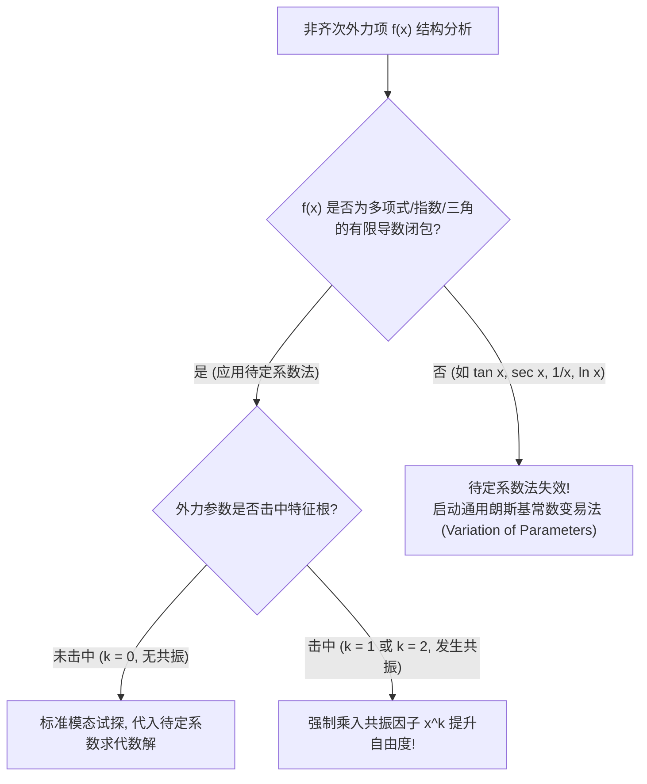

---
tags:
  - 数学/常微分方程
  - 求解技术
  - 技术卡
  - 非齐次方程
  - 待定系数法
  - 共振陷阱
  - 常数变易法
aliases:
  - 非齐次方程待定系数法与共振陷阱
  - 待定系数法
  - 非齐次常微分方程
  - 共振因子与受迫振动
  - 高阶常数变易法
  - Method of Undetermined Coefficients
  - Resonance and Variation of Parameters
created: 2026-09-06
updated: 2026-09-08
---

> [!summary] 技术核心论断
> 非齐次线性微分方程 $a y'' + b y' + c y = f(x)$ 描述了动力系统在**外界持续扰动驱动下的受迫响应（Forced Response）**。当非齐次外力源 $f(x)$ 具有有限阶导数闭包结构（多项式、指数、正弦余弦及其复合乘积）时，**待定系数法（Method of Undetermined Coefficients）**能够以极其高效的代数试探直接锁定特解 $y_p$。然而，该方法潜伏着整个动力学中最具破坏性的暗礁——**共振陷阱（Resonance Trap）**：当外力的驱动频率恰好与系统的固有频率发生重合时，微分算子将原试探基元直接“吞噬”抵消为零，必须乘上阶数因子 $x^k$ 才能成功激发特解；而若外力呈现非常规非初等形态（如 $\tan x, \sec x, 1/x$），则必须切换至无视形式约束的普适核武器——**通用常数变易法（Variation of Parameters）**。

---

## 一、推导机理与规范求解工作流

### 1.1 待定系数法两大经典外力模态表

考虑二阶常系数非齐次线性方程：
$$a y'' + b y' + c y = f(x) \tag{1}$$
特征方程为 $P(r) = a r^2 + b r + c = 0$。非齐次特解 $y_p(x)$ 的试探形态由 $f(x)$ 的数学类型与特征根的重数 $k$ 共同唯一确定：

#### 模态一：多项式与指数复合型 $f(x) = P_m(x) e^{\lambda x}$
其中 $P_m(x)$ 为 $m$ 次多项式，$\lambda \in \mathbb{R}$ 为指数参数。
特解设定形式为：

$$\boxed{y_p(x) = x^k Q_m(x) e^{\lambda x} = x^k (A_m x^m + A_{m-1} x^{m-1} + \dots + A_1 x + A_0) e^{\lambda x}}$$

- **共振指数 $k$ 判定法则**：
  - 若 $\lambda$ 不是特征方程的根，取 **$k = 0$**（无共振）；
  - 若 $\lambda$ 是特征方程的单实根，取 **$k = 1$**（一阶共振，振幅随时间线性发散）；
  - 若 $\lambda$ 是特征方程的二重实根，取 **$k = 2$**（严重共振，振幅随时间二次抛物发散）。

---

#### 模态二：多项式、指数与正弦余弦复合型 $f(x) = e^{\alpha x} [P_l(x) \cos(\beta x) + Q_n(x) \sin(\beta x)]$
记最高多项式次数为 $m = \max(l, n)$。
特解设定形式必须**同时包含正弦与余弦对称对偶项**：

$$\boxed{y_p(x) = x^k e^{\alpha x} [R_m(x) \cos(\beta x) + S_m(x) \sin(\beta x)]}$$

- **共振指数 $k$ 判定法则**：
  - 构造复参数 $\sigma = \alpha + i \beta$；
  - 若 $\sigma = \alpha + i \beta$ 不是特征方程的根，取 **$k = 0$**；
  - 若 $\sigma = \alpha + i \beta$ 恰好是特征方程的单复根，取 **$k = 1$**（机械物理受迫共振灾难，塔科马海峡大桥风振模型！）。

---

### 1.2 为什么必须乘以 $x^k$？共振因子的代数微积分本原证明

设微分算子为 $L = a D^2 + b D + c$。若 $\lambda$ 是特征方程的 $k$ 重根，则由代数基本定理，特征多项式必可分解为：
$$P(D) = (D - \lambda)^k Q(D) \quad (Q(\lambda) \ne 0)$$
当将未乘 $x^k$ 的常规形式 $u(x) e^{\lambda x}$ 输入算子时，由指数移位算子定理：
$$L[u(x) e^{\lambda x}] = e^{\lambda x} P(D + \lambda)[u(x)] = e^{\lambda x} D^k Q(D + \lambda)[u(x)]$$
- 若取 $u(x) = Q_m(x)$，对多项式求导 $D^k$ 会导致常数项全部归零；特别地当 $m=0$ 时，$D^k[A] = 0$，算子作用后**恒等于零**！这表明该形式被齐次核空间完全吞噬，右端永远无法匹配出非零外力；
- 唯有在试探项中乘入 **$x^k$**，由于 $\frac{d^k}{dx^k}[x^k] = k! \ne 0$，求导 $k$ 次后方能恰好抵消零化算子，在右端精确释放出非零的非齐次项！这就是共振因子 $x^k$ 的纯代数根源。

---

### 1.3 普适核武器：二阶常数变易法 (Variation of Parameters)

对于任意连续外力 $f(x)$（哪怕 $f(x) = \tan x$ 或 $f(x) = \frac{1}{x}$）：
设齐次基本解系为 $y_1(x), y_2(x)$，朗斯基行列式为 $W(x) = y_1 y_2' - y_1' y_2$。
假设特解形式为 $y_p(x) = u_1(x) y_1(x) + u_2(x) y_2(x)$。
施加拉格朗日约束条件 $u_1' y_1 + u_2' y_2 = 0$，联立解出导数：
$$\begin{cases} u_1' y_1 + u_2' y_2 = 0 \\ a(u_1' y_1' + u_2' y_2') = f(x) \end{cases} \implies \begin{cases} u_1'(x) = -\dfrac{y_2(x) f(x)}{a W(x)} \\ u_2'(x) = \dfrac{y_1(x) f(x)}{a W(x)} \end{cases}$$
积分立即导出**二阶非齐次特解的万能闭合求积公式**：

$$\boxed{y_p(x) = -y_1(x) \int \frac{y_2(x) f(x)}{a W(y_1, y_2)(x)} dx + y_2(x) \int \frac{y_1(x) f(x)}{a W(y_1, y_2)(x)} dx}$$

---

## 二、⚠️ 致命失分陷阱与临界边界

> [!warning] 陷阱 1：共振盲区——漏乘 $x$ 导致方程联立得出“$0 = 1$”的荒谬死循环
> 考查方程：$y'' + y = \cos x$。
> 特征方程 $r^2 + 1 = 0 \implies r = \pm i$。外力 $\cos x$ 对应的复参数为 $0 + 1i = i$，**恰为单特征根 ($k = 1$)**！
> 若未识别共振，盲目设 $y_p = A \cos x + B \sin x$：
> 计算二阶导数：$y_p'' = -A \cos x - B \sin x = -y_p$；
> 代入原方程左侧：$y_p'' + y_p = (-y_p) + y_p \equiv 0$！
> 得到矛盾等式：$0 = \cos x$。所有未知常数全部抵消消失，无法解出任何结果！
> **唯一正解**：必须乘以共振因子 $x^1$，设 $y_p = x (A \cos x + B \sin x)$。

> [!caution] 陷阱 2：正弦或余弦单项出现时，试探解中遗漏对偶项
> 若外力仅包含正弦项 $f(x) = \sin(2x)$，初学者常犯直觉错误：以为特解也仅需设 $y_p = A \sin(2x)$。
> **致命缺陷**：若方程中包含一阶导数项 $b y'$，求导后 $\frac{d}{dx}[\sin 2x] = 2\cos 2x$ 会在左侧激发处余弦项！
> 若试探解中未配备余弦项 $B \cos(2x)$，将导致余弦系数无从平衡。
> **法则**：只要外力包含 $\sin$ 或 $\cos$ 中任意一个，试探解**必须无条件同时包含 $\cos$ 与 $\sin$ 两项**！

> [!danger] 陷阱 3：在非适用函数上硬套待定系数法
> 待定系数法成立的铁律是：外力反复求导后所产生的新函数集合必须是**有限维线性空间**。
> 对于形如 $f(x) = \tan x, \sec x, \frac{1}{x}, \ln x, \frac{1}{1+e^x}$ 等函数：
> 其导数序列 $\sec^2 x, 2\sec^2 x \tan x, \dots$ 会源源不断生成无限多个互不相关的非线性函数项，待定系数法彻底失效！此时硬套必全题尽墨，必须且只能使用常数变易法。

---

## 三、经典范例手把手演算与反代验算

### 3.1 经典例题：纯共振受迫振动初值问题全流程解算
**题目（Constanda 教材 §4.5 经典考题，物理无阻尼共振爆破模型）**：
求解二阶常系数非齐次线性微分方程的初值问题：
$$y'' + 9y = 6\sin(3x), \qquad y(0) = 1, \quad y'(0) = 0 \tag{1}$$

#### 第一步：求解对应齐次方程的通解
齐次微分方程为：
$$y'' + 9y = 0$$
特征方程为：
$$r^2 + 9 = 0 \implies r^2 = -9 \implies r = \pm 3i$$
特征根为纯虚数：$\alpha = 0, \beta = 3$。
齐次基本解系为 $\cos(3x)$ 与 $\sin(3x)$。
齐次通解为：
$$y_h(x) = C_1 \cos(3x) + C_2 \sin(3x) \tag{2}$$

#### 第二步：识别共振状态与设定非齐次特解
分析外力项 $f(x) = 6\sin(3x)$：
- 外力角频率为 $\omega = 3$；
- 对应的特征根参数为 $\sigma = 0 + 3i = 3i$；
- 对比齐次特征根 $r = \pm 3i$，**外力频率与系统固有本征频率完全重叠！**
- $\sigma = 3i$ 是特征方程的**单重特征根**，共振重度为 **$k = 1$**！
因此，特解必须强制乘以共振因子 $x^1$，设定为：
$$\boxed{y_p(x) = x [A \cos(3x) + B \sin(3x)] = A x \cos(3x) + B x \sin(3x) \tag{3}}$$

#### 第三步：求导代入方程锁定待定系数 $A, B$
计算特解的一阶导数 $y_p'(x)$：
$$\begin{aligned}
y_p'(x) &= [A \cos(3x) + B \sin(3x)] + x [-3A \sin(3x) + 3B \cos(3x)] \\
&= (A + 3Bx) \cos(3x) + (B - 3Ax) \sin(3x)
\end{aligned}$$
计算特解的二阶导数 $y_p''(x)$：
$$\begin{aligned}
y_p''(x) &= 3B \cos(3x) - 3(A + 3Bx) \sin(3x) - 3A \sin(3x) + 3(B - 3Ax) \cos(3x) \\
&= [3B + 3(B - 3Ax)] \cos(3x) + [-3(A + 3Bx) - 3A] \sin(3x) \\
&= (6B - 9Ax) \cos(3x) + (-6A - 9Bx) \sin(3x)
\end{aligned}$$
代入原方程左侧 $y_p'' + 9y_p$：
$$\begin{aligned}
y_p'' + 9y_p &= [(6B - 9Ax) \cos(3x) + (-6A - 9Bx) \sin(3x)] + 9 [A x \cos(3x) + B x \sin(3x)] \\
&= (6B - 9Ax + 9Ax) \cos(3x) + (-6A - 9Bx + 9Bx) \sin(3x) \\
&= 6B \cos(3x) - 6A \sin(3x)
\end{aligned}$$
**惊艳消去**：所有含自变量 $x$ 的共振项 $-9Ax$ 与 $-9Bx$ 干净利落地相互抵消！
强制令其恒等于右端外力 $6\sin(3x) = 0 \cos(3x) + 6\sin(3x)$：
$$\begin{cases} 6B = 0 \implies B = 0 \\ -6A = 6 \implies A = -1 \end{cases}$$
解得待定系数：$A = -1, B = 0$。
代回式 (3)，求得非齐次特解：
$$\boxed{y_p(x) = -x \cos(3x)}$$

#### 第四步：构建完全通解
$$y(x) = y_h(x) + y_p(x) = C_1 \cos(3x) + C_2 \sin(3x) - x \cos(3x) \tag{4}$$

#### 第五步：代入初值精确锁定积分常数
求原函数导数：
$$y'(x) = -3C_1 \sin(3x) + 3C_2 \cos(3x) - [\cos(3x) - 3x \sin(3x)]$$
代入初始条件 $y(0) = 1, y'(0) = 0$：
1. 代入 $y(0) = 1$：
   $$y(0) = C_1 \cos(0) + C_2 \sin(0) - 0 = C_1 \cdot 1 + 0 - 0 = C_1 = 1 \implies C_1 = 1$$
2. 代入 $y'(0) = 0$：
   $$y'(0) = 0 + 3C_2 \cos(0) - [\cos(0) - 0] = 3C_2(1) - 1 = 0 \implies 3C_2 = 1 \implies C_2 = \frac{1}{3}$$
特解函数唯一锁定为：
$$\boxed{y(x) = \cos(3x) + \frac{1}{3}\sin(3x) - x \cos(3x)}$$

#### 第六步：反代微分方程自洽核验
1. **初值核对**：
   - $y(0) = \cos 0 + \frac{1}{3}\sin 0 - 0 = 1 + 0 - 0 = 1$（吻合！）；
   - $y'(x) = -3\sin 3x + \cos 3x - \cos 3x + 3x \sin 3x = -3\sin 3x + 3x \sin 3x \implies y'(0) = 0$（吻合！）。
2. **微分方程逐项代回**：
   求二阶导数：
   $$y''(x) = \frac{d}{dx}[-3\sin 3x + 3x \sin 3x] = -9\cos 3x + 3\sin 3x + 9x \cos 3x$$
   代入原微分方程左端 $y'' + 9y$：
   $$\begin{aligned}
   y'' + 9y &= (-9\cos 3x + 3\sin 3x + 9x \cos 3x) + 9 \left( \cos 3x + \frac{1}{3}\sin 3x - x \cos 3x \right) \\
   &= -9\cos 3x + 3\sin 3x + 9x \cos 3x + 9\cos 3x + 3\sin 3x - 9x \cos 3x \\
   &= (-9 + 9)\cos 3x + (3 + 3)\sin 3x + (9 - 9)x \cos 3x \\
   &= 0 + 6\sin(3x) + 0 = 6\sin(3x)
   \end{aligned}$$
   与方程右端外力完全恒等一致！共振解析验证无懈可击！

---

## 四、出处与纸质笔记坐标

- **权威教材出处**：
  - **C. Constanda**: *Differential Equations: A Primer for Scientists and Engineers*
    - Chapter 4: Second-Order Linear Equations
    - §4.5 Nonhomogeneous Equations (原书 P93-P107, Examples 4.17-4.25)
    - Chapter 5: Forced Oscillations and Resonance (原书 P115-P127)
  - **E.A. Coddington**: *An Introduction to Ordinary Differential Equations*
    - Chapter 2: Linear Equations with Constant Coefficients (原书 P89-P102)
- **对应全景图**：[[00_常微分方程_学习全景图]]
- **纸质活页定位**：`[活页-ODE-10]`