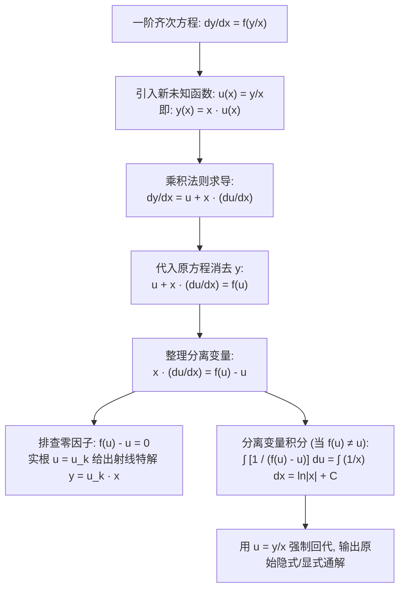

---
tags:
  - 数学/常微分方程
  - 求解技术
  - 技术卡
  - 齐次方程
  - 变量代换
  - 极坐标变换
  - 旋涡流场
aliases:
  - 齐次极坐标方程与变量代换法
  - 齐次微分方程
  - 欧拉齐次变换
  - 极坐标微分方程
  - Homogeneous Differential Equations
  - Polar Coordinate Transformation in ODEs
created: 2026-09-06
updated: 2026-09-08
---

> [!summary] 技术核心论断
> 齐次微分方程（Homogeneous ODE）揭示了微分系统在**均匀几何尺度伸缩下的各向同性对称（Scale Invariance）**。当一阶方程右端仅取决于纵横坐标之比 $\frac{y}{x}$ 时，笛卡尔平面上的非分离交织结构，通过代数代换 $y = u x$ 能瞬间崩解降维为一维可分离变量方程；而当微分形式中自然浮现出具有同心圆或旋涡旋转特征的对称结构（如微元组合 $x dx + y dy$ 与 $x dy - y dx$）时，强行采用直角坐标代换往往陷入高次代数泥潭，此时切换至**极坐标变换（Polar Transformation）** $x = r\cos\theta, y = r\sin\theta$，便能以近乎神迹的几何几何直观直接解耦径向距离 $r$ 与回转角 $\theta$。

---

## 一、推导机理与规范求解工作流

### 1.1 齐次函数的数学定义与判据

设二元函数 $f(x, y)$ 定义于某个锥形平面区域上。若存在实数 $k$，对任意非零参数 $t \in \mathbb{R}$ 恒有：
$$\boxed{f(tx, ty) = t^k f(x, y)}$$
则称 $f(x, y)$ 为 **$k$ 次齐次函数 (Homogeneous Function of Degree $k$)**。

#### 一阶齐次微分方程的标准判据
对于微分形式 $M(x, y) dx + N(x, y) dy = 0$：
- 若 $M(x, y)$ 与 $N(x, y)$ 均为同次数 $k$ 的齐次函数；
- 则移项解出导数后，取 $t = \frac{1}{x}$（设 $x \ne 0$）：
  $$\frac{dy}{dx} = -\frac{M(x, y)}{N(x, y)} = -\frac{x^k M\left(1, \frac{y}{x}\right)}{x^k N\left(1, \frac{y}{x}\right)} = g\left( \frac{y}{x} \right)$$
因此，**一阶齐次方程的充要特征是导数仅依赖于比值 $\frac{y}{x}$**：

$$\boxed{\frac{dy}{dx} = f\left( \frac{y}{x} \right)}$$

---

### 1.2 欧拉齐次变量代换法（直角坐标流水线）

#### 规范推导细节
1. **代换设置**：令 $y = u(x) \cdot x$；
2. **乘积求导**：$\frac{dy}{dx} = u + x \frac{du}{dx}$；
3. **代入方程**：
   $$u + x \frac{du}{dx} = f(u) \implies x \frac{du}{dx} = f(u) - u$$
4. **分离变量**：
   $$\boxed{\frac{1}{f(u) - u} du = \frac{1}{x} dx}$$
   两边对 $u$ 和 $x$ 分别积分即化解为初等微积分求积。

---

### 1.3 极坐标系下的全微分几何解耦原理

在许多流体力学与电磁场问题中，方程往往呈现出环状或对流对称。
引入极坐标变换：
$$\begin{cases} x = r \cos\theta \\ y = r \sin\theta \end{cases} \quad (r \ge 0, \; \theta \in [0, 2\pi))$$
计算其全微分：
$$\begin{aligned}
dx &= \cos\theta dr - r \sin\theta d\theta \\
dy &= \sin\theta dr + r \cos\theta d\theta
\end{aligned}$$

#### 两大神奇几何代数恒等式（必须死记硬背）
$$\boxed{\begin{aligned}
x dx + y dy &= r dr = \frac{1}{2} d(r^2) \\
x dy - y dx &= r^2 d\theta
\end{aligned}}$$

- **物理直觉**：
  - $x dx + y dy = 0$ 描述的是以原点为中心的同心圆簇（纯径向垂直）；
  - $x dy - y dx = 0$ 描述的是由原点发散的光线簇（纯角向垂直）。
- **应用场景**：若微分方程中显式包含 $x dx + y dy$ 与 $x dy - y dx$ 的组合项（如形如 $(x + y)dx + (y - x)dy = 0$），立即改用极坐标，方程将直接蜕变为 $r$ 与 $\theta$ 的极简分离变量形式！

---

## 二、⚠️ 致命失分陷阱与临界边界

> [!warning] 陷阱 1：遗漏代数根 $f(u) - u = 0$ 对应的直线特解
> 在分离变量 $\frac{du}{f(u) - u} = \frac{dx}{x}$ 前，必须令分母 $f(u) - u = 0$：
> 若方程存在实数根 $u = c$，则必有常数解 $u(x) \equiv c$。
> 回代后得到过原点的**直线解**：
> $$\boxed{y(x) = c \cdot x}$$
> 此解往往无法由积分后含对数任意常数 $C$ 的通解公式表示，是必须单独补全的**奇解 / 边界解**！

> [!caution] 陷阱 2：在 $\frac{y}{x}$ 极其复杂时，固执死板不愿反向设 $x = v y$
> 考虑方程 $\frac{dy}{dx} = \frac{y}{x + y \sqrt{y/x}}$：
> 若设 $y = u x$，导数倒数极度繁琐；
> 此时应立刻将自变量与未知函数地位对调，考虑 $\frac{dx}{dy}$，设 $x = v(y) \cdot y$！
> 对称换元法：
> $$\frac{dx}{dy} = v + y \frac{dv}{dy}$$
> 能以极其对称简洁的代数形式破局。

> [!danger] 陷阱 3：在跨越坐标轴 $x = 0$ 时忽略奇异性
> 齐次变换 $u = \frac{y}{x}$ 在 $y$ 轴（$x = 0$）上无定义。
> 所求通解通常严格限制在半平面 $x > 0$ 或 $x < 0$ 内。若初值问题给出 $x_0 = 0$ 处的条件，必须以 $y$ 为自变量展开，不可强行套用除以 $x$ 的公式。

---

## 三、经典范例手把手演算与反代验算

### 3.1 经典例题：对流旋涡微分方程的双法求解（代数代换 vs 极坐标变换）
**题目（Constanda 教材 §2.3 核心精选范题，物理旋转流场模型）**：
求解一阶齐次微分方程：
$$(x - y) dx + (x + y) dy = 0 \tag{1}$$
满足初值条件 $y(1) = 0$。

---

#### 途径 A：规范欧拉齐次代换法 ($y = ux$)

#### 第一步：改写为标准导数型
将式 (1) 化解出 $\frac{dy}{dx}$：
$$(x + y) dy = -(x - y) dx = (y - x) dx$$
两边同除以 $x$（$x \ne 0$）：
$$\frac{dy}{dx} = \frac{y - x}{x + y} = \frac{\frac{y}{x} - 1}{1 + \frac{y}{x}}$$
确认右端为纯比值函数 $f(u) = \frac{u - 1}{u + 1}$，为标准齐次方程。

#### 第二步：引入代换并求导展开
令 $y = u x \implies \frac{dy}{dx} = u + x \frac{du}{dx}$：
$$u + x \frac{du}{dx} = \frac{u - 1}{u + 1}$$
移项通分：
$$x \frac{du}{dx} = \frac{u - 1}{u + 1} - u = \frac{u - 1 - u(u + 1)}{u + 1} = \frac{u - 1 - u^2 - u}{u + 1} = -\frac{u^2 + 1}{u + 1}$$

#### 第三步：零因子排查与分离变量
分母因子 $u^2 + 1 = 0$ 在实数域**无实根**！故无多余常数直线解。
分离变量：
$$\frac{u + 1}{u^2 + 1} du = -\frac{1}{x} dx$$
拆分左端为两项基本微积分形式：
$$\left( \frac{u}{u^2 + 1} + \frac{1}{u^2 + 1} \right) du = -\frac{1}{x} dx$$

#### 第四步：双端不定积分
$$\int \frac{u}{u^2 + 1} du + \int \frac{1}{u^2 + 1} du = -\int \frac{1}{x} dx$$
$$\frac{1}{2} \ln(u^2 + 1) + \arctan u = -\ln|x| + C$$
两边同乘以 2，并将 $\ln|x|$ 项移至左侧：
$$\ln(u^2 + 1) + 2\ln|x| + 2\arctan u = 2C$$
利用对数性质合并：$\ln[(u^2 + 1) x^2] = \ln(u^2 x^2 + x^2)$：
$$\ln(x^2 + y^2) + 2\arctan\left(\frac{y}{x}\right) = C_1 \tag{2}$$

#### 第五步：代入初值 $x = 1, y = 0$
代入初值点 $(1, 0)$：
$$\ln(1^2 + 0^2) + 2\arctan\left(\frac{0}{1}\right) = \ln(1) + 2\arctan(0) = 0 + 0 = C_1 \implies C_1 = 0$$
特解隐式关系式为：
$$\boxed{\ln(x^2 + y^2) + 2\arctan\left(\frac{y}{x}\right) = 0}$$

---

#### 途径 B：极坐标变换几何秒杀法（对偶对照）

整理原式 (1)：
$$(x dx + y dy) + (x dy - y dx) = 0$$
应用极坐标微分恒等式 $x dx + y dy = r dr$ 与 $x dy - y dx = r^2 d\theta$：
$$r dr + r^2 d\theta = 0$$
当 $r \ne 0$ 时，两边同除以 $r^2$：
$$\frac{1}{r} dr + d\theta = 0$$
瞬间变量完全分离！直接积分：
$$\ln r + \theta = C_0$$
初值 $x = 1, y = 0 \implies r = 1, \theta = 0$：
$$\ln 1 + 0 = C_0 \implies C_0 = 0$$
故极坐标解为：
$$\ln r + \theta = 0 \implies r = e^{-\theta}$$
代回 $r = \sqrt{x^2 + y^2}$ 与 $\theta = \arctan(y/x)$：
$$\ln\sqrt{x^2 + y^2} + \arctan\left(\frac{y}{x}\right) = 0 \iff \ln(x^2 + y^2) + 2\arctan\left(\frac{y}{x}\right) = 0$$
两套方法得出的几何隐式解完全无缝等价！极坐标法仅用 3 行代数演算便彻底击穿问题！

#### 第六步：反代隐函数微分核验
对隐式解 $F(x, y) = \ln(x^2 + y^2) + 2\arctan(y/x) = 0$ 实施全微分核查：
$$\frac{\partial F}{\partial x} = \frac{2x}{x^2 + y^2} + 2 \frac{-\frac{y}{x^2}}{1 + \left(\frac{y}{x}\right)^2} = \frac{2x - 2y}{x^2 + y^2}$$
$$\frac{\partial F}{\partial y} = \frac{2y}{x^2 + y^2} + 2 \frac{\frac{1}{x}}{1 + \left(\frac{y}{x}\right)^2} = \frac{2y + 2x}{x^2 + y^2}$$
由隐函数求导法则：
$$\frac{dy}{dx} = -\frac{\frac{\partial F}{\partial x}}{\frac{\partial F}{\partial y}} = -\frac{2(x - y)}{2(x + y)} = \frac{y - x}{x + y}$$
与原方程 (1) 展开的导数表达式完全恒等吻合！验算完美闭环！

---

## 四、出处与纸质笔记坐标

- **权威教材出处**：
  - **C. Constanda**: *Differential Equations: A Primer for Scientists and Engineers*
    - Chapter 2: First-Order Equations
    - §2.3 Homogeneous Polar Equations (原书 P35-P38, Examples 2.15-2.17)
  - **E.A. Coddington**: *An Introduction to Ordinary Differential Equations*
    - Chapter 1: Linear Equations of First Order (原书 P22-P26)
- **对应全景图**：[[00_常微分方程_学习全景图]]
- **纸质活页定位**：`[活页-ODE-03]`
