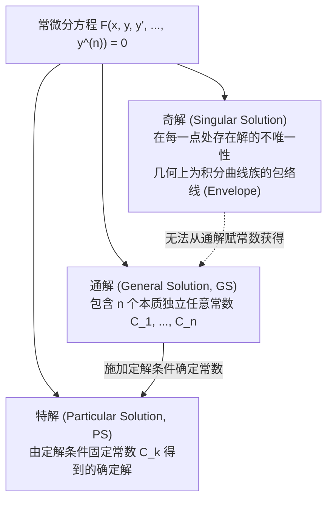
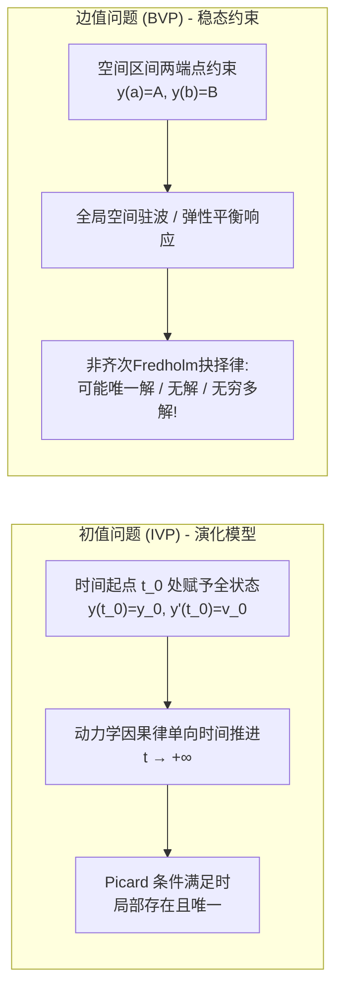

---
tags:
  - 数学/常微分方程
  - 基础概念
  - 概念卡
  - 初值问题
  - 边值问题
  - 方向场
  - 解的本质
aliases:
  - 微分方程与解的本质(IVP与BVP)
  - 微分方程与解的本质
  - 初值问题与边值问题
  - 通解特解与奇解
  - IVP与BVP
  - Nature of Differential Equations and Solutions
  - Initial Value Problems and Boundary Value Problems
created: 2026-09-06
updated: 2026-09-08
---

> [!summary] 核心认知先验
> 微分方程（Differential Equations, DE）是人类刻画现实动态连续演化世界的核心数学语言。在经典微积分中，求导是一种确定性的局部“微观变化率探测”；而微分方程的求解，则是从局部导数约束反向重建宏观整体状态的“全局积分重塑”。未附加任何约束的**通解（General Solution, GS）**构成了一个带自由参数的无限积分曲线族；而为了使物理系统具有因果可预测性，必须施加定解条件。约束全部施加于单一基准点的**初值问题（Initial Value Problem, IVP）**反映了时间单向因果演化，局部往往具备唯一确定性；而约束分布于空间多端点的**边值问题（Boundary Value Problem, BVP）**则刻画了空间稳态场分布，即使方程完全线性且系数极其光滑，解也可能呈现“唯一、无穷多、或彻底无解”的本征谐振多态性。

---

## 一、推导机理与核心数学定义

### 1.1 常微分方程的形式化定义与分类阶数

设未知函数为单变量实函数 $y = y(x)$（或以时间为自变量 $y = y(t)$）。
一般 $n$ 阶常微分方程的隐式定义形式为：
$$\boxed{F(x, y, y', y'', \dots, y^{(n)}) = 0}$$
若能将最高阶导数显式解出，则称为已解出最高阶导数的**显式标准型**：
$$y^{(n)} = f(x, y, y', \dots, y^{(n-1)})$$

#### 核心分类维度
1. **常微分方程 (ODE) vs 偏微分方程 (PDE)**：ODE 仅包含单一独立自变量，所求导数为全导数 $\frac{dy}{dx}$；PDE 则涉及两个及以上自变量，包含偏导数 $\frac{\partial u}{\partial t}, \frac{\partial^2 u}{\partial x^2}$；
2. **方程阶数 (Order)**：方程中所出现的未知函数导数的**最高阶数** $n$；
3. **线性 (Linear) vs 非线性 (Nonlinear)**：若方程关于未知函数 $y$ 及其各阶导数 $y', y'', \dots, y^{(n)}$ 均为一次齐次多项式，即能写为：
   $$a_n(x) y^{(n)} + a_{n-1}(x) y^{(n-1)} + \dots + a_1(x) y' + a_0(x) y = g(x)$$
   则称为 **$n$ 阶线性微分方程**；只要出现 $y^2, \sin y, y y'$ 等非线性项，即为非线性方程。

---

### 1.2 解的严格数学定义与谱系分类

设函数 $\phi(x)$ 定义于区间 $I \subset \mathbb{R}$ 上，且在 $I$ 上具有直至 $n$ 阶连续导数。若将 $y = \phi(x)$ 代入方程后恒等式 $F(x, \phi(x), \phi'(x), \dots, \phi^{(n)}(x)) \equiv 0$ 对任意 $x \in I$ 恒成立，则称 $\phi(x)$ 为方程在区间 $I$ 上的一个**显式解 (Explicit Solution)**。

1. **通解 (General Solution, GS)**：包含 $n$ 个相互独立的任意常数 $C_1, C_2, \dots, C_n$ 的解族：
   $$\Phi(x, y, C_1, C_2, \dots, C_n) = 0$$
   几何上，通解代表二维平面内由参数 $C_k$ 调控的**单参数或多参数积分曲线族 (Family of Integral Curves)**；
2. **特解 (Particular Solution, PS)**：通过给通解中的任意常数 $C_k$ 赋予具体数值而得到的无自由参数的单一解；
3. **隐式解 (Implicit Solution)**：若二元关系 $\Phi(x, y) = 0$ 在区间内隐式确定了一个或多个显式解函数 $y = \phi(x)$，则称 $\Phi(x, y) = 0$ 为方程的隐式解；
4. **奇解 (Singular Solution)**：微分方程的解，且在该解曲线上的**每一点处，都有至少另一条不同的解曲线与其相切相交**（破坏局部唯一性）。**奇解绝对无法通过给通解中的任意常数取有限值而获得**，在几何上，奇解恰好是通解积分曲线族的**包络线 (Envelope)**。

---

### 1.3 几何视角：方向场 (Direction Field) 与积分曲线

对于一阶标准方程 $y' = f(x, y)$：
- 在平面每一点 $(x_0, y_0)$，导数值 $f(x_0, y_0)$ 给出了穿过该点的解曲线切线的斜率 $k$；
- 在网格点上绘制带有斜率 $f(x, y)$ 的微元线段，所形成的几何图样称为**方向场（斜率场，Direction Field）**；
- **微分方程求解的几何本质**：在方向场中顺着切线微元流动，拼接出一条光滑的连续曲线，此即**积分曲线**；
- 满足 $f(x, y) = C$（$C$ 为常数）的平面曲线称为**等斜线 (Isoclines)**，沿同一条等斜线上的所有切线微元彼此严格平行。

---

### 1.4 初值问题 (IVP) 与边值问题 (BVP) 的本质对立

为了在由无穷多条积分曲线组成的通解族中筛选出契合物理真实世界的唯一确定特解，必须施加外部物理约束：

$$\boxed{\begin{aligned}
\text{初值问题 (IVP):} \quad & \begin{cases} y^{(n)} = f(x, y, y', \dots, y^{(n-1)}) \\ y(x_0) = y_0, \; y'(x_0) = y_1, \; \dots, \; y^{(n-1)}(x_0) = y_{n-1} \end{cases} \\
\text{边值问题 (BVP):} \quad & \begin{cases} y'' = f(x, y, y') \quad (a < x < b) \\ \alpha_1 y(a) + \beta_1 y'(a) = \gamma_1 \\ \alpha_2 y(b) + \beta_2 y'(b) = \gamma_2 \end{cases}
\end{aligned}}$$

#### IVP 与 BVP 核心机理对照

| 比较维度 | 初值问题 (IVP, Initial Value Problem) | 边值问题 (BVP, Boundary Value Problem) |
| :--- | :--- | :--- |
| **物理背景** | **动力学时域演化过程**（如牛顿第二定律质点运动、RLC电路暂态响应、化学反应动力学） | **空间稳态分布与平衡形变**（如受压两端固支梁的挠度、静电势分布、稳态温度场） |
| **自变量意义** | 通常为**单向流逝的时间** $t \in [t_0, +\infty)$ | 通常为**有界有限的空间区间坐标** $x \in [a, b]$ |
| **约束点分布** | **集中于单一点** $t_0$：给出函数值及其直至 $n-1$ 阶导数值 | **分散于两个或多个边界点** $a$ 与 $b$：给出边界位置或通量约束 |
| **解的适定性行为** | 只要 $f$ 连续且满足局部 Lipschitz 条件，解**在局部严格保证存在且唯一**（因果确定性） | 即使方程是最高度光滑的线性方程，解也可能**彻底不存在、存在唯一样条、或有无穷多解**（取决于本征谐振） |

---

## 二、⚠️ 致命失分陷阱与临界边界

> [!warning] 陷阱 1：常数个数陷阱——误以为“式中含有 $n$ 个常数就必定是 $n$ 阶方程的通解”
> 通解要求所含的 $n$ 个常数必须是**本质独立的（Essential Arbitrary Constants）**！
> **典型数值反例**：表达式 $y = C_1 e^{x+C_2}$ 看似含有两个常数 $C_1, C_2$。
> 但代数恒等变形：$y = C_1 e^{C_2} e^x = A e^x$（其中 $A = C_1 e^{C_2}$ 仅为一个本质自由常数）。
> 该解实际上只能作为一阶方程 $y' = y$ 的通解，绝不能充当二阶方程的通解！
> **判据**：若能通过代数或函数变换减少常数个数，则常数非本质独立。

> [!caution] 陷阱 2：边值问题中的“连续即可解”错觉——线性方程 BVP 导致无解灾难
> 对于一阶线性方程初值问题，系数连续必有唯一解；但对于二阶线性边值问题，**即使所有系数在全区间解析连续，也可能彻底无解**！
> **严峻考题反例**：考查极其简单的简谐振动方程边值问题：
> $$y'' + y = 0, \quad y(0) = 0, \quad y(\pi) = 1$$
> 齐次通解为 $y = C_1 \cos x + C_2 \sin x$。
> 代入端点条件：
> - $y(0) = C_1 \cdot 1 + C_2 \cdot 0 = 0 \implies C_1 = 0$；
> - $y(\pi) = C_1 \cos \pi + C_2 \sin \pi = -C_1 + 0 = 0 \ne 1$！
> 得到荒谬等式 $0 = 1$。方程在此边界约束下**完全无解 (No Solution)**！
> **物理根源**：区间长度 $\pi$ 恰好击中了该系统的固有共振波长（本征值 $\lambda = 1$），破坏了解的存在性。

> [!danger] 陷阱 3：将包络奇解直接当做特解代入定解条件
> 考查克莱罗方程（Clairaut's Equation）$y = x y' + (y')^2$：
> 通解为直线族 $y = C x + C^2$；但微分方程同时拥有奇解抛物线 $y = -\frac{1}{4}x^2$。
> 奇解在每一点与通解相切。若求解初值问题 $y(0) = 0$，代入通解得 $C = 0 \implies y = 0$；
> 但直接代入奇解发现 $y(0) = -\frac{1}{4}(0)^2 = 0$ 也完全满足！初值问题在原点处同时出现两条合法光滑解曲线，唯一性彻底丧失！

---

## 三、经典范例手把手演算与反代验算

### 3.1 经典例题：二阶边值问题的三种奇异解态（存在、唯一与无穷多解判别）
**题目（Constanda 教材 §1.3 核心范题，考研与高阶数理方程基石）**：
考虑二阶常系数线性齐次微分方程：
$$y'' + 4y = 0 \tag{1}$$
分别针对以下三组不同的边界条件，求解边值问题并深入讨论其解的存在性与唯一性特征：
1. **边界条件 A**：$y(0) = 0, \quad y\left(\frac{\pi}{4}\right) = 3$
2. **边界条件 B**：$y(0) = 0, \quad y(\pi) = 1$
3. **边界条件 C**：$y(0) = 0, \quad y(\pi) = 0$

#### 第一步：求解常微分方程的齐次通解
特征方程为：
$$r^2 + 4 = 0 \implies r = \pm 2i$$
对应的基本解系为 $\cos(2x)$ 与 $\sin(2x)$。
因此，方程 (1) 在全实轴上的通用通解为：
$$\boxed{y(x) = C_1 \cos(2x) + C_2 \sin(2x)}$$
其中 $C_1, C_2$ 为待定的独立任意常数。

---

#### 第二步：解算边界条件 A（存在唯一特解）
边界条件为 $y(0) = 0$ 且 $y(\pi/4) = 3$：
1. 代入第一个边界点 $x = 0$：
   $$y(0) = C_1 \cos(0) + C_2 \sin(0) = C_1 \cdot 1 + C_2 \cdot 0 = C_1 = 0 \implies C_1 = 0$$
   此时解化简为 $y(x) = C_2 \sin(2x)$；
2. 代入第二个边界点 $x = \pi/4$：
   $$y\left(\frac{\pi}{4}\right) = C_2 \sin\left(2 \cdot \frac{\pi}{4}\right) = C_2 \sin\left(\frac{\pi}{2}\right) = C_2 \cdot 1 = 3 \implies C_2 = 3$$
3. **结论**：常数被唯一定出，边值问题存在**唯一特解**：
   $$\boxed{y(x) = 3\sin(2x)}$$

#### 验算 A：
- $y'' = \frac{d^2}{dx^2}[3\sin(2x)] = -12\sin(2x)$；
- $y'' + 4y = -12\sin(2x) + 4[3\sin(2x)] = 0$（微分方程恒等满足）；
- 端点核对：$y(0) = 3\sin(0) = 0$；$y(\pi/4) = 3\sin(\pi/2) = 3$。完全吻合！

---

#### 第三步：解算边界条件 B（彻底无解情况）
边界条件为 $y(0) = 0$ 且 $y(\pi) = 1$：
1. 代入第一个边界点 $x = 0$：
   $$y(0) = C_1 \cos(0) + C_2 \sin(0) = C_1 = 0 \implies C_1 = 0$$
   解仍为 $y(x) = C_2 \sin(2x)$；
2. 代入第二个边界点 $x = \pi$：
   $$y(\pi) = C_2 \sin(2\pi) = C_2 \cdot 0 = 0$$
   但边界条件硬性要求 $y(\pi) = 1$！
   导出矛盾代数方程：
   $$0 \cdot C_2 = 1 \implies 0 = 1 \quad (\text{绝对不可能成立})$$
3. **结论**：没有任何常数 $C_2$ 能够满足该约束，此边值问题**无解 (No Solution)**！

---

#### 第四步：解算边界条件 C（存在无穷多解情况）
边界条件为 $y(0) = 0$ 且 $y(\pi) = 0$：
1. 代入第一个边界点 $x = 0$ 同样定出 $C_1 = 0$；
2. 代入第二个边界点 $x = \pi$：
   $$y(\pi) = C_2 \sin(2\pi) = 0 \cdot C_2 = 0$$
   由于该等式对**任意实数常数 $C_2 \in \mathbb{R}$ 恒等成立**！
3. **结论**：常数 $C_2$ 可以任意选取，此边值问题存在**无穷多解 (Infinitely Many Solutions)**：
   $$\boxed{y(x) = C \sin(2x), \quad \forall C \in \mathbb{R}}$$

#### 综合深度点评
同一个极其光滑简易的二阶线性微分方程，仅仅因为第二个空间约束点的取值差异（$3$、 $1$、 $0$），就分别激发出“唯一解”、“无解”与“无穷多解”三种截然相反的拓扑状态！这彻底揭示了边值问题区别于初值问题的核心物理与代数本质——**边界约束必须与系统固有本征模态（Eigenmodes）协调自洽**。

---

## 四、出处与纸质笔记坐标

- **权威教材出处**：
  - **C. Constanda**: *Differential Equations: A Primer for Scientists and Engineers*
    - Chapter 1: Introduction
    - §1.2 Differential Equations and Their Solutions (原书 P15-P18)
    - §1.3 Initial and Boundary Conditions (原书 P18-P21)
    - §1.4 Classification of Differential Equations (原书 P21-P25)
  - **E.A. Coddington**: *An Introduction to Ordinary Differential Equations*
    - Chapter 0: Introduction (原书 P1-P10)
- **对应全景图**：[[00_常微分方程_学习全景图]]
- **纸质活页定位**：`[活页-ODE-01]`
