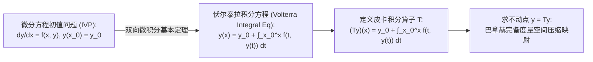
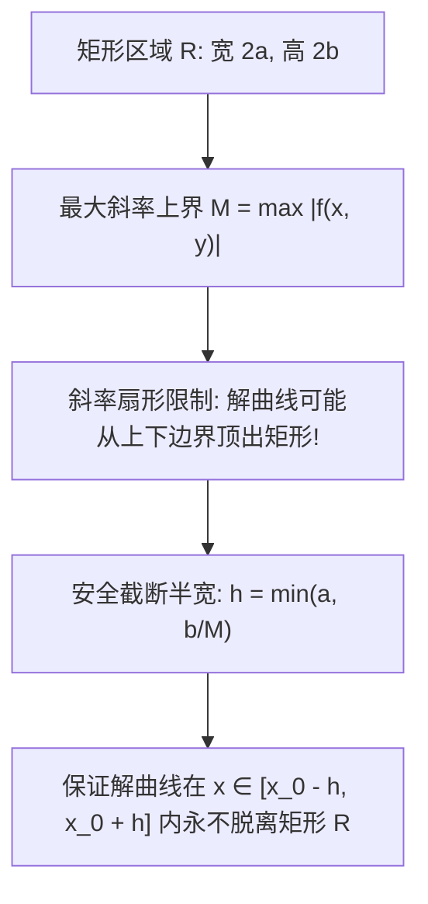

---
tags:
  - 数学/常微分方程
  - 基础理论
  - 概念卡
  - 存在唯一性定理
  - 皮卡逐次逼近法
  - 利普希茨条件
  - 不动点迭代
aliases:
  - 解的存在唯一性定理与皮卡逐次逼近
  - 皮卡林德勒夫定理
  - 解的存在唯一性定理
  - 利普希茨条件
  - 皮卡逐次逼近法
  - 佩亚诺存在定理
  - Picard-Lindelöf Theorem
  - Existence and Uniqueness Theorem and Picard Iteration
created: 2026-09-06
updated: 2026-09-08
---

> [!summary] 核心认知先验
> 物理世界的“决定论（Determinism）”在数学上的投影，即是常微分方程初值问题的**解的存在唯一性定理（Picard-Lindelöf Theorem）**。在尝试求解一个未知微分方程前，首要哲学问题不是“怎么解”，而是“解是否存在？若存在是否唯一？能存活多大区间？”柯丁顿（Coddington）指出：**微分方程与积分方程互为对偶表象**——初值问题 $y'=f(x,y)$ 经微积分基本定理转化为伏尔泰拉积分方程后，微分算子便化为连续积分压缩映射。连续性（Peano 定理）仅能苟延残喘保证“解的存在”，而**利普希茨条件（Lipschitz Condition）**才是斩断分岔、锁定唯一确定轨线的终极枷锁；**皮卡逐次逼近（Picard Iteration）**更提供了由平凡常数逐步迭代逼近真实解析解的标准构造性算法。

---

## 一、推导机理与核心数学定义

### 1.1 微分初值问题向等价积分方程的对偶跃迁

考虑一阶常微分方程的标准初值问题 (IVP)：
$$\begin{cases} \dfrac{dy}{dx} = f(x, y) \\ y(x_0) = y_0 \end{cases} \tag{1}$$

#### 等价性定理证明
- **若 $y(x)$ 是 (1) 的解**：则 $y'(t) = f(t, y(t))$ 在区间上连续。两边从 $x_0$ 到 $x$ 积分：
  $$\int_{x_0}^x y'(t) dt = \int_{x_0}^x f(t, y(t)) dt \implies y(x) - y(x_0) = \int_{x_0}^x f(t, y(t)) dt$$
  代入初值 $y(x_0) = y_0$，即得：
  $$\boxed{y(x) = y_0 + \int_{x_0}^x f(t, y(t)) dt \tag{2}}$$
- **反之，若连续函数 $y(x)$ 满足积分方程 (2)**：代入 $x = x_0$，积分上限与下限重合，立即得到 $y(x_0) = y_0$；由变上限积分导数定理，对 $x$ 求导得 $y'(x) = f(x, y(x))$。
因此，**微分初值问题 (1) 与积分方程 (2) 在连续函数空间 $C(I)$ 内严格完全等价**！

---

### 1.2 利普希茨条件 (Lipschitz Condition) 与几何内涵

设函数 $f(x, y)$ 定义于矩形闭区域 $R = \{ (x, y) \in \mathbb{R}^2 \mid |x - x_0| \le a, \; |y - y_0| \le b \}$ 上。
若存在独立于 $x, y$ 的常数 $L > 0$，使得对矩形内任意具有相同横坐标的两个点 $(x, y_1)$ 与 $(x, y_2)$，恒满足：

$$\boxed{|f(x, y_1) - f(x, y_2)| \le L |y_1 - y_2|}$$

则称函数 $f(x, y)$ 在区域 $R$ 上关于未知变量 $y$ 满足**利普希茨条件 (Lipschitz Condition)**，$L$ 称为**利普希茨常数**。

#### 实用判据（偏导数有界性推论）
若偏导数 $\frac{\partial f}{\partial y}(x, y)$ 在闭区域 $R$ 上存在且连续，由拉格朗日微分中值定理：
$$f(x, y_1) - f(x, y_2) = \frac{\partial f}{\partial y}(x, \xi) (y_1 - y_2) \quad (\xi \text{ 介于 } y_1, y_2 \text{ 之间})$$
由闭区域连续函数有界性定理，必存在上界 $L = \max_{(x,y) \in R} \left| \frac{\partial f}{\partial y}(x, y) \right| < \infty$。
因此：**偏导数 $\frac{\partial f}{\partial y}$ 连续必满足利普希茨条件**！

---

### 1.3 皮卡－林德勒夫定理 (Picard-Lindelöf Theorem)

#### 定理完整陈述
设 $f(x, y)$ 在矩形闭区域 $R = \{ |x - x_0| \le a, |y - y_0| \le b \}$ 上满足：
1. **连续性**：$f(x, y)$ 连续，由闭域极值定理，必存在上界 $M = \max_{(x,y) \in R} |f(x, y)|$；
2. **利普希茨条件**：在 $R$ 上关于 $y$ 满足利普希茨条件（常数为 $L$）。

定义有效存活区间半宽：
$$\boxed{h = \min\left( a, \; \frac{b}{M} \right)}$$
则在区间 $I_h = [x_0 - h, x_0 + h]$ 上，初值问题 (1) **存在唯一的连续可微解 $y = \phi(x)$**。

---

### 1.4 皮卡逐次逼近迭代算法 (Picard Iteration Scheme)

皮卡定理不仅是存在性证明，更直接给出了**构造解的迭代算子序列**：
从初始值函数出发，定义递归序列：

$$\boxed{\begin{aligned}
y_0(x) &= y_0 \\
y_1(x) &= y_0 + \int_{x_0}^x f(t, y_0(t)) dt \\
y_2(x) &= y_0 + \int_{x_0}^x f(t, y_1(t)) dt \\
&\dots \\
y_{n+1}(x) &= y_0 + \int_{x_0}^x f(t, y_n(t)) dt \quad (n = 0, 1, 2, \dots)
\end{aligned}}$$

#### 压缩映射与绝对一致收敛证明纲要
将函数序列改写为级数和：$y_n(x) = y_0 + \sum_{k=1}^n [y_k(x) - y_{k-1}(x)]$。
利用利普希茨条件：
$$\begin{aligned}
|y_1(x) - y_0| &\le \left| \int_{x_0}^x |f(t, y_0)| dt \right| \le M |x - x_0| \\
|y_2(x) - y_1(x)| &\le \left| \int_{x_0}^x |f(t, y_1) - f(t, y_0)| dt \right| \le L \int_{x_0}^x |y_1 - y_0| dt \le L M \frac{|x - x_0|^2}{2!} \\
&\dots \\
|y_n(x) - y_{n-1}(x)| &\le \frac{M}{L} \frac{(L |x - x_0|)^n}{n!} \le \frac{M}{L} \frac{(L h)^n}{n!}
\end{aligned}$$
由魏尔斯特拉斯判别法，控制级数 $\sum \frac{(L h)^n}{n!} = e^{L h} < \infty$ 绝对收敛！
因此函数列 $y_n(x)$ 在闭区间 $[x_0 - h, x_0 + h]$ 上**一致收敛于唯一连续解 $\phi(x) = \lim_{n \to \infty} y_n(x)$**！

---

## 二、⚠️ 致命失分陷阱与临界边界

> [!warning] 陷阱 1：利普希茨条件缺失导致唯一性破裂——佩亚诺分岔陷阱
> 考查极著名的经典初值问题：
> $$\frac{dy}{dx} = 3 y^{2/3}, \qquad y(0) = 0$$
> - 函数 $f(x, y) = 3 y^{2/3}$ 在原点处是**连续的**（佩亚诺存在定理保证解必存在）；
> - 计算对 $y$ 的偏导数：$\frac{\partial f}{\partial y} = 2 y^{-1/3} = \frac{2}{\sqrt[3]{y}}$。
>   当 $y \to 0$ 时，偏导数爆炸发散！在包含原点的任意邻域内，**绝对不满足利普希茨条件**！
> - **解的多态灾难**：
>   1. 解一：常数零解 $y(x) \equiv 0$；
>   2. 解二：分离变量积分 $\int \frac{dy}{y^{2/3}} = 3\int dx \implies 3 y^{1/3} = 3x \implies y(x) = x^3$；
>   3. 解三：在 $x \le c$ 时取 $y = 0$，在 $x > c$ 时取 $y = (x - c)^3$（存在**无穷多个解曲线分岔**！）。
> 唯一性彻底破灭！此例深刻印证：**连续性仅保存在，利普希茨才保唯一**。

> [!caution] 陷阱 2：非线性方程的最大存在区间“有限爆破 (Blow-Up)”
> 线性微分方程 $y' + P(x)y = Q(x)$ 的解定义域由系数 $P, Q$ 的连续区间全局决定；
> 但非线性方程即使右端在全平面处处光滑解析，解也可能在**有限时间内发生奇点爆破**！
> **典型反例**：$y' = y^2, y(0) = 1$。
> 右端 $f(x, y) = y^2$ 在全平面任意局部均可导且满足利普希茨条件；
> 分离变量求解：$-\frac{1}{y} = x - 1 \implies y(x) = \frac{1}{1 - x}$。
> 当 $x \to 1^-$ 时，$y(x) \to +\infty$ 发生爆破！解的最大存在区间仅为 $(-\infty, 1)$，根本无法延拓至全实轴。
> 这正是皮卡定理中存活宽度必须取 $h = \min(a, b/M)$ 截断的深刻几何原因。

> [!danger] 陷阱 3：皮卡迭代中搞混积分变量与上限自变量
> 在计算 $y_{n+1}(x) = y_0 + \int_{x_0}^x f(t, y_n(t)) dt$ 时：
> 积分内部的变量必须严谨写为哑变量 $t$（将 $y_n(x)$ 中的 $x$ 全面替换为 $t$），积分上限方为 $x$。
> 若初学者在积分号内混用 $x$，将错误地把 $x$ 当成常数提至积分号外，导致迭代彻底错乱。

---

## 三、经典范例手把手演算与反代验算

### 3.1 经典例题：皮卡逐次逼近算法构造收敛级数并还原解析特解
**题目（Constanda 教材 §2.7 核心演示题，考研复试必问算法）**：
考虑初值问题：
$$\frac{dy}{dx} = 2x(y + 1), \qquad y(0) = 0 \tag{1}$$
1. 验证该方程在全平面是否满足全局存在唯一性条件；
2. 应用皮卡逐次逼近算法，从 $y_0(x) = 0$ 出发，手把手逐阶演算出前四次逼近解 $y_1(x), y_2(x), y_3(x), y_4(x)$；
3. 归纳猜想序列的通项形式 $y_n(x)$，并求出极限函数 $\phi(x) = \lim_{n \to \infty} y_n(x)$；
4. 用初等分离变量法直接求解该初值问题，反向验证皮卡迭代极限解的正确性。

---

#### 第一步：存在唯一性与利普希茨条件核查
右端函数 $f(x, y) = 2x(y + 1) = 2xy + 2x$：
- $f(x, y)$ 是多项式，在全实平面 $\mathbb{R}^2$ 上显然无限次连续可微；
- 对 $y$ 求偏导数：$\frac{\partial f}{\partial y} = 2x$；
在任意以原点为中心的有界闭矩形 $R: |x| \le a, |y| \le b$ 内：
$$\left| \frac{\partial f}{\partial y} \right| = |2x| \le 2a = L < \infty$$
因此利普希茨条件在任意有限区域恒成立，皮卡定理保证其在局部存在唯一的连续可微解。

---

#### 第二步：皮卡迭代积分手把手演算
初值设定：$x_0 = 0, y_0 = 0$。
零阶初始逼近：
$$y_0(x) \equiv 0$$

#### 计算一阶逼近 $y_1(x)$：
$$y_1(x) = y_0 + \int_0^x f(t, y_0(t)) dt = 0 + \int_0^x 2t(0 + 1) dt = \int_0^x 2t dt = [t^2]_0^x = x^2$$

#### 计算二阶逼近 $y_2(x)$：
将 $y_1(t) = t^2$ 代入积分核：
$$\begin{aligned}
y_2(x) &= 0 + \int_0^x f(t, y_1(t)) dt = \int_0^x 2t(t^2 + 1) dt = \int_0^x (2t^3 + 2t) dt \\
&= \left[ \frac{t^4}{2} + t^2 \right]_0^x = x^2 + \frac{x^4}{2!} = x^2 + \frac{(x^2)^2}{2!}
\end{aligned}$$

#### 计算三阶逼近 $y_3(x)$：
将 $y_2(t) = t^2 + \frac{t^4}{2}$ 代入积分核：
$$\begin{aligned}
y_3(x) &= \int_0^x 2t\left( t^2 + \frac{t^4}{2} + 1 \right) dt = \int_0^x \left( 2t + 2t^3 + t^5 \right) dt \\
&= \left[ t^2 + \frac{t^4}{2} + \frac{t^6}{6} \right]_0^x = x^2 + \frac{(x^2)^2}{2!} + \frac{(x^2)^3}{3!}
\end{aligned}$$

#### 计算四阶逼近 $y_4(x)$：
将 $y_3(t) = t^2 + \frac{t^4}{2!} + \frac{t^6}{3!}$ 代入积分核：
$$\begin{aligned}
y_4(x) &= \int_0^x 2t\left( 1 + t^2 + \frac{t^4}{2!} + \frac{t^6}{3!} \right) dt = \int_0^x \left( 2t + 2t^3 + \frac{2t^5}{2!} + \frac{2t^7}{3!} \right) dt \\
&= \left[ t^2 + \frac{t^4}{2!} + \frac{t^6}{3!} + \frac{t^8}{4!} \right]_0^x = x^2 + \frac{(x^2)^2}{2!} + \frac{(x^2)^3}{3!} + \frac{(x^2)^4}{4!}
\end{aligned}$$

---

#### 第三步：通项归纳与取极限定理
观察前四阶逼近结构，以高度精巧的数学归纳法可严格证明第 $n$ 阶逼近通项为：
$$y_n(x) = \sum_{k=1}^n \frac{(x^2)^k}{k!}$$
令迭代次数 $n \to \infty$，级数绝对收敛：
$$\phi(x) = \lim_{n \to \infty} y_n(x) = \sum_{k=1}^\infty \frac{(x^2)^k}{k!} = \left( \sum_{k=0}^\infty \frac{(x^2)^k}{k!} \right) - 1$$
识别出指数函数的标准麦克劳林级数定义式 $\sum_{k=0}^\infty \frac{u^k}{k!} = e^u$（此处 $u = x^2$）：
$$\boxed{\phi(x) = e^{x^2} - 1}$$

---

#### 第四步：分离变量初等解法双向闭环验算
直接利用分离变量法求解原初值问题 (1)：
$$\frac{dy}{dx} = 2x(y + 1) \implies \frac{dy}{y + 1} = 2x dx$$
两端不定积分：
$$\ln|y + 1| = x^2 + C_0 \implies y + 1 = C e^{x^2} \implies y(x) = C e^{x^2} - 1$$
代入初始条件 $y(0) = 0$：
$$0 = C e^0 - 1 \implies C - 1 = 0 \implies C = 1$$
故精确特解为：
$$y(x) = e^{x^2} - 1$$
与皮卡迭代序列的极限函数 $\phi(x)$ **分毫不差、完全一致**！皮卡逼近构造理论与经典微积分验证完满闭环自洽！

---

## 四、出处与纸质笔记坐标

- **权威教材出处**：
  - **C. Constanda**: *Differential Equations: A Primer for Scientists and Engineers*
    - Chapter 2: First-Order Equations
    - §2.7 The Picard Method (原书 P47-P51, Examples 2.27-2.29)
  - **E.A. Coddington**: *An Introduction to Ordinary Differential Equations*
    - Chapter 1: Linear Equations of First Order (原书 P35-P43)
    - Chapter 5: Existence and Uniqueness of Solutions to First Order Equations (原书 P190-P210)
- **对应全景图**：[[00_常微分方程_学习全景图]]
- **纸质活页定位**：`[活页-ODE-07]`