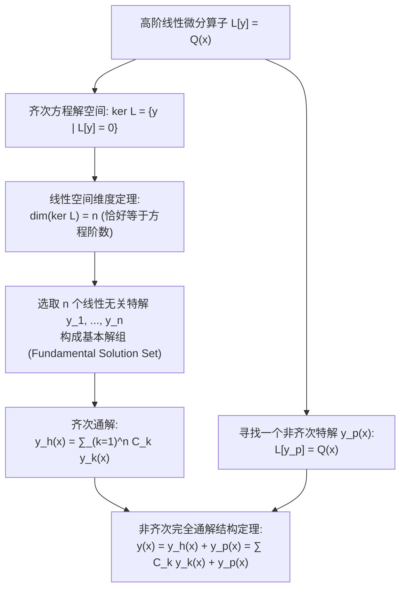

---
tags:
  - 数学/常微分方程
  - 基础理论
  - 概念卡
  - 高阶线性方程
  - 解空间结构
  - 朗斯基行列式
  - 阿贝尔恒等式
  - 降阶法
aliases:
  - 高阶线性微分方程解的结构与朗斯基行列式
  - 朗斯基行列式
  - 解空间结构
  - 阿贝尔恒等式
  - 达朗贝尔降阶法
  - Wronskian Determinant
  - Structure of Solutions of Linear ODEs and Abel's Formula
created: 2026-09-06
updated: 2026-09-08
---

> [!summary] 核心认知先验
> 高阶线性微分方程的理论大厦，是线性代数向量空间（Vector Space）理论在无限维函数流形上的崇高投影。微分算子 $L$ 的线性性质，决定了齐次方程的解集构成一个**维数恰好等于方程阶数 $n$ 的有限维线性子空间**。**朗斯基行列式（Wronskian Determinant）**则是测度解函数族线性相关性的核心几何探测器。而**阿贝尔恒等式（Liouville-Abel Formula）**更揭示了极其霸道的全域刚性法则：齐次解的 Wronskian 行列式**在定义区间上要么处处为零，要么处处永不为零**，绝不可能在某处孤立触零。掌握解的线性叠加、基本解组、阿贝尔公式与达朗贝尔降阶技术，是统领二阶乃至高阶变系数方程的最高纲领。

---

## 一、推导机理与核心数学定义

### 1.1 线性微分算子与高阶方程的标准型

$n$ 阶线性常微分方程的标准显式形式为：

$$\boxed{L[y] \equiv y^{(n)} + P_{n-1}(x) y^{(n-1)} + \dots + P_1(x) y' + P_0(x) y = Q(x)}$$

- 其中 $L = \frac{d^n}{dx^n} + \sum_{k=0}^{n-1} P_k(x) \frac{d^k}{dx^k}$ 为 **$n$ 阶线性微分算子**；
- **算子线性度**：对任意充分可微函数 $y_1, y_2$ 及任意常数 $c_1, c_2 \in \mathbb{R}$，恒满足：
  $$L[c_1 y_1 + c_2 y_2] = c_1 L[y_1] + c_2 L[y_2]$$
- **齐次方程**：$L[y] = 0$，其解集为微分算子的零空间（核空间）$\ker L = \{ y \in C^n(I) \mid L[y] = 0 \}$；
- **非齐次方程**：$L[y] = Q(x)$。

---

### 1.2 解的结构定理（Structure of General Solutions）

#### 定理一：齐次方程通解结构定理
若函数系 $\{ y_1(x), y_2(x), \dots, y_n(x) \}$ 是齐次方程 $L[y] = 0$ 在区间 $I$ 上的 $n$ 个**线性无关特解**，则该方程的通解为这 $n$ 个特解的任意线性组合：
$$\boxed{y_h(x) = C_1 y_1(x) + C_2 y_2(x) + \dots + C_n y_n(x) = \sum_{k=1}^n C_k y_k(x)}$$
其中 $C_1, \dots, C_n$ 为 $n$ 个本质独立的任意常数。该特解组称为方程的**基本解组（基本解系，Fundamental Set of Solutions）**。

#### 定理二：非齐次方程通解结构定理
非齐次线性方程 $L[y] = Q(x)$ 的通解，等于**对应的齐次方程的通解 $y_h(x)$ 加上非齐次方程自身的任意一个非齐次特解 $y_p(x)$**：
$$\boxed{y(x) = y_h(x) + y_p(x) = \sum_{k=1}^n C_k y_k(x) + y_p(x)}$$
- *证明*：设 $y(x)$ 为非齐次方程的任意解，则 $L[y - y_p] = L[y] - L[y_p] = Q(x) - Q(x) = 0$。因此差函数 $y - y_p \in \ker L$，必能表示为基本解组的线性组合 $\sum C_k y_k$。

---

### 1.3 朗斯基行列式 (Wronskian Determinant) 与线性相关性判据

设 $n$ 个函数 $y_1(x), y_2(x), \dots, y_n(x)$ 在区间 $I$ 上具有直至 $n-1$ 阶导数。定义其**朗斯基行列式**为：

$$\boxed{W(y_1, y_2, \dots, y_n)(x) \equiv \begin{vmatrix} 
y_1(x) & y_2(x) & \dots & y_n(x) \\ 
y_1'(x) & y_2'(x) & \dots & y_n'(x) \\ 
\vdots & \vdots & \ddots & \vdots \\ 
y_1^{(n-1)}(x) & y_2^{(n-1)}(x) & \dots & y_n^{(n-1)}(x) 
\end{vmatrix}}$$

特别地，对于二阶方程的两个解 $y_1, y_2$：
$$W(y_1, y_2)(x) = y_1(x) y_2'(x) - y_1'(x) y_2(x)$$

---

### 1.4 阿贝尔恒等式 (Liouville-Abel Formula) 严格推导

设 $y_1, y_2, \dots, y_n$ 是齐次方程 $y^{(n)} + P_{n-1}(x)y^{(n-1)} + \dots + P_0(x)y = 0$ 的任意一组解。
以二阶方程 $y'' + P(x)y' + Q(x)y = 0$ 为例进行推导：
$$W(x) = y_1 y_2' - y_1' y_2$$
两边对 $x$ 求导：
$$W'(x) = (y_1' y_2' + y_1 y_2'') - (y_1'' y_2 + y_1' y_2') = y_1 y_2'' - y_1'' y_2$$
由原微分方程，$y_k'' = -P(x)y_k' - Q(x)y_k$。代入得：
$$\begin{aligned}
W'(x) &= y_1 [-P(x)y_2' - Q(x)y_2] - [-P(x)y_1' - Q(x)y_1] y_2 \\
&= -P(x) [y_1 y_2' - y_1' y_2] - Q(x) [y_1 y_2 - y_1 y_2] = -P(x) W(x)
\end{aligned}$$
得到关于 Wronskian 的极其简美的一阶可分离变量常微分方程：
$$\frac{dW}{dx} = -P(x) W(x)$$
分离变量并积分，立即导出著名的**阿贝尔公式 (Liouville-Abel Formula)**：

$$\boxed{W(x) = W(x_0) \exp\left( -\int_{x_0}^x P_{n-1}(t) dt \right)}$$

#### 核心推论（全域刚性定律）
由于指数函数 $\exp(\cdot)$ 永不为零且恒正：
1. 若在区间内**某一点 $x_0$ 处**有 $W(x_0) \ne 0$，则在**整个连续区间 $I$ 内处处有 $W(x) \ne 0$**；
2. 若在区间内**某一点 $x_0$ 处**有 $W(x_0) = 0$，则在**整个连续区间 $I$ 内处处恒为 $0$**；
3. **充要判据**：齐次方程的 $n$ 个特解 $y_1, \dots, y_n$ 线性无关 $\iff$ 其在定义区间上任意一点的朗斯基行列式 $W \ne 0$。

---

### 1.5 达朗贝尔降阶法 (Reduction of Order)

若已知二阶齐次方程 $y'' + P(x)y' + Q(x)y = 0$ 的一个非零已知特解 $y_1(x)$：
利用阿贝尔公式 $y_1 y_2' - y_1' y_2 = W(x) = C e^{-\int P dx}$：
两边同除以 $y_1^2$：
$$\frac{y_1 y_2' - y_1' y_2}{y_1^2} = \frac{d}{dx}\left( \frac{y_2}{y_1} \right) = \frac{W(x)}{y_1^2(x)} = \frac{C e^{-\int P(x) dx}}{y_1^2(x)}$$
两边直接积分（取常数 $C = 1$）：
$$\frac{y_2}{y_1} = \int \frac{e^{-\int P(x) dx}}{y_1^2(x)} dx$$
由此直接推导出构造**第二个线性无关特解 $y_2(x)$ 的万能求积公式**：

$$\boxed{y_2(x) = y_1(x) \int \frac{\exp\left(-\int P(x) dx\right)}{y_1^2(x)} dx}$$

---

## 二、⚠️ 致命失分陷阱与临界边界

> [!warning] 陷阱 1：柯西病态反例——误以为“任意函数的 Wronskian 恒为零必线性相关”
> 阿贝尔定理 $W \equiv 0 \iff$ 线性相关的充要性，**仅对线性微分方程的解函数系成立**！
> 对任意给定的一般可微函数，$W \equiv 0$ **根本不能推出线性相关**！
> **极著名考研反例**：在区间 $(-1, 1)$ 上定义两函数：
> $y_1(x) = x^2, \quad y_2(x) = x |x| = \begin{cases} x^2, & x \ge 0 \\ -x^2, & x < 0 \end{cases}$
> - 两者在 $(-1, 1)$ 上处处一阶连续可导；
> - 当 $x \ge 0$ 时，$y_2 = y_1 \implies W = 0$；当 $x < 0$ 时，$y_2 = -y_1 \implies W = 0$。在全区间恒有 $W(x) \equiv 0$！
> - 但是，两函数在区间 $(-1, 1)$ 上是**严格线性无关的**！因为若存在常数使得 $c_1 x^2 + c_2 x|x| \equiv 0$：
>   令 $x = 1 \implies c_1 + c_2 = 0$；令 $x = -1 \implies c_1 - c_2 = 0 \implies c_1 = 0, c_2 = 0$。
> **深度根源**：这两函数不可能同时是一个在原点拥有连续系数的二阶线性微分方程的解。

> [!caution] 陷阱 2：在首项非 1 的方程中提取 $P(x)$ 遗漏除法
> 方程 $a_2(x) y'' + a_1(x) y' + a_0(x) y = 0$：
> 阿贝尔公式中的 $P(x)$ 必须是首一标准型系数，即 **$P(x) = \frac{a_1(x)}{a_2(x)}$**。
> 极其多学生直接将 $a_1(x)$ 当作 $P(x)$ 代入，导致指数积分与降阶结果完全偏离。

> [!danger] 陷阱 3：降阶公式求积时分母带入平方遗漏项
> 降阶公式分母是 $[y_1(x)]^2$。若已知特解本身为复合结构（如 $y_1 = x e^x$），平方应为 $x^2 e^{2x}$。
> 初学者常手误写成 $x^2 e^x$ 或忘记平方，导致后续积分无法化简。

---

## 三、经典范例手把手演算与反代验算

### 3.1 经典例题：利用已知特解与降阶法求解变系数勒让德型方程
**题目（Constanda 教材 §4.3 核心范题，高阶变系数方程经典）**：
考查定义在区间 $x \in (-1, 1)$ 上的变系数二阶线性齐次微分方程：
$$(1 - x^2) y'' - 2x y' + 2y = 0 \tag{1}$$
1. 验证简单多项式 $y_1(x) = x$ 是否为该方程的一个特解；
2. 应用阿贝尔恒等式计算该方程在区间上的朗斯基行列式结构；
3. 应用达朗贝尔降阶求积公式，构造出与 $y_1(x)$ 线性无关的第二个特解 $y_2(x)$；
4. 写出方程在区间 $(-1, 1)$ 内的通用通解，并通过微分方程进行反代验算。

---

#### 第一步：特解验证
对 $y_1(x) = x$ 求导：
$$y_1'(x) = 1, \qquad y_1''(x) = 0$$
代入原微分方程 (1) 左侧：
$$(1 - x^2)(0) - 2x(1) + 2(x) = 0 - 2x + 2x = 0$$
两端恒等为 0，证实 $y_1(x) = x$ 确为原方程的一个特解。

#### 第二步：化为首一标准型并求 Wronskian
在区间 $x \in (-1, 1)$ 内，$1 - x^2 \ne 0$。两端同除以 $1 - x^2$：
$$y'' - \frac{2x}{1 - x^2} y' + \frac{2}{1 - x^2} y = 0$$
识别首一导数系数：
$$P(x) = -\frac{2x}{1 - x^2} = \frac{2x}{x^2 - 1}$$
计算不定积分：
$$\int P(x) dx = \int \frac{2x}{x^2 - 1} dx = \ln|x^2 - 1| = \ln(1 - x^2) \quad (\text{因 } x^2 < 1)$$
由阿贝尔公式：
$$\boxed{W(x) = C_0 \exp\left( -\int P dx \right) = C_0 e^{-\ln(1 - x^2)} = \frac{C_0}{1 - x^2}}$$
在开区间 $(-1, 1)$ 上，$1 - x^2 > 0$ 且有限，当 $C_0 \ne 0$ 时 Wronskian 处处永不为零，验证了阿贝尔刚性定理。

#### 第三步：应用降阶公式构造第二特解 $y_2(x)$
取归一化常数 $C_0 = 1$。由达朗贝尔降阶公式：
$$y_2(x) = y_1(x) \int \frac{\exp(-\int P dx)}{y_1^2(x)} dx = x \int \frac{1}{(1 - x^2) x^2} dx$$
对被积函数进行部分分式分解：
$$\frac{1}{x^2(1 - x^2)} = \frac{1}{x^2} + \frac{1}{1 - x^2} = \frac{1}{x^2} + \frac{1}{2}\left( \frac{1}{1 - x} + \frac{1}{1 + x} \right)$$
逐项进行不定积分：
$$\begin{aligned}
\int \frac{1}{x^2(1 - x^2)} dx &= \int x^{-2} dx + \frac{1}{2} \int \left( \frac{1}{1+x} - \frac{1}{x-1} \right) dx \\
&= -\frac{1}{x} + \frac{1}{2} [\ln(1+x) - \ln(1-x)] = -\frac{1}{x} + \frac{1}{2} \ln\left( \frac{1+x}{1-x} \right)
\end{aligned}$$
代回 $y_2(x)$：
$$y_2(x) = x \left[ -\frac{1}{x} + \frac{1}{2} \ln\left( \frac{1+x}{1-x} \right) \right] = -1 + \frac{x}{2} \ln\left( \frac{1+x}{1-x} \right)$$
去掉平凡常数负号（取线性组合），定义标准第二特解：
$$\boxed{y_2(x) = 1 - \frac{x}{2} \ln\left( \frac{1+x}{1-x} \right)}$$

#### 第四步：线性无关性核查与通用通解
计算 $x = 0$ 处的朗斯基行列式：
- $y_1(0) = 0, y_1'(0) = 1$；
- $y_2(0) = 1 - 0 = 1$；
- 求导：$y_2'(x) = -\frac{1}{2}\ln\left(\frac{1+x}{1-x}\right) - \frac{x}{2} \frac{2}{1-x^2} \implies y_2'(0) = 0 - 0 = 0$；
代入行列式：
$$W(y_1, y_2)(0) = \begin{vmatrix} 0 & 1 \\ 1 & 0 \end{vmatrix} = 0 - 1 = -1 \ne 0$$
因在 $x=0$ 处不为零，由阿贝尔定理，两解在全区间 $(-1, 1)$ 上**绝对严格线性无关**！
因此方程的完全齐次通解为：
$$\boxed{y(x) = C_1 x + C_2 \left[ 1 - \frac{x}{2} \ln\left( \frac{1+x}{1-x} \right) \right]}$$

#### 第五步：反代微分方程核验
对 $y_2(x) = 1 - \frac{x}{2} \ln\left(\frac{1+x}{1-x}\right)$ 实施微分验证：
1. $y_2' = -\frac{1}{2} \ln\left(\frac{1+x}{1-x}\right) - \frac{x}{1-x^2}$；
2. 二阶导数：
   $$y_2'' = -\frac{1}{2}\frac{2}{1-x^2} - \frac{1(1-x^2) - x(-2x)}{(1-x^2)^2} = -\frac{1}{1-x^2} - \frac{1+x^2}{(1-x^2)^2} = \frac{-(1-x^2) - (1+x^2)}{(1-x^2)^2} = -\frac{2}{(1-x^2)^2}$$
3. 代入方程左端 $(1-x^2)y_2'' - 2x y_2' + 2y_2$：
   $$\begin{aligned}
   &(1-x^2)\left[ -\frac{2}{(1-x^2)^2} \right] - 2x \left[ -\frac{1}{2}\ln\left(\frac{1+x}{1-x}\right) - \frac{x}{1-x^2} \right] + 2 \left[ 1 - \frac{x}{2}\ln\left(\frac{1+x}{1-x}\right) \right] \\
   &= -\frac{2}{1-x^2} + x \ln\left(\frac{1+x}{1-x}\right) + \frac{2x^2}{1-x^2} + 2 - x \ln\left(\frac{1+x}{1-x}\right) \\
   &= \frac{-2 + 2x^2}{1-x^2} + 2 = \frac{-2(1-x^2)}{1-x^2} + 2 = -2 + 2 = 0
   \end{aligned}$$
恒等式处处成立为 0！求解过程无懈可击！

---

## 四、出处与纸质笔记坐标

- **权威教材出处**：
  - **C. Constanda**: *Differential Equations: A Primer for Scientists and Engineers*
    - Chapter 4: Second-Order Linear Equations
    - §4.3 The Wronskian (原书 P78-P83, Examples 4.7-4.10)
  - **E.A. Coddington**: *An Introduction to Ordinary Differential Equations*
    - Chapter 2: Linear Equations with Constant Coefficients (原书 P67-P78)
    - Chapter 3: Linear Equations with Variable Coefficients (原书 P115-P125)
- **对应全景图**：[[00_常微分方程_学习全景图]]
- **纸质活页定位**：`[活页-ODE-08]`