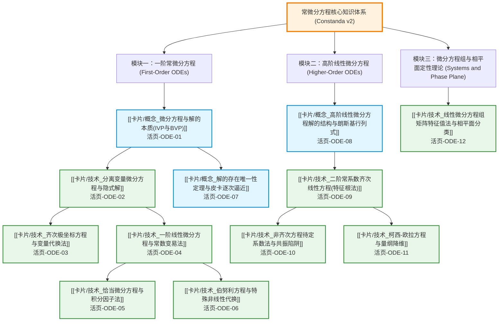

---
tags:
  - 数学/常微分方程
  - 知识图谱
  - MOC
  - 学习路径
  - textbook-to-obsidian-v2
aliases:
  - 常微分方程学习全景图
  - 常微分方程全景图
  - ODE Master Roadmap
  - Ordinary Differential Equations Roadmap
created: 2026-09-14
updated: 2026-09-14
---

# 常微分方程 (ODE) 核心知识体系与全景图谱 (Master MOC v2)

> [!summary] 知识库架构与研读指引
> 本知识库严格遵循 **textbook-to-obsidian v2** 官方知识解构规范重构，以 **C. Constanda: Differential Equations: A Primer for Scientists and Engineers**（高清矢量全书 Chapter 1 至 Chapter 7，共 184 页）为核心锚点全量逐节深度解构。
>
> 整个知识体系包含：
> 1. **全书原顺序逐节精读文库**：**35 篇** 章节精析笔记（涵盖 Chapter 1~7 全部 36 个节），每节包含公理化定义、定理条件、例题闭环验算与课后习题目标；
> 2. **全书黄金核心知识卡片**：**12 张** 核心双链卡片（3 张概念卡 + 9 张硬核技术求解卡），配备推导机理流程图、⚠️ 致命失分陷阱、手把手演算与双向反代验算；
> 3. **全书教材索引与覆盖度审计报告**：已通过 `coverage_audit.py audit` 官方零缺口认证（47/47 任务已生成且已复核），详见 [[Obsidian知识库_常微分方程_v2/00_教材索引]] 与 [[Obsidian知识库_常微分方程_v2/coverage_report]]。

---

## 一、知识拓扑图谱与逻辑依赖演进

---

## 二、12 张黄金核心卡片全景导引

| 序号 | 类别 | 卡片名称 | 核心数学思想与物理机制 | 原书对应章节与页码 | 纸质活页槽位 |
| :--- | :--- | :--- | :--- | :--- | :--- |
| **01** | 概念 | [[卡片/概念_微分方程与解的本质(IVP与BVP)]] | 积分常数自由度、显/隐式解流形、初值条件与边值条件边界 | Ch 1 (1.3节) p.18-20 | `[活页-ODE-01]` |
| **02** | 技术 | [[卡片/技术_分离变量微分方程与隐式解]] | 形式分离微分算子、除零除法丢失奇解陷阱、隐式解反求 | Ch 2 (2.1节) p.26-30 | `[活页-ODE-02]` |
| **03** | 技术 | [[卡片/技术_齐次极坐标方程与变量代换法]] | 齐次函数量纲缩放对称性、$u=y/x$ 代换与射线轨线积分 | Ch 2 (2.3节) p.35-37 | `[活页-ODE-03]` |
| **04** | 技术 | [[卡片/技术_一阶线性微分方程与常数变易法]] | 乘积导数法则逆用、积分因子 $\mu(x)$、拉格朗日常数变易 | Ch 2 (2.2节) p.31-34 | `[活页-ODE-04]` |
| **05** | 技术 | [[卡片/技术_恰当微分方程与积分因子法]] | 势函数 $\Phi(x,y)=C$ 守恒面、克莱罗混合偏导对称性、积分因子 | Ch 2 (2.6节) p.42-46 | `[活页-ODE-05]` |
| **06** | 技术 | [[卡片/技术_伯努利方程与特殊非线性代换]] | 幂次代换 $v=y^{1-n}$ 强行线性化、非线性方程降阶转化 | Ch 2 (2.4节) p.38-39 | `[活页-ODE-06]` |
| **07** | 概念 | [[卡片/概念_解的存在唯一性定理与皮卡逐次逼近]] | Picard-Lindelöf 矩形域定理、Lipschitz 条件、积分迭代 | Ch 2 (2.7节) p.47-51 | `[活页-ODE-07]` |
| **08** | 概念 | [[卡片/概念_高阶线性微分方程解的结构与朗斯基行列式]] | 线性解空间基底、Wronskian 行列式、阿贝尔恒等式 | Ch 4 (4.3节) & Ch 6 p.78-83 | `[活页-ODE-08]` |
| **09** | 技术 | [[卡片/技术_二阶常系数齐次线性方程(特征根法)]] | 欧拉指数猜解、特征多项式判别式、过阻尼/临界/欠阻尼相态 | Ch 4 (4.4节) p.84-92 | `[活页-ODE-09]` |
| **10** | 技术 | [[卡片/技术_非齐次方程待定系数法与共振陷阱]] | 自由项母机试探解、特征根重叠共振修正因子 $x^s$、常数变易 | Ch 4 (4.5节) p.93-107 | `[活页-ODE-10]` |
| **11** | 技术 | [[卡片/技术_柯西-欧拉方程与量纲降维]] | 等维量纲分析、单项式猜解 $x^r$、对数自变量代换 $x=e^t$ | Ch 4 (4.6节) p.108-111 | `[活页-ODE-11]` |
| **12** | 技术 | [[卡片/技术_线性微分方程组矩阵特征值法与相平面分类]] | 状态矩阵特征向量展开、相平面鞍点/结点/焦点/中心定性分类 | Ch 7 (7.4节) p.164-182 | `[活页-ODE-12]` |

---

## 三、教材原书章节索引速览 (Chapters 1~7)

- **第1章 引论与微积分预备**：[[章节/s01_01_1.1_微积分预备知识]] · [[章节/s01_02_1.2_微分方程及其解]] · [[章节/s01_03_1.3_初始条件与边界条件]] · [[章节/s01_04_1.4_微分方程分类体系]]
- **第2章 一阶微分方程**：[[章节/s02_01_2.1_可分离变量微分方程]] · [[章节/s02_02_2.2_一阶线性微分方程与积分因子]] · [[章节/s02_03_2.3_齐次极坐标微分方程]] · [[章节/s02_04_2.4_伯努利微分方程]] · [[章节/s02_05_2.5_里卡蒂微分方程]] · [[章节/s02_06_2.6_恰当微分方程与势函数求法]] · [[章节/s02_07_2.7_存在唯一性定理与皮卡逐次逼近]] · [[章节/s02_08_2.8_方向场与斜率几何分析]]
- **第3章 一阶数学建模**：[[章节/s03_01_3.1_可分离方程物理模型]] · [[章节/s03_02_3.2_线性方程物理模型]] · [[章节/s03_03_3.3_自治方程与定性稳定性]]
- **第4章 二阶线性微分方程**：[[章节/s04_01_4.1_二阶微分方程建模导论]] · [[章节/s04_02_4.2_代数预备知识与行列式]] · [[章节/s04_03_4.3_二阶齐次线性方程解的结构与朗斯基行列式]] · [[章节/s04_04_4.4_常系数齐次线性微分方程与特征根法]] · [[章节/s04_05_4.5_非齐次方程待定系数法与常数变易法]] · [[章节/s04_06_4.6_柯西-欧拉方程与量纲变换]] · [[章节/s04_07_4.7_特殊二阶非线性方程降阶法]]
- **第5章 二阶机械振动与物理模型**：[[章节/s05_01_5.1_自由机械振动]] · [[章节/s05_02_5.2_受迫机械振动与共振]] · [[章节/s05_03_5.3_电学振荡与_RLC_电路同构]]
- **第6章 高阶线性微分方程**：[[章节/s06_01_6.1_高阶方程建模导引]] · [[章节/s06_02_6.2_高阶代数预备与线性无关性]] · [[章节/s06_03_6.3_高阶齐次线性微分方程通解理论]] · [[章节/s06_04_6.4_高阶非齐次方程求解方法]]
- **第7章 一阶线性微分方程组**：[[章节/s07_01_7.1_微分方程组物理建模]] · [[章节/s07_02_7.2_矩阵代数与特征值理论]] · [[章节/s07_03_7.3_一阶线性微分方程组解的理论]] · [[章节/s07_04_7.4_常系数齐次线性微分方程组]] · [[章节/s07_05_7.5_矩阵指数与基底解性质]] · [[章节/s07_06_7.6_非齐次线性微分方程组]]
