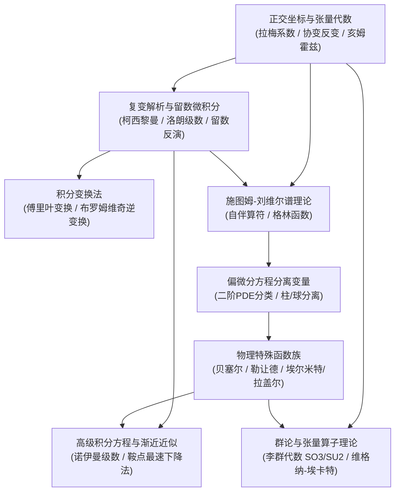

---
aliases:
  - 数学物理方法全景图
  - Mathematical Methods for Physicists MOC
tags:
  - 物理/数学物理方法
  - 知识全景图
---

# 数学物理方法 (Mathematical Methods for Physicists) 体系全景图

> 本知识库严格遵循 **教材解构黄金标准 (v1 Standard)** 构建，解构自全球物理学界公认的数学方法圣经 **George B. Arfken, Hans J. Weber, Frank E. Harris《Mathematical Methods for Physicists》**。
> 全库涵盖从正交曲线坐标与张量分析、复变解析与留数定理、施图姆-刘维尔算子理论与格林函数，到偏微分方程分离变量、特殊函数族（柱函数/球函数/正交多项式）、积分变换、积分方程、鞍点渐近展开及李群李代数的 27 张高阶出版级卡片，筑牢理论物理与实验建模的坚实数学底座。

---

## 模块一：正交曲线坐标与张量分析代数

物理场空间微分算符在任意正交曲面坐标下的普遍形式与张量语言。

- [[技术_正交曲线坐标系下拉梅系数与微分算子构造]] `[活页-MP-01]`：拉梅标度因子 $h_i$、梯度/散度/旋度/拉普拉斯算符在柱、球及椭球坐标系下的统一构造范式。
- [[概念_笛卡尔与张量分析：协变反变与指标收缩代数]] `[活页-MP-02]`：爱因斯坦求和、协变反变分量变换律、度规张量 $g_{ij}$ 升降指标与列维-奇维塔伪张量缩并代数。
- [[定理_亥姆霍兹分解定理与矢量场规范自由度]] `[活页-MP-03]`：任意平滑矢量场分解为标势梯度与矢势旋度、边界积分与库仑/洛伦茨规范自由度。

---

## 模块二：复变函数与留数微积分

以解析性与围道积分为核心的强大积分与反演工具。

- [[概念_柯西黎曼条件与复解析延拓原理]] `[活页-MP-04]`：柯西-黎曼微分方程、调和函数性质、分支割线与黎曼面、施瓦茨反射与解析延拓唯一性。
- [[定理_柯西积分公式与洛朗级数展开]] `[活页-MP-05]`：柯西积分定理、闭合围道变形、柯西积分公式及高阶导数、圆环域洛朗级数与孤立奇点分类。
- [[技术_围道积分留数定理与实反常积分计算]] `[活页-MP-06]`：留数定理、约当引理、实轴奇点主值积分与匙孔围道处理分支割线积分的标准范式。
- [[定理_克拉默斯克勒尼希色散关系与因果性原理]] `[活页-MP-07]`：时间因果律对频域解析性的约束、上半复平面解析性与希尔伯特变换实虚部积分关系。

---

## 模块三：无限维空间与施图姆-刘维尔理论

微分算子的谱分析与非齐次方程脉冲响应构造。

- [[概念_希尔伯特空间与厄米算符谱理论]] `[活页-MP-08]`：$L^2$ 内积空间完备性、微分算子伴随算子、自伴边界条件与本征谱实数正交性。
- [[定理_施图姆刘维尔本征值问题与正交完备基]] `[活页-MP-09]`：标准施图姆-刘维尔方程、权函数 $w(x)$、广义傅里叶级数带权正交完备展开定理。
- [[技术_一维施图姆刘维尔方程格林函数构造法]] `[活页-MP-10]`：点源脉冲响应、界面连续性与导数跳跃条件、朗斯基行列式构造闭合单体格林函数。

---

## 模块四：积分变换法

时空微分算子向代数频域的映射与复积分逆变换。

- [[定理_傅里叶变换反演律与卷积定理]] `[活页-MP-11]`：连续傅里叶变换对、帕塞瓦尔能量守恒定理、时域卷积向频域乘积转化的物理机制。
- [[技术_拉普拉斯变换反演布罗姆维奇围道积分]] `[活页-MP-12]`：单边拉普拉斯变换性质、初值终值定理、梅林反演与布罗姆维奇复围道积分求解初值微分方程。

---

## 模块五：数学物理偏微分方程与分离变量

经典三类偏微分方程（波动/热传导/位势）在物理边界下的解析通解。

- [[技术_二阶线性偏微分方程分类与边界条件匹配]] `[活页-MP-13]`：椭圆/双曲/抛物型方程特征线判别、狄利克雷/诺依曼/罗宾边界定解适定性条件。
- [[技术_圆柱坐标系下拉普拉斯方程分离变量与贝塞尔级数]] `[活页-MP-14]`：柱对称分离变量、原点轴心有限性约束、第一类贝塞尔函数零点本征值展开。
- [[技术_球坐标系下拉普拉斯方程分离变量与勒让德级数]] `[活页-MP-15]`：球坐标分离变量、欧拉径向解、轴对称勒让德多项式与非对称球谐函数级数展开。
- [[定理_狄利克雷与诺依曼泊松方程格林函数积分表示]] `[活页-MP-16]`：格林第二恒等式、三维泊松方程积分通解、狄利克雷边界格林函数消除表面未知导数。

---

## 模块六：物理特殊函数族

微观量子与宏观场论中不可替代的微分方程解析本征基底。

- [[概念_伽马与贝塔函数：解析性质与斯特林渐近公式]] `[活页-MP-17]`：欧拉第一二类积分定义、余元公式、复平面极点分布与斯特林大参数阶乘渐近公式。
- [[定理_贝塞尔方程级数解与第一二类柱函数]] `[活页-MP-18]`：弗罗贝尼乌斯级数指标方程、第一类柱函数 $J_\nu(x)$ 与第二类诺伊曼函数 $N_\nu(x)$ 线性无关性。
- [[技术_贝塞尔函数生成函数与正交本征根展开]] `[活页-MP-19]`：贝塞尔母函数、升降阶微分递推关系、有限区间带权傅里叶-贝塞尔正交级数。
- [[概念_虚宗量贝塞尔与汉克尔函数：波场辐射与阻尼]] `[活页-MP-20]`：第三类汉克尔辐射波函数 $H_\nu^{(1,2)}(x)$、修正虚宗量贝塞尔函数 $I_\nu(x), K_\nu(x)$ 的行波与倏逝波物理图像。
- [[定理_勒让德多项式罗德里格斯公式与母函数]] `[活页-MP-21]`：罗德里格斯微分表示、静电库仑势多极展开母函数、正交归一模因子严格推导。
- [[技术_连带勒让德函数与球谐函数正交完备族]] `[活页-MP-22]`：连带勒让德函数 $P_l^m(x)$、球面调和函数 $Y_{lm}(\theta,\phi)$ 正交完备基与空间角向加法定理。
- [[概念_埃尔米特与拉盖尔多项式：微观量子束缚态正交基]] `[活页-MP-23]`：埃尔米特高斯正交多项式（谐振子）、连带拉盖尔指数正交多项式（氢原子束缚态）。

---

## 模块七：积分方程与大参数鞍点渐近展开

超越常规微积分的高阶积分方程分析与极限渐近逼近。

- [[定理_第二类弗雷德霍姆与沃尔泰拉积分方程解法]] `[活页-MP-24]`：退化可分离核代数解法、逐次迭代与诺伊曼级数解法、沃尔泰拉方程全局收敛性。
- [[技术_最速下降法与鞍点积分渐近估计]] `[活页-MP-25]`：复平面无极值解析函数鞍点条件、沿虚部不变线的最速下降路径选取与高斯主阶渐近公式。

---

## 模块八：物理中的李群与张量算符理论

几何对称性与微观角动量张量选择定则的现代数学表述。

- [[概念_李群李代数与三维旋转群SO3与其二重覆盖SU2]] `[活页-MP-26]`：连续李群生成元对易代数、$SO(3)$ 空间旋转与 $SU(2)$ 自旋旋量二重覆盖同态映射。
- [[技术_不可约张量算子与维格纳埃卡特定理]] `[活页-MP-27]`：球张量对易定义、维格纳-埃卡特定理实现几何与物理动力学解耦、量子跃迁选择定则推导。

---

## 建议精读路线图

