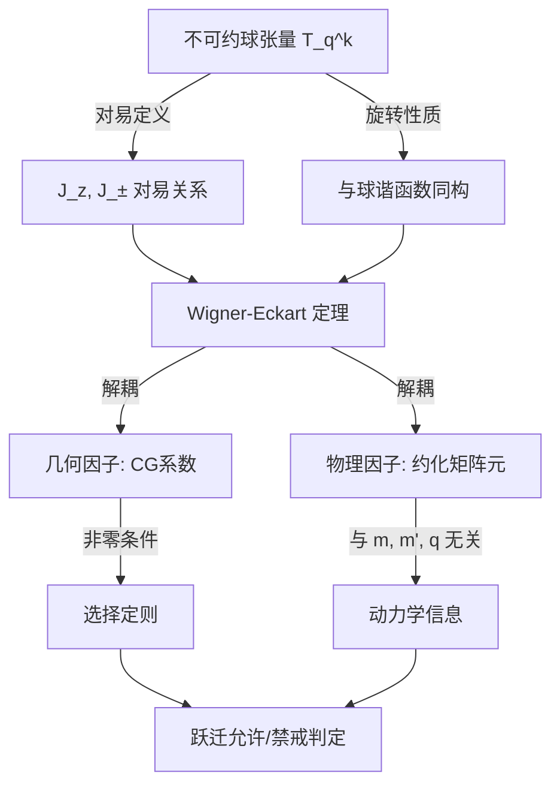

---
tags:
  - 量子力学
  - 角动量理论
  - 不可约张量
  - Wigner-Eckart定理
  - 选择定则
aliases:
  - Wigner-Eckart定理
  - 不可约球张量算子
  - 约化矩阵元
created: 2026-01-15
updated: 2026-01-15
---

> [!summary] 算法执行总览
> 本卡为**解法卡**，核心策略：将物理上复杂的跃迁矩阵元 $\langle j' m' | T_q^k | j m \rangle$ 严格拆解为**几何因子**（CG系数，仅依赖角动量耦合与对称性）与**物理因子**（约化矩阵元 $\langle j' \| T^k \| j \rangle$，蕴含动力学细节）。求解流程为：① 确认 $T_q^k$ 满足不可约球张量对易定义；② 直接套用 Wigner-Eckart 定理完成解耦；③ 依据 CG 系数非零条件（三角不等式与磁量子数守恒）判定跃迁选择定则；④ 若 CG 系数为零，则跃迁严格禁戒，无需计算约化矩阵元。

---

## 一、推导机理与核心数学定义

### 1.1 不可约球张量算符的定义

在角动量理论中，一组 $2k+1$ 个算符 $\{T_q^k : q = -k, -k+1, \dots, k\}$ 若满足以下对易关系，则构成**秩为 $k$ 的不可约球张量算符**：

$$
[J_z, T_q^k] = q \, T_q^k
$$

$$
[J_{\pm}, T_q^k] = \sqrt{(k \mp q)(k \pm q + 1)} \, T_{q \pm 1}^k
$$

其中 $J_{\pm} = J_x \pm i J_y$ 为角动量升降算符。**直觉先验**：这些对易关系与球谐函数 $Y_{kq}$ 在旋转下的变换性质完全同构——$T_q^k$ 在 $J$ 的旋转作用下按 $k$ 秩不可约表示变换，$q$ 扮演“磁量子数”角色，$k$ 扮演“总角动量”角色。

### 1.2 维格纳-埃卡特定理的数学表述

**定理核心论断**：设 $T_q^k$ 为不可约球张量算符，则其矩阵元在角动量本征态基 $\{|j m\rangle\}$ 下可严格解耦为：

$$
\langle j' m' | T_q^k | j m \rangle = \frac{1}{\sqrt{2j' + 1}} \, C_{j m \, k q}^{j' m'} \, \langle j' \| T^k \| j \rangle
$$

其中：
- $C_{j m \, k q}^{j' m'} = \langle j m; k q | j' m' \rangle$ 为 Clebsch-Gordan (CG) 系数；
- $\langle j' \| T^k \| j \rangle$ 为**约化矩阵元**（reduced matrix element），与 $m, m', q$ 完全无关；
- 因子 $1/\sqrt{2j'+1}$ 为归一化约定（不同教材可能采用不同约定，需保持一致）。

**推导机理**：将 $T_q^k | j m \rangle$ 视为 $|j m\rangle$ 与秩 $k$ 张量耦合的产物，按角动量耦合理论展开：

$$
T_q^k | j m \rangle = \sum_{j'' m''} C_{j m \, k q}^{j'' m''} \, | j'' m'' \rangle \otimes (\text{径向/内部自由度})
$$

对 $\langle j' m' |$ 投影后，正交性 $\langle j' m' | j'' m'' \rangle = \delta_{j'j''} \delta_{m'm''}$ 自动筛选出 $j'' = j'$、$m'' = m'$ 的分量，从而将 $m$-依赖全部收入 CG 系数，剩余部分仅依赖 $j, j', k$。

### 1.3 选择定则的推导

CG 系数 $C_{j m \, k q}^{j' m'}$ 非零的必要条件为：

$$
m' = m + q \quad (\text{磁量子数守恒})
$$

$$
|j - k| \leq j' \leq j + k \quad (\text{三角不等式})
$$

由此直接导出跃迁选择定则：若上述任一条件不满足，则 $C_{j m \, k q}^{j' m'} = 0$，从而 $\langle j' m' | T_q^k | j m \rangle = 0$，跃迁严格禁戒。

---

## 二、⚠️ 致命失分陷阱与临界边界

### 陷阱 1：约化矩阵元与磁量子数的独立性

**最易失分点**：约化矩阵元 $\langle j' \| T^k \| j \rangle$ 中**不含** $m, m', q$。若在计算中试图将 $m$-依赖代入约化矩阵元，或认为约化矩阵元随 $q$ 变化，则完全错误。约化矩阵元仅由 $j, j', k$ 及算符的物理本质（如径向波函数重叠积分）决定。

### 陷阱 2：CG 系数为零时的禁戒跃迁

若 $C_{j m \, k q}^{j' m'} = 0$（例如 $m' \neq m + q$，或三角不等式不满足），则**整个矩阵元严格为零**，无论约化矩阵元多大。此时跃迁为**严格禁戒**，不可因约化矩阵元非零而误判跃迁允许。

### 陷阱 3：归一化约定不一致

不同教材对 Wigner-Eckart 定理的归一化约定不同。Arfken & Weber 采用 $1/\sqrt{2j'+1}$ 因子；部分文献（如 Sakurai）采用 $1/\sqrt{2j+1}$ 或省略根号因子。**解题时必须与教材约定严格一致**，否则约化矩阵元数值相差常数倍。

### 陷阱 4：$T_0^1 = J_z$ 的特殊验证

对于矢量算符 $T_q^1$，当 $T_0^1 = J_z$ 时，由 Wigner-Eckart 定理可证：

$$
\langle j m | J_z | j m \rangle = m = \frac{1}{\sqrt{2j+1}} C_{j m \, 1 0}^{j m} \langle j \| J \| j \rangle
$$

代入 $C_{j m \, 1 0}^{j m} = \frac{m}{\sqrt{j(j+1)}}$，可得 $\langle j \| J \| j \rangle = \sqrt{j(j+1)(2j+1)}$。此结果可作为验算基准，若偏离则说明计算有误。

### 陷阱 5：$k = 0$ 标量算符的退化情形

当 $k = 0$ 时，$T_0^0$ 为标量算符，对易关系退化为 $[J_i, T_0^0] = 0$。此时 CG 系数 $C_{j m \, 0 0}^{j' m'} = \delta_{jj'} \delta_{mm'}$，定理退化为：

$$
\langle j' m' | T_0^0 | j m \rangle = \frac{\delta_{jj'} \delta_{mm'}}{\sqrt{2j+1}} \langle j \| T^0 \| j \rangle
$$

即标量算符不改变 $j, m$，且矩阵元与 $m$ 无关（对角且 $m$-简并）。

---

## 三、经典范例手把手演算

### 范例：电偶极跃迁选择定则

**问题**：设原子受电偶极扰动 $H' = -e \vec{E} \cdot \vec{r}$，其中 $\vec{r}$ 的分量可表示为 $k=1$ 的不可约球张量：

$$
r_q^1 = \sqrt{\frac{4\pi}{3}} \, r \, Y_{1q}(\theta, \phi), \quad q = -1, 0, +1
$$

求从态 $|j m\rangle$ 到 $|j' m'\rangle$ 的电偶极跃迁选择定则。

**第一步：确认张量秩**

电偶极算符 $\vec{r}$ 的三个分量构成 $k=1$ 的不可约球张量 $T_q^1 = r_q^1$（$q = -1, 0, +1$），满足对易定义。

**第二步：套用 Wigner-Eckart 定理**

跃迁矩阵元为：

$$
\langle j' m' | r_q^1 | j m \rangle = \frac{1}{\sqrt{2j' + 1}} \, C_{j m \, 1 q}^{j' m'} \, \langle j' \| r^1 \| j \rangle
$$

**第三步：由 CG 系数非零条件推导选择定则**

CG 系数 $C_{j m \, 1 q}^{j' m'}$ 非零的必要条件：

**条件一（磁量子数守恒）**：

$$
m' = m + q
$$

由于 $q \in \{-1, 0, +1\}$，故：

$$
\Delta m = m' - m = q \in \{-1, 0, +1\}
$$

即 $\Delta m = 0, \pm 1$。

**条件二（三角不等式）**：

$$
|j - 1| \leq j' \leq j + 1
$$

即 $\Delta j = j' - j \in \{-1, 0, +1\}$。

**第四步：排除 $\Delta j = 0$ 且 $\Delta m = 0$ 的例外**

当 $j' = j$ 且 $m' = m$（即 $\Delta j = 0, \Delta m = 0$）时，需检查 CG 系数 $C_{j m \, 1 0}^{j m}$。由 CG 系数表：

$$
C_{j m \, 1 0}^{j m} = \frac{m}{\sqrt{j(j+1)}}
$$

当 $m = 0$ 时，$C_{j 0 \, 1 0}^{j 0} = 0$，跃迁禁戒。因此：

$$
j' = j, \; m' = m = 0 \implies \text{跃迁禁戒}
$$

**第五步：汇总选择定则**

$$
\Delta m = 0, \pm 1 \quad \text{且} \quad \Delta j = 0, \pm 1 \quad \text{但排除} \quad (j' = j, \; m' = m = 0)
$$

**第六步：终解反代验算**

取 $j = 1, m = 0$，$j' = 1, m' = 0$（即 $\Delta j = 0, \Delta m = 0, m = 0$）：

$$
\langle 1 0 | r_0^1 | 1 0 \rangle = \frac{1}{\sqrt{3}} \, C_{1 0 \, 1 0}^{1 0} \, \langle 1 \| r^1 \| 1 \rangle = \frac{1}{\sqrt{3}} \cdot 0 \cdot \langle 1 \| r^1 \| 1 \rangle = 0
$$

验算通过：矩阵元为零，跃迁禁戒。

再取 $j = 1, m = 1$，$j' = 1, m' = 1$（$\Delta j = 0, \Delta m = 0, m \neq 0$）：

$$
\langle 1 1 | r_0^1 | 1 1 \rangle = \frac{1}{\sqrt{3}} \, C_{1 1 \, 1 0}^{1 1} \, \langle 1 \| r^1 \| 1 \rangle = \frac{1}{\sqrt{3}} \cdot \frac{1}{\sqrt{2}} \cdot \langle 1 \| r^1 \| 1 \rangle \neq 0
$$

跃迁允许，与选择定则一致。

---

## 四、出处与纸质笔记坐标

### 教材出处

- **Arfken & Weber**, *Mathematical Methods for Physicists*, 7th Edition
  - Chapter 4, §4.5 (P211–P225)：不可约张量算符定义与对易关系
  - Chapter 4, §4.6 (P225–P239)：Wigner-Eckart 定理及其应用

### 纸质活页留痕槽位

- **[活页-MP-27]**：不可约球张量对易关系推导 + CG 系数表速查
- **[活页-MP-28]**：Wigner-Eckart 定理证明纲要 + 约化矩阵元计算流程
- **[活页-MP-29]**：电偶极/四极跃迁选择定则范例 + 错题订正区

### 全景图挂载

---

*本卡对应 Arfken & Weber Ch.4 §4.5–§4.6，建议配合 [活页-MP-27] 至 [活页-MP-29] 完成手写推导与错题订正。*

---
**知识图谱导航**：[[00_数学物理方法_学习全景图]]
