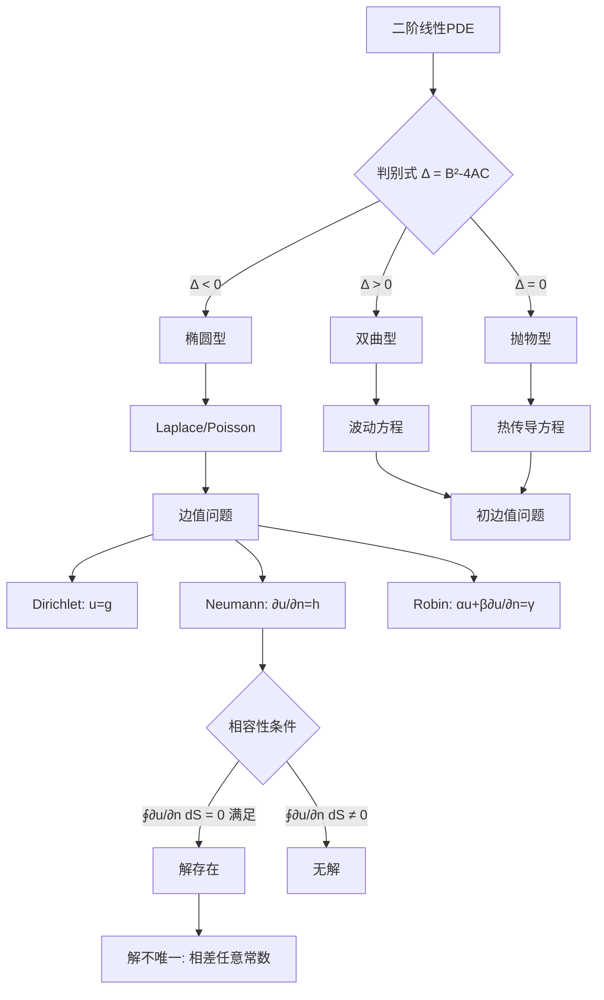

---
tags:
  - PDE/二阶线性分类
  - PDE/边界条件
  - 数学物理方法
aliases:
  - 二阶线性PDE分类
  - 椭圆-双曲-抛物判别
  - Dirichlet-Neumann-Robin条件
created: 2025-01-01
updated: 2025-01-01
---

> [!summary] 算法执行总览
> 本卡处理二阶线性偏微分方程（PDE）的**分类判别**与**边界条件匹配**。核心操作分两步：首先，依据主部系数判别式 $\Delta = B^2 - 4AC$ 的符号将方程定位为椭圆型、双曲型或抛物型；其次，依据定解问题的物理背景与适定性要求，从三类经典边界条件（Dirichlet、Neumann、Robin）中选取匹配项，并严格校验 Neumann 内问题所必需的相容性闭合积分条件。

---

## 一、推导机理与核心数学定义

### 1.1 二阶线性 PDE 的一般形式与主部判别

考察含两个自变量 $x, y$ 的一般二阶线性 PDE：

$$
A u_{xx} + 2B u_{xy} + C u_{yy} + D u_x + E u_y + F u = G(x,y),
$$

其中 $A, B, C, D, E, F$ 可为 $x, y$ 的函数，$G$ 为非齐次项。分类完全由**最高阶导数项（主部）**决定，即由系数 $A, B, C$ 构成的判别式主导：

$$
\Delta(x_0, y_0) = B^2(x_0, y_0) - 4A(x_0, y_0) C(x_0, y_0).
$$

在点 $(x_0, y_0)$ 处：

- **椭圆型**：$\Delta < 0$。典型代表为拉普拉斯方程 $u_{xx} + u_{yy} = 0$（此处 $A=1, B=0, C=1$，得 $\Delta = -4 < 0$）及泊松方程。
- **双曲型**：$\Delta > 0$。典型代表为一维波动方程 $u_{tt} = c^2 u_{xx}$，改写为 $c^2 u_{xx} - u_{tt} = 0$（取 $x$ 为空间、$y=t$，则 $A=c^2, B=0, C=-1$，得 $\Delta = 4c^2 > 0$）。
- **抛物型**：$\Delta = 0$。典型代表为一维热传导方程 $u_t = \alpha u_{xx}$，改写为 $\alpha u_{xx} - u_t = 0$（此处缺 $u_{yy}$ 项，即 $C=0, B=0$，得 $\Delta = 0$）。

**直觉先验**：分类的物理本质对应三种截然不同的信息传播机制。椭圆型方程描述**稳态平衡**（如静电场、平衡膜位移），解在域内处处光滑，边界上任意微扰即刻影响全域；双曲型方程描述**波动传播**（如弦振动、声波），具有有限传播速度与特征线结构；抛物型方程描述**扩散或耗散过程**（如热传导），扰动以无限速度衰减传播。判别式 $\Delta$ 的符号实质上刻画了方程在给定点处特征方向的实虚性质：$\Delta > 0$ 给出两族实特征线（双曲），$\Delta = 0$ 给出一族实特征线（抛物），$\Delta < 0$ 给出复特征线（椭圆）。

### 1.2 三类经典边界条件

设求解区域为 $\Omega \subset \mathbb{R}^n$，边界为 $\partial\Omega$，$n$ 为边界外法向单位向量。三类边界条件统一表述为：

$$
\alpha(\mathbf{x}) u(\mathbf{x}) + \beta(\mathbf{x}) \frac{\partial u}{\partial n}(\mathbf{x}) = \gamma(\mathbf{x}), \quad \mathbf{x} \in \partial\Omega,
$$

其中 $\alpha, \beta$ 不同时为零。

- **第一类（Dirichlet）**：$\beta = 0$，给定边界上的函数值本身：
  $$
  u(\mathbf{x}) = g(\mathbf{x}), \quad \mathbf{x} \in \partial\Omega.
  $$
  物理背景：固定温度边界、固定位移的弦端。

- **第二类（Neumann）**：$\alpha = 0$，给定边界上的外法向导数值：
  $$
  \frac{\partial u}{\partial n}(\mathbf{x}) = h(\mathbf{x}), \quad \mathbf{x} \in \partial\Omega.
  $$
  物理背景：绝热边界（热流为零）、自由端弦（张力为零）。

- **第三类（Robin）**：$\alpha \neq 0$ 且 $\beta \neq 0$，给定函数值与法向导数的线性组合：
  $$
  \alpha u + \beta \frac{\partial u}{\partial n} = \gamma.
  $$
  物理背景：牛顿冷却定律（边界热流正比于表面与环境的温差）、弹性支撑端。

### 1.3 定解问题的适定性匹配

**适定性**（Hadamard 意义）要求解存在、唯一且连续依赖于数据。不同方程类型须匹配不同边界条件组合：

- **椭圆型方程**（如 Laplace/Poisson）：须在**封闭边界** $\partial\Omega$ 上给定条件（Dirichlet 或 Neumann 或 Robin），构成**边值问题**。不可仅在部分边界给条件，否则解不唯一或不存在。
- **双曲型方程**（如波动方程）：须给定**初始位移与初始速度**（Cauchy 数据），并在空间边界上配合边界条件，构成**初边值问题**。
- **抛物型方程**（如热传导方程）：须给定**初始温度分布**，并在空间边界上配合边界条件，构成**初边值问题**。

---

## 二、⚠️ 致命失分陷阱与临界边界

### 2.1 Neumann 内问题的可解相容性条件

**陷阱核心**：对纯 Neumann 内问题（即在封闭边界 $\partial\Omega$ 上全部给定 $\partial u/\partial n$），解并非对任意边界数据都存在。由散度定理（Gauss 定理）可导出必要条件。

对拉普拉斯方程 $\nabla^2 u = 0$ 在 $\Omega$ 内成立，两边在 $\Omega$ 上积分并应用散度定理：

$$
\iiint_\Omega \nabla^2 u \, dV = \iint_{\partial\Omega} \frac{\partial u}{\partial n} \, dS = 0.
$$

若边界条件给定为 $\dfrac{\partial u}{\partial n}\bigg|_{\partial\Omega} = h(\mathbf{x})$，则必须有：

$$
\oint_{\partial\Omega} h(\mathbf{x}) \, dS = \oint_{\partial\Omega} \frac{\partial u}{\partial n} \, dS = 0.
$$

**此即 Neumann 内问题的可解相容性闭合积分条件**。若 $\oint_{\partial\Omega} h \, dS \neq 0$，则该 Neumann 问题无解。对 Poisson 方程 $\nabla^2 u = f$，条件推广为：

$$
\oint_{\partial\Omega} \frac{\partial u}{\partial n} \, dS = \iiint_\Omega f \, dV.
$$

### 2.2 Neumann 内问题解的非唯一性

**陷阱核心**：即使相容性条件满足，Neumann 内问题的解也不唯一。若 $u$ 是一个解，则 $u + C$（$C$ 为任意常数）同样是解，因为：

$$
\frac{\partial (u + C)}{\partial n} = \frac{\partial u}{\partial n} + \frac{\partial C}{\partial n} = \frac{\partial u}{\partial n},
$$

常数对法向导数的贡献为零。因此 **Neumann 内问题的解只确定到相差一个任意常数**。在物理上这对应势场的绝对参考点未固定（如静电场势能的零点漂移）。若要获得唯一解，须附加一个规范化条件，如 $\iiint_\Omega u \, dV = 0$ 或指定域内某点函数值。

### 2.3 其他临界边界

- **判别式符号的局部性**：当 $A, B, C$ 依赖坐标时，方程类型可能随位置改变（混合型方程，如 Tricomi 方程）。此时不可全域套用单一分类，须逐点判别。
- **退化情形**：当 $A = C = B = 0$ 时主部消失，方程退化为一阶，分类失效。
- **Dirichlet 外问题**：在无界域上，除边界条件外还须附加无穷远处的衰减条件（如 $u \to 0$ 当 $|\mathbf{x}| \to \infty$），否则解不唯一。
- **边界条件的过度指定**：在封闭边界上同时给定 Dirichlet 与 Neumann 条件（Cauchy 边界条件）对椭圆型方程通常导致问题**不适定**（Hadamard 经典反例），解可能不存在或对数据不连续依赖。

---

## 三、经典范例手把手演算

### 3.1 范例：Neumann 内问题的相容性检验与求解

**问题**：在单位圆盘 $\Omega = \{(x,y) : x^2 + y^2 < 1\}$ 内求解 Laplace 方程：

$$
\nabla^2 u = \frac{\partial^2 u}{\partial x^2} + \frac{\partial^2 u}{\partial y^2} = 0,
$$

边界 $\partial\Omega$（单位圆周）上给定 Neumann 条件：

$$
\frac{\partial u}{\partial n}\bigg|_{\partial\Omega} = \cos\theta,
$$

其中 $\theta$ 为极角，$n$ 为外法向（即径向方向）。

**第一步：相容性检验**

计算边界上的闭合积分。在单位圆上，$dS = d\theta$（弧长微元），$\theta$ 从 $0$ 到 $2\pi$：

$$
\oint_{\partial\Omega} \frac{\partial u}{\partial n} \, dS = \int_0^{2\pi} \cos\theta \, d\theta.
$$

计算该定积分：

$$
\int_0^{2\pi} \cos\theta \, d\theta = \left[ \sin\theta \right]_0^{2\pi} = \sin(2\pi) - \sin(0) = 0 - 0 = 0.
$$

相容性条件 $\oint_{\partial\Omega} \frac{\partial u}{\partial n} \, dS = 0$ 满足，故解存在。

**第二步：求解**

在极坐标 $(r, \theta)$ 下，Laplace 方程写为：

$$
\frac{1}{r}\frac{\partial}{\partial r}\left( r \frac{\partial u}{\partial r} \right) + \frac{1}{r^2}\frac{\partial^2 u}{\partial \theta^2} = 0.
$$

采用分离变量法，设 $u(r, \theta) = R(r)\Theta(\theta)$。代入并分离变量得：

$$
\frac{r}{R}\frac{d}{dr}\left( r \frac{dR}{dr} \right) = -\frac{1}{\Theta}\frac{d^2\Theta}{d\theta^2} = \lambda,
$$

其中 $\lambda$ 为分离常数。角向方程：

$$
\frac{d^2\Theta}{d\theta^2} + \lambda\Theta = 0.
$$

周期性要求 $\Theta(\theta + 2\pi) = \Theta(\theta)$ 迫使 $\lambda = n^2$，$n = 0, 1, 2, \ldots$，对应解 $\Theta_n(\theta) = a_n \cos(n\theta) + b_n \sin(n\theta)$。

径向方程（$\lambda = n^2$）：

$$
r^2 \frac{d^2R}{dr^2} + r \frac{dR}{dr} - n^2 R = 0,
$$

此为 Euler-Cauchy 方程。设 $R = r^p$，代入得：

$$
p(p-1) + p - n^2 = p^2 - n^2 = 0 \Rightarrow p = \pm n.
$$

在圆盘内要求有界，舍去 $r^{-n}$ 项（在 $r=0$ 处发散），故 $R_n(r) = c_n r^n$。对 $n=0$，$R_0 = c_0$（常数）。

一般解为：

$$
u(r, \theta) = \frac{A_0}{2} + \sum_{n=1}^{\infty} r^n \left( A_n \cos(n\theta) + B_n \sin(n\theta) \right).
$$

**第三步：施加边界条件**

边界条件为 $\dfrac{\partial u}{\partial r}\bigg|_{r=1} = \cos\theta$。对一般解求 $r$ 的偏导：

$$
\frac{\partial u}{\partial r} = \sum_{n=1}^{\infty} n r^{n-1} \left( A_n \cos(n\theta) + B_n \sin(n\theta) \right).
$$

在 $r=1$ 处：

$$
\frac{\partial u}{\partial r}\bigg|_{r=1} = \sum_{n=1}^{\infty} n \left( A_n \cos(n\theta) + B_n \sin(n\theta) \right) = \cos\theta.
$$

对比 Fourier 系数：$n=1$ 时 $1 \cdot A_1 = 1$，故 $A_1 = 1$；其余所有 $A_n = 0$（$n \geq 2$）且所有 $B_n = 0$。

**第四步：写出解并验证非唯一性**

$$
u(r, \theta) = \frac{A_0}{2} + r\cos\theta.
$$

其中 $A_0/2$ 为任意常数（记作 $C$）。验证：$\dfrac{\partial u}{\partial r} = \cos\theta$，在 $r=1$ 处恰为 $\cos\theta$，满足边界条件。且 $\nabla^2 u = 0$ 显然成立（$r\cos\theta = x$ 为调和函数）。

**第五步：终解反代验算**

取 $u = C + r\cos\theta$。计算 $\nabla^2 u$：

$$
\frac{\partial^2 u}{\partial x^2} = \frac{\partial^2 (C + x)}{\partial x^2} = 0, \quad \frac{\partial^2 u}{\partial y^2} = 0,
$$

故 $\nabla^2 u = 0$ 满足。边界上 $\dfrac{\partial u}{\partial r} = \cos\theta$ 满足。相容性积分已验为零。解族 $\{C + r\cos\theta : C \in \mathbb{R}\}$ 中任意成员均为合法解，证实解仅确定到相差一个任意常数。

---

## 四、出处与纸质笔记坐标

### 4.1 指定教材出处

- **教材**：Arfken, Weber & Harris, *Mathematical Methods for Physicists*, 7th ed.
- **章节**：Ch. 9, §9.1–§9.3
- **页码**：P426–P445
  - §9.1 二阶 PDE 分类与特征理论：P426–P433
  - §9.2 边界条件类型与适定性讨论：P434–P439
  - §9.3 Neumann 相容性条件与唯一性分析：P440–P445

### 4.2 纸质活页留痕槽位

- **活页编号**：[活页-MP-13]
- **正面留痕区**：抄录判别式 $\Delta = B^2 - 4AC$ 推导全过程，绘制三类方程特征线结构示意图。
- **背面留痕区**：手写 Neumann 相容性条件 $\oint_{\partial\Omega} \frac{\partial u}{\partial n} \, dS = 0$ 的散度定理证明；重演 §3.1 范例的 Fourier 系数比对步骤。
- **错题订正区**：记录将 Neumann 外问题误用内问题相容性条件的典型错误。

### 4.3 知识全景图

---

*本卡依据 Arfken & Weber Ch.9 §9.1–§9.3 编写，对应活页 [活页-MP-13]。建议配合教材 P440 例 9.3.1 与 P445 习题 9.3.4 同步演练。*

---
**知识图谱导航**：[[00_数学物理方法_学习全景图]]
