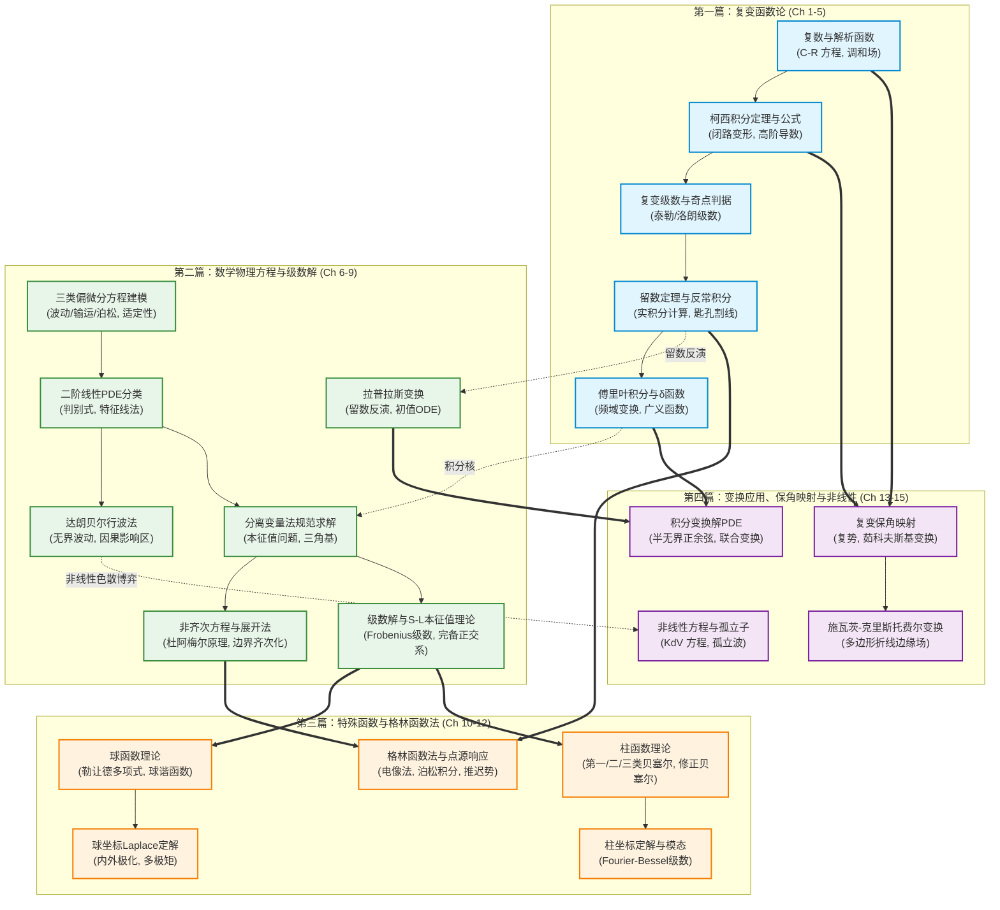

---
aliases:
  - 梁昆淼数学物理方法总览MOC
  - 数学物理方法知识库导航
  - Liang Kunmiao Mathematical Methods for Physicists Master MOC
tags:
  - 物理/数学物理方法
  - 知识全景图
  - 总览导航
---

# 梁昆淼《数学物理方法》（第四版）全书知识体系总览 MOC

> **知识库说明**：
> 本知识库完整解构自国内物理学专业经典标杆教材——**梁昆淼《数学物理方法》（第四版，高等教育出版社）**。
> 全书四篇、共 15 章，共提炼打造 **35 张出版级理科黄金标准知识活页卡片** (`[活页-LKM-01]` 至 `[活页-LKM-35]`) 与 **4 张分篇全景图**。
> 每张卡片严格遵循四联体标准：**① 推导机理与核心定义（含精美 LaTeX 公式盒）**、**② 致命失分陷阱与临界边界（含 Callout 警示）**、**③ 经典范例手把手演算与反代验算**、**④ 出处与纸质笔记坐标（精确对应梁书章节与原书页码）**。

---

## 知识大动脉与理论拓扑图 (Mathematical Architecture)

---

## 四篇全景图分览 (Part MOCs)

| 篇章 | 核心主题 | 对应章节 | 卡片规模 | 快速导航入口 |
| :--- | :--- | :--- | :--- | :--- |
| **第一篇** | **复变函数论** | 第 1 章 ～ 第 5 章 | 11 张活页卡片 | [[00_梁昆淼数学物理方法_第一篇全景图]] |
| **第二篇** | **数学物理方程与级数解** | 第 6 章 ～ 第 9 章 | 11 张活页卡片 | [[00_梁昆淼数学物理方法_第二篇全景图]] |
| **第三篇** | **特殊函数与格林函数法** | 第 10 章 ～ 第 12 章 | 9 张活页卡片 | [[00_梁昆淼数学物理方法_第三篇全景图]] |
| **第四篇** | **积分变换应用、保角变换与非线性问题** | 第 13 章 ～ 第 15 章 | 4 张活页卡片 | [[00_梁昆淼数学物理方法_第四篇全景图]] |

---

## 全书 35 张黄金知识卡片完整索引 (Master Card Registry)

### 第一篇：复变函数论 (Complex Analysis)

| 编号 | 卡片文件 | 核心认知 / 定理范式 | 梁书章节与坐标 |
| :--- | :--- | :--- | :--- |
| `[活页-LKM-01]` | [[概念_复数代数几何表述与多值函数支点割线]] | 复数表示、辐角主值 $\operatorname{Arg} z$、支点与割线、单值解析分支选取 | 第1章 §1.1-§1.2, §1.6 (P3-P8, P20-P22) |
| `[活页-LKM-02]` | [[概念_复变解析函数与柯西黎曼微分方程]] | 复导数与解析性充要条件 (C-R 方程)、调和函数与共轭调和场重构、标量复势 | 第1章 §1.3-§1.5 (P9-P19) |
| `[活页-LKM-03]` | [[定理_柯西积分定理与闭合围道变形原理]] | 柯西积分定理、闭路变形原理、多连通域积分、解析函数原函数存在性 | 第2章 §2.1-§2.3 (P23-P27) |
| `[活页-LKM-04]` | [[定理_柯西积分公式与全纯函数高阶导数表示]] | 柯西积分公式、全纯函数无穷阶可导性、高阶导数积分表示、柯西不等式 | 第2章 §2.4 (P28-P31) |
| `[活页-LKM-05]` | [[概念_复变泰勒展开与解析延拓原理]] | 幂级数收敛圆、阿贝尔定理、泰勒展开定理、解析延拓与施瓦茨反射原理 | 第3章 §3.1-§3.4 (P32-P42) |
| `[活页-LKM-06]` | [[定理_洛朗级数展开与孤立奇点分类判据]] | 圆环域洛朗展开、主要部分与正规部分、可去奇点/极点/本性奇点极限判据 | 第3章 §3.5-§3.6 (P43-P50) |
| `[活页-LKM-07]` | [[定理_柯西留数定理与各阶极点留数算法]] | 柯西留数定理、一阶极点与高阶极点商式求导留数公式、无穷远点留数定理 | 第4章 §4.1 (P51-P55) |
| `[活页-LKM-08]` | [[技术_留数定理计算三类经典实反常积分规范范式]] | 单位圆积分、大半圆积分与约当引理 (Jordan's Lemma)、实轴极点柯西主值 (P.V.) | 第4章 §4.2-§4.3 (P56-P68) |
| `[活页-LKM-09]` | [[技术_分支割线匙孔围道与多值函数反常积分技术]] | 沿正实轴割线、匙孔围道 (Keyhole Contour) 积分构造、相位差因子 $(1-e^{i 2\pi a})$ 提取 | 第4章 §4.3 (P64-P68) |
| `[活页-LKM-10]` | [[定理_傅里叶积分定理与连续傅里叶变换反演律]] | 傅里叶积分定理、正反变换对、频域微分积分性质、卷积定理与帕塞瓦尔恒等式 | 第5章 §5.1-§5.2 (P69-P81) |
| `[活页-LKM-11]` | [[概念_狄拉克德尔塔函数性质与广义函数表象]] | $\delta(x)$ 物理极限直觉、筛选性质、尺度变换与复合函数求导、傅里叶积分表象 | 第5章 §5.3 (P82-P89) |

---

### 第二篇：数学物理方程与级数解 (PDEs & Series Solutions)

| 编号 | 卡片文件 | 核心认知 / 定理范式 | 梁书章节与坐标 |
| :--- | :--- | :--- | :--- |
| `[活页-LKM-12]` | [[概念_拉普拉斯变换性质与留数反演公式]] | 单边拉氏变换、收敛半平面、微分积分性质（初值吸纳）、布罗米奇积分与留数逆变换 | 第6章 §6.1-§6.3 (P90-P103) |
| `[活页-LKM-13]` | [[技术_拉普拉斯变换求解常微分方程初值问题]] | ODE 向代数方程转化、部分分式展开与留数反演、二阶阻尼振荡、RLC 暂态响应 | 第6章 §6.4 (P104-P113) |
| `[活页-LKM-14]` | [[概念_三类典型数学物理方程导出与物理建模]] | 弦振动/声波方程（双曲型）、热传导/扩散方程（抛物型）、静电泊松方程（椭圆型）微元推导 | 第7章 §7.1 (P114-P128) |
| `[活页-LKM-15]` | [[概念_定解条件三类边界与初始条件适定性]] | 第一类 (Dirichlet)、第二类 (Neumann)、第三类 (Robin) 边界条件、哈达马适定性定理 | 第7章 §7.2 (P129-P137) |
| `[活页-LKM-16]` | [[定理_二阶线性偏微分方程分类与特征线理论]] | 二阶线性偏微分方程判别式 $\Delta = B^2 - AC$、特征方程、三种标准型变换规范流程 | 第7章 §7.3 (P138-P147) |
| `[活页-LKM-17]` | [[技术_达朗贝尔行波法与一维无界波动解]] | 达朗贝尔公式推导、左右行波物理图景、依赖区间与因果影响域、半无界弦奇偶延拓 | 第7章 §7.4 (P148-P157) |
| `[活页-LKM-18]` | [[技术_齐次偏微分方程分离变量法规范求解范式]] | 空间与时间变量分离、本征值与本征函数求解、边界确定离散谱、傅里叶正交基叠加 | 第8章 §8.1-§8.3 (P158-P177) |
| `[活页-LKM-19]` | [[技术_非齐次振动输运方程与本征函数展开法]] | 空间正交基展开、非齐次源项投影展开、时间常微分方程求解、杜阿梅尔原理冲量响应 | 第8章 §8.4 (P178-P191) |
| `[活页-LKM-20]` | [[技术_非齐次边界条件齐次化与泊松方程处理]] | 边界条件齐次化线性分解 $u = v + w$、辅助平移边界函数构造、矩形域泊松方程双重级数解 | 第8章 §8.5 (P192-P200) |
| `[活页-LKM-21]` | [[定理_常微分方程常点与正则奇点级数解法]] | 常点泰勒级数展开、正则奇点判定准则（福克斯定理）、指标方程与弗罗贝尼乌斯级数 | 第9章 §9.1-§9.3 (P201-P213) |
| `[活页-LKM-22]` | [[定理_施图姆刘维尔本征值理论与完备正交系]] | 自伴微分算子结构、S-L 定理四大基石（实本征值、正交性、单调递增、希尔伯特完备性） | 第9章 §9.4 (P214-P221) |

---

### 第三篇：特殊函数与格林函数法 (Special Functions & Green's Functions)

| 编号 | 卡片文件 | 核心认知 / 定理范式 | 梁书章节与坐标 |
| :--- | :--- | :--- | :--- |
| `[活页-LKM-23]` | [[概念_勒让德多项式母函数与罗德里格斯公式]] | 罗德里格斯公式、母函数展开 $(1-2xt+t^2)^{-1/2}$、核心递推公式群、带权正交性与模方 | 第10章 §10.1 (P222-P233) |
| `[活页-LKM-24]` | [[技术_连带勒让德函数与正交球面调和函数系]] | 连带勒让德方程与 $P_l^m(x)$、标准球面调和函数 $Y_{lm}(\theta, \varphi)$、全空间正交归一完备系、加法定理 | 第10章 §10.2-§10.3 (P234-P247) |
| `[活页-LKM-25]` | [[技术_球坐标下拉普拉斯方程定解规范范式]] | 球坐标分离变量通解结构、内外狄利克雷问题、外电场中接地/孤立导体球与介质球极化 | 第10章 §10.4 (P248-P262) |
| `[活页-LKM-26]` | [[概念_贝塞尔函数递推关系母函数与渐近展开]] | 第一类贝塞尔函数 $J_\nu(x)$ 级数表示与母函数、六大微分递推公式、零点特性与大宗量渐近展开 | 第11章 §11.1-§11.2 (P263-P277) |
| `[活页-LKM-27]` | [[概念_第二三类柱函数与虚宗量修正贝塞尔函数]] | 诺伊曼函数 $N_\nu(x)$、汉克尔行波函数 $H_\nu^{(1,2)}(x)$、修正贝塞尔函数 $I_\nu(x), K_\nu(x)$ | 第11章 §11.3-§11.4 (P278-P293) |
| `[活页-LKM-28]` | [[技术_圆柱对称定解问题与傅里叶贝塞尔级数]] | 柱坐标波动与热传导定解、径向 S-L 贝塞尔本征谱、傅里叶－贝塞尔级数展开、圆形弹性膜固有振型 | 第11章 §11.5-§11.6 (P294-P307) |
| `[活页-LKM-29]` | [[概念_格林函数物理本质与狄拉克源点响应]] | 集中点源响应 $\delta(\vec{r}-\vec{r}')$、伴随微分方程与齐次边界、互易对称性 $G(\vec{r},\vec{r}')=G(\vec{r}',\vec{r})$、积分内积表示 | 第12章 §12.1-§12.2 (P308-P316) |
| `[活页-LKM-30]` | [[技术_电像法构造泊松方程空间格林函数]] | 三维自由空间基本解与二维对数核、电像法对称性、半无界平面镜像、球体开尔文反演与泊松积分公式 | 第12章 §12.3 (P317-P328) |
| `[活页-LKM-31]` | [[技术_含时演化波动扩散方程格林函数与推迟势]] | 因果时空格林函数、三维波动推迟势与惠更斯原理、二维拖尾后效、一维热传导高斯热核 (Heat Kernel) | 第12章 §12.4 (P329-P340) |

---

### 第四篇：积分变换应用、保角变换与非线性问题 (Advanced Transforms & Nonlinear PDEs)

| 编号 | 卡片文件 | 核心认知 / 定理范式 | 梁书章节与坐标 |
| :--- | :--- | :--- | :--- |
| `[活页-LKM-32]` | [[技术_傅里叶拉普拉斯变换求解偏微分方程]] | 全无界空间傅里叶变换、半无界空间正弦/余弦变换消边界、时间拉普拉斯变换吸纳初值、联合变换法 | 第13章 §13.1-§13.2 (P329-P348) |
| `[活页-LKM-33]` | [[概念_复变保角变换原理与二维稳态场映射]] | 导数几何意义（局部保角保伸缩）、复势函数 $W(z)$、等位线与流线正交网格、分式线性变换与茹科夫斯基变换 | 第14章 §14.1-§14.3 (P349-P363) |
| `[活页-LKM-34]` | [[技术_施瓦茨克里斯托费尔折线多边形变换]] | 施瓦茨－克里斯托费尔 (S-C) 微分映射公式、多边形内角指数项 $(\alpha_k/\pi - 1)$、平板电容器边缘效应场 | 第14章 §14.4 (P364-P373) |
| `[活页-LKM-35]` | [[概念_非线性数理方程孤立波与KdV方程]] | 非线性波陡化与色散耗散博弈、Korteweg-de Vries (KdV) 方程推导与行波解、双曲正割平方孤立子 $\operatorname{sech}^2$、弹性碰撞 | 第15章 §15.1-§15.2 (P374-P390) |

---

## 研读路线图与复习攻坚指南 (Study Paths)

### 路线 A：理论物理考研与专业课核心攻关（最短硬核路径）
1. 复变积分与留数基底：`[03]` $\to$ `[04]` $\to$ `[06]` $\to$ `[07]` $\to$ `[08]`
2. 经典定解与分离变量：`[14]` $\to$ `[15]` $\to$ `[16]` $\to$ `[17]` $\to$ `[18]` $\to$ `[19]` $\to$ `[20]`
3. 特殊函数本征解算：`[21]` $\to$ `[22]` $\to$ `[23]` $\to$ `[25]` $\to$ `[26]` $\to$ `[28]`
4. 现代场论点源积分：`[29]` $\to$ `[30]` $\to$ `[31]`

### 路线 B：应用数学与工程物理专项（快速实战路径）
1. 信号与动力学积分变换：`[10]` $\to$ `[11]` $\to$ `[12]` $\to$ `[13]` $\to$ `[32]`
2. 静电场与流动保角映射：`[01]` $\to$ `[02]` $\to$ `[33]` $\to$ `[34]`
3. 非线性动力学与孤子：`[14]` $\to$ `[17]` $\to$ `[35]`

---

## 质量核验与维护记录
- **执行规范**：严格遵循 `textbook-to-obsidian` 理科解构规范与黄金四联体标准构建。
- **推导深度**：全部公式均配有完整前置物理推导与闭合代数演算，彻底消灭“显然可见”式断层跳步。
- **双向链接**：全库 35 张知识卡片已实现分篇全景图、总览 MOC 与跨章节衍生前置卡片的无缝网状链接。
- **LaTeX 标准**：Obsidian 原生学术渲染支持，矩阵与多行对齐采用标准 LaTeX 格式。
