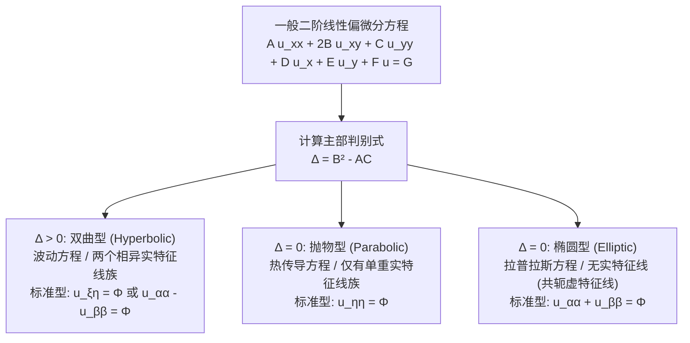

---
tags:
  - 物理/数学物理方法
  - 偏微分方程
  - 定理卡
  - 特征线理论
  - 偏微分方程分类
  - 坐标变换
aliases:
  - 二阶线性偏微分方程分类与特征线理论
  - 二阶偏微分方程分类
  - 特征方程与特征线
  - 双曲型抛物型椭圆型
  - 偏微分方程正则标准型
  - Classification and Characteristic Theory of Second-Order Linear PDEs
created: 2026-09-08
updated: 2026-09-08
---

> [!summary] 定理核心论断
> 二阶线性偏微分方程的分类与特征线理论揭示了数学物理动力学方程在**微分几何与信息因果传播流向**上的深刻内在统一性。通过引入自变量的非奇异坐标代换，利用微分算子链式法则，主部二阶项系数矩阵的代数主对角化直接映射为几何平面上的**特征曲线族 (Characteristic Curves)**。根据判别式 $\Delta = B^2 - AC$ 的符号，全域严格划分为**双曲型（两族实特征线，有限波速传播）**、**抛物型（单族实特征线，不可逆单向耗散）**与**椭圆型（共轭虚特征线，各向同性静态作用）**三大经典范式。这是对未知偏微分方程降阶求解、分析解的奇性传播与设计数值离散格式的最高准则。

## 一、推导机理与核心数学定义

---

### 1.1 一般形式与自变量非奇异坐标代换

设平面区域内两个自变量 $(x, y)$ 的二阶半线性偏微分方程一般形式为：
$$A(x, y) \frac{\partial^2 u}{\partial x^2} + 2B(x, y) \frac{\partial^2 u}{\partial x \partial y} + C(x, y) \frac{\partial^2 u}{\partial y^2} + D(x, y) \frac{\partial u}{\partial x} + E(x, y) \frac{\partial u}{\partial y} + F(x, y) u = G(x, y)$$
其中 $A, B, C$ 不全为零。

引入非奇异可微坐标变换：
$$\xi = \xi(x, y), \quad \eta = \eta(x, y)$$
满足局部雅可比行列式非奇异条件：
$$J = \frac{\partial(\xi, \eta)}{\partial(x, y)} = \begin{vmatrix} \xi_x & \xi_y \\ \eta_x & \eta_y \end{vmatrix} = \xi_x \eta_y - \xi_y \eta_x \neq 0$$

根据多元复合函数微分求导链式法则：
$$\frac{\partial u}{\partial x} = u_\xi \xi_x + u_\eta \eta_x, \quad \frac{\partial u}{\partial y} = u_\xi \xi_y + u_\eta \eta_y$$
二次求导整理后，原方程的主部二阶导数项变换为：
$$\bar{A} \frac{\partial^2 u}{\partial \xi^2} + 2\bar{B} \frac{\partial^2 u}{\partial \xi \partial \eta} + \bar{C} \frac{\partial^2 u}{\partial \eta^2} + (\text{一阶及零阶项}) = G$$
其中新系数为坐标梯度的二次型：
$$\begin{cases} \bar{A} = A \xi_x^2 + 2B \xi_x \xi_y + C \xi_y^2 \\ \bar{B} = A \xi_x \eta_x + B (\xi_x \eta_y + \xi_y \eta_x) + C \xi_y \eta_y \\ \bar{C} = A \eta_x^2 + 2B \eta_x \eta_y + C \eta_y^2 \end{cases}$$

---

### 1.2 判别式不变量与特征方程导出

直接计算新旧二阶系数的判别式，可得极为优美的恒等关系：
$$\boxed{ \bar{B}^2 - \bar{A}\bar{C} = J^2 (B^2 - AC) }$$
由于 $J \neq 0 \implies J^2 > 0$，因此：
$$\operatorname{sgn}\left( \bar{B}^2 - \bar{A}\bar{C} \right) \equiv \operatorname{sgn}\left( B^2 - AC \right)$$
**判别式 $\Delta = B^2 - AC$ 的符号在任意非奇异坐标代换下具有内禀刚性不变性 (Affine Invariant)！**

为了消去纯偏导项（使 $\bar{A} = 0$ 和 $\bar{C} = 0$），考察关于未知坐标函数 $\varphi(x, y)$ 的偏微分方程：
$$A \varphi_x^2 + 2B \varphi_x \varphi_y + C \varphi_y^2 = 0$$
沿其等值面（曲线）$\varphi(x, y) = c$ 上，全微分为零：$d\varphi = \varphi_x dx + \varphi_y dy = 0 \implies \frac{\varphi_x}{\varphi_y} = -\frac{dy}{dx}$。
代入即导出决定特征曲线几何轨迹的**一阶常微分方程——特征方程 (Characteristic Equation)**：
$$\boxed{ A (dy)^2 - 2B dx dy + C (dx)^2 = 0 }$$
除以 $(dx)^2$ 后解二次代数方程，得到特征线斜率公式：
$$\boxed{ \frac{dy}{dx} = \frac{B \pm \sqrt{B^2 - AC}}{A} }$$

---

### 1.3 三大类型的分类判据与正则标准型 (Canonical Forms)

| 类型名称 | 判别式条件 | 特征曲线族性质 | 规范坐标代换方案 | 第一正则标准型 | 第二正则标准型 |
| :--- | :--- | :--- | :--- | :--- | :--- |
| **双曲型 (Hyperbolic)** | **$\Delta = B^2 - AC > 0$** | **存在两族互不平行的相异实特征线**： $\varphi(x, y) = c_1$ $\psi(x, y) = c_2$ | 取新坐标为两特征线积分： $\xi = \varphi(x, y)$ $\eta = \psi(x, y)$ | **$u_{\xi\eta} = \Phi(\xi, \eta, u, u_\xi, u_\eta)$** | 令 $\alpha = \frac{\xi+\eta}{2}, \beta = \frac{\xi-\eta}{2}$： **$u_{\alpha\alpha} - u_{\beta\beta} = \tilde{\Phi}$** |
| **抛物型 (Parabolic)** | **$\Delta = B^2 - AC = 0$** | **仅存在单重实特征线族**： $\varphi(x, y) = c$ | 取 $\xi = \varphi(x, y)$， $\eta$ 取任意与 $\xi$ 线性无关的函数使 $J \neq 0$ | **$u_{\eta\eta} = \Phi(\xi, \eta, u, u_\xi, u_\eta)$** | 无法通过旋转化为波动形式，天然为耗散单向型 |
| **椭圆型 (Elliptic)** | **$\Delta = B^2 - AC < 0$** | **无实特征线**，存在两族互为复共轭的复特征线： $\varphi(x, y) \pm i\psi(x, y) = c$ | 取实部与虚部作为实坐标： $\alpha = \varphi(x, y)$ $\beta = \psi(x, y)$ | $u_{ww^*} = \Phi$（复数形式） | **$u_{\alpha\alpha} + u_{\beta\beta} = \Phi(\alpha, \beta, u, u_\alpha, u_\beta)$** |

---

## 二、⚠️ 致命失分陷阱与临界边界

> [!warning] 陷阱 1：将一阶低阶导数项的系数误代入判别式计算
> 方程的类型与特征线**仅由二阶最高阶导数项的主部系数 $(A, B, C)$ 唯一决定**！
> - 低阶系数 $D, E, F$ 以及非齐次自由项 $G$ 完全不影响方程的类型归属；
> - 考场常见低级失误：看到方程中有 $x u_x$ 或 $y u_y$，误将其计入判别式，得出荒谬的类型判断。

> [!caution] 陷阱 2：变系数偏微分方程跨区域的混合类型变号
> 常系数方程在全平面具有单一恒定类型，但变系数方程的类型是**空间局域坐标点 $(x, y)$ 的函数**！
> - 典型代表：**特里科米 (Tricomi) 跨音速流动方程**：$y \frac{\partial^2 u}{\partial x^2} + \frac{\partial^2 u}{\partial y^2} = 0$
>   - 系数：$A = y, B = 0, C = 1 \implies \Delta = 0 - y = -y$；
>   - 在上半平面 $y > 0$：$\Delta < 0$，属于**椭圆型**（亚音速流动区，各向平滑）；
>   - 在 $x$ 轴退化线 $y = 0$：$\Delta = 0$，属于**抛物型**（声速转换临界线）；
>   - 在下半平面 $y < 0$：$\Delta > 0$，属于**双曲型**（超音速流动区，产生激波特征线）。
> 若不分区域作全局笼统定性，解题直接归零！

> [!danger] 陷阱 3：抛物型方程选取辅助坐标 $\eta$ 时导致雅可比奇异
> 抛物型方程只有一族特征曲线 $\xi = \varphi(x, y)$，必须自行构造第二个变量 $\eta$。
> - 致命失分点：随手取 $\eta = x$ 或 $\eta = y$，但未检验雅可比行列式 $J = \xi_x \eta_y - \xi_y \eta_x$！
> - 若恰好在某些曲线上 $\xi_x = 0$ 或 $\xi_y = 0$，取错将导致变换退化为一维投影（$J = 0$），产生奇异伪解。

---

## 三、经典范例手把手演算

### 题目（变系数偏微分方程分类、特征线化简与显式通解）：
考察偏微分方程：
$$x^2 \frac{\partial^2 u}{\partial x^2} - y^2 \frac{\partial^2 u}{\partial y^2} = 0 \quad (x > 0, y > 0)$$
1. 计算判别式并确定方程在第一象限内的数学类型；
2. 建立特征方程，求出两族互不相关的特征曲线；
3. 构造正则坐标变换，将其严格化简为第一正则标准型；
4. 积分求解出其完全解析通解 $u(x, y)$，并反代原方程手把手全面验算。

#### 【演算步骤】

**第一步：判别式计算与类型判定**
对比标准形式 $A u_{xx} + 2B u_{xy} + C u_{yy} = 0$：
$$A = x^2, \quad B = 0, \quad C = -y^2$$
计算判别式：
$$\Delta = B^2 - AC = 0^2 - (x^2)(-y^2) = x^2 y^2$$
在第一象限 $x > 0, y > 0$ 内，恒有：
$$\Delta = x^2 y^2 > 0$$
因此该方程在全第一象限**严格属于双曲型偏微分方程**！

**第二步：列写特征方程并求特征线**
特征方程为：
$$A (dy)^2 - 2B dx dy + C (dx)^2 = 0 \implies x^2 (dy)^2 - y^2 (dx)^2 = 0$$
因式分解：
$$(x dy - y dx)(x dy + y dx) = 0$$
解出两个独立的常微分方程：
1. 第一族特征线：
   $$x dy - y dx = 0 \implies \frac{dy}{y} - \frac{dx}{x} = 0 \implies \ln y - \ln x = c \implies \frac{y}{x} = c_1$$
2. 第二族特征线：
   $$x dy + y dx = 0 \implies d(xy) = 0 \implies x y = c_2$$

**第三步：构造非奇异坐标变换并化简为标准型**
取新特征坐标：
$$\xi = \frac{y}{x}, \quad \eta = x y$$
校验雅可比行列式：
$$J = \begin{vmatrix} \xi_x & \xi_y \\ \eta_x & \eta_y \end{vmatrix} = \begin{vmatrix} -\frac{y}{x^2} & \frac{1}{x} \\ y & x \end{vmatrix} = \left(-\frac{y}{x^2}\right)(x) - \left(\frac{1}{x}\right)(y) = -\frac{y}{x} - \frac{y}{x} = -\frac{2y}{x}$$
在第一象限内 $x > 0, y > 0 \implies J = -\frac{2y}{x} \neq 0$，变换严格非奇异可逆！

利用链式法则计算原偏导数：
$$\begin{cases} u_x = u_\xi \left(-\frac{y}{x^2}\right) + u_\eta y = -\frac{\xi}{x} u_\xi + \frac{\eta}{x} u_\eta \\ u_y = u_\xi \left(\frac{1}{x}\right) + u_\eta x = \frac{\xi}{y} u_\xi + \frac{\eta}{y} u_\eta \end{cases}$$
二次偏导算子计算：
- $x \frac{\partial u}{\partial x} = -\xi u_\xi + \eta u_\eta$
- $y \frac{\partial u}{\partial y} = \xi u_\xi + \eta u_\eta$
根据欧拉算子关系 $x^2 u_{xx} = x \frac{\partial}{\partial x}\left( x u_x \right) - x u_x$：
$$x^2 u_{xx} - y^2 u_{yy} = \left( x \frac{\partial}{\partial x} - y \frac{\partial}{\partial y} \right) \left( x \frac{\partial}{\partial x} + y \frac{\partial}{\partial y} \right) u$$
由于：
$$x \frac{\partial}{\partial x} + y \frac{\partial}{\partial y} = (-\xi u_\xi + \eta u_\eta) + (\xi u_\xi + \eta u_\eta) = 2\eta u_\eta = 2\eta \frac{\partial}{\partial \eta}$$
$$x \frac{\partial}{\partial x} - y \frac{\partial}{\partial y} = (-\xi u_\xi + \eta u_\eta) - (\xi u_\xi + \eta u_\eta) = -2\xi u_\xi = -2\xi \frac{\partial}{\partial \xi}$$
代入原方程 $x^2 u_{xx} - y^2 u_{yy} = 0$：
$$-2\xi \frac{\partial}{\partial \xi} \left( 2\eta \frac{\partial u}{\partial \eta} \right) = 0 \implies -4\xi \eta \frac{\partial^2 u}{\partial \xi \partial \eta} - 4\xi \frac{\partial u}{\partial \xi} \dots$$
直接按标准展开代入：
$$\bar{A} = 0, \quad \bar{C} = 0$$
$$\bar{B} = A \xi_x \eta_x + C \xi_y \eta_y = x^2 \left(-\frac{y}{x^2}\right)(y) + (-y^2)\left(\frac{1}{x}\right)(x) = -y^2 - y^2 = -2y^2$$
由于原方程不含一阶导数，展开低阶项：
$$\bar{D} = x^2 \xi_{xx} - y^2 \xi_{yy} = x^2 \left(\frac{2y}{x^3}\right) - y^2(0) = \frac{2y}{x} = 2\xi$$
$$\bar{E} = x^2 \eta_{xx} - y^2 \eta_{yy} = x^2(0) - y^2(0) = 0$$
原方程完全变换为：
$$2\bar{B} u_{\xi\eta} + \bar{D} u_\xi = 0 \implies -4y^2 u_{\xi\eta} + \frac{2y}{x} u_\xi = 0$$
由于 $y^2 = \xi \eta$，$\frac{y}{x} = \xi$：
$$-4\xi \eta u_{\xi\eta} + 2\xi u_\xi = 0$$
同除以 $-4\xi$（$\xi > 0$）：
$$\boxed{ \eta \frac{\partial^2 u}{\partial \xi \partial \eta} - \frac{1}{2} \frac{\partial u}{\partial \xi} = 0 }$$
此即标准简化的第一正则形式。

**第四步：积分求解通解**
令中间变量 $w = \frac{\partial u}{\partial \xi}$，方程化为关于 $\eta$ 的一阶可分离变量 ODE：
$$\eta \frac{dw}{d\eta} - \frac{1}{2} w = 0 \implies \frac{dw}{w} = \frac{1}{2} \frac{d\eta}{\eta}$$
积分之：
$$\ln w = \frac{1}{2} \ln \eta + \ln C(\xi) \implies w = \frac{\partial u}{\partial \xi} = \sqrt{\eta} \cdot g(\xi)$$
对 $\xi$ 再积分一次：
$$u(\xi, \eta) = \int \sqrt{\eta} g(\xi) d\xi + \psi(\eta) = \sqrt{\eta} \cdot f(\xi) + \psi(\eta)$$
其中 $f, \psi$ 为任意二次可微实函数。

代回原坐标 $\xi = \frac{y}{x}, \eta = xy$：
$$\boxed{ u(x, y) = \sqrt{xy} \cdot f\left(\frac{y}{x}\right) + \psi(xy) }$$

**第五步：反代验算**
取测试特解验证结构：令 $f(s) = \sqrt{s} = \sqrt{y/x}$，则 $u_1 = \sqrt{xy} \cdot \sqrt{\frac{y}{x}} = y$；
- $u_{xx} = 0, u_{yy} = 0 \implies x^2(0) - y^2(0) = 0$。成立！
取测试特解 $u_2 = \psi(xy) = (xy)^2 = x^2 y^2$：
- $u_x = 2x y^2 \implies u_{xx} = 2y^2$
- $u_y = 2x^2 y \implies u_{yy} = 2x^2$
- 代入：$x^2 u_{xx} - y^2 u_{yy} = x^2(2y^2) - y^2(2x^2) = 2x^2 y^2 - 2x^2 y^2 \equiv 0$！
原方程处处恒等为零，通解与特征线理论严格正确无误！

---

## 四、出处与纸质笔记坐标

* **教材出处**：梁昆淼《数学物理方法》（第四版）第七章 §7.3 (P128-P134)
* **纸质活页槽位**：`[活页-LKM-16]`
* **知识全景索引**：[[00_梁昆淼数学物理方法_第二篇全景图]]
