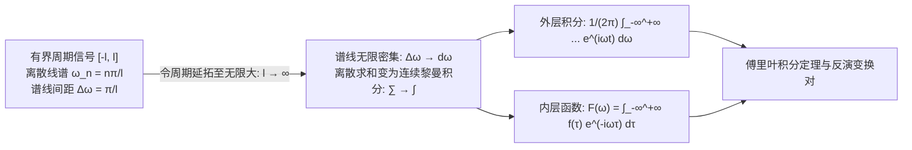

---
tags:
  - 物理/数学物理方法
  - 积分变换
  - 定理卡
  - 傅里叶变换
  - 傅里叶积分定理
  - 卷积定理
  - 帕塞瓦尔定理
aliases:
  - 傅里叶积分定理与连续傅里叶变换反演律
  - 傅里叶积分定理
  - 连续傅里叶变换
  - 傅里叶反演公式
  - 卷积定理与帕塞瓦尔定理
  - Fourier Integral Theorem
  - Fourier Transform and Inversion
created: 2026-09-07
updated: 2026-09-08
---

> [!summary] 定理核心透视
> 傅里叶积分定理（Fourier Integral Theorem）标志着数学物理分析从**离散驻波谐波系向连续全域波包谱分析**的质的飞跃。当物理系统的空间或时间尺度延展至全实轴无界域（周期 $T \to \infty$）时，离散傅里叶级数的谱线间距收缩为零，线谱平滑凝聚为连续频谱函数。傅里叶变换对（Fourier Transform Pair）由此诞生，构成了现代时频分析与线性时不变系统理论的支柱。其最具革命性的算子魔力在于**微分代数化**——将时域或空间中极其棘手的微积分算子 $\frac{d}{dt}$ 降维映射为频域中的纯代数乘法因子 $i\omega$；结合**卷积定理**与**帕塞瓦尔能量守恒律**，为偏微分方程（波动方程、热传导方程、薛定谔方程）提供了最核心的解析求解通道。

---

## 一、定理陈述与推导机理

### 1.1 从离散傅里叶级数向连续傅里叶积分的极限跃迁

设函数 $f(t)$ 定义在有限对称区间 $[-l, l]$ 上，满足狄利克雷条件（分段光滑、极值点有限），展开为复指数形式的离散傅里叶级数：
$$f(t) = \sum_{n=-\infty}^{+\infty} c_n e^{i \omega_n t}, \quad c_n = \frac{1}{2l} \int_{-l}^l f(\tau) e^{-i \omega_n \tau} d\tau$$
其中离散角频率为 $\omega_n = \frac{n\pi}{l}$，相邻频率谱线间距为：
$$\Delta \omega = \omega_{n+1} - \omega_n = \frac{\pi}{l} \implies \frac{1}{2l} = \frac{\Delta \omega}{2\pi}$$

#### 极限推演过程
将系数 $c_n$ 代回级数表达式：
$$f(t) = \sum_{n=-\infty}^{+\infty} \left[ \frac{1}{2\pi} \int_{-l}^l f(\tau) e^{-i \omega_n \tau} d\tau \right] e^{i \omega_n t} \Delta \omega$$
令区域向无界全实轴延伸，即 $l \to \infty$：
- 频率间距 $\Delta \omega \to 0$，离散频率 $\omega_n$ 转化为连续变量 $\omega$；
- 离散求和式严格收敛为连续变量 $\omega$ 在全实轴 $(-\infty, +\infty)$ 上的黎曼积分；
- 得到**傅里叶积分定理 (Fourier's Integral Formula)**：

$$\boxed{f(t) = \frac{1}{2\pi} \int_{-\infty}^{+\infty} \left[ \int_{-\infty}^{+\infty} f(\tau) e^{-i \omega \tau} d\tau \right] e^{i \omega t} d\omega}$$

*(在间断点 $t_0$ 处，积分值严格收敛于左右极限的几何平均值 $\frac{f(t_0^+) + f(t_0^-)}{2}$)*。

---

### 1.2 傅里叶正反变换对的标准定义

由傅里叶积分定理自然解耦出两道相互互逆的映射（物理学对称形式约定）：

$$\boxed{\begin{aligned}
\text{正变换 (Forward FT):} \quad & F(\omega) = \mathcal{F}[f(t)] = \int_{-\infty}^{+\infty} f(t) e^{-i \omega t} dt \\
\text{反变换 (Inverse FT):} \quad & f(t) = \mathcal{F}^{-1}[F(\omega)] = \frac{1}{2\pi} \int_{-\infty}^{+\infty} F(\omega) e^{i \omega t} d\omega
\end{aligned}}$$

#### 充分收敛条件（狄利克雷条件）
1. **绝对可积性**：$\int_{-\infty}^{+\infty} |f(t)| dt < \infty$；
2. 在任意有限区间内，只有有限个第一类间断点和有限个极值点。

---

### 1.3 连续傅里叶变换的核心运算性质群

设 $\mathcal{F}[f(t)] = F(\omega), \mathcal{F}[g(t)] = G(\omega)$：

| 运算法则 | 时域表达式 $f(t)$ | 频域表达式 $F(\omega)$ | 物理意义与数学机制 |
| :--- | :--- | :--- | :--- |
| **线性性质** | $\alpha f(t) + \beta g(t)$ | $\alpha F(\omega) + \beta G(\omega)$ | 线性叠加原理 |
| **尺度变换** | $f(at) \quad (a \ne 0)$ | $\frac{1}{\|a\|} F\left( \frac{\omega}{a} \right)$ | 时域压缩对应频域展宽（不确定性原理） |
| **时移定理** | $f(t - t_0)$ | $e^{-i \omega t_0} F(\omega)$ | 时移不改变振幅谱，仅引入线性相移 |
| **频移定理 (调制)** | $e^{i \omega_0 t} f(t)$ | $F(\omega - \omega_0)$ | 高频正弦载波调制与频谱搬移 |
| **时域微分定理** | $f'(t)$ | $i\omega F(\omega)$ | **核心价值**：求导降维为乘以 $i\omega$ |
| **高阶微分定理** | $f^{(n)}(t)$ | $(i\omega)^n F(\omega)$ | 将常系数微分方程直接转化为代数方程 |
| **频域微分定理** | $(-it)^n f(t)$ | $\frac{d^n F(\omega)}{d\omega^n}$ | 时频对偶性 |
| **时域积分定理** | $\int_{-\infty}^t f(\tau) d\tau$ | $\frac{F(\omega)}{i\omega} + \pi F(0) \delta(\omega)$ | 积分对应除以 $i\omega$，包含直流分量 |

---

### 1.4 卷积定理与帕塞瓦尔能量守恒律

#### (1) 卷积定理 (Convolution Theorem)
定义两函数在时域的连续卷积：
$$(f * g)(t) \equiv \int_{-\infty}^{+\infty} f(\tau) g(t - \tau) d\tau$$
对卷积求傅里叶变换：
$$\begin{aligned}
\mathcal{F}[(f * g)(t)] &= \int_{-\infty}^{+\infty} \left[ \int_{-\infty}^{+\infty} f(\tau) g(t - \tau) d\tau \right] e^{-i\omega t} dt \\
&= \int_{-\infty}^{+\infty} f(\tau) \left[ \int_{-\infty}^{+\infty} g(t - \tau) e^{-i\omega(t-\tau)} dt \right] e^{-i\omega \tau} d\tau \\
&= \left( \int_{-\infty}^{+\infty} g(u) e^{-i\omega u} du \right) \left( \int_{-\infty}^{+\infty} f(\tau) e^{-i\omega \tau} d\tau \right) = G(\omega) F(\omega)
\end{aligned}$$

$$\boxed{\mathcal{F}[(f * g)(t)] = F(\omega) \cdot G(\omega)}$$

**物理内涵**：时域极其繁复的卷积滤波积分，在频域退化为极其简洁的**点对点乘法**！输出频谱等于输入频谱乘上传递函数。

#### (2) 帕塞瓦尔定理 (Parseval's Identity / Plancherel Theorem)
设能量型信号 $f(t) \in L^2(\mathbb{R})$：
$$\int_{-\infty}^{+\infty} f(t) g^*(t) dt = \frac{1}{2\pi} \int_{-\infty}^{+\infty} F(\omega) G^*(\omega) d\omega$$
特别地，当 $g(t) = f(t)$ 时：

$$\boxed{\int_{-\infty}^{+\infty} |f(t)|^2 dt = \frac{1}{2\pi} \int_{-\infty}^{+\infty} |F(\omega)|^2 d\omega}$$

**物理内涵**：信号在时域的总物理能量，严格等于其在频域能量谱密度 $|F(\omega)|^2$ 的连续积分（能量守恒定律的频域表现）。

---

## 二、⚠️ 致命失分陷阱与临界边界

> [!warning] 陷阱 1：归一化常数与核函数指数符号混乱
> 不同教材对傅里叶变换定义有不同约定（对称型 $\frac{1}{\sqrt{2\pi}}$、非对称型正变换无系数反变换 $\frac{1}{2\pi}$）。
> 梁昆淼教材采用中国物理学标准约定：
> 正变换内核为 **$e^{-i\omega t}$**，系数为 **$1$**；
> 反变换内核为 **$e^{+i\omega t}$**，系数为 **$\frac{1}{2\pi}$**！
> 绝对不能在反演时漏掉 $\frac{1}{2\pi}$，亦不可在正反变换中搞反指数上的正负号。

> [!caution] 陷阱 2：对非绝对可积函数盲目套用初等积分
> 常见信号如常数 $f(t) = 1$、阶跃函数 $\theta(t)$、正弦波 $\cos(\omega_0 t)$ 并不满足 $\int_{-\infty}^{+\infty} |f(t)| dt < \infty$。
> 它们的傅里叶变换**在传统经典函数意义下发散**！必须引入广义函数（狄拉克 $\delta$ 函数）才能表达（如 $\mathcal{F}[1] = 2\pi \delta(\omega)$，$\mathcal{F}[\cos \omega_0 t] = \pi [\delta(\omega - \omega_0) + \delta(\omega + \omega_0)]$）。

> [!danger] 陷阱 3：微分性质应用中忽视边界衰减条件
> 微分定理 $\mathcal{F}[f'(t)] = i\omega F(\omega)$ 的推导依赖分部积分：
> $\int_{-\infty}^{+\infty} f'(t) e^{-i\omega t} dt = [f(t) e^{-i\omega t}]_{-\infty}^{+\infty} + i\omega \int_{-\infty}^{+\infty} f(t) e^{-i\omega t} dt$。
> 其成立的前提是**在无穷远处原函数必须衰减为零**：$\lim_{t \to \pm\infty} f(t) = 0$。若边界项不为零，直接套用将丢失常数跳变项。

---

## 三、经典范例手把手演算与反代验算

### 3.1 经典例题：双边单指数衰减信号的傅里叶正反变换与能量核验
**题目（梁书第 5 章 §5.2 核心基础例题）**：
求双边指数衰减信号（典型阻尼波形）
$$f(t) = e^{-a |t|} \quad (a > 0)$$
的傅里叶变换 $F(\omega)$，并利用傅里叶反演公式与留数微积分反向还原 $f(t)$，最后验证帕塞瓦尔恒等式。

#### 第一步：求解正傅里叶变换 $F(\omega)$
由于绝对值符号，拆分为正负半轴实积分：
$$\begin{aligned}
F(\omega) &= \int_{-\infty}^{+\infty} e^{-a |t|} e^{-i\omega t} dt = \int_{-\infty}^0 e^{at} e^{-i\omega t} dt + \int_0^{+\infty} e^{-at} e^{-i\omega t} dt \\
&= \int_{-\infty}^0 e^{(a - i\omega)t} dt + \int_0^{+\infty} e^{-(a + i\omega)t} dt
\end{aligned}$$
因 $a > 0$，上下限指数项在无穷远处衰减收敛：
$$\begin{aligned}
\int_{-\infty}^0 e^{(a - i\omega)t} dt &= \left[ \frac{e^{(a - i\omega)t}}{a - i\omega} \right]_{-\infty}^0 = \frac{1}{a - i\omega} - 0 = \frac{1}{a - i\omega} \\
\int_0^{+\infty} e^{-(a + i\omega)t} dt &= \left[ -\frac{e^{-(a + i\omega)t}}{a + i\omega} \right]_0^{+\infty} = 0 - \left( -\frac{1}{a + i\omega} \right) = \frac{1}{a + i\omega}
\end{aligned}$$
通分相加：
$$F(\omega) = \frac{1}{a - i\omega} + \frac{1}{a + i\omega} = \frac{(a + i\omega) + (a - i\omega)}{(a - i\omega)(a + i\omega)} = \frac{2a}{a^2 + \omega^2}$$
得到洛伦兹线型频谱：
$$\boxed{F(\omega) = \frac{2a}{\omega^2 + a^2}}$$

#### 第二步：傅里叶反演公式与留数微积分复原
由反演公式：
$$f(t) = \frac{1}{2\pi} \int_{-\infty}^{+\infty} \frac{2a}{\omega^2 + a^2} e^{i\omega t} d\omega = \frac{a}{\pi} \int_{-\infty}^{+\infty} \frac{e^{i\omega t}}{\omega^2 + a^2} d\omega$$
将变量 $\omega$ 延拓为复变量 $z$。奇点为 $z = \pm ia$。
1. **当 $t > 0$ 时**：指数为 $e^{izt}$，满足约当引理向上半平面闭合条件（$t > 0$）：
   上半平面内仅包含单极点 $z_1 = ia$。
   留数计算：
   $$\operatorname{Res}\left[ \frac{e^{izt}}{z^2 + a^2}, ia \right] = \lim_{z \to ia} (z - ia) \frac{e^{izt}}{(z - ia)(z + ia)} = \frac{e^{i(ia)t}}{2ia} = \frac{e^{-at}}{2ia}$$
   由留数定理：
   $$f(t) = \frac{a}{\pi} \cdot 2\pi i \cdot \frac{e^{-at}}{2ia} = e^{-at}$$
2. **当 $t < 0$ 时**：令 $t = -|t|$。指数为 $e^{-iz|t|}$。必须**向下半平面顺时针闭合**（方向为负向）：
   下半平面内仅包含极点 $z_2 = -ia$。
   $$\operatorname{Res}\left[ \frac{e^{izt}}{z^2 + a^2}, -ia \right] = \frac{e^{i(-ia)t}}{-2ia} = \frac{e^{at}}{-2ia}$$
   下半平面围道为顺时针方向，计入负号：
   $$f(t) = \frac{a}{\pi} \cdot (-2\pi i) \cdot \frac{e^{at}}{-2ia} = e^{at} = e^{-a|t|}$$
统一两式：对任意实数 $t$ 恒有：
$$f(t) = e^{-a|t|}$$
反演完美还原原函数！

#### 第三步：帕塞瓦尔能量守恒恒等式验算
1. **时域积分总能量**：
   $$\int_{-\infty}^{+\infty} |f(t)|^2 dt = \int_{-\infty}^{+\infty} e^{-2a|t|} dt = 2 \int_0^{+\infty} e^{-2at} dt = 2 \left[ -\frac{e^{-2at}}{2a} \right]_0^{+\infty} = \frac{1}{a}$$
2. **频域积分总能量**：
   $$\frac{1}{2\pi} \int_{-\infty}^{+\infty} |F(\omega)|^2 d\omega = \frac{1}{2\pi} \int_{-\infty}^{+\infty} \left( \frac{2a}{\omega^2 + a^2} \right)^2 d\omega = \frac{2a^2}{\pi} \int_{-\infty}^{+\infty} \frac{1}{(\omega^2 + a^2)^2} d\omega$$
   应用留数定理计算该有理积分：上半平面有二阶极点 $z = ia$。
   $$\operatorname{Res}\left[ \frac{1}{(z^2 + a^2)^2}, ia \right] = \lim_{z \to ia} \frac{d}{dz} \left[ \frac{1}{(z + ia)^2} \right] = \lim_{z \to ia} \left[ -\frac{2}{(z + ia)^3} \right] = -\frac{2}{(2ia)^3} = -\frac{2}{-8i a^3} = \frac{1}{4i a^3}$$
   闭路积分值：
   $$\int_{-\infty}^{+\infty} \frac{1}{(\omega^2 + a^2)^2} d\omega = 2\pi i \cdot \frac{1}{4i a^3} = \frac{\pi}{2 a^3}$$
   代入总能量：
   $$\frac{2a^2}{\pi} \cdot \left( \frac{\pi}{2 a^3} \right) = \frac{1}{a}$$
时域能量 $\frac{1}{a}$ 与频域能量 $\frac{1}{a}$ 严格相等！验证完全闭环！

---

## 四、出处与纸质笔记坐标

- **教材出处**：梁昆淼《数学物理方法》（第四版）
  - 第五章：傅里叶变换
  - §5.1 傅里叶级数向积分过渡（原书 P69-P73）
  - §5.2 傅里叶积分与傅里叶变换（原书 P73-P81）
- **对应 MinerU OCR 语料**：`mineru_output/梁昆淼_数学物理方法/数学物理方法_梁昆淼_第四版/ocr/数学物理方法_梁昆淼_第四版.md` Lines 3202-3896
- **对应全景图**：[[00_梁昆淼数学物理方法_第一篇全景图]]
- **纸质活页定位**：`[活页-LKM-10]`
