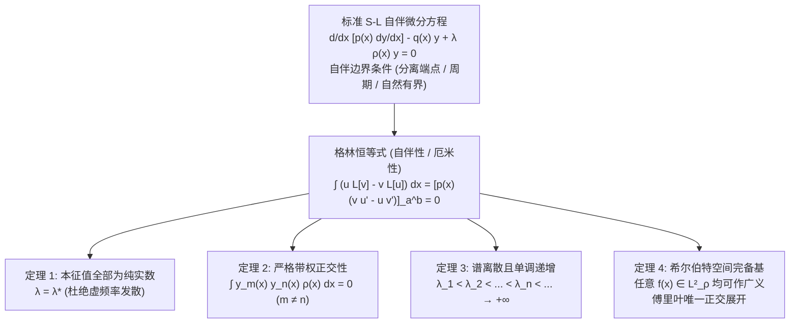

---
tags:
  - 物理/数学物理方法
  - 常微分方程
  - 定理卡
  - 施图姆刘维尔理论
  - 本征值问题
  - 正交完备基
  - 希尔伯特空间
aliases:
  - 施图姆刘维尔本征值理论与完备正交系
  - 施图姆刘维尔理论
  - S-L 本征值问题
  - 自伴算符与格林公式
  - 广义傅里叶级数展开
  - Sturm-Liouville Eigenvalue Theory and Complete Orthogonal Systems
created: 2026-09-08
updated: 2026-09-08
---

> [!summary] 定理核心论断
> 施图姆－刘维尔 (Sturm-Liouville, S-L) 本征值理论是整个经典数学物理方法中最具统摄性的**泛函分析基石**，亦是量子力学中厄米算符谱理论在常微分方程领域的宏伟前奏。一切源于偏微分方程分离变量法所导出的空间边值问题（简谐三角函数、勒让德多项式、贝塞尔函数、拉盖尔多项式、埃尔米特多项式等），均可严格统一纳编入 S-L 自伴微分算符的普适框架。该理论以极其严密的逻辑确立了四大不可动摇的数学定理：**本征值的严格实数性**、**不同本征模关于权函数的严格正交性**、**本征谱的半无界离散递增性**、以及**本征函数基底在带权平方可积空间 $L^2_\rho$ 中的严格完备性**。

## 一、推导机理与核心数学定义

---

### 1.1 施图姆－刘维尔方程的标准自伴形式

在有限或半无限区间 $[a, b]$ 上，二阶齐次变系数线性微分方程的**标准 S-L 形式**表述为：
$$\boxed{ \frac{d}{dx}\left[ p(x) \frac{dy}{dx} \right] - q(x) y + \lambda \rho(x) y = 0 }$$
定义**微分算符** $L$：
$$L[y] \equiv -\frac{d}{dx}\left[ p(x) \frac{dy}{dx} \right] + q(x) y$$
则方程可写成极简的本征方程算符形式：
$$\boxed{ L[y] = \lambda \rho(x) y }$$

#### 核心系数的物理与分析约束：
1. **$p(x) \in C^1[a, b]$ 且在开区间内 $p(x) > 0$**（描述介质的刚度、张力、介电常数等传输物性）；
2. **$\rho(x) \in C[a, b]$ 且 $\rho(x) > 0$**，称为**权函数 (Weight Function)**（描述介质的质量密度、几何体积元因子）；
3. **$q(x) \in C[a, b]$ 且通常 $q(x) \ge 0$**（描述系统的恢复力刚度、耗散或空间势能项）；
4. 参数 $\lambda$ 为待确定的**本征值 (Eigenvalue)**，对应的非零解 $y(x) \not\equiv 0$ 称为**本征函数 (Eigenfunction)**。

> [!tip] 一般二阶方程化为标准 S-L 自伴方程的积分因子公式
> 若已知一般形式：$A(x) y'' + B(x) y' + C(x) y + \lambda D(x) y = 0$。
> 引入积分因子 $\mu(x) = \frac{1}{A(x)} \exp\left( \int \frac{B(x)}{A(x)} dx \right)$，两边同乘 $\mu(x)$，立即自伴化为：
> $$p(x) = \exp\left( \int \frac{B(x)}{A(x)} dx \right), \quad q(x) = -\frac{C(x)}{A(x)} p(x), \quad \rho(x) = \frac{D(x)}{A(x)} p(x)$$

---

### 1.2 格林恒等式与自伴边界条件

设有两个充分光滑的复函数 $u(x), v(x)$。考察微分表达式：
$$v L[u] - u L[v] = -v [p u']' + u [p v']' = -v (p' u' + p u'') + u (p' v' + p v'') = \frac{d}{dx} \left[ p(x) (u v' - v u') \right]$$
在区间 $[a, b]$ 上两边求定积分，得到**拉格朗日恒等式 / 一维格林公式**：
$$\boxed{ \int_a^b \left( v L[u] - u L[v] \right) dx = \left. p(x) \left[ u(x) v'(x) - v(x) u'(x) \right] \right|_a^b }$$

#### 自伴边界条件的三大类型（保证边界项右端严格为 0）：
1. **分离型线性齐次边界条件 (Separated BCs)**：
   $$\begin{cases} \alpha_1 y(a) + \beta_1 y'(a) = 0 & (\alpha_1^2 + \beta_1^2 \neq 0) \\ \alpha_2 y(b) + \beta_2 y'(b) = 0 & (\alpha_2^2 + \beta_2^2 \neq 0) \end{cases}$$
   在此条件下，$u(a) v'(a) - v(a) u'(a) \equiv 0$，边界项恒为零！
2. **周期性边界条件 (Periodic BCs)**：
   若 $p(a) = p(b)$，且施加：
   $$y(a) = y(b), \quad y'(a) = y'(b)$$
   边界项直接对消为零（如圆环振动、傅里叶级数）。
3. **奇异自然边界条件 (Natural Singular BCs)**：
   若在端点处 $p(a) = 0$（例如勒让德方程在 $x = \pm 1$ 处 $p(x) = 1 - x^2 = 0$；贝塞尔方程在原点 $x = 0$ 处 $p(x) = x = 0$）：
   只需补充物理自然的**端点有界性条件**：$\lim_{x \to a} |y(x)| < \infty$，边界项自然因 $p(a) = 0$ 而自动消失！

只要边界项为零，算符 $L$ 即满足**形式自伴性（Hermitian 自共轭性）**：
$$\langle v, L[u] \rangle = \langle L[v], u \rangle$$

---

### 1.3 施图姆－刘维尔理论四大核心定理证明

#### 定理一：本征值的纯实数性 (Reality of Eigenvalues)
> **结论**：自伴 S-L 问题的每一个本征值 $\lambda$ 必然是**纯实数**，绝无任何复数或虚数根！

*严格证明*：
设 $\lambda$ 是复本征值，对应的本征函数为 $y(x)$：
$$L[y] = \lambda \rho(x) y$$
对该方程两边取复共轭（因 $p(x), q(x), \rho(x)$ 为实函数，故 $L^* = L$）：
$$L[y^*] = \lambda^* \rho(x) y^*$$
在格林公式中取 $u = y(x), v = y^*(x)$：
$$\int_a^b \left( y^* L[y] - y L[y^*] \right) dx = 0$$
将两本征方程代入：
$$\int_a^b \left[ y^* (\lambda \rho y) - y (\lambda^* \rho y^*) \right] dx = (\lambda - \lambda^*) \int_a^b |y(x)|^2 \rho(x) dx = 0$$
由于 $y(x) \not\equiv 0$ 是非零解，且权函数 $\rho(x) > 0$，故被积函数 $|y(x)|^2 \rho(x) > 0$，定积分严格大于零：
$$\int_a^b |y(x)|^2 \rho(x) dx > 0 \implies \lambda - \lambda^* = 0 \implies \boxed{ \lambda = \lambda^* \in \mathbb{R} }$$
证毕！

---

#### 定理二：本征函数的带权正交性 (Orthogonality of Eigenfunctions)
> **结论**：属于不同本征值 $\lambda_m \neq \lambda_n$ 的两个本征函数 $y_m(x)$ 与 $y_n(x)$，关于权函数 $\rho(x)$ 在 $[a, b]$ 上**严格正交**：
> $$\boxed{ \int_a^b y_m(x) y_n(x) \rho(x) dx = 0 \quad (\lambda_m \neq \lambda_n) }$$

*严格证明*：
分别列写两个本征态的方程：
$$L[y_m] = \lambda_m \rho(x) y_m, \quad L[y_n] = \lambda_n \rho(x) y_n$$
利用格林公式，令 $u = y_m, v = y_n$：
$$\int_a^b \left( y_n L[y_m] - y_m L[y_n] \right) dx = 0$$
代入得：
$$\int_a^b \left( y_n \lambda_m \rho y_m - y_m \lambda_n \rho y_n \right) dx = (\lambda_m - \lambda_n) \int_a^b y_m(x) y_n(x) \rho(x) dx = 0$$
因为假定 $\lambda_m \neq \lambda_n \implies \lambda_m - \lambda_n \neq 0$，两边同除以此非零因子：
$$\boxed{ \int_a^b y_m(x) y_n(x) \rho(x) dx = 0 }$$
证毕！

---

#### 定理三：本征谱的单调增性与非负性
1. **谱的离散单调排布**：自伴 S-L 问题的本征值是可数无穷个实数，可以严格从小到大单调递增排列：
   $$\lambda_1 < \lambda_2 < \lambda_3 < \dots < \lambda_n < \dots \to +\infty$$
   对应的本征函数 $y_n(x)$ 在开区间 $(a, b)$ 内恰好具有 **$n - 1$ 个零点（振动节点）**！
2. **本征值的非负性**：若 $q(x) \ge 0$ 且边界参数 $\alpha_i \beta_i \ge 0$，则所有本征值均为非负：$\lambda_n \ge 0$。

---

#### 定理四：广义傅里叶完备展开定理 (Completeness Theorem)
本征函数族 $\{y_n(x)\}_{n=1}^\infty$ 构成希尔伯特空间 $L^2_\rho[a, b]$ 中的完备正交基。
任意在 $[a, b]$ 上满足狄利克雷条件（分段二次可微）且满足相同边界条件的函数 $f(x)$，均可唯一展开为广义傅里叶级数：
$$\boxed{ f(x) = \sum_{n=1}^\infty c_n y_n(x) }$$
展开系数由带权正交投影唯一定出：
$$\boxed{ c_n = \frac{\langle f, y_n \rangle_\rho}{\|y_n\|_\rho^2} = \frac{\int_a^b f(x) y_n(x) \rho(x) dx}{\int_a^b y_n^2(x) \rho(x) dx} }$$

---

## 二、⚠️ 致命失分陷阱与临界边界

> [!warning] 陷阱 1：广义傅里叶级数系数积分中遗漏权函数 $\rho(x)$
> 最容易使全题归零的毁灭性错误：
> - 经典三角级数中 $\rho(x) = 1$，大家习惯了直接写 $\int f(x) \sin(\dots) dx$；
> - 但对于圆柱坐标贝塞尔函数，$\rho(x) = x$！
> - 考场极其容易写出 $c_n = \frac{\int f(x) J_0(k_n x) dx}{\dots}$，**漏掉了面积微元因子 $x$**！
> 缺少权函数的投影算出的系数在物理维度与数学正交性上均是彻底错误的伪解！

> [!caution] 陷阱 2：非自伴边界条件导致本征值退化为复数
> 若边界上包含外场非对角耦合或非耗散传递（例如 $y'(a) = k y(b)$）：
> - 边界项 $\left. p(x)(u v' - v u') \right|_a^b \neq 0$；
> - 此时微分算符 $L$ 不再满足自伴性（非厄米）；
> - 算出的本征值将可能出现虚部 $\lambda = \lambda_r + i \lambda_i$！
> 在物理波动中，虚本征值对应 $e^{\pm \sqrt{\lambda} a t}$，导致体系能量在无外界做功下产生**指数级自发发散爆炸**。必须时刻校验边界的自伴性。

> [!danger] 陷阱 3：化标准 S-L 型时对全导数微商展开的负号错位
> 在写出 $p(x)$ 与 $q(x)$ 时：
> - 标准形式是 $\frac{d}{dx}[p y'] - q y + \lambda \rho y = 0$；
> - 许多文献定义为 $+ q y$，导致 $q(x)$ 的正负号定义颠倒；
> - 严格遵循梁昆淼规范：负号在外（$-q(x) y$），当 $q(x) \ge 0$ 时对应正定势能。

---

## 三、经典范例手把手演算

### 题目（圆柱对称下径向微分方程的 S-L 自伴标准化与权函数识别）：
考察圆柱坐标系中膜振动或热传导分离变量导出的零阶径向微分方程：
$$x \frac{d^2 y}{dx^2} + \frac{dy}{dx} + \lambda x y = 0 \quad (0 < x < l)$$
边界条件为：在原点有界 $\lim_{x \to 0} |y(x)| < \infty$；在外边缘固定 $y(l) = 0$。
1. 将该方程化为标准施图姆－刘维尔形式，精确识别系数函数 $p(x), q(x)$ 与权函数 $\rho(x)$；
2. 验证边界条件满足自伴性条件；
3. 写出本征函数正交性关系与广义傅里叶展开系数的完全积分公式。

#### 【演算步骤】

**第一步：标准 S-L 自伴形式识别**
观察方程前两项：
$$x y'' + y' = \frac{d}{dx} \left( x \frac{dy}{dx} \right)$$
原方程可直接改写为：
$$\frac{d}{dx} \left[ x \frac{dy}{dx} \right] - 0 \cdot y + \lambda x y = 0$$
对比标准 S-L 形式 $\frac{d}{dx}[p(x) y'] - q(x) y + \lambda \rho(x) y = 0$：
- **刚度函数**：$\boxed{ p(x) = x }$；
- **势能项**：$\boxed{ q(x) = 0 }$；
- **权函数**：$\boxed{ \rho(x) = x }$。
（权函数 $\rho(x) = x$ 精确对应柱坐标系下的面积元半径微元 $dA = x dx d\theta$！物理几何与代数完全契合）。

**第二步：校验边界条件的自伴性**
考察格林公式在两端的边界项：
$$B = \left. p(x) \left[ u(x) v'(x) - v(x) u'(x) \right] \right|_0^l = \left. x [u v' - v u'] \right|_0^l$$
- **在右端 $x = l$ 处**：
  两函数均满足齐次第一类边界：$u(l) = 0, v(l) = 0$。
  $$l [0 \cdot v'(l) - 0 \cdot u'(l)] = 0$$
- **在左端原点 $x = 0$ 处**：
  函数在原点有限：$|u(0)| < \infty, |v(0)| < \infty$。
  且系数 $p(0) = 0$：
  $$\lim_{x \to 0} x [u(x) v'(x) - v(x) u'(x)] = 0$$
两端边界项严格恒为零！边界自伴性完美成立。

**第三步：导出零阶贝塞尔本征系与带权正交积分**
令自变量无量纲换元 $\xi = \sqrt{\lambda} x$：
方程化为标准零阶贝塞尔方程：
$$\xi^2 \frac{d^2 y}{d\xi^2} + \xi \frac{dy}{d\xi} + \xi^2 y = 0$$
通解为：$y(x) = C_1 J_0(\sqrt{\lambda} x) + C_2 Y_0(\sqrt{\lambda} x)$。
- 由原点有界性条件：由于第二类诺伊曼贝塞尔函数在原点对数发散 $\lim_{x \to 0} Y_0(x) \to -\infty$，舍弃之：$C_2 = 0$；
- 由外边界条件 $y(l) = 0$：
  $$J_0(\sqrt{\lambda} l) = 0$$
  设 $\mu_n$ 为零阶贝塞尔函数 $J_0$ 的第 $n$ 个正实数零点（$\mu_1 \approx 2.4048, \mu_2 \approx 5.5201, \dots$）：
  $$\sqrt{\lambda_n} l = \mu_n \implies \boxed{ \lambda_n = \left( \frac{\mu_n}{l} \right)^2 }$$
  对应的**本征函数为零阶贝塞尔函数**：
  $$\boxed{ y_n(x) = J_0\left( \frac{\mu_n x}{l} \right) \quad (n = 1, 2, 3, \dots) }$$

**第四步：正交性与广义傅里叶－贝塞尔展开**
由定理二，属于不同本征值的本征函数关于权函数 $\rho(x) = x$ 严格正交：
$$\boxed{ \int_0^l J_0\left( \frac{\mu_m x}{l} \right) J_0\left( \frac{\mu_n x}{l} \right) x dx = 0 \quad (m \neq n) }$$
其归一化模方积分为（利用贝塞尔函数递推导数关系）：
$$N_n = \int_0^l J_0^2\left( \frac{\mu_n x}{l} \right) x dx = \frac{l^2}{2} J_1^2(\mu_n)$$
对任意定义在 $[0, l]$ 上的函数 $f(x)$，其**傅里叶－贝塞尔级数展开式**为：
$$f(x) = \sum_{n=1}^\infty c_n J_0\left( \frac{\mu_n x}{l} \right)$$
其中展开系数精确表达为带权正交投影：
$$\boxed{ c_n = \frac{2}{l^2 J_1^2(\mu_n)} \int_0^l f(x) J_0\left( \frac{\mu_n x}{l} \right) x dx }$$
整个体系严丝合缝，展现了 S-L 理论对特殊函数与偏微分方程求解的强大统御力！

---

## 四、出处与纸质笔记坐标

* **教材出处**：梁昆淼《数学物理方法》（第四版）第九章 §9.4 (P212-P221)
* **纸质活页槽位**：`[活页-LKM-22]`
* **知识全景索引**：[[00_梁昆淼数学物理方法_第二篇全景图]]
