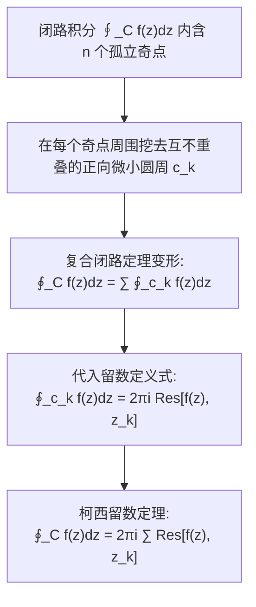

---
tags:
  - 物理/数学物理方法
  - 复变函数
  - 定理卡
  - 柯西留数定理
  - 留数算法
  - 一阶极点
  - 高阶极点
  - 无穷远点留数
aliases:
  - 柯西留数定理与各阶极点留数算法
  - 柯西留数定理
  - 留数定理
  - 极点留数算法
  - 无穷远点留数定理
  - Cauchy's Residue Theorem
  - Calculation of Residues at Poles
created: 2026-09-07
updated: 2026-09-08
---

> [!summary] 定理核心透视
> 柯西留数定理（Cauchy's Residue Theorem）是复分析乃至整个应用数学物理中最具威力与计算美感的集大成工具。它将原本极度繁琐复杂的闭合线积分，惊人地转化为局部孤立奇点处**留数（Residues）的纯代数求和**。其本质在于：全复平面闭合积分仅有洛朗级数的负一次项 $c_{-1}$ 能够逃脱全微分导数的抵消而留存非零贡献。掌握一阶极点商式微分极限定理、高阶极点微分算法以及无穷远点留数“和为零定理”，是解析计算实反常积分、拉普拉斯/傅里叶逆变换与格林函数谱分解的终极核武器。

---

## 一、定理陈述与推导机理

### 1.1 留数的数学定义与物理内核

设 $z_0$ 为复变函数 $f(z)$ 的孤立奇点。在去心邻域 $0 < |z - z_0| < R$ 内，$f(z)$ 展开为洛朗级数：
$$f(z) = \sum_{n=-\infty}^{+\infty} c_n (z - z_0)^n$$
在圆周积分下，由于对所有整数 $n \ne -1$：
$$\oint_C (z - z_0)^n dz = 0$$
唯独当 $n = -1$ 时：
$$\oint_C \frac{1}{z - z_0} dz = 2\pi i$$
因此，闭路积分值**完全被负一次方项的系数 $c_{-1}$ 单独独占**！
定义 $f(z)$ 在孤立奇点 $z_0$ 处的**留数 (Residue)** 为：

$$\boxed{\operatorname{Res}[f(z), z_0] \equiv c_{-1} = \frac{1}{2\pi i} \oint_C f(z) dz}$$

其中闭路 $C$ 为包围 $z_0$ 且不含任何其他奇点的充分小正向闭曲线。

---

### 1.2 柯西留数定理陈述与证明

#### 定理内容
设区域 $D$ 由分段光滑闭曲线 $C$ 所围成。若函数 $f(z)$ 在 $D$ 内除有限个孤立奇点 $z_1, z_2, \dots, z_n$ 外处处解析，且在闭边界 $C$ 上解析连续，则沿逆时针正向边界 $C$ 的闭路积分满足：

$$\boxed{\oint_C f(z) dz = 2\pi i \sum_{k=1}^n \operatorname{Res}[f(z), z_k]}$$

#### 证明流程
分别以 $z_k$ 为中心，作互不相交且全包含在 $D$ 内的正向充分小圆周 $c_k$ ($k = 1, \dots, n$)。
在由外边界 $C$ 与所有内边界 $c_k$ 所构成的多连通区域内，$f(z)$ 处处全纯解析。
由复合闭路定理：
$$\oint_C f(z) dz = \sum_{k=1}^n \oint_{c_k} f(z) dz$$
由留数定义式，$\oint_{c_k} f(z) dz = 2\pi i \operatorname{Res}[f(z), z_k]$。
代入即得：
$$\oint_C f(z) dz = 2\pi i \sum_{k=1}^n \operatorname{Res}[f(z), z_k]$$
定理严格获证。

---

### 1.3 极点留数的规范化计算公式群

无需对函数繁琐求出完整洛朗级数，利用极限与微分可直接提取 $c_{-1}$：

#### (1) 一阶单极点 (Simple Pole) 的两大计算准则
若 $z_0$ 为一阶极点：
1. **直接因式极限法**：
   $$\boxed{\operatorname{Res}[f(z), z_0] = \lim_{z \to z_0} (z - z_0) f(z)}$$
2. **商式导数商法则（最常用杀手锏）**：
   若 $f(z) = \frac{P(z)}{Q(z)}$，其中 $P(z_0) \ne 0$，$Q(z_0) = 0$ 且 $Q'(z_0) \ne 0$：
   $$\operatorname{Res}[f(z), z_0] = \lim_{z \to z_0} \frac{(z - z_0) P(z)}{Q(z)} = \lim_{z \to z_0} \frac{P(z)}{\frac{Q(z) - Q(z_0)}{z - z_0}} = \frac{P(z_0)}{Q'(z_0)}$$

   $$\boxed{\operatorname{Res}\left[\frac{P(z)}{Q(z)}, z_0\right] = \frac{P(z_0)}{Q'(z_0)}}$$

#### (2) $m$ 阶高阶极点 (Pole of Order $m$) 的通用微分公式
若 $z_0$ 为 $m$ 阶极点（$m \ge 2$），其主要部分以 $\frac{c_{-m}}{(z-z_0)^m}$ 截止：
两边同乘 $(z - z_0)^m$ 消去分母奇异性：
$$(z - z_0)^m f(z) = c_{-m} + c_{-m+1}(z - z_0) + \dots + c_{-1}(z - z_0)^{m-1} + \sum_{n=0}^\infty c_n (z - z_0)^{m+n}$$
对上式关于 $z$ 求 $m-1$ 阶导数，前 $m-1$ 项常数全被消灭，首项变为 $(m-1)! c_{-1}$，令 $z \to z_0$ 即导出：

$$\boxed{\operatorname{Res}[f(z), z_0] = \frac{1}{(m-1)!} \lim_{z \to z_0} \frac{d^{m-1}}{dz^{m-1}} \left[ (z - z_0)^m f(z) \right]}$$

---

### 1.4 无穷远点留数与全平面留数和为零定理

#### (1) 无穷远点留数的定义
定义沿包围全平面所有有限奇点的大圆周 $C_R$ 逆时针绕行一周的负向积分（即顺时针环绕无穷远点一周）：
$$\operatorname{Res}[f(z), \infty] \equiv \frac{1}{2\pi i} \oint_{C_R^-} f(z) dz = -\frac{1}{2\pi i} \oint_{C_R^+} f(z) dz$$
若 $f(z)$ 在大圆外域 $R < |z| < \infty$ 的洛朗级数为 $f(z) = \sum_{n=-\infty}^{+\infty} c_n z^n$，则：
$$\boxed{\operatorname{Res}[f(z), \infty] = -c_{-1}}$$
*(注意：负号不可遗漏！)*

#### (2) 全平面留数总和为零定理 (Residue Sum Theorem)
若函数 $f(z)$ 在扩充复平面内除有限个孤立奇点外处处解析，则**其在全平面所有有限奇点的留数之和，加上无穷远点的留数，恒等于零**：

$$\boxed{\sum_{k=1}^n \operatorname{Res}[f(z), z_k] + \operatorname{Res}[f(z), \infty] = 0}$$

**计算奇招**：当闭路内包含非常多复杂的有限奇点时，若闭路外部仅包含一个简单的无穷远点，可反向通过计算 $\operatorname{Res}[f(z), \infty]$ 一步秒杀所有有限留数总和！

---

## 二、⚠️ 致命失分陷阱与临界边界

> [!warning] 陷阱 1：盲目对极点套用一阶极点公式
> 当极点阶数 $m \ge 2$ 时，若直接计算 $\lim_{z \to z_0} (z - z_0) f(z)$，其结果必然发散为 $\infty$！
> 必须准确判定极点阶数 $m$ 后，套用带阶乘分母 $\frac{1}{(m-1)!}$ 与 $(m-1)$ 阶求导的高阶公式。

> [!caution] 陷阱 2：在商式法则 $\frac{P(z_0)}{Q'(z_0)}$ 中忽视分母的一阶条件
> 商式法则仅适用于 $Q'(z_0) \ne 0$（即 $z_0$ 为分母的单零点）。
> 若 $Q'(z_0) = 0$，说明分母为高阶零点，必须继续求高阶导或利用洛朗级数展开，直接套用将导致除以零崩溃。

> [!danger] 陷阱 3：无穷远点留数误以为“当 $f(\infty)=0$ 时留数必定为零”
> 这是理论物理考研中最具欺骗性的陷阱！
> 例如 $f(z) = \frac{1}{z}$：当 $z \to \infty$ 时，$f(\infty) = 0$（可去奇点）。
> 但其在无穷远外域的洛朗级数直接就是 $\frac{1}{z} \implies c_{-1} = 1$。
> 故无穷远点留数为 $\operatorname{Res}[f(z), \infty] = -c_{-1} = -1 \ne 0$！
> 只有当 $f(z)$ 在大圆展开中至少为 $O(1/z^2)$ 时，无穷远点留数才为零。

---

## 三、经典范例手把手演算与反代验算

### 3.1 经典例题：高阶极点留数与留数和为零定理双向核验
**题目（梁书第 4 章 §4.1 典型考题）**：
求函数
$$f(z) = \frac{1}{z^2 (z - 1)}$$
在所有有限奇点及无穷远点处的留数，并计算闭路积分 $I = \oint_{|z| = 2} f(z) dz$。

#### 第一步：奇点判别
分母因式为 $z^2 (z-1)$：
- $z_1 = 0$：为函数的 **2 阶极点**（$m = 2$）；
- $z_2 = 1$：为函数的 **1 阶单极点**（$m = 1$）；
两奇点均严格包含在闭合圆周 $|z| = 2$ 内部。

#### 第二步：计算一阶极点 $z_2 = 1$ 处的留数
使用因式极限法：
$$\operatorname{Res}[f, 1] = \lim_{z \to 1} (z - 1) f(z) = \lim_{z \to 1} \frac{1}{z^2} = \frac{1}{1^2} = 1$$

#### 第三步：计算二阶极点 $z_1 = 0$ 处的留数
使用二阶极点求导公式（$m = 2 \implies \frac{1}{(2-1)!} = 1$）：
$$\begin{aligned}
\operatorname{Res}[f, 0] &= \lim_{z \to 0} \frac{d}{dz} \left[ z^2 f(z) \right] = \lim_{z \to 0} \frac{d}{dz} \left[ \frac{1}{z - 1} \right] \\
&= \lim_{z \to 0} \left[ -\frac{1}{(z - 1)^2} \right] = -\frac{1}{(0 - 1)^2} = -1
\end{aligned}$$

#### 第四步：计算无穷远点留数 $\operatorname{Res}[f, \infty]$
考察大宗量 $|z| > 1$ 时的洛朗级数展开：
$$f(z) = \frac{1}{z^2 (z - 1)} = \frac{1}{z^3 (1 - 1/z)} = \frac{1}{z^3} \sum_{n=0}^\infty \left( \frac{1}{z} \right)^n = \frac{1}{z^3} + \frac{1}{z^4} + \frac{1}{z^5} + \dots$$
在此展开式中，**$1/z$ 负一次方的系数为 $c_{-1} = 0$**！
根据无穷远点留数定义：
$$\operatorname{Res}[f, \infty] = -c_{-1} = 0$$

#### 第五步：全平面留数和为零定理验证
加和全平面所有奇点留数：
$$\sum \operatorname{Res} = \operatorname{Res}[f, 0] + \operatorname{Res}[f, 1] + \operatorname{Res}[f, \infty] = (-1) + (+1) + 0 \equiv 0$$
严格满足留数和为零定理！

#### 第六步：求解闭路积分 $I$
由柯西留数定理：
$$I = \oint_{|z|=2} f(z) dz = 2\pi i \left( \operatorname{Res}[f, 0] + \operatorname{Res}[f, 1] \right) = 2\pi i [(-1) + 1] = 0$$
最终结果为：
$$\boxed{I = 0}$$

#### 第七步：反代验算（大圆弧极限自洽性检验）
令积分围道由 $|z|=2$ 连续变形为巨大半径 $R \to \infty$ 的同心大圆周 $C_R$。
在 $C_R$ 上：
$$|f(z)| = \left| \frac{1}{z^2(z-1)} \right| \le \frac{1}{R^2(R-1)}$$
周长 $L = 2\pi R$。由 ML 估值不等式：
$$|I| \le \frac{1}{R^2(R-1)} \cdot 2\pi R = \frac{2\pi}{R(R-1)}$$
令 $R \to \infty$，右端极限严格收敛为 $0$！
故该积分恒为 $0$，推导演算完全自洽完备！

---

## 四、出处与纸质笔记坐标

- **教材出处**：梁昆淼《数学物理方法》（第四版）
  - 第四章：留数定理
  - §4.1 留数定理与各阶极点留数的求法（原书 P51-P55）
- **对应 MinerU OCR 语料**：`mineru_output/梁昆淼_数学物理方法/数学物理方法_梁昆淼_第四版/ocr/数学物理方法_梁昆淼_第四版.md` Lines 2349-2619
- **对应全景图**：[[00_梁昆淼数学物理方法_第一篇全景图]]
- **纸质活页定位**：`[活页-LKM-07]`
