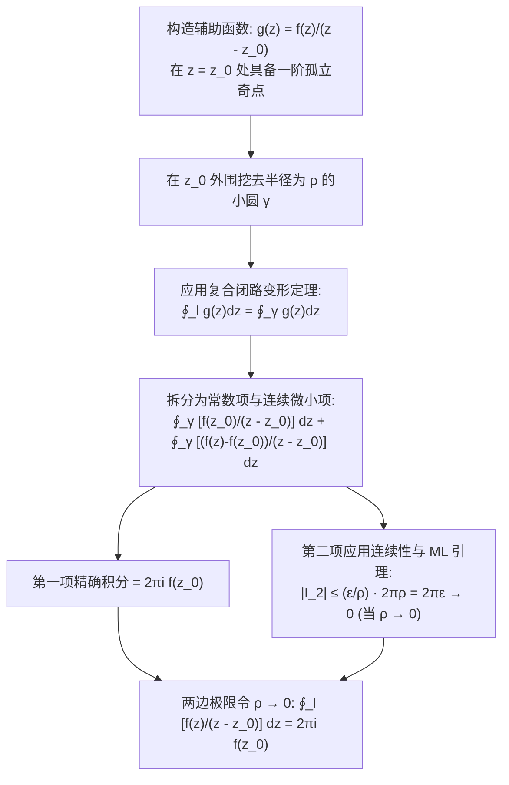

---
tags:
  - 物理/数学物理方法
  - 复变函数
  - 定理卡
  - 柯西积分公式
  - 高阶导数积分公式
  - 全纯性
  - 柯西不等式
  - 刘维尔定理
aliases:
  - 柯西积分公式与全纯函数高阶导数表示
  - 柯西积分公式
  - 全纯函数高阶导数
  - 柯西不等式
  - 刘维尔定理与代数基本定理
  - Cauchy's Integral Formula
  - Cauchy's Differentiation Formula
created: 2026-09-07
updated: 2026-09-08
---

> [!summary] 定理核心透视
> 柯西积分公式（Cauchy's Integral Formula）展现了复分析中最具全息特性的深刻公理：**解析函数在区域内部任意一点的取值，完全由该区域闭合边界上的函数值通过加权积分唯一确定**。这一“边界全息决定内部”的拓扑特性，在实微积分中是完全不可想象的。更令人震撼的是，通过对积分核参数反复求导，直接推导出了**全纯函数无穷阶可导性定理**——复变函数一旦一阶可导，便自动拥有任意高阶导数，并可导出柯西不等式、刘维尔定理与代数基本定理，构筑起现代格林函数积分方程与狄利克雷问题的数学底座。

---

## 一、定理陈述与推导机理

### 1.1 柯西积分公式陈述

设区域 $B$ 是由分段光滑闭曲线 $l$ 所围成的单连通区域。若函数 $f(z)$ 在 $B$ 内解析，在闭区域 $B + l$ 上连续，则对于区域 $B$ 内部任意指定点 $z_0$：

$$\boxed{f(z_0) = \frac{1}{2\pi i} \oint_l \frac{f(z)}{z - z_0} dz}$$

其中闭路 $l$ 取逆时针正向。

---

### 1.2 严格证明过程（小圆隔离极限法）

#### 第一步：孤立奇点排除
以 $z_0$ 为圆心，作充分小的正向圆周 $\gamma: |z - z_0| = \rho$，使圆 $\gamma$ 及其内部完全包含在区域 $B$ 内。
由于 $f(z)$ 在 $B$ 内解析，函数 $\frac{f(z)}{z - z_0}$ 在 $l$ 和 $\gamma$ 所围成的环状区域内**处处解析**。
由复合闭路定理（闭路变形原理）：
$$\oint_l \frac{f(z)}{z - z_0} dz = \oint_\gamma \frac{f(z)}{z - z_0} dz$$

#### 第二步：提取目标值
将被积函数恒等改写：
$$\frac{f(z)}{z - z_0} = \frac{f(z_0) + [f(z) - f(z_0)]}{z - z_0} = \frac{f(z_0)}{z - z_0} + \frac{f(z) - f(z_0)}{z - z_0}$$
代入右端积分：
$$\oint_\gamma \frac{f(z)}{z - z_0} dz = f(z_0) \oint_\gamma \frac{1}{z - z_0} dz + \oint_\gamma \frac{f(z) - f(z_0)}{z - z_0} dz$$

#### 第三步：计算主项积分与余项极限估计
1. **主项精确值**：参数化 $\gamma: z = z_0 + \rho e^{i\theta} (\theta \in [0, 2\pi]), dz = i\rho e^{i\theta} d\theta$：
   $$\oint_\gamma \frac{1}{z - z_0} dz = \int_0^{2\pi} \frac{1}{\rho e^{i\theta}} (i\rho e^{i\theta} d\theta) = i \int_0^{2\pi} d\theta = 2\pi i$$
   故主项为 $2\pi i f(z_0)$；
2. **余项积分估计**：由 $f(z)$ 在点 $z_0$ 处连续，对任意 $\varepsilon > 0$，必存在 $\delta > 0$，当 $\rho < \delta$ 时，在圆周 $\gamma$ 上恒有 $|f(z) - f(z_0)| < \varepsilon$。
   利用 ML 估值不等式：
   $$\left| \oint_\gamma \frac{f(z) - f(z_0)}{z - z_0} dz \right| \le \oint_\gamma \frac{|f(z) - f(z_0)|}{|z - z_0|} |dz| < \frac{\varepsilon}{\rho} \cdot (2\pi \rho) = 2\pi \varepsilon$$
   令 $\rho \to 0$（即 $\varepsilon \to 0$），余项积分严格收敛为 $0$！

#### 结论
$$\oint_l \frac{f(z)}{z - z_0} dz = 2\pi i f(z_0) \implies f(z_0) = \frac{1}{2\pi i} \oint_l \frac{f(z)}{z - z_0} dz$$
定理证毕。

---

### 1.3 全纯函数的高阶导数积分公式

在柯西积分公式中，积分核 $\frac{1}{z - z_0}$ 关于内部参变量 $z_0$ 是无限次可微的。由于积分路径 $l$ 与 $z_0$ 保持正距离，可在积分号下**任意多次求导**：

$$\begin{aligned}
f'(z_0) &= \frac{1}{2\pi i} \oint_l \frac{\partial}{\partial z_0}\left( \frac{1}{z - z_0} \right) f(z) dz = \frac{1!}{2\pi i} \oint_l \frac{f(z)}{(z - z_0)^2} dz \\
f''(z_0) &= \frac{1}{2\pi i} \oint_l \frac{\partial^2}{\partial z_0^2}\left( \frac{1}{z - z_0} \right) f(z) dz = \frac{2!}{2\pi i} \oint_l \frac{f(z)}{(z - z_0)^3} dz
\end{aligned}$$

数学归纳法导出**高阶导数积分表示公式**：

$$\boxed{f^{(n)}(z_0) = \frac{n!}{2\pi i} \oint_l \frac{f(z)}{(z - z_0)^{n+1}} dz \quad (n = 1, 2, 3, \dots)}$$

#### 核心推论
1. **无限次可微性**：复变函数若在区域内可导一次，则必在该区域内处处拥有任意阶导数，且所有高阶导数仍然是该区域内的解析函数；
2. **反求闭路积分的标准武器**：将公式移项反写，即可将难以直接计算的高阶分母闭路积分转化为求导运算：
   $$\boxed{\oint_l \frac{f(z)}{(z - z_0)^{n+1}} dz = \frac{2\pi i}{n!} f^{(n)}(z_0)}$$

---

### 1.4 柯西不等式与代数基本定理推演

#### (1) 柯西不等式 (Cauchy's Inequality)
取 $l$ 为以 $z_0$ 为中心、半径为 $R$ 的圆周 $C_R$，设在 $C_R$ 上 $|f(z)| \le M(R)$。利用高阶导数公式与 ML 引理：
$$|f^{(n)}(z_0)| \le \frac{n!}{2\pi} \oint_{C_R} \frac{|f(z)|}{|z - z_0|^{n+1}} |dz| \le \frac{n!}{2\pi} \frac{M(R)}{R^{n+1}} (2\pi R)$$

$$\boxed{|f^{(n)}(z_0)| \le \frac{n! M(R)}{R^n}}$$

#### (2) 刘维尔定理 (Liouville's Theorem)
若函数 $f(z)$ 在整个复平面处处解析（整函数），且在全平面有界（即存在常数 $M$ 使得对任意 $z$ 均有 $|f(z)| \le M$），则 **$f(z)$ 必为常数**。
- *证明*：在全平面取任意点 $z_0$，令 $n=1$。对任意半径 $R$，由柯西不等式 $|f'(z_0)| \le \frac{M}{R}$。令 $R \to \infty$，立即导出 $|f'(z_0)| = 0 \implies f'(z_0) = 0$。由于 $z_0$ 任意，$f'(z) \equiv 0 \implies f(z) = \text{常数}$。

#### (3) 代数基本定理 (Fundamental Theorem of Algebra)
任何次数 $n \ge 1$ 的复系数多项式 $P(z) = a_n z^n + \dots + a_0$ ($a_n \ne 0$) 在复平面上**至少存在一个零点**。
- *证明反证法*：若 $P(z)$ 在全平面无零点，则 $g(z) = \frac{1}{P(z)}$ 为全平面解析的整函数。由于当 $|z| \to \infty$ 时 $|P(z)| \to \infty \implies g(z) \to 0$，故 $g(z)$ 在全平面必有界。根据刘维尔定理，$g(z)$ 必须为常数，矛盾！故多项式必有复根。

---

## 二、⚠️ 致命失分陷阱与临界边界

> [!warning] 陷阱 1：分母阶数与导数阶数 $n$ 与 $n!$ 不匹配
> 高阶导数公式分母为 $(z-z_0)^{n+1}$，对应的是 **$n$ 阶导数**，系数为 **$\frac{2\pi i}{n!}$**！
> 极高频粗心失误：计算 $\oint \frac{e^z}{(z-1)^3} dz$ 时：
> 此时分母幂次为 $3 = 2 + 1$，对应的是 **$n = 2$ 阶导数**！公式系数必须除以 $2!$：
> 错误写法：$2\pi i \cdot (e^z)'' = 2\pi i e$（丢失分母的 $2!$）；
> 正确结果：$\frac{2\pi i}{2!} (e^z)''|_{z=1} = \pi i e$。

> [!caution] 陷阱 2：点 $z_0$ 落在积分闭路外部时误套柯西公式
> 柯西积分公式成立的前提是 $z_0$ 严格位于闭曲线 $l$ 的**内部**。
> 若 $z_0$ 位于 $l$ 的**外部**，则函数 $\frac{f(z)}{z - z_0}$ 在 $l$ 及其内部**完全全纯解析**！根据柯西积分定理，其积分直接为 **$0$**，绝不是 $2\pi i f(z_0)$！

> [!danger] 陷阱 3：若闭路内包含多个奇点，不可直接套用单奇点柯西公式
> 若分母在闭路内拥有多个零点（如分母为 $(z-a)(z-b)$），必须先通过**部分分式展开**或**复合闭路变形拆分**，分别针对各单个奇点应用柯西公式，或者统一使用留数定理。直接把某个因子混入分子往往导致分子在奇点处不解析。

---

## 三、经典范例手把手演算与反代验算

### 3.1 经典例题：高阶极点与多元因式积分的反求计算
**题目（梁书第 2 章 §2.4 典型例题）**：
计算闭路积分
$$I = \oint_C \frac{e^{2z}}{(z+1)^3 (z-2)} dz$$
其中积分路径 $C$ 为正向圆周 $|z| = \frac{3}{2}$。

#### 第一步：分析奇点分布与围道关系
被积函数的分母零点为：
- 奇点 $z_1 = -1$：三阶极点，其模 $|z_1| = 1 < \frac{3}{2}$，**严格位于圆周内部**；
- 奇点 $z_2 = 2$：一阶极点，其模 $|z_2| = 2 > \frac{3}{2}$，**位于圆周外部**！

#### 第二步：构造内部全纯的分子函数
由于 $z_2 = 2$ 位于圆周 $|z| = 3/2$ 外部，函数 $\frac{1}{z - 2}$ 在该圆周及其内部**处处解析**。
因此，将被积函数改写为标准高阶柯西积分公式形式：
$$\frac{e^{2z}}{(z+1)^3 (z-2)} = \frac{\frac{e^{2z}}{z-2}}{(z - (-1))^3}$$
定义分子辅助函数：
$$\Phi(z) = \frac{e^{2z}}{z-2}$$
$\Phi(z)$ 在 $|z| \le 3/2$ 区域内满足全部全纯解析条件。此时奇点为 $z_0 = -1$，分母幂次为 $3 = 2 + 1 \implies n = 2$。

#### 第三步：应用高阶导数积分公式
由高阶导数积分公式：
$$\oint_C \frac{\Phi(z)}{(z - (-1))^{2+1}} dz = \frac{2\pi i}{2!} \Phi''(-1) = \pi i \Phi''(-1)$$

#### 第四步：逐阶计算微分
对 $\Phi(z) = e^{2z} (z-2)^{-1}$ 求一阶导数：
$$\Phi'(z) = 2 e^{2z} (z-2)^{-1} - e^{2z} (z-2)^{-2} = e^{2z} \left[ \frac{2}{z-2} - \frac{1}{(z-2)^2} \right] = e^{2z} \frac{2z - 5}{(z-2)^2}$$
求二阶导数：
$$\begin{aligned}
\Phi''(z) &= 2 e^{2z} \frac{2z - 5}{(z-2)^2} + e^{2z} \frac{2(z-2)^2 - (2z-5) \cdot 2(z-2)}{(z-2)^4} \\
&= e^{2z} \left[ \frac{2(2z - 5)}{(z-2)^2} + \frac{2(z-2) - 2(2z-5)}{(z-2)^3} \right] \\
&= \frac{e^{2z}}{(z-2)^3} [2(2z-5)(z-2) + 2z - 4 - 4z + 10] \\
&= \frac{e^{2z}}{(z-2)^3} [2(2z^2 - 9z + 10) - 2z + 6] = \frac{e^{2z}}{(z-2)^3} [4z^2 - 20z + 26]
\end{aligned}$$

#### 第五步：代入点 $z_0 = -1$
代入 $z = -1$：
- $e^{2(-1)} = e^{-2}$；
- 分母：$(-1 - 2)^3 = (-3)^3 = -27$；
- 分子中括号：$4(-1)^2 - 20(-1) + 26 = 4 + 20 + 26 = 50$；
因此：
$$\Phi''(-1) = \frac{e^{-2}}{-27} \times 50 = -\frac{50}{27 e^2}$$
最终积分值为：
$$\boxed{I = \pi i \left( -\frac{50}{27 e^2} \right) = -\frac{50 \pi i}{27 e^2}}$$

#### 第六步：反代验算（留数定理自洽性核查）
根据后续留数定理，该积分值应等于 $2\pi i \operatorname{Res}[f(z), -1]$。
对于三阶极点 $z = -1$：
$$\operatorname{Res}[f, -1] = \frac{1}{2!} \lim_{z \to -1} \frac{d^2}{dz^2}\left[(z+1)^3 f(z)\right] = \frac{1}{2} \lim_{z \to -1} \frac{d^2}{dz^2}\left[\frac{e^{2z}}{z-2}\right] = \frac{1}{2} \Phi''(-1) = -\frac{25}{27 e^2}$$
积分结果：
$$I = 2\pi i \times \left( -\frac{25}{27 e^2} \right) = -\frac{50 \pi i}{27 e^2}$$
两种方法计算结果完全一致，推导严密闭环！

---

## 四、出处与纸质笔记坐标

- **教材出处**：梁昆淼《数学物理方法》（第四版）
  - 第二章：复变函数的积分
  - §2.4 柯西积分公式与解析函数的高阶导数（原书 P28-P31）
- **对应 MinerU OCR 语料**：`mineru_output/梁昆淼_数学物理方法/数学物理方法_梁昆淼_第四版/ocr/数学物理方法_梁昆淼_第四版.md` Lines 1258-1425
- **对应全景图**：[[00_梁昆淼数学物理方法_第一篇全景图]]
- **纸质活页定位**：`[活页-LKM-04]`
