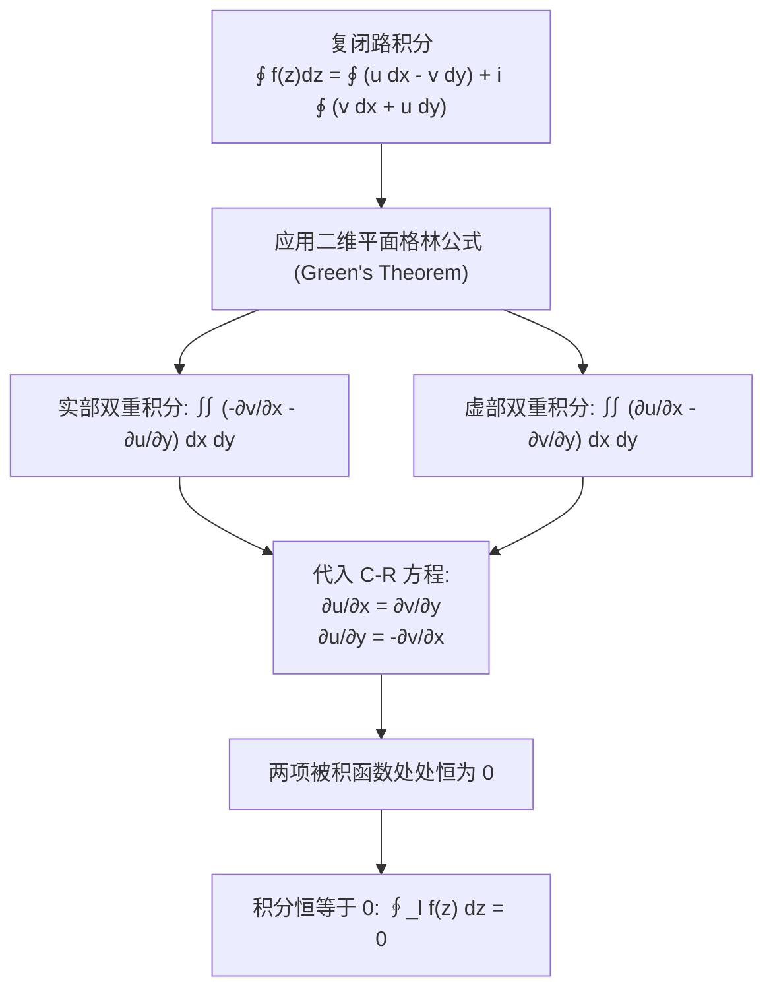

---
tags:
  - 物理/数学物理方法
  - 复变函数
  - 定理卡
  - 柯西积分定理
  - 闭路变形原理
  - 复合闭路
  - 原函数
aliases:
  - 柯西积分定理与闭合围道变形原理
  - 柯西积分定理
  - 闭路变形原理
  - 复合闭路定理
  - 柯西-古萨定理
  - Cauchy-Goursat Theorem
  - Contour Deformation Principle
created: 2026-09-07
updated: 2026-09-08
---

> [!summary] 定理核心透视
> 柯西积分定理（柯西－古萨定理，Cauchy-Goursat Theorem）是整个复变函数微积分理论的“第一宪法”。它从根本上改写了线积分的物理与几何法则：在单连通全纯区域内，解析函数的闭合路径积分**恒等于零**，从而保证了路径无关性与解析原函数的存在性。将其延拓至多连通区域后，更衍生出复分析中最具操作威力的**闭路变形原理（Contour Deformation Principle）**——我们可以将极其复杂、扭曲的积分闭路自由收缩、变形为环绕奇点的规则微小圆周，这构成了后续柯西积分公式、洛朗级数展开以及留数微积分的共同理论源泉。

---

## 一、定理陈述与推导机理

### 1.1 复变线积分的定义与实积分分解

设复变函数 $f(z) = u(x, y) + i v(x, y)$ 沿复平面上的光滑有向有界曲线 $C$ 连续。由微元关系 $dz = dx + i dy$，复积分可严格分解为两个实第二类曲线积分的线性组合：

$$\boxed{\int_C f(z) dz = \int_C (u dx - v dy) + i \int_C (v dx + u dy)}$$

#### 核心估值不等式 (Darboux Inequality / ML 引理)
若曲线 $C$ 的弧长为 $L$，且在 $C$ 上 $|f(z)| \le M$（$M$ 为上界常数），则：
$$\boxed{\left| \int_C f(z) dz \right| \le \int_C |f(z)| |dz| \le M L}$$
该不等式是后续证明大圆弧积分消失（如若当引理）的最高频武器。

---

### 1.2 柯西积分定理 (Cauchy's Theorem) 的严格推导

#### 定理内容（单连通域）
设区域 $B$ 是由闭合光滑或分段光滑曲线 $l$ 所围成的**单连通区域**。若函数 $f(z)$ 在 $B$ 内解析，且在闭区域 $B + l$ 上连续，则沿着闭边界 $l$ 的复积分恒为零：

$$\boxed{\oint_l f(z) dz = 0}$$

#### 格林公式法严格证明（梁书规范证明流程）
将闭路积分代入实第二类曲线积分表达：
$$\oint_l f(z) dz = \oint_l (u dx - v dy) + i \oint_l (v dx + u dy)$$
利用平面高级微积分中的格林定理：$\oint_l (P dx + Q dy) = \iint_B \left( \frac{\partial Q}{\partial x} - \frac{\partial P}{\partial y} \right) dx dy$：
1. **对于实部项**：$P_1 = u, Q_1 = -v$，
   $$\oint_l (u dx - v dy) = \iint_B \left[ \frac{\partial (-v)}{\partial x} - \frac{\partial u}{\partial y} \right] dx dy = -\iint_B \left( \frac{\partial v}{\partial x} + \frac{\partial u}{\partial y} \right) dx dy$$
   由 C-R 微分方程第二式 $\frac{\partial u}{\partial y} = -\frac{\partial v}{\partial x} \implies \frac{\partial v}{\partial x} + \frac{\partial u}{\partial y} = 0$，故其实部双重积分恒为 $0$；
2. **对于虚部项**：$P_2 = v, Q_2 = u$，
   $$\oint_l (v dx + u dy) = \iint_B \left( \frac{\partial u}{\partial x} - \frac{\partial v}{\partial y} \right) dx dy$$
   由 C-R 微分方程第一式 $\frac{\partial u}{\partial x} = \frac{\partial v}{\partial y} \implies \frac{\partial u}{\partial x} - \frac{\partial v}{\partial y} = 0$，故其虚部双重积分恒为 $0$。
联立实部与虚部，定理得证：$\oint_l f(z) dz = 0 + i 0 = 0$。

*(注：古萨 Goursat 后来证明无需假设偏导数连续，仅凭复可导性即可成立，称柯西－古萨定理)*。

---

### 1.3 多连通区域与复合闭路定理

若区域 $B$ 内包含若干“孔洞”或孤立奇点区域，设外边界为逆时针闭路 $C$，内部包含 $n$ 个互不重叠的顺时针内边界 $C_1, C_2, \dots, C_n$。若 $f(z)$ 在多连通域内及其边界上处处解析：
通过引入割线将多连通区域剪开为单连通区域，由于割线往返两次方向相反、积分严格抵消，立即导出**复合闭路定理**：

$$\boxed{\oint_C f(z) dz = \sum_{k=1}^n \oint_{C_k} f(z) dz}$$

其中外闭路 $C$ 与所有内闭路 $C_k$ 均取**逆时针方向（正向）**。

#### 闭路变形原理 (Contour Deformation Principle)
若闭合曲线 $C_1$ 能够通过在 $f(z)$ 的**解析区域内进行连续平滑变形**而转变为闭合曲线 $C_2$，且变形过程中**不跨越任何非解析奇点**，则：
$$\boxed{\oint_{C_1} f(z) dz = \oint_{C_2} f(z) dz}$$

---

### 1.4 解析函数的原函数与微积分基本定理

由柯西积分定理，单连通解析域内复积分 $\int_{z_0}^z f(\zeta) d\zeta$ **与连接 $z_0$ 和 $z$ 的具体路径完全无关**！
- 定义变上限积分函数：
  $$F(z) = \int_{z_0}^z f(\zeta) d\zeta$$
- 易证 $F(z)$ 在区域内处处可导，且**导数恰为被积函数**：$F'(z) = f(z)$；
- 成立**牛顿－莱布尼茨公式**：
  $$\boxed{\int_{z_1}^{z_2} f(z) dz = F(z_2) - F(z_1)}$$

---

## 二、⚠️ 致命失分陷阱与临界边界

> [!warning] 陷阱 1：在包含奇点的区域内盲目使用柯西定理判定积分等于零
> 柯西定理成立的绝对前提是被积函数在**闭路内部全部点解析**。若闭路内部包含哪怕一个孤立奇点，积分离奇点再远也绝对不等于零！
> **高频陷阱例题**：$\oint_{|z|=1} \frac{1}{z} dz$。
> 奇点 $z = 0$ 位于圆内。若错误使用柯西定理写为 $0$，直接得零分。
> 真实计算：参数化 $z = e^{i\theta} (\theta \in [0, 2\pi]), dz = i e^{i\theta} d\theta$：
> $$\oint_{|z|=1} \frac{1}{z} dz = \int_0^{2\pi} \frac{1}{e^{i\theta}} (i e^{i\theta} d\theta) = i \int_0^{2\pi} d\theta = 2\pi i \ne 0$$

> [!caution] 陷阱 2：高次反比函数 $\oint_C \frac{1}{(z-z_0)^n} dz$ ($n \ge 2$) 的特异性
> 虽然 $\oint \frac{1}{z-z_0} dz = 2\pi i$，但对于所有**高次幂 ($n \ge 2, n \in \mathbb{Z}$)**：
> $$\oint_C \frac{1}{(z-z_0)^n} dz = 0$$
> 原因在于：当 $n \ge 2$ 时，$\frac{1}{(z-z_0)^n}$ 拥有单值解析原函数 $-\frac{1}{n-1}\frac{1}{(z-z_0)^{n-1}}$，闭合路径代入起点与终点必然重合抵消为零！不可与 $n=1$ 混淆。

> [!danger] 陷阱 3：在多连通闭路变形时忽视“割线截断引起的相位变化”
> 当被积函数为多值函数时（如 $z^\alpha$），闭路变形若穿过支割线，函数将跳转到不同叶片，此时复合闭路定理**不再成立**，必须采用钥匙孔围道补齐上下割线跳变。

---

## 三、经典范例手把手演算与反代验算

### 3.1 经典例题：利用闭路变形原理与部分分式计算多元奇点线积分
**题目（梁书第 2 章 §2.2 经典范题）**：
计算积分
$$I = \oint_C \frac{2z + 1}{z^2 + z} dz$$
分别针对以下两条闭合围道：
1. $C_1$: 圆周 $|z| = \frac{1}{2}$（逆时针正向）；
2. $C_2$: 椭圆 $4x^2 + 9y^2 = 36$（逆时针正向）。

#### 第一步：分析被积函数的奇点分布
被积函数分母因式分解：
$$f(z) = \frac{2z + 1}{z(z + 1)}$$
奇点位于分母零点：$z_1 = 0$ 与 $z_2 = -1$。两者均为一阶极点。

#### 第二步：针对围道 $C_1$（$|z| = 1/2$）求解
- 奇点位置分析：
  - 奇点 $z_1 = 0$ 的模 $|z_1| = 0 < 1/2$，位于 $C_1$ 内部；
  - 奇点 $z_2 = -1$ 的模 $|z_2| = 1 > 1/2$，位于 $C_1$ 外部！
- 部分分式展开法：
  $$\frac{2z + 1}{z(z+1)} = \frac{A}{z} + \frac{B}{z+1}$$
  通分：$A(z+1) + Bz = 2z + 1 \implies (A+B)z + A = 2z + 1$。
  解得：$A = 1, B = 1$。
  即：
  $$f(z) = \frac{1}{z} + \frac{1}{z+1}$$
- 分项积分：
  $$I = \oint_{C_1} \frac{1}{z} dz + \oint_{C_1} \frac{1}{z+1} dz$$
- 应用定理：
  - 对第二项：$\frac{1}{z+1}$ 在 $|z| \le 1/2$ 内**完全解析**，根据柯西积分定理：
    $$\oint_{C_1} \frac{1}{z+1} dz = 0$$
  - 对第一项：由标准圆形积分 $\oint_{C_1} \frac{1}{z} dz = 2\pi i$。
- 汇总结果：
  $$\boxed{I_{C_1} = 2\pi i}$$

#### 第三步：针对围道 $C_2$（椭圆 $4x^2 + 9y^2 = 36 \implies \frac{x^2}{9} + \frac{y^2}{4} = 1$）求解
- 奇点位置分析：
  - 半长轴 $a = 3$，半短轴 $b = 2$；
  - 奇点 $z_1 = 0$ 和 $z_2 = -1$ 均位于该椭圆**内部**！
- 应用复合闭路变形原理：
  将大椭圆 $C_2$ 变形为分别包围 $z_1=0$ 的微小圆 $c_1$ 与包围 $z_2=-1$ 的微小圆 $c_2$：
  $$\oint_{C_2} f(z) dz = \oint_{c_1} \left( \frac{1}{z} + \frac{1}{z+1} \right) dz + \oint_{c_2} \left( \frac{1}{z} + \frac{1}{z+1} \right) dz$$
  - 在 $c_1$ 内部，$\frac{1}{z+1}$ 解析 $\implies \oint_{c_1} \frac{1}{z+1} dz = 0$，留存 $\oint_{c_1} \frac{1}{z} dz = 2\pi i$；
  - 在 $c_2$ 内部，$\frac{1}{z}$ 解析 $\implies \oint_{c_2} \frac{1}{z} dz = 0$，留存 $\oint_{c_2} \frac{1}{z+1} dz = 2\pi i$；
- 汇总结果：
  $$\boxed{I_{C_2} = 2\pi i + 2\pi i = 4\pi i}$$

#### 第四步：反代验算与自洽性检验
针对围道 $C_2$，令其自由变形为半径 $R \to \infty$ 的巨大圆周 $C_R$（因为无穷远之外无任何奇点）：
在巨大圆周上：
$$f(z) = \frac{2z + 1}{z^2 + z} = \frac{2z(1 + \frac{1}{2z})}{z^2(1 + \frac{1}{z})} = \frac{2}{z}\left(1 + \frac{1}{2z}\right)\left(1 - \frac{1}{z} + O(z^{-2})\right) = \frac{2}{z} - \frac{1}{z^2} + O(z^{-3})$$
对大圆周积分：
$$\oint_{C_R} f(z) dz = \oint_{C_R} \frac{2}{z} dz - \oint_{C_R} \frac{1}{z^2} dz + \oint_{C_R} O(z^{-3}) dz$$
已知 $\oint_{C_R} \frac{2}{z} dz = 2 \times (2\pi i) = 4\pi i$；
高阶项 $\oint_{C_R} z^{-n} dz = 0$ ($n \ge 2$)；
当 $R \to \infty$ 时，$O(z^{-3})$ 积分由 ML 引理：$|O(R^{-3}) \cdot 2\pi R| = O(R^{-2}) \to 0$。
极限结果严格收敛为 $4\pi i$！与复合闭路变形计算完全闭合自洽！

---

## 四、出处与纸质笔记坐标

- **教材出处**：梁昆淼《数学物理方法》（第四版）
  - 第二章：复变函数的积分
  - §2.1 复变函数的积分（原书 P23-P24）
  - §2.2 柯西积分定理与闭路变形（原书 P24-P27）
  - §2.3 原函数与积分基本定理（原书 P27-P28）
- **对应 MinerU OCR 语料**：`mineru_output/梁昆淼_数学物理方法/数学物理方法_梁昆淼_第四版/ocr/数学物理方法_梁昆淼_第四版.md` Lines 962-1257
- **对应全景图**：[[00_梁昆淼数学物理方法_第一篇全景图]]
- **纸质活页定位**：`[活页-LKM-03]`
