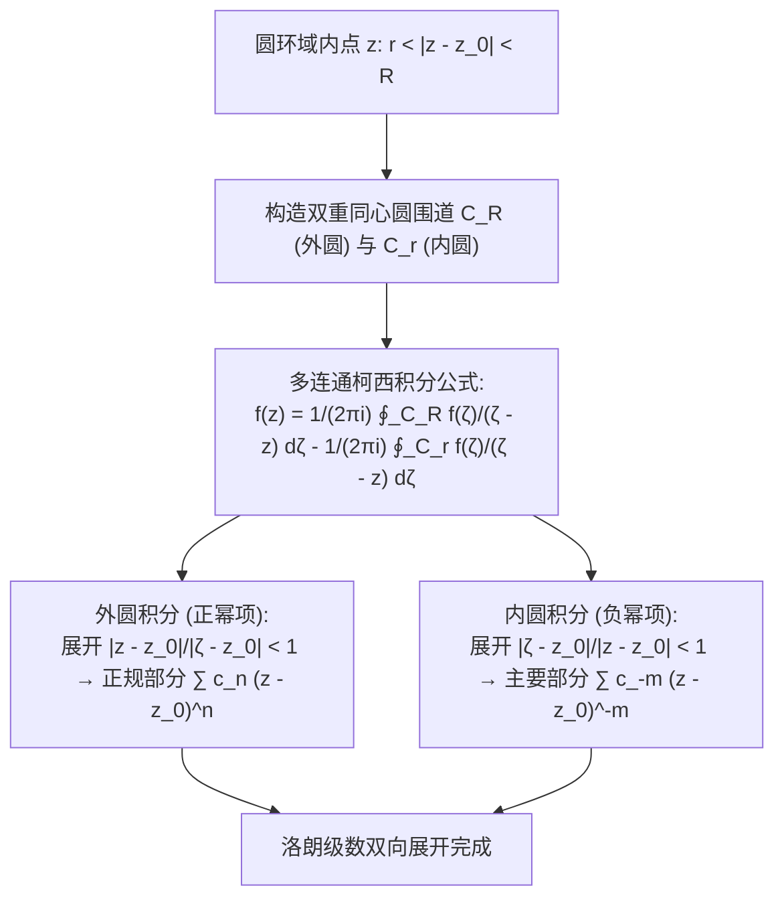

---
tags:
  - 物理/数学物理方法
  - 复变函数
  - 定理卡
  - 洛朗级数
  - 孤立奇点
  - 可去奇点
  - 极点
  - 本性奇点
  - 皮卡定理
aliases:
  - 洛朗级数展开与孤立奇点分类判据
  - 洛朗级数展开定理
  - 孤立奇点分类
  - 极点与本性奇点
  - 洛朗主要部分与正规部分
  - Laurent Series Expansion
  - Classification of Isolated Singularities
created: 2026-09-07
updated: 2026-09-08
---

> [!summary] 定理核心透视
> 泰勒展开受制于“圆盘内处处解析”的严格约束，一旦中心包含奇异点便彻底瘫痪。**洛朗级数展开定理（Laurent Series Expansion）**打破了这一枷锁：它将展开区域从实心圆盘解放至**同心圆环域（Annular Domain）**，引入了负整数幂次项。更具决定性意义的是，洛朗展开的负幂项集合——**主要部分（Principal Part）**，如同一台超高精度的“数学质谱仪”，彻底透视并分类了函数在孤立奇点附近的奇性结构（可去奇点、极点、本性奇点）。其中负一次方项系数 $c_{-1}$，正是留数微积分的灵魂核心。

---

## 一、定理陈述与推导机理

### 1.1 洛朗级数展开定理陈述

设函数 $f(z)$ 在圆环域 $D: r < |z - z_0| < R$ ($0 \le r < R \le +\infty$) 内单值解析，则在该圆环域内 $f(z)$ 必可唯一展开为双向无穷幂级数：

$$\boxed{f(z) = \sum_{n=-\infty}^{+\infty} c_n (z - z_0)^n = \sum_{n=0}^\infty c_n (z - z_0)^n + \sum_{m=1}^\infty \frac{c_{-m}}{(z - z_0)^m}}$$

其中系数积分通式为：
$$\boxed{c_n = \frac{1}{2\pi i} \oint_C \frac{f(\zeta)}{(\zeta - z_0)^{n+1}} d\zeta \quad (n = 0, \pm 1, \pm 2, \dots)}$$
积分路径 $C$ 为圆环域内绕 $z_0$ 的**任意一条逆时针正向闭曲线**。

---

### 1.2 严格推导机理（双圆围道分解法）

在圆环域内任取一点 $z$，设 $|z - z_0| = \rho$。取正数 $r_1, R_1$ 满足 $r < r_1 < \rho < R_1 < R$。
分别作外圆 $C_{R_1}: |\zeta - z_0| = R_1$ 与内圆 $C_{r_1}: |\zeta - z_0| = r_1$（均取逆时针方向）。
由复合闭路柯西积分公式：
$$f(z) = \frac{1}{2\pi i} \oint_{C_{R_1}} \frac{f(\zeta)}{\zeta - z} d\zeta - \frac{1}{2\pi i} \oint_{C_{r_1}} \frac{f(\zeta)}{\zeta - z} d\zeta = I_1 + I_2$$

#### (1) 外圆周积分 $I_1$：导出正规部分
在 $C_{R_1}$ 上，$|\zeta - z_0| = R_1 > |z - z_0| = \rho$。与泰勒展开完全相同：
$$\frac{1}{\zeta - z} = \sum_{n=0}^\infty \frac{(z - z_0)^n}{(\zeta - z_0)^{n+1}}$$
由于一致收敛，逐项积分得到非负幂级数：
$$I_1 = \sum_{n=0}^\infty c_n (z - z_0)^n, \quad c_n = \frac{1}{2\pi i} \oint_{C_{R_1}} \frac{f(\zeta)}{(\zeta - z_0)^{n+1}} d\zeta \quad (n \ge 0)$$

#### (2) 内圆周积分 $I_2$：导出主要部分
在 $C_{r_1}$ 上，$|\zeta - z_0| = r_1 < |z - z_0| = \rho$。此时比值 $\left| \frac{\zeta - z_0}{z - z_0} \right| = \frac{r_1}{\rho} < 1$！
改写分式结构（提取分母的 $-(z - z_0)$）：
$$-\frac{1}{\zeta - z} = \frac{1}{(z - z_0) - (\zeta - z_0)} = \frac{1}{z - z_0} \frac{1}{1 - \frac{\zeta - z_0}{z - z_0}} = \sum_{m=1}^\infty \frac{(\zeta - z_0)^{m-1}}{(z - z_0)^m}$$
逐项积分代入 $I_2$：
$$I_2 = \sum_{m=1}^\infty \left[ \frac{1}{2\pi i} \oint_{C_{r_1}} f(\zeta) (\zeta - z_0)^{m-1} d\zeta \right] \frac{1}{(z - z_0)^m}$$
令 $n = -m$（$m \ge 1 \implies n \le -1$），并记：
$$c_n = c_{-m} = \frac{1}{2\pi i} \oint_{C_{r_1}} \frac{f(\zeta)}{(\zeta - z_0)^{n+1}} d\zeta$$
由闭路变形原理，$C_{R_1}$ 与 $C_{r_1}$ 上的积分均可统一替换为圆环域内任意闭路 $C$。将正负幂次统一，定理严格获证！

---

### 1.3 孤立奇点的三大分类判据

设 $z_0$ 为 $f(z)$ 的孤立奇点。在去心邻域 $0 < |z - z_0| < R$ 内作洛朗展开：
$$f(z) = \underbrace{\sum_{n=0}^\infty c_n (z - z_0)^n}_{\text{正规部分 (Regular Part)}} + \underbrace{\sum_{m=1}^\infty \frac{c_{-m}}{(z - z_0)^m}}_{\text{主要部分 (Principal Part)}}$$

| 孤立奇点类型 | 洛朗主要部分的代数特征 | 极限行为特征 $\lim_{z \to z_0} f(z)$ | 物理与几何图像 |
| :--- | :--- | :--- | :--- |
| **可去奇点 (Removable Singularity)** | 主要部分**完全为零**（所有 $c_{-m} = 0$） | 极限存在且为有限常数 $A$： $\lim_{z \to z_0} f(z) = c_0 = A$ | “假性奇点”，只需补充定义 $f(z_0) = A$ 即可在全域全纯。 |
| **$m$ 阶极点 (Pole of Order $m$)** | 主要部分含**有限个非零项**： $c_{-m} \ne 0$ 且对所有 $k > m$ 有 $c_{-k} = 0$ | 模长趋于无穷： $\lim_{z \to z_0} |f(z)| = \infty$ | 倒数函数 $g(z) = 1/f(z)$ 在 $z_0$ 处呈现 $m$ 阶零点。 |
| **本性奇点 (Essential Singularity)** | 主要部分含**无穷多个非零项** | 极限不存在，既不收敛亦非无穷大 | 奇性极度剧烈，局部相位产生无限次振荡。 |

#### 皮卡大定理 (Picard's Great Theorem)
在具有本性奇点 $z_0$ 的任意微小去心邻域内，函数 $f(z)$ 可以取得**任意复数值无穷多次**，至多只能有一个例外值！
- *典型范例*：$f(z) = e^{1/z}$ 在 $z = 0$ 处，主要部分为 $\sum_{m=1}^\infty \frac{1}{m! z^m}$（无穷项）。在原点附近无论多么微小的邻域内，方程 $e^{1/z} = w$ 对任意 $w \ne 0$ 均有无穷多个解（例外值仅为 $0$）。

---

### 1.4 无穷远点 $z = \infty$ 的孤立奇性判据

作变量代换 $z = 1/t$，研究变换后的函数 $g(t) = f(1/t)$ 在原点 $t = 0$ 处的奇点类型：
- 将 $f(z)$ 在外圆域 $R < |z| < \infty$ 内展开为以原点为中心的洛朗级数：
  $$f(z) = \sum_{n=-\infty}^{+\infty} a_n z^n = \sum_{m=0}^\infty a_m z^m + \sum_{k=1}^\infty \frac{a_{-k}}{z^k}$$
- 注意：**对于无穷远点，其主要部分恰恰是正幂次项 $\sum_{m=1}^\infty a_m z^m$**！因为当 $z \to \infty$ 时，使其发散的正是正幂次项。
  - 若正幂项全为零 $\implies z = \infty$ 为可去奇点；
  - 若正幂项最高次为 $a_m z^m \implies z = \infty$ 为 $m$ 阶极点；
  - 若正幂项有无穷多项 $\implies z = \infty$ 为本性奇点。

---

## 二、⚠️ 致命失分陷阱与临界边界

> [!warning] 陷阱 1：脱离具体“圆环域”谈论洛朗展开式
> 同一个函数在不同圆环域上的洛朗展开式是完全不同的！
> **经典失分陷阱**：将 $f(z) = \frac{1}{(z-1)(z-2)}$ 展开为以原点为中心的级数：
> 该函数有两个奇点 $1$ 和 $2$，以原点为中心将复平面切为三个完全不同的环域：
> 1. 圆盘内：$0 \le |z| < 1$（泰勒展开，纯正幂次）；
> 2. 圆环内：$1 < |z| < 2$（洛朗展开，同时包含正幂项与负幂项）；
> 3. 外圆域：$2 < |z| < \infty$（洛朗展开，纯负幂项）！
> 脱离具体圆环域写出的级数直接得零分。

> [!caution] 陷阱 2：用零点阶数反推极点阶数时忽略分子因式
> 极点阶数判据：$z_0$ 为 $f(z) = \frac{P(z)}{Q(z)}$ 的极点阶数，**必须是分母零点阶数减去分子零点阶数**！
> 例如 $f(z) = \frac{\sin z}{z^3}$：
> 虽然分母 $z^3$ 在 $z=0$ 处有 3 阶零点，但分子 $\sin z = z - \frac{z^3}{6} + \dots$ 在原点拥有 1 阶零点。
> 因式相消后，实际展开为 $f(z) = \frac{1}{z^2} - \frac{1}{6} + \dots$，原点仅为 **2 阶极点**，而非 3 阶极点！

> [!danger] 陷阱 3：混淆本性奇点与极点的极限区别
> 很多初学者误以为 $\lim_{z \to z_0} f(z) = \infty$ 是本性奇点。
> 必须牢记：**极限为 $\infty$ 是极点的充要特征**；本性奇点的特征是**极限根本不存在**（沿不同方向逼近给出不同有限值或无穷大）。

---

## 三、经典范例手把手演算与反代验算

### 3.1 经典例题：三大不同圆环域下的洛朗级数展开与奇点判别
**题目（梁书第 3 章 §3.5 典型范题）**：
给定复变函数
$$f(z) = \frac{1}{z(z - 1)(z - 2)}$$
1. 找出 $f(z)$ 在复平面上的全部孤立奇点，并根据极限判据确定各奇点的类型与阶数；
2. 分别在下列以 $z_0 = 0$ 为中心的三个互不重叠的同心环域内，求出 $f(z)$ 的洛朗级数展开式：
   - 区域 I：$0 < |z| < 1$
   - 区域 II：$1 < |z| < 2$
   - 区域 III：$|z| > 2$

#### 第一步：奇点分类判定
分母零点为 $z = 0, 1, 2$。分子为常数 $1$（无零点）。
- 对 $z = 0$：$\lim_{z \to 0} z \cdot f(z) = \lim_{z \to 0} \frac{1}{(z-1)(z-2)} = \frac{1}{2} \ne 0 \implies z = 0$ 为 **1 阶极点**；
- 对 $z = 1$：$\lim_{z \to 1} (z-1) \cdot f(z) = \lim_{z \to 1} \frac{1}{z(z-2)} = -1 \ne 0 \implies z = 1$ 为 **1 阶极点**；
- 对 $z = 2$：$\lim_{z \to 2} (z-2) \cdot f(z) = \lim_{z \to 2} \frac{1}{z(z-1)} = \frac{1}{2} \ne 0 \implies z = 2$ 为 **1 阶极点**。

#### 第二步：部分分式拆解
对 $f(z)$ 进行部分分式展开：
$$f(z) = \frac{A}{z} + \frac{B}{z - 1} + \frac{C}{z - 2}$$
利用留数掩盖法求解待定系数：
- $A = \lim_{z \to 0} z f(z) = \frac{1}{(-1)(-2)} = \frac{1}{2}$
- $B = \lim_{z \to 1} (z-1) f(z) = \frac{1}{1(-1)} = -1$
- $C = \lim_{z \to 2} (z-2) f(z) = \frac{1}{2(1)} = \frac{1}{2}$
因此：
$$f(z) = \frac{1}{2z} - \frac{1}{z - 1} + \frac{1}{2(z - 2)}$$

#### 第三步：区域 I（$0 < |z| < 1$）展开
在该区域内，$|z| < 1 < 2$：
- 第一项 $\frac{1}{2z}$ 保持不变（构成洛朗级数的主要部分，仅此一项负幂项，再度证实 $z=0$ 为一阶极点）；
- 第二项：$|z| < 1 \implies -\frac{1}{z-1} = \frac{1}{1 - z} = \sum_{n=0}^\infty z^n$；
- 第三项：$|z/2| < 1/2 < 1 \implies \frac{1}{2(z-2)} = -\frac{1}{4(1 - z/2)} = -\frac{1}{4} \sum_{n=0}^\infty \left( \frac{z}{2} \right)^n = -\sum_{n=0}^\infty \frac{1}{2^{n+2}} z^n$。
汇总得区域 I 洛朗级数：
$$\boxed{f(z) = \frac{1}{2z} + \sum_{n=0}^\infty \left( 1 - \frac{1}{2^{n+2}} \right) z^n \quad (0 < |z| < 1)}$$

#### 第四步：区域 II（$1 < |z| < 2$）展开
在该区域内，$|z| > 1$ 但 $|z| < 2$：
- 第一项仍为 $\frac{1}{2z}$；
- 第二项因 $|z| > 1 \implies |1/z| < 1$，必须按 $1/z$ 展开为负幂级数：
  $$-\frac{1}{z-1} = -\frac{1}{z(1 - 1/z)} = -\frac{1}{z} \sum_{m=0}^\infty \left( \frac{1}{z} \right)^m = -\sum_{m=1}^\infty \frac{1}{z^m}$$
- 第三项因 $|z| < 2 \implies |z/2| < 1$，仍按正幂级数展开：
  $$\frac{1}{2(z-2)} = -\sum_{n=0}^\infty \frac{1}{2^{n+2}} z^n$$
汇总得区域 II 洛朗级数（双向无穷）：
$$\boxed{f(z) = -\sum_{m=2}^\infty \frac{1}{z^m} - \frac{1}{2z} - \sum_{n=0}^\infty \frac{1}{2^{n+2}} z^n \quad (1 < |z| < 2)}$$
*(注：负一次项合并了 $\frac{1}{2z} - \frac{1}{z} = -\frac{1}{2z}$)*。

#### 第五步：区域 III（$|z| > 2$）展开
在该区域内，$|z| > 2 > 1$，所有项均必须按 $1/z$ 展开（纯负幂次项）：
- 第二项同上：$-\sum_{m=1}^\infty \frac{1}{z^m}$；
- 第三项因 $|2/z| < 1$：
  $$\frac{1}{2(z-2)} = \frac{1}{2z(1 - 2/z)} = \frac{1}{2z} \sum_{k=0}^\infty \left( \frac{2}{z} \right)^k = \sum_{k=0}^\infty \frac{2^{k-1}}{z^{k+1}} = \sum_{m=1}^\infty \frac{2^{m-2}}{z^m}$$
汇总得区域 III 洛朗级数：
$$\boxed{f(z) = \sum_{m=3}^\infty \frac{2^{m-2} - 1}{z^m} \quad (|z| > 2)}$$

#### 第六步：反代验算
在区域 III 中，检查 $m=1$ 与 $m=2$ 负幂项系数：
- $m=1$ 系数：原式首项系数 $\frac{1}{2} - 1 + \frac{2^{-1}}{1} = \frac{1}{2} - 1 + \frac{1}{2} = 0$；
- $m=2$ 系数：第二项贡献 $-1$，第三项贡献 $2^{2-2} = 1$，$-1 + 1 = 0$；
- $m=3$ 系数：$2^{3-2} - 1 = 2 - 1 = 1 \implies \frac{1}{z^3}$。
直接在大宗量极限下检验原函数：
当 $|z| \to \infty$ 时：
$$f(z) = \frac{1}{z \cdot z(1 - 1/z) \cdot z(1 - 2/z)} = \frac{1}{z^3} \left(1 + \frac{1}{z} + \dots\right)\left(1 + \frac{2}{z} + \dots\right) = \frac{1}{z^3} + O(z^{-4})$$
大宗量直接渐近展开主项恰为 $\frac{1}{z^3}$，与区域 III 计算出的首项 $m=3$ 完全吻合！自洽验算通过！

---

## 四、出处与纸质笔记坐标

- **教材出处**：梁昆淼《数学物理方法》（第四版）
  - 第三章：复变函数的幂级数展开
  - §3.5 洛朗级数展开（原书 P43-P47）
  - §3.6 孤立奇点的分类判据与性质（原书 P47-P50）
- **对应 MinerU OCR 语料**：`mineru_output/梁昆淼_数学物理方法/数学物理方法_梁昆淼_第四版/ocr/数学物理方法_梁昆淼_第四版.md` Lines 1979-2346
- **对应全景图**：[[00_梁昆淼数学物理方法_第一篇全景图]]
- **纸质活页定位**：`[活页-LKM-06]`
