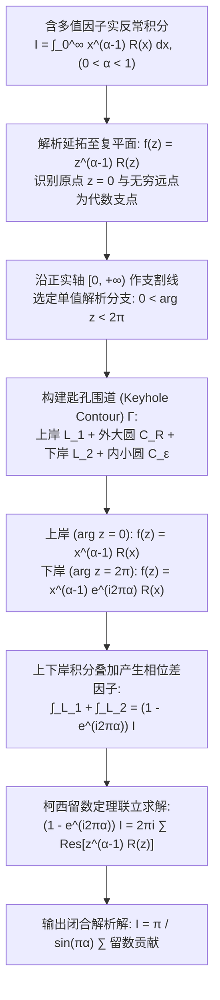

---
tags:
  - 物理/数学物理方法
  - 复变函数
  - 技术卡
  - 匙孔围道
  - 支割线积分
  - 多值函数反常积分
  - 欧拉反射公式
aliases:
  - 分支割线匙孔围道与多值函数反常积分技术
  - 匙孔围道积分法
  - 支割线积分
  - 多值函数积分
  - Keyhole Contour Integration
  - Branch Cut Contour Integrals
created: 2026-09-07
updated: 2026-09-08
---

> [!summary] 技术核心透视
> 当实反常积分包含**非整数分数幂因子 $x^{\alpha-1}$ ($0 < \alpha < 1$) 或对数项 $\ln x$** 时，常规的半圆闭合围道彻底崩溃——被积函数解析延拓至复平面后在原点与无穷远点产生具有内在缠绕多值性的**分支点（Branch Points）**。破除这一数学绝境的精妙杀手锏，是**支割线围道积分技术（特别是沿正实轴剪开的匙孔围道 / Keyhole Contour）**：通过让围道紧贴割线的上岸与下岸往返穿行，利用上下两岸**宗量相位的阶跃差 $(1 - e^{i 2\pi \alpha})$**，精巧地将实积分从复杂的复闭路中“榨取”剥离出来，是量子场论单圈费曼积分与反常色散关系的解析计算大门。

---

## 一、技术原理与规范求解工作流

---

### 1.1 核心问题抽象与收敛判据

求解形式为：
$$I = \int_0^{+\infty} x^{\alpha - 1} R(x) dx \quad (0 < \alpha < 1)$$
其中 $R(x) = \frac{P(x)}{Q(x)}$ 为有理分式，满足：
1. $Q(x)$ 在正实轴 $[0, +\infty)$ 上无实零点；
2. **零点收敛性**：当 $x \to 0^+$ 时，$x^{\alpha - 1} R(x) \sim x^{\alpha - 1}$，因 $\alpha - 1 > -1 \iff \alpha > 0$，原点处可积收敛；
3. **无穷远收敛性**：当 $x \to +\infty$ 时，$R(x) \sim x^{\deg P - \deg Q}$。若 $\deg Q - \deg P \ge 1$，因 $\alpha < 1$，总幂次 $\alpha - 1 + \deg P - \deg Q < 0 - 1 = -1$，无穷远反常积分绝对收敛。

---

### 1.2 匙孔围道 (Keyhole Contour) 的严格几何构造

1. **支割线与分支选取**：
   从原点 $z = 0$ 沿正实轴 $[0, +\infty)$ 作支割线。
   规定复变函数 $z^{\alpha - 1} = |z|^{\alpha - 1} e^{i(\alpha - 1)\operatorname{Arg} z}$ 的单值解析分支定义域为：
   $$\boxed{0 < \operatorname{Arg} z < 2\pi}$$
2. **四段路径合成闭路 $\Gamma$**：
   - **割线上岸 $L_1$**：$z = x e^{i 0} = x$，从 $x = \varepsilon$ 沿实轴上侧行进至 $x = R$；
   - **外大圆周 $C_R$**：$z = R e^{i\theta}$，辐角 $\theta$ 从 $0$ 逆时针连续增加至 $2\pi$；
   - **割线下岸 $L_2$**：$z = x e^{i 2\pi}$，从 $x = R$ 沿实轴下侧反向返回至 $x = \varepsilon$；
   - **内小圆周 $C_\varepsilon$**：$z = \varepsilon e^{i\theta}$，辐角 $\theta$ 从 $2\pi$ 顺时针缩减至 $0$。

---

### 1.3 上下两岸积分的相位差抵消机理

由单值分支定义，计算两岸被积函数的实际取值：
1. **上岸 $L_1$**：$\operatorname{Arg} z = 0$，
   $$f(z)|_{L_1} = (x e^{i 0})^{\alpha - 1} R(x) = x^{\alpha - 1} R(x)$$
   $$\int_{L_1} f(z) dz = \int_\varepsilon^R x^{\alpha - 1} R(x) dx$$
2. **下岸 $L_2$**：$\operatorname{Arg} z = 2\pi$，
   $$f(z)|_{L_2} = (x e^{i 2\pi})^{\alpha - 1} R(x) = x^{\alpha - 1} e^{i 2\pi (\alpha - 1)} R(x) = x^{\alpha - 1} e^{i 2\pi \alpha} e^{-i 2\pi} R(x) = e^{i 2\pi \alpha} x^{\alpha - 1} R(x)$$
   注意行进方向是从 $R$ 到 $\varepsilon$（$dz = dx$）：
   $$\int_{L_2} f(z) dz = \int_R^\varepsilon e^{i 2\pi \alpha} x^{\alpha - 1} R(x) dx = -e^{i 2\pi \alpha} \int_\varepsilon^R x^{\alpha - 1} R(x) dx$$
3. **两岸线性叠加**：
   $$\int_{L_1} f(z) dz + \int_{L_2} f(z) dz = (1 - e^{i 2\pi \alpha}) \int_\varepsilon^R x^{\alpha - 1} R(x) dx$$

---

### 1.4 内外圆周极限消失严格证明

1. **内小圆周 $C_\varepsilon$**：令 $z = \varepsilon e^{i\theta}$，
   $$|f(z)| \le \varepsilon^{\alpha - 1} M_\varepsilon$$
   由 ML 不等式：
   $$\left| \int_{C_\varepsilon} f(z) dz \right| \le \varepsilon^{\alpha - 1} M_\varepsilon \cdot (2\pi \varepsilon) = 2\pi M_\varepsilon \varepsilon^\alpha$$
   由于 $\alpha > 0$，当 $\varepsilon \to 0$ 时，$\varepsilon^\alpha \to 0$，故：
   $$\lim_{\varepsilon \to 0} \int_{C_\varepsilon} f(z) dz = 0$$
2. **外大圆周 $C_R$**：令 $z = R e^{i\theta}$，因 $\deg Q - \deg P \ge 1$，$|R(z)| \le \frac{M}{R}$，
   $$|f(z)| \le R^{\alpha - 1} \frac{M}{R} = M R^{\alpha - 2}$$
   由 ML 不等式：
   $$\left| \int_{C_R} f(z) dz \right| \le M R^{\alpha - 2} \cdot (2\pi R) = 2\pi M R^{\alpha - 1}$$
   由于 $\alpha < 1 \implies \alpha - 1 < 0$，当 $R \to \infty$ 时，$R^{\alpha - 1} \to 0$，故：
   $$\lim_{R \to \infty} \int_{C_R} f(z) dz = 0$$

---

### 1.5 留数定理与闭合反演公式

由柯西留数定理：
$$\lim_{\substack{R \to \infty \\ \varepsilon \to 0}} \oint_\Gamma f(z) dz = (1 - e^{i 2\pi \alpha}) I = 2\pi i \sum_{k=1}^m \operatorname{Res}\left[ z^{\alpha - 1} R(z), z_k \right]$$
解出目标积分 $I$：
$$I = \frac{2\pi i}{1 - e^{i 2\pi \alpha}} \sum_{k=1}^m \operatorname{Res} = \frac{2\pi i}{e^{i\pi \alpha}(e^{-i\pi \alpha} - e^{i\pi \alpha})} \sum_{k=1}^m \operatorname{Res} = \frac{2\pi i}{-2i \sin(\pi \alpha) e^{i\pi \alpha}} \sum_{k=1}^m \operatorname{Res}$$

$$\boxed{\int_0^{+\infty} x^{\alpha - 1} R(x) dx = -\frac{\pi e^{-i\pi \alpha}}{\sin(\pi \alpha)} \sum_{k=1}^m \operatorname{Res}\left[ z^{\alpha - 1} R(z), z_k \right]}$$

*(其中 $z_k$ 为不在割线正实轴上的全部极点，计算 $z_k^{\alpha-1}$ 时必须代入 $\operatorname{Arg} z_k \in (0, 2\pi)$)*。

---

## 二、⚠️ 致命失分陷阱与临界边界

> [!warning] 陷阱 1：在极点处计算留数时代错辐角分支
> 这是匙孔积分中最容易全题尽墨的致命陷阱！
> 选定割线为正实轴后，规定的分支是 **$0 < \operatorname{Arg} z < 2\pi$**。
> **数值典型反例**：若极点在负实轴 $z_0 = -1$：
> 常规主值习惯写 $\operatorname{Arg}(-1) = \pi$；但在匙孔规定下确实落在区间 $(0, 2\pi)$ 内为 $\pi$，此时 $(-1)^{\alpha-1} = e^{i\pi(\alpha-1)} = -e^{i\pi \alpha}$；
> 但如果极点在第四象限（如 $z_0 = 1 - i$），平时习惯写辐角为 $-\frac{\pi}{4}$，**在匙孔坐标下必须写为 $\frac{7\pi}{4}$**！若直接带入负角，指数相位直接发生灾难性偏离。

> [!caution] 陷阱 2：上下两岸抵消因子误写为 $(1 + e^{i 2\pi \alpha})$
> 下岸积分方向是反向的（从 $+\infty$ 到 $0$），提取符号变成负号；而 $e^{i 2\pi(\alpha-1)} = e^{i 2\pi \alpha}$。
> 负号与正相位相乘，导致总因子是 **$(1 - e^{i 2\pi \alpha})$**，绝不是相加！

> [!danger] 陷阱 3：当幂次 $\alpha$ 超出区间 $(0, 1)$ 时强套公式
> - 若 $\alpha \le 0$，在 $x \to 0$ 处积分本身发散；
> - 若 $\alpha \ge 1$，在 $R \to \infty$ 时大圆弧积分不再收敛为零。
> 必须确保指数范围严格落在 $(0, 1)$ 之内。若遇到高阶幂次，必须先通过分部积分法将指数降低至 $(0, 1)$ 之间再行应用。

---

## 三、经典范例手把手演算与反代验算

### 3.1 经典例题：欧拉反射公式与有理多值积分严格推导
**题目（梁书第 4 章 §4.3 核心例题，欧拉互补公式）**：
计算实反常积分：
$$I = \int_0^{+\infty} \frac{x^{\alpha - 1}}{1 + x} dx \quad (0 < \alpha < 1)$$

#### 第一步：分析奇点与支点
解析延拓至复平面：
$$f(z) = \frac{z^{\alpha - 1}}{1 + z}$$
- 支点：$z = 0$ 和 $z = \infty$；
- 沿正实轴作支割线，分支约定 $0 < \operatorname{Arg} z < 2\pi$；
- 极点：分母 $1 + z = 0 \implies z_0 = -1$。为一阶单极点。

#### 第二步：极点辐角与留数计算
计算极点 $z_0 = -1$ 的模与辐角：
$$|-1| = 1, \quad \operatorname{Arg}(-1) = \pi \in (0, 2\pi)$$
在该解析分支下：
$$(-1)^{\alpha - 1} = [1 \cdot e^{i\pi}]^{\alpha - 1} = e^{i\pi(\alpha - 1)} = e^{i\pi \alpha} e^{-i\pi} = -e^{i\pi \alpha}$$
计算极点留数（一阶单极点）：
$$\operatorname{Res}[f(z), -1] = \lim_{z \to -1} (z - (-1)) \frac{z^{\alpha - 1}}{z + 1} = (-1)^{\alpha - 1} = -e^{i\pi \alpha}$$

#### 第三步：应用匙孔围道留数公式
由匙孔围道公式：
$$(1 - e^{i 2\pi \alpha}) I = 2\pi i \operatorname{Res}[f(z), -1] = 2\pi i (-e^{i\pi \alpha})$$
解出 $I$：
$$I = \frac{-2\pi i e^{i\pi \alpha}}{1 - e^{i 2\pi \alpha}}$$
分子分母同除以 $-e^{i\pi \alpha}$：
$$I = \frac{2\pi i}{e^{i\pi \alpha} - e^{-i\pi \alpha}} = \frac{\pi}{\frac{e^{i\pi \alpha} - e^{-i\pi \alpha}}{2i}} = \frac{\pi}{\sin(\pi \alpha)}$$
最终导出著名的欧拉互补积分公式：
$$\boxed{\int_0^{+\infty} \frac{x^{\alpha - 1}}{1 + x} dx = \frac{\pi}{\sin(\pi \alpha)} \quad (0 < \alpha < 1)}$$

#### 第四步：反代验算（极限取值检验与对称性验证）
1. **取特例 $\alpha = 1/2$**：
   代入上式解析解：
   $$I\left(\frac{1}{2}\right) = \frac{\pi}{\sin(\pi / 2)} = \pi$$
   直接计算原实定积分：
   $$\int_0^{+\infty} \frac{x^{-1/2}}{1 + x} dx = \int_0^{+\infty} \frac{1}{\sqrt{x}(1 + x)} dx$$
   作实数换元 $x = t^2$ ($t \ge 0, dx = 2t dt$)：
   $$\int_0^{+\infty} \frac{1}{t(1 + t^2)} (2t dt) = 2 \int_0^{+\infty} \frac{1}{1 + t^2} dt = 2 [\arctan t]_0^{+\infty} = 2\left( \frac{\pi}{2} - 0 \right) = \pi$$
   初等微积分换元计算与留数匙孔法结果分毫不差！
2. **对称性验证**：作倒数代换 $x = 1/u$：
   $$\int_0^{+\infty} \frac{x^{\alpha - 1}}{1 + x} dx = \int_{+\infty}^0 \frac{u^{1-\alpha}}{1 + 1/u} \left(-\frac{du}{u^2}\right) = \int_0^{+\infty} \frac{u^{(1-\alpha)-1}}{1 + u} du$$
   这表明积分关于 $\alpha \leftrightarrow 1 - \alpha$ 对称。
   而公式右端 $\frac{\pi}{\sin(\pi \alpha)} = \frac{\pi}{\sin(\pi(1-\alpha))}$，天然满足全反射对称性！
   理论推导完满自洽！

---

## 四、出处与纸质笔记坐标

- **教材出处**：梁昆淼《数学物理方法》（第四版）
  - 第四章：留数定理
  - §4.3 包含多值函数反常积分的计算技术（原书 P64-P68）
- **对应 MinerU OCR 语料**：`mineru_output/梁昆淼_数学物理方法/数学物理方法_梁昆淼_第四版/ocr/数学物理方法_梁昆淼_第四版.md` Lines 3015-3201
- **对应全景图**：[[00_梁昆淼数学物理方法_第一篇全景图]]
- **纸质活页定位**：`[活页-LKM-09]`
