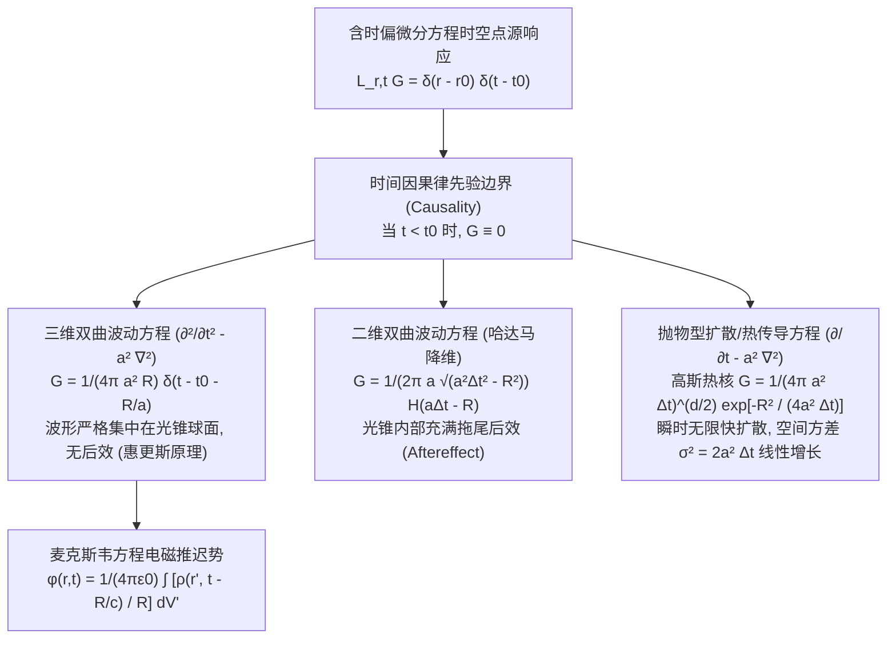

---
tags:
  - 物理/数学物理方法
  - 偏微分方程
  - 技术卡
  - 格林函数
  - 波动方程
  - 热核
  - 惠更斯原理
  - 推迟势
aliases:
  - 含时演化波动扩散方程格林函数与推迟势
  - 含时格林函数
  - 波动方程因果格林函数
  - 热传导高斯热核
  - 惠更斯原理与波动后效
  - 推迟势与电磁辐射
  - Time-Dependent Green Functions Heat Kernel and Retarded Potentials
created: 2026-09-08
updated: 2026-09-08
---

> [!summary] 技术核心论断
> 当物理系统从静态场跨入随时间单向演化的**动态场（双曲型波动力学与抛物型热量扩散）**时，格林函数升维为兼具空间几何与时间因果时序的**时空格林张量核 $G(\boldsymbol{r}, t; \boldsymbol{r}_0, t_0)$**。其最高准则为**相对论因果律 (Causality Condition)**：在脉冲激发发生之前（$t < t_0$），时空任意角落的响应严格归零。三维波动格林函数呈现为光锥表面上无畸变传播的锐利奇异脉冲，完美印证了**无后效的惠更斯原理**与电磁学**推迟势 (Retarded Potentials)**；而扩散方程格林函数则表现为向全时空对称弥散的**高斯热核 (Heat Kernel)**，生动诠释了热力学第二定律由微观集中向宏观熵增耗散的不可逆时箭。

## 一、推导机理与规范求解工作流

---

### 1.1 三维波动方程的因果格林函数与惠更斯原理

考虑全无界三维空间中的波动方程：
$$\left( \frac{1}{a^2} \frac{\partial^2}{\partial t^2} - \nabla^2 \right) G(\boldsymbol{r}, t; \boldsymbol{r}_0, t_0) = \delta(\boldsymbol{r} - \boldsymbol{r}_0) \delta(t - t_0)$$
引入空间相对距离矢量 $\boldsymbol{R} = \boldsymbol{r} - \boldsymbol{r}_0, R = |\boldsymbol{R}|$，时间延迟 $\tau = t - t_0$。

利用球对称性与三维傅里叶变换展开，可严格导出**三维无界因果格林函数**：
$$\boxed{ G(\boldsymbol{r}, t; \boldsymbol{r}_0, t_0) = \frac{1}{4\pi a^2 R} \delta\left( t - t_0 - \frac{R}{a} \right) \quad (t > t_0) }$$
（在某些定义中若方程算子不除以 $a^2$，即 $\frac{\partial^2 G}{\partial t^2} - a^2 \nabla^2 G = \delta$，则 $G = \frac{1}{4\pi R} \delta(t - t_0 - R/a)$）。

#### 物理图景与惠更斯原理 (Huygens' Principle)：
1. **锐利波阵面（无后效性）**：
   由于解中严格只包含狄拉克 $\delta$ 函数，扰动只能存在于满足 $t - t_0 = \frac{R}{a}$ 的**单一膨胀球面上（光锥母面）**！
2. **静止恢复**：
   当球形波前扫过空间任意固定观测点后，由于 $\delta$ 函数归零，该点立即**恢复完全静止**，不存在任何残余扰动。这正是三维物理空间声音与光波能够清晰传递信息、无模糊拖尾的数学基石！

---

### 1.2 二维波动方程降维法与拖尾后效 (Aftereffect)

在二维无界平面上（如平静水面），点源相当于三维空间中沿整条 $z$ 轴同时激发的无线电缆线源。根据**哈达马降维法 (Hadamard's Method of Descent)**，对三维格林函数沿 $z$ 轴从 $-\infty$ 积分至 $+\infty$：
$$G_{2D}(\boldsymbol{\rho}, t; \boldsymbol{\rho}_0, t_0) = \int_{-\infty}^{+\infty} \frac{\delta\left( t - t_0 - \frac{\sqrt{\rho^2 + z^2}}{a} \right)}{4\pi a^2 \sqrt{\rho^2 + z^2}} dz$$
其中 $\rho = |\boldsymbol{\rho} - \boldsymbol{\rho}_0|$。计算定积分导出**二维无界波动格林函数**：
$$\boxed{ G_{2D}(\boldsymbol{\rho}, t; \boldsymbol{\rho}_0, t_0) = \frac{1}{2\pi a \sqrt{a^2 (t - t_0)^2 - \rho^2}} H\left( a(t - t_0) - \rho \right) }$$
其中 $H$ 为赫维赛德阶跃函数。

#### 波动后效物理本质：
在二维世界中，波前虽然以速度 $a$ 到达（$\rho = a\tau$），但在波前扫过后，由于当 $a\tau > \rho$ 时阶跃函数 $H = 1$，**扰动在圆盘内部长久不衰**！其振幅按 $\frac{1}{\sqrt{a^2\tau^2 - \rho^2}}$ 缓慢拖尾衰减。在二维平面上投石击水，泛起的涟漪经久不散，正源于此后效拖尾现象。

---

### 1.3 抛物型热传导方程的高斯热核 (Heat Kernel)

考虑一维无界热传导方程：
$$\frac{\partial G}{\partial t} - a^2 \frac{\partial^2 G}{\partial x^2} = \delta(x - x_0) \delta(t - t_0)$$
满足因果条件：当 $t < t_0$ 时 $G \equiv 0$。

#### 1. 傅里叶变换推导：
对空间变量 $x$ 施行连续傅里叶变换（Card 10），记 $\bar{G}(k, t) = \mathcal{F}[G]$：
$$\frac{d\bar{G}}{dt} + a^2 k^2 \bar{G} = \frac{1}{2\pi} e^{-i k x_0} \delta(t - t_0)$$
解此一阶常微分方程：
$$\bar{G}(k, t) = \frac{1}{2\pi} e^{-ik x_0} e^{-a^2 k^2 (t - t_0)} H(t - t_0)$$
执行傅里叶反演积分：
$$G(x, t; x_0, t_0) = \frac{1}{2\pi} \int_{-\infty}^{+\infty} e^{-a^2 k^2 (t - t_0)} e^{ik (x - x_0)} dk \cdot H(t - t_0)$$
利用高斯积分公式 $\int_{-\infty}^{+\infty} e^{-\alpha k^2 + i \beta k} dk = \sqrt{\frac{\pi}{\alpha}} e^{-\frac{\beta^2}{4\alpha}}$，其中 $\alpha = a^2(t - t_0), \beta = x - x_0$：
$$G = \frac{1}{2\pi} \sqrt{\frac{\pi}{a^2 (t - t_0)}} \exp\left[ -\frac{(x - x_0)^2}{4 a^2 (t - t_0)} \right] H(t - t_0)$$
即导出著名的**一维高斯热核 (Gaussian Heat Kernel)**：
$$\boxed{ G(x, t; x_0, t_0) = \frac{1}{\sqrt{4\pi a^2 (t - t_0)}} \exp\left[ -\frac{(x - x_0)^2}{4 a^2 (t - t_0)} \right] H(t - t_0) }$$

#### 2. 三维高斯热核推广：
由三个相互垂直坐标维度的独立乘积：
$$\boxed{ G(\boldsymbol{r}, t; \boldsymbol{r}_0, t_0) = \frac{1}{\left[ 4\pi a^2 (t - t_0) \right]^{3/2}} \exp\left[ -\frac{|\boldsymbol{r} - \boldsymbol{r}_0|^2}{4 a^2 (t - t_0)} \right] H(t - t_0) }$$

---

### 1.4 电动力学推迟势 (Retarded Potentials)

在电动力学中，麦克斯韦方程组在洛伦兹规范下，电磁标势 $\varphi$ 与矢势 $\boldsymbol{A}$ 遵从达朗贝尔波动方程：
$$\nabla^2 \varphi - \frac{1}{c^2} \frac{\partial^2 \varphi}{\partial t^2} = -\frac{\rho(\boldsymbol{r}, t)}{\varepsilon_0}, \quad \nabla^2 \boldsymbol{A} - \frac{1}{c^2} \frac{\partial^2 \boldsymbol{A}}{\partial t^2} = -\mu_0 \boldsymbol{J}(\boldsymbol{r}, t)$$
利用三维波动因果格林函数 $G = \frac{\delta(t - t' - R/c)}{4\pi R}$ 对全时空执行四维卷积积分：
$$\varphi(\boldsymbol{r}, t) = \int dt' \iiint dV' \frac{\rho(\boldsymbol{r}', t')}{\varepsilon_0} \frac{\delta\left( t - t' - \frac{|\boldsymbol{r} - \boldsymbol{r}'|}{c} \right)}{4\pi |\boldsymbol{r} - \boldsymbol{r}'|}$$
对时间 $t'$ 积分，由 $\delta$ 函数提取出**电磁推迟时刻 (Retarded Time)**：
$$\boxed{ t' = t_{\text{ret}} \equiv t - \frac{|\boldsymbol{r} - \boldsymbol{r}'|}{c} }$$
由此直接推导出统治现代辐射理论的**推迟势公式**：
$$\boxed{ \varphi(\boldsymbol{r}, t) = \frac{1}{4\pi\varepsilon_0} \iiint \frac{\rho(\boldsymbol{r}', t_{\text{ret}})}{|\boldsymbol{r} - \boldsymbol{r}'|} dV', \quad \boldsymbol{A}(\boldsymbol{r}, t) = \frac{\mu_0}{4\pi} \iiint \frac{\boldsymbol{J}(\boldsymbol{r}', t_{\text{ret}})}{|\boldsymbol{r} - \boldsymbol{r}'|} dV' }$$

---

## 二、⚠️ 致命失分陷阱与临界边界

> [!warning] 陷阱 1：高斯热核指数分母常数 4 的丢失
> 考场最高频低级失误：
> - 正确热核公式：$\frac{1}{\sqrt{4\pi a^2 t}} \exp\left[ -\frac{x^2}{4 a^2 t} \right]$；
> - 许多考生误记为类似正态分布的 $2 a^2 t$，漏掉系数 4；
> - 一旦分母写成 $2 a^2 t$，代入热传导方程 $\frac{\partial u}{\partial t} = a^2 \frac{\partial^2 u}{\partial x^2}$ 验算将无法恒等，导致后续初值卷积解全盘错误。

> [!caution] 陷阱 2：波动推迟时间正负号混淆（超前势佯谬）
> 波动因果律要求**响应滞后于源**：
> - 正确推迟时刻是 $t - R/c$；
> - 若误写成 $t + R/c$，则称为**超前势 (Advanced Potentials)**；
> - 超前势表示电荷还未运动、探测器已提前接收到辐射，公然违背时间不可逆因果律！在经典电动力学中必须舍弃。

> [!danger] 陷阱 3：二维波动方程中盲目套用三维球面脉冲
> 在求解二维鼓膜或浅水波时：
> - 许多考生盲目套用三维解的形式写出 $\delta(at - r)$；
> - 必须严正牢记：**只有奇数空间维度（3D, 5D, ...）才严格满足纯锐利脉冲无后效的惠更斯原理！**
> - 偶数空间维度（2D, 4D, ...）必然存在拖尾后效，格林函数必须包含阶跃函数 $H$ 与代数衰减根号项！

---

## 三、经典范例手把手演算

### 题目（全空间一维热传导柯西初值问题的泊松积分推导与初值还原）：
全无界一维细杆初始时刻具有任意温度分布：
$$\frac{\partial u}{\partial t} = a^2 \frac{\partial^2 u}{\partial x^2} \quad (-\infty < x < +\infty, t > 0), \quad u(x, 0) = \varphi(x)$$
1. 利用一维高斯热核写出完全时空解析解；
2. 考虑阶跃初始分布 $\varphi(x) = \begin{cases} T_0 & (x > 0) \\ 0 & (x < 0) \end{cases}$，手把手化简为**高斯误差函数 $\operatorname{erf}(z)$** 的形式；
3. 严格手把手利用换元与高斯极限证明：当 $t \to 0^+$ 时，解严格还原初始阶跃值。

#### 【演算步骤】

**第一步：写出热核卷积全解**
将初始分布看作由一系列冲量构成的初值，利用一维热核（令 $t_0 = 0$）：
$$\boxed{ u(x, t) = \frac{1}{\sqrt{4\pi a^2 t}} \int_{-\infty}^{+\infty} \varphi(\xi) \exp\left[ -\frac{(x - \xi)^2}{4 a^2 t} \right] d\xi }$$

**第二步：阶跃初值积分化简为误差函数**
代入 $\varphi(\xi) = T_0 H(\xi)$：
$$u(x, t) = \frac{T_0}{\sqrt{4\pi a^2 t}} \int_0^{+\infty} \exp\left[ -\frac{(x - \xi)^2}{4 a^2 t} \right] d\xi$$
作变量代换：令 $\eta = \frac{\xi - x}{\sqrt{4 a^2 t}} \implies \xi = x + \sqrt{4 a^2 t} \eta, d\xi = \sqrt{4 a^2 t} d\eta$。
积分限变换：
- 当 $\xi = 0$ 时：$\eta = -\frac{x}{\sqrt{4 a^2 t}} = -\frac{x}{2a\sqrt{t}}$；
- 当 $\xi \to +\infty$ 时：$\eta \to +\infty$。
代入得：
$$u(x, t) = \frac{T_0}{\sqrt{\pi}} \int_{-\frac{x}{2a\sqrt{t}}}^{+\infty} e^{-\eta^2} d\eta$$
将积分区间拆开：
$$\int_{-\frac{x}{2a\sqrt{t}}}^{+\infty} e^{-\eta^2} d\eta = \int_0^{+\infty} e^{-\eta^2} d\eta + \int_{-\frac{x}{2a\sqrt{t}}}^0 e^{-\eta^2} d\eta = \frac{\sqrt{\pi}}{2} + \int_0^{\frac{x}{2a\sqrt{t}}} e^{-\eta^2} d\eta$$
根据标准**误差函数 (Error Function)** 定义 $\operatorname{erf}(z) \equiv \frac{2}{\sqrt{\pi}} \int_0^z e^{-\eta^2} d\eta$：
$$\int_0^{\frac{x}{2a\sqrt{t}}} e^{-\eta^2} d\eta = \frac{\sqrt{\pi}}{2} \operatorname{erf}\left( \frac{x}{2a\sqrt{t}} \right)$$
因此电位/温度的完全封闭解析解为：
$$\boxed{ u(x, t) = \frac{T_0}{2} \left[ 1 + \operatorname{erf}\left( \frac{x}{2a\sqrt{t}} \right) \right] }$$

---

**第三步：初始极限手把手严格核验（$t \to 0^+$）**
考察自变量极限 $z = \frac{x}{2a\sqrt{t}}$ 当 $t \to 0^+$ 时的性态：
1. **当 $x > 0$ 时（原始高温区）**：
   $$\lim_{t \to 0^+} \frac{x}{2a\sqrt{t}} = +\infty$$
   已知误差函数在正无穷远处极限为 $\lim_{z \to +\infty} \operatorname{erf}(z) = 1$：
   $$\lim_{t \to 0^+} u(x, t) = \frac{T_0}{2} [1 + 1] = T_0$$
2. **当 $x < 0$ 时（原始低温区）**：
   $$\lim_{t \to 0^+} \frac{x}{2a\sqrt{t}} = -\infty$$
   已知 $\lim_{z \to -\infty} \operatorname{erf}(z) = -1$：
   $$\lim_{t \to 0^+} u(x, t) = \frac{T_0}{2} [1 - 1] = 0$$
3. **在原点间断点 $x = 0$ 处**：
   对任意 $t > 0$，$\operatorname{erf}(0) = 0$：
   $$u(0, t) \equiv \frac{T_0}{2}$$
   严格等于左右初值的算术平均值 $\frac{T_0 + 0}{2}$！

解析解不仅在时间演化中平滑无瑕，且在 $t \to 0^+$ 时以狄拉克极限的方式精确重构了初始阶跃分布！

---

## 四、出处与纸质笔记坐标

* **教材出处**：梁昆淼《数学物理方法》（第四版）第十二章 §12.3 (P321-P328)
* **纸质活页槽位**：`[活页-LKM-31]`
* **知识全景索引**：[[00_梁昆淼数学物理方法_第三篇全景图]]
