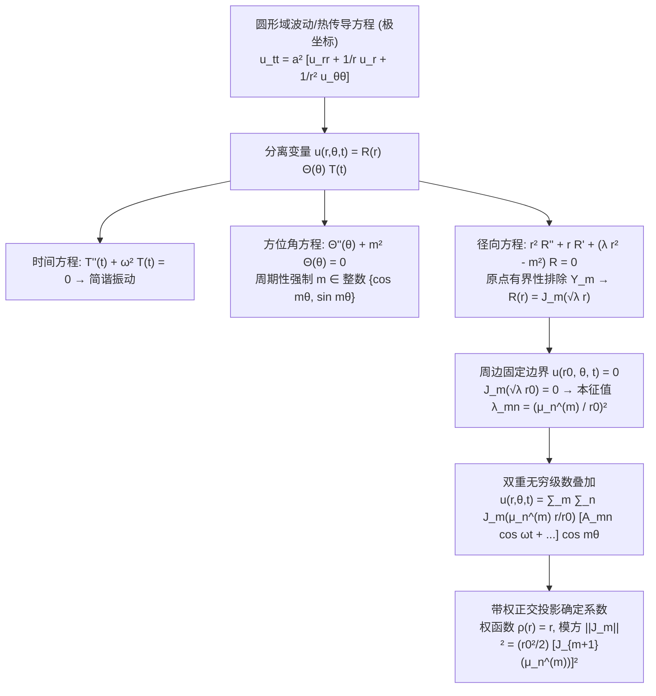

---
tags:
  - 物理/数学物理方法
  - 特殊函数
  - 技术卡
  - 柱坐标
  - 贝塞尔函数
  - 傅里叶贝塞尔级数
  - 圆形膜振动
aliases:
  - 圆柱对称定解问题与傅里叶贝塞尔级数
  - 傅里叶贝塞尔级数展开
  - 圆形弹性膜振动
  - 圆柱坐标分离变量法
  - 贝塞尔本征值与节圆节线
  - Cylindrical Boundary Value Problems and Fourier-Bessel Series
created: 2026-09-08
updated: 2026-09-08
---

> [!summary] 技术核心论断
> 圆柱坐标系下的偏微分方程定解问题（圆形鼓膜振动、圆柱形谐振腔、圆截面传热与流体泊肃叶流）是二阶偏微分方程分离变量法在非笛卡尔几何中的最高典范。其径向边值问题是典型的**奇异施图姆－刘维尔本征值问题**：轴心物理有界性自动排除对数发散的诺伊曼函数，而周边边界齐次约束则通过**贝塞尔函数的实数零点 $\mu_n^{(m)}$ 精确锁定空间固有波矢与本征振动频率**。由带权正交性（面积微元权函数 $\rho(r) = r$）导出的**傅里叶－贝塞尔级数**构成了对任意径向初始分布进行能量谱分解的标准数学利器，生动勾勒出由**同心节圆与径向节线**编织而成的振动驻波图像。

## 一、推导机理与规范求解工作流



---

### 1.1 圆形弹性薄膜横振动的分离变量推导

考虑半径为 $r_0$、边缘刚性固定夹紧的均匀圆形弹性薄膜：
$$\begin{cases} \frac{\partial^2 u}{\partial t^2} = a^2 \left( \frac{\partial^2 u}{\partial r^2} + \frac{1}{r} \frac{\partial u}{\partial r} + \frac{1}{r^2} \frac{\partial^2 u}{\partial \theta^2} \right) & (0 \le r < r_0, 0 \le \theta < 2\pi, t > 0) \\ u(r_0, \theta, t) = 0 & (\text{边缘固定}) \\ \lim_{r \to 0} |u(r, \theta, t)| < \infty & (\text{中心有限}) \\ u(r, \theta + 2\pi, t) = u(r, \theta, t) & (\text{方位角单值周期}) \\ u(r, \theta, 0) = \varphi(r, \theta), \quad \left. \frac{\partial u}{\partial t} \right|_{t=0} = \psi(r, \theta) & (\text{初始条件}) \end{cases}$$

#### 第一步：变量分离与建立常微分方程
设未知解为三元乘积：$u(r, \theta, t) = R(r) \Theta(\theta) T(t)$。
代入波动方程并分离时间与空间：
$$\frac{T''(t)}{a^2 T(t)} = \frac{R''(r) + \frac{1}{r} R'(r)}{R(r)} + \frac{\Theta''(\theta)}{r^2 \Theta(\theta)} = -\lambda$$
1. **时间演化方程**：
   $$T''(t) + a^2 \lambda T(t) = 0 \implies T(t) = A \cos(\omega t) + B \sin(\omega t) \quad (\omega = a\sqrt{\lambda})$$
2. **空间方程再度分离角度与半径**：
   $$r^2 \left[ \frac{R''(r) + \frac{1}{r} R'(r)}{R(r)} + \lambda \right] = -\frac{\Theta''(\theta)}{\Theta(\theta)} = m^2$$
   - **方位角方程**：
     $$\Theta''(\theta) + m^2 \Theta(\theta) = 0$$
     由单值周期性 $\Theta(\theta + 2\pi) = \Theta(\theta)$，**$m$ 必须严格为非负整数**：$m = 0, 1, 2, \dots$。
     其线性无关基底为 $\{\cos(m\theta), \sin(m\theta)\}$。
   - **径向贝塞尔方程**：
     $$r^2 R''(r) + r R'(r) + (\lambda r^2 - m^2) R(r) = 0$$
     令变量代换 $\xi = \sqrt{\lambda} r$（$d/dr = \sqrt{\lambda} d/d\xi$），方程严格化为**标准 $m$ 阶贝塞尔方程**：
     $$\xi^2 \frac{d^2 R}{d\xi^2} + \xi \frac{dR}{d\xi} + (\xi^2 - m^2) R = 0$$
     数学通解为：$R(r) = C_1 J_m(\sqrt{\lambda} r) + C_2 Y_m(\sqrt{\lambda} r)$。

#### 第二步：奇点筛选与边界本征值离散化
1. **中心原点有界性筛选**：
   在膜中心 $r = 0$ 处位移有限，而第二类诺伊曼函数 $Y_m(\sqrt{\lambda} r)$ 在原点对数或多项式发散（Card 27），故**必须剔除诺伊曼函数**：
   $$\boxed{ C_2 = 0 \implies R(r) = J_m(\sqrt{\lambda} r) }$$
2. **圆周边固定边界条件**：
   $$u(r_0, \theta, t) = 0 \implies R(r_0) = J_m(\sqrt{\lambda} r_0) = 0$$
   这表明：$\sqrt{\lambda} r_0$ 必须是 $m$ 阶第一类贝塞尔函数 $J_m(x)$ 的正实数零点！
   设 $\mu_n^{(m)}$ 为 $J_m(x)$ 的第 $n$ 个正零点（按从小到大排布 $0 < \mu_1^{(m)} < \mu_2^{(m)} < \dots \to \infty$）：
   $$\sqrt{\lambda_{mn}} r_0 = \mu_n^{(m)} \implies \boxed{ \lambda_{mn} = \left( \frac{\mu_n^{(m)}}{r_0} \right)^2 \quad (n = 1, 2, 3, \dots) }$$
   由此解得体系的双重离散**固有角频率谱 (Natural Frequency Spectrum)**：
   $$\boxed{ \omega_{mn} = a \sqrt{\lambda_{mn}} = \frac{a \mu_n^{(m)}}{r_0} }$$

---

### 1.2 傅里叶－贝塞尔级数 (Fourier-Bessel Series) 与带权正交性

根据施图姆－刘维尔理论（Card 22），贝塞尔微分算子对应的权函数为面积微元因子 $\rho(r) = r$。

> **正交性与归一化模方定理**：
> 固定整数阶数 $m$，对应不同零点 $\mu_p^{(m)} \neq \mu_q^{(m)}$ 的本征函数在区间 $[0, r_0]$ 上满足：
> $$\boxed{ \int_0^{r_0} J_m\left( \frac{\mu_p^{(m)} r}{r_0} \right) J_m\left( \frac{\mu_q^{(m)} r}{r_0} \right) r dr = \frac{r_0^2}{2} \left[ J_{m+1}\left( \mu_p^{(m)} \right) \right]^2 \delta_{pq} }$$

#### 广义傅里叶－贝塞尔展开展开法：
定义在 $[0, r_0]$ 上的任意满足齐次边界的连续函数 $f(r)$，均可展开为：
$$f(r) = \sum_{n=1}^\infty c_n J_m\left( \frac{\mu_n^{(m)} r}{r_0} \right)$$
其中展开系数由正交投影唯一定出：
$$\boxed{ c_n = \frac{\int_0^{r_0} f(r) J_m\left( \frac{\mu_n^{(m)} r}{r_0} \right) r dr}{\frac{r_0^2}{2} \left[ J_{m+1}\left( \mu_n^{(m)} \right) \right]^2} = \frac{2}{r_0^2 J_{m+1}^2(\mu_n^{(m)})} \int_0^{r_0} f(r) J_m\left( \frac{\mu_n^{(m)} r}{r_0} \right) r dr }$$

---

### 1.3 固有振型、节圆与节线的几何物理图像

每个分离变量特解 $u_{mn}(r, \theta, t)$ 构成膜的一个独立驻波本征模态：
$$u_{mn}(r, \theta, t) = J_m\left( \frac{\mu_n^{(m)} r}{r_0} \right) [A_{mn} \cos(\omega_{mn} t) + B_{mn} \sin(\omega_{mn} t)] \cos(m\theta - \alpha_m)$$

```
     m=0, n=1 (基模)             m=1, n=1 (一条节线)           m=0, n=2 (一个节圆)
        +-------+                    +---+---+                    +-------+
       /    +    \                  /  + | -  \                  /   +     \
      |   (中心)  |                |     |     |                |  (---)   |
       \    +    /                  \  + | -  /                  \   +     /
        +-------+                    +---+---+                    +-------+
       纯同相涨落                    中央对开反相                 内外反向环带
```

1. **节线 (Nodal Lines)**：由 $\cos(m\theta - \alpha) = 0$ 决定。在圆面上形成 $m$ 条穿过圆心的直角直径节线（共 $2m$ 条半射线）；
2. **节圆 (Nodal Circles)**：由 $J_m\left( \frac{\mu_n^{(m)} r}{r_0} \right) = 0$ 决定。在膜内部形成 $n - 1$ 个与外边界同心的静止圆环（不含固定外边缘 $r = r_0$）；
3. **泛音频率的非公度性 (Inharmonic Spectrum)**：
   贝塞尔零点比值是非理数的（例如 $J_0$ 前三个零点为 $\mu_1 \approx 2.405, \mu_2 \approx 5.520, \mu_3 \approx 8.654$）：
   $$\omega_{02} / \omega_{01} \approx 5.520 / 2.405 \approx 2.295 \neq \text{整数}！$$
   **声学物理核心**：打击乐器（鼓）与弦乐器（琴弦泛音为严格整数倍 $1:2:3$）不同，鼓的各阶泛音彼此不成整数倍，因而击鼓的声音不具备明确的单一定音音高，而具有浑厚饱满的打击音色。

---

## 二、⚠️ 致命失分陷阱与临界边界

> [!warning] 陷阱 1：模方归一化系数中的阶数加一错位
> 傅里叶－贝塞尔级数展开模方公式分母是 $\left[ J_{m+1}(\mu_n^{(m)}) \right]^2$：
> - 许多考生误顺手写成 $\left[ J_m(\mu_n^{(m)}) \right]^2$；
> - 注意：根据定义 $\mu_n^{(m)}$ 本身就是 $J_m$ 的零点，代入 $J_m(\mu_n^{(m)}) \equiv 0$！
> - 若写成 $J_m$，分母直接为零导致全题除零崩溃！必须牢记模方中阶数加 1（或者写成导数项 $\left[ J_m'(\mu_n^{(m)}) \right]^2$）。

> [!caution] 陷阱 2：正交积分中遗漏面积权函数 $r$
> 考场在计算展开系数积分时，常把 $\int_0^{r_0} f(r) J_m(\dots) r dr$ 漏写了其中的 $r$：
> - 绝对牢记：在柱坐标下 $dA = r dr d\theta$，一维径向积分的微元永远是 $r dr$；
> - 漏乘 $r$ 不仅量纲错乱，在数学上亦破坏了自伴正交性，算出的系数积分全错。

> [!danger] 陷阱 3：轴对称问题（$m=0$）方位角积分因子的 2 倍差异
> 方位角积分：
> - 当 $m = 0$ 时：$\int_0^{2\pi} 1^2 d\theta = 2\pi$；
> - 当 $m \ge 1$ 时：$\int_0^{2\pi} \cos^2(m\theta) d\theta = \pi$；
> 若对轴对称问题盲目套用 $\pi$，最终合成解直接被虚假放大了 2 倍。

---

## 三、经典范例手把手演算

### 题目（抛物面初形圆形弹性膜轴对称自由振动手把手全解——梁昆淼 §11.5 原型）：
固定半径为 $r_0$ 的均匀弹性圆膜，边缘固定 $u(r_0, t) = 0$。波速为 $a$。
初始时刻膜被压成轴对称的旋转抛物面形状，然后自静止状态释放：
$$\varphi(r) = h \left( 1 - \frac{r^2}{r_0^2} \right), \quad \left. \frac{\partial u}{\partial t} \right|_{t=0} = 0$$
1. 建立轴对称分离变量解的级数展开式；
2. 运用贝塞尔微分递推公式手把手积分求出傅里叶－贝塞尔展开系数；
3. 写出膜表面横向位移 $u(r, t)$ 的完全封闭级数解，并指出基频数值。

#### 【演算步骤】

**第一步：确立轴对称振动解结构**
由于初始位移与边界均与方位角 $\theta$ 无关，振动保持严格轴对称，即 $m = 0$：
$$u(r, t) = \sum_{n=1}^\infty A_n J_0\left( \frac{\mu_n r}{r_0} \right) \cos(\omega_n t)$$
其中 $\mu_n \equiv \mu_n^{(0)}$ 为零阶贝塞尔函数 $J_0(x)$ 的第 $n$ 个正零点，$J_0(\mu_n) = 0$，固有角频率 $\omega_n = \frac{a \mu_n}{r_0}$。
初始速度为零，正弦项 $B_n = 0$。

**第二步：利用正交投影求展开系数 $A_n$**
代入初始位移 $u(r, 0) = \varphi(r)$：
$$\sum_{n=1}^\infty A_n J_0\left( \frac{\mu_n r}{r_0} \right) = h \left( 1 - \frac{r^2}{r_0^2} \right)$$
根据傅里叶－贝塞尔系数公式：
$$A_n = \frac{2}{r_0^2 J_1^2(\mu_n)} \int_0^{r_0} h \left( 1 - \frac{r^2}{r_0^2} \right) J_0\left( \frac{\mu_n r}{r_0} \right) r dr$$
提取常数，令无量纲变量代换 $\xi = \frac{\mu_n r}{r_0}$（$r = \frac{r_0}{\mu_n}\xi, dr = \frac{r_0}{\mu_n} d\xi$）：
$$I_n = \int_0^{r_0} \left( 1 - \frac{r^2}{r_0^2} \right) J_0\left( \frac{\mu_n r}{r_0} \right) r dr = \left( \frac{r_0}{\mu_n} \right)^2 \int_0^{\mu_n} \left( 1 - \frac{\xi^2}{\mu_n^2} \right) J_0(\xi) \xi d\xi$$
分拆积分：
$$I_n = \frac{r_0^2}{\mu_n^2} \left[ \int_0^{\mu_n} \xi J_0(\xi) d\xi - \frac{1}{\mu_n^2} \int_0^{\mu_n} \xi^3 J_0(\xi) d\xi \right]$$

1. **计算第一项 $\int_0^{\mu_n} \xi J_0(\xi) d\xi$**：
   利用微分递推公式一：$\frac{d}{d\xi}[\xi J_1(\xi)] = \xi J_0(\xi)$：
   $$\int_0^{\mu_n} \xi J_0(\xi) d\xi = \left[ \xi J_1(\xi) \right]_0^{\mu_n} = \mu_n J_1(\mu_n) - 0 = \mu_n J_1(\mu_n)$$

2. **计算第二项 $\int_0^{\mu_n} \xi^3 J_0(\xi) d\xi$（分部积分法）**：
   将 $\xi J_0(\xi) d\xi$ 写为 $d[\xi J_1(\xi)]$：
   $$\int_0^{\mu_n} \xi^2 [\xi J_0(\xi) d\xi] = \int_0^{\mu_n} \xi^2 d[\xi J_1(\xi)] = \left[ \xi^3 J_1(\xi) \right]_0^{\mu_n} - \int_0^{\mu_n} \xi J_1(\xi) \cdot (2\xi) d\xi$$
   $$= \mu_n^3 J_1(\mu_n) - 2 \int_0^{\mu_n} \xi^2 J_1(\xi) d\xi$$
   再次利用递推公式一（$\nu = 2$）：$\frac{d}{d\xi}[\xi^2 J_2(\xi)] = \xi^2 J_1(\xi)$：
   $$\int_0^{\mu_n} \xi^2 J_1(\xi) d\xi = \left[ \xi^2 J_2(\xi) \right]_0^{\mu_n} = \mu_n^2 J_2(\mu_n)$$
   代入第二项得：
   $$\int_0^{\mu_n} \xi^3 J_0(\xi) d\xi = \mu_n^3 J_1(\mu_n) - 2\mu_n^2 J_2(\mu_n)$$

3. **合并计算括号内总积分**：
   $$\int_0^{\mu_n} \left( 1 - \frac{\xi^2}{\mu_n^2} \right) \xi J_0(\xi) d\xi = \mu_n J_1(\mu_n) - \frac{1}{\mu_n^2} \left[ \mu_n^3 J_1(\mu_n) - 2\mu_n^2 J_2(\mu_n) \right]$$
   $$= \mu_n J_1(\mu_n) - \mu_n J_1(\mu_n) + 2 J_2(\mu_n) = 2 J_2(\mu_n)$$
   利用三项递推公式（公式三）：$J_0(\mu_n) + J_2(\mu_n) = \frac{2}{\mu_n} J_1(\mu_n)$。
   因为 $J_0(\mu_n) = 0$，故 $J_2(\mu_n) = \frac{2}{\mu_n} J_1(\mu_n)$！
   代入得最终积分：
   $$I_n = \frac{r_0^2}{\mu_n^2} \cdot 2 \left( \frac{2}{\mu_n} J_1(\mu_n) \right) = \frac{4 r_0^2}{\mu_n^3} J_1(\mu_n)$$

**第三步：求出系数 $A_n$ 并汇编解析解**
$$A_n = \frac{2 h}{r_0^2 J_1^2(\mu_n)} \cdot \left[ \frac{4 r_0^2}{\mu_n^3} J_1(\mu_n) \right] = \frac{8h}{\mu_n^3 J_1(\mu_n)}$$

将 $A_n$ 代入通解，得圆形薄膜轴对称振动的完全显式解析解：
$$\boxed{ u(r, t) = 8h \sum_{n=1}^\infty \frac{1}{\mu_n^3 J_1(\mu_n)} J_0\left( \frac{\mu_n r}{r_0} \right) \cos\left( \frac{\mu_n a t}{r_0} \right) }$$

**第四步：基态频率与振幅衰减核验**
- 基态本征零点 $\mu_1 \approx 2.4048$，$J_1(\mu_1) \approx 0.5191$；
- 基模振动角频率：$\omega_1 \approx \frac{2.405 a}{r_0}$；
- 振幅随零点三次幂 $\mu_n^3$ 快速衰减（第二项 $\mu_2 \approx 5.520$，分母已大一个数量级），因此基振型在抛物面振动中占有压倒性主导能量！

---

## 四、出处与纸质笔记坐标

* **教材出处**：梁昆淼《数学物理方法》（第四版）第十一章 §11.5 (P289-P302)
* **纸质活页槽位**：`[活页-LKM-28]`
* **知识全景索引**：[[00_梁昆淼数学物理方法_第三篇全景图]]
