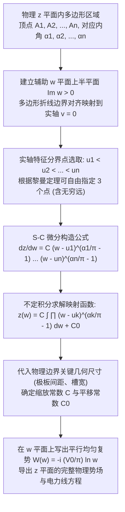

---
tags:
  - 物理/数学物理方法
  - 复变函数
  - 技术卡
  - 施瓦茨克里斯托费尔变换
  - 保角映射
  - 多边形边界
  - 边缘效应
aliases:
  - 施瓦茨克里斯托费尔折线多边形变换
  - 施瓦茨克里斯托费尔变换
  - S-C 积分变换公式
  - 平行板电容器边缘效应
  - 折线多边形保角映射
  - Schwarz-Christoffel Transformation and Polygonal Boundaries
created: 2026-09-08
updated: 2026-09-08
---

> [!summary] 技术核心论断
> 施瓦茨－克里斯托费尔 (Schwarz-Christoffel, S-C) 变换是复变几何映射理论中最具工程实用价值的非线性积分变换法。它彻底攻克了传统初等保角变换无法处理**带有直角突变、狭缝槽道、折线台阶等多边形几何边界**的世纪难题。S-C 变换建立了一套精巧的微分构造规则：通过将多边形各顶点的**内角转折突变**直接编码为实轴特征点处的**代数代数分支奇性指数 $(\frac{\alpha_k}{\pi} - 1)$**，将任意封闭或开口多边形内部区域，完全解析单值地映射为标准平坦的上半复平面。它是计算高压平板电容器边缘场溢出、流体自由射流喷管与波导不连续性阶跃匹配的无冕之王。

## 一、推导机理与规范求解工作流

---

### 1.1 S-C 微分公式的严格几何推导

设 $w$ 平面的实轴 $v = 0$ 上的点按照从小到大排列为 $u_1 < u_2 < \dots < u_n$。
当实变量 $w = u$ 沿实轴从 $-\infty$ 移动到 $+\infty$ 时：
其在 $z$ 平面上的像点沿着多边形的边界行进，依次经过多边形的各个顶点 $A_1, A_2, \dots, A_n$。

#### 1. 切线方向角与转角的突变关系：
设像曲线在顶点 $A_k$ 处的**内部几何顶角**为 $\alpha_k$。
当像点越过顶点 $A_k$ 时，前进方向逆时针旋转了**外角（转角）**：
$$\theta_k = \pi - \alpha_k$$
由保角变换切向量关系 $dz = \frac{dz}{dw} du$（在实轴上 $dw = du$ 为实数，$\arg(dw) = 0$）：
$$\arg(dz) = \arg\left( \frac{dz}{dw} \right)$$
因此，当 $w$ 从 $u_k$ 的左侧移动到右侧时，微商导数的辐角 $\arg\left( \frac{dz}{dw} \right)$ 必须发生一个值为 $\pi - \alpha_k$ 的阶跃跳变！

#### 2. 构造代数因子以产生辐角跳变：
考察复数因子 $(w - u_k)$：
- 当 $w < u_k$ 时：$w - u_k < 0$，其辐角为 $\arg(w - u_k) = \pi$；
- 当 $w > u_k$ 时：$w - u_k > 0$，其辐角为 $\arg(w - u_k) = 0$；
因此，当 $w$ 穿过 $u_k$ 时，因子 $(w - u_k)$ 的辐角改变了：
$$\Delta \arg(w - u_k) = 0 - \pi = -\pi$$
若给该因子赋予幂指数 $\beta_k$，即 $(w - u_k)^{\beta_k}$，则其辐角改变量为 $-\pi \beta_k$。
为了让其精确匹配几何外角 $\pi - \alpha_k$：
$$-\pi \beta_k = \pi - \alpha_k \implies \boxed{ \beta_k = \frac{\alpha_k}{\pi} - 1 }$$

由此，将所有顶点的贡献乘积叠加，即导出至尊**施瓦茨－克里斯托费尔微分方程**：
$$\boxed{ \frac{dz}{dw} = C (w - u_1)^{\frac{\alpha_1}{\pi} - 1} (w - u_2)^{\frac{\alpha_2}{\pi} - 1} \dots (w - u_n)^{\frac{\alpha_n}{\pi} - 1} }$$
对两边积分，得到将上半复平面 $\operatorname{Im} w > 0$ 映射为多边形内部的保角变换：
$$\boxed{ z(w) = C \int \prod_{k=1}^n (w - u_k)^{\frac{\alpha_k}{\pi} - 1} dw + C_0 }$$

---

### 1.2 自由度规范与无穷远顶点特殊处理定理

#### 1. 黎曼映射定理的三自由度原则：
根据共形映射基本定理，上半复平面到任意单连通多边形的保角变换存在三个自由实参数。
**标准求解惯例**：我们可以在多边形顶点中，**任意指定其中的三个顶点在 $w$ 实轴上的对应坐标**！
最经典的简化选点策略为：
- 选取两个有限对称点：$u_1 = -1, u_2 = 1$；
- 选取第三个顶点映射到实轴无穷远点：$u_n = \infty$。

#### 2. 无穷远点顶点的“隐形消除”定理：
> **核心定理**：若多边形的某个顶点 $A_n$ 被指定映射为 $w$ 平面实轴上的无穷远点 $u_n = \infty$：
> 则该顶点在 S-C 微分公式中**对应的项严格等于 1，直接从公式中略去不写**！

*简证*：将常数 $C$ 吸收无穷远极限 $\lim_{u_n \to \infty} (-u_n)^{\beta_n}$，项 $(w - u_n)^{\beta_n} = (-u_n)^{\beta_n} (1 - w/u_n)^{\beta_n} \to \text{常数}$。因此映射到无穷远处的顶点绝不增加微商的代数复杂度。

---

## 二、⚠️ 致命失分陷阱与临界边界

> [!warning] 陷阱 1：指数公式正负号颠倒
> 考场最高频毁灭性失分：
> - 许多考生误将指数记为 $(1 - \frac{\alpha_k}{\pi})$；
> - 严正核验：若内角为直角凹槽 $\alpha_k = \pi/2 < \pi$，指数必为负数 $\frac{\pi/2}{\pi} - 1 = -\frac{1}{2}$（分母开根号）；
> - 若误记为 $1 - 1/2 = +1/2$，微商直接从奇异分母跑到分子，积分结果完全面目全非！
> - **铁律：指数是 $(\frac{\alpha_k}{\pi} - 1)$！**

> [!caution] 陷阱 2：开口多边形狭缝两壁内角的识别
> 遇到半无限长极板（例如平行板电容器的一块薄电极）：
> - 极板具有上下两个表面，电极边缘端点相当于一条“折返线”；
> - 几何内角是从物理流体/场的一侧绕端点转过去的角度，此时**内角为 $\alpha_k = 2\pi$**！
> - 其对应的 S-C 指数为：$\beta = \frac{2\pi}{\pi} - 1 = +1$；
> 许多考生误以为极板端点是尖角而取 $\alpha = 0$，导致微分公式彻底错乱。

> [!danger] 陷阱 3：选定无穷远映射点后又在公式中重复保留
> 若已将多边形外边界无穷远处选定为 $u_3 = \infty$：
> - S-C 公式中只写出 $u_1, u_2$ 两项；
> - 切忌在积分式中又画蛇添足地写出 $(w - \infty)$，造成公式无法积分。

---

## 三、经典范例手把手演算

### 题目（半无限大平行平板电容器边缘电场分布手把手全解——梁昆淼 §14.4 例 1 原型）：
考虑两块相距为 $h$ 的半无限长极板构成的平行板电容器，极板平行于 $x$ 轴放置在 $y = h$ 与 $y = 0$ 上，并在 $x > 0$ 区域向右无限延伸，端点位于 $x = 0$。上极板维持电位 $V_0$，下极板接地维持 $0$。
1. 将两极板及其中间空隙视为开口多边形，确定各顶点内角，建立 S-C 映射微分方程；
2. 手把手积分求出将上半复平面 $\operatorname{Im} w > 0$ 映射为电容器内部区域的保角变换解析式；
3. 给出边缘处电力线弯曲外溢的复势与参数方程。

#### 【演算步骤】

**第一步：几何顶点分析与特征点配置**
将物理区域（电容器两板之间及其外溢半空间）视为由三个关键顶点构成的开口多边形：
- **顶点 $A_1$（上极板左边缘端点 $z = ih$）**：
  极板有上下两面，内角绕端点旋转一整圈：$\alpha_1 = 2\pi$。
- **顶点 $A_2$（极板深处 $x \to +\infty$ 无穷远）**：
  两平行板在无穷远处平行相交，内角为 $\alpha_2 = 0$。
- **顶点 $A_3$（下极板左边缘端点 $z = 0$）**：
  对称地，选其映射为 $w$ 平面的无穷远点 $u_3 = \infty$！

根据三自由度选取 $w$ 实轴上的特征点：
- 令 $A_1$ 映射为 $u_1 = -1$（内角 $\alpha_1 = 2\pi$）；
- 令 $A_2$ 映射为原点 $u_2 = 0$（内角 $\alpha_2 = 0$）；
- 令 $A_3$ 映射为无穷远 $u_3 = \infty$（该项在 S-C 公式中自动略去！）。

**第二步：代入 S-C 公式建立微分方程**
计算各顶点的指数：
- 对于 $A_1$（$u_1 = -1$）：$\beta_1 = \frac{\alpha_1}{\pi} - 1 = \frac{2\pi}{\pi} - 1 = 1$；
- 对于 $A_2$（$u_2 = 0$）：$\beta_2 = \frac{\alpha_2}{\pi} - 1 = \frac{0}{\pi} - 1 = -1$；
代入 S-C 微分公式：
$$\frac{dz}{dw} = C (w - (-1))^1 (w - 0)^{-1} = C \frac{w + 1}{w} = C \left( 1 + \frac{1}{w} \right)$$
方程形式极其优美！

**第三步：积分求解保角变换式并定常数**
对两边求不定积分：
$$z(w) = C \int \left( 1 + \frac{1}{w} \right) dw = C (w + \ln w) + C_0$$
利用边界物理对应关系确定常数 $C$ 与 $C_0$：
当 $w$ 在原点 $u_2 = 0$ 附近沿着极小半圆 $w = \varepsilon e^{i\theta}$（$\theta$ 从 $\pi$ 变到 $0$）绕行时：
$$\Delta z = C \Delta (\ln w) = C [0 - i\pi] = -i\pi C$$
而在 $z$ 平面上，对应从上极板深处（$y = h$）跨越到下极板深处（$y = 0$）：
$$\Delta z = 0 - ih = -ih$$
两端相等：
$$-i\pi C = -ih \implies \boxed{ C = \frac{h}{\pi} }$$

再由对称性，当 $w = -1$ 时，对应端点 $z = ih$：
$$z(-1) = \frac{h}{\pi} (-1 + \ln(-1)) + C_0 = \frac{h}{\pi} (-1 + i\pi) + C_0 = -\frac{h}{\pi} + ih + C_0 = ih$$
由此解得实平移常数：
$$\boxed{ C_0 = \frac{h}{\pi} }$$
将 $C, C_0$ 代回，整理得到著名的**罗金 (Rogowski) 平板电容器边缘保角变换公式**：
$$\boxed{ z(w) = \frac{h}{\pi} \left( w + 1 + \ln w \right) }$$

---

**第四步：复势与边缘外溢电场物理分析**
在 $w$ 平面上，上极板对应负实轴 $u < 0$（$\Phi = V_0$），下极板对应正实轴 $u > 0$（$\Phi = 0$）。
上半平面内满足边界阶跃的复势为简单的对数复势：
$$W(w) = -\frac{V_0}{\pi} \ln w + V_0$$
将 $w = e^{\frac{\pi(V_0 - W)}{V_0}}$ 代入几何映射式 $z(w)$：
$$z = \frac{h}{\pi} \left[ e^{\frac{\pi(V_0 - W)}{V_0}} + 1 + \frac{\pi(V_0 - W)}{V_0} \right]$$
分离实部与虚部，可画出一条条从电容器内部伸展出来并在边缘**光滑向外弯曲膨胀的流线与等位线**！
- 在深处 $x \gg h$（$w \to 0$）：$\ln w \sim \frac{\pi z}{h}$，电位 $\Phi(x, y) \approx V_0 \frac{y}{h}$，电场为完美的均匀平行板电场 $E = \frac{V_0}{h}$；
- 在边缘外部 $x \le 0$：电力线向外鼓出产生显著的**边缘效应电容 (Fringing Capacitance)**。
S-C 变换以单行解析解精确刻画了百年来工程电磁学的经典难题！

---

## 四、出处与纸质笔记坐标

* **教材出处**：梁昆淼《数学物理方法》（第四版）第十四章 §14.4 (P364-P373)
* **纸质活页槽位**：`[活页-LKM-34]`
* **知识全景索引**：[[00_梁昆淼数学物理方法_第四篇全景图]]
