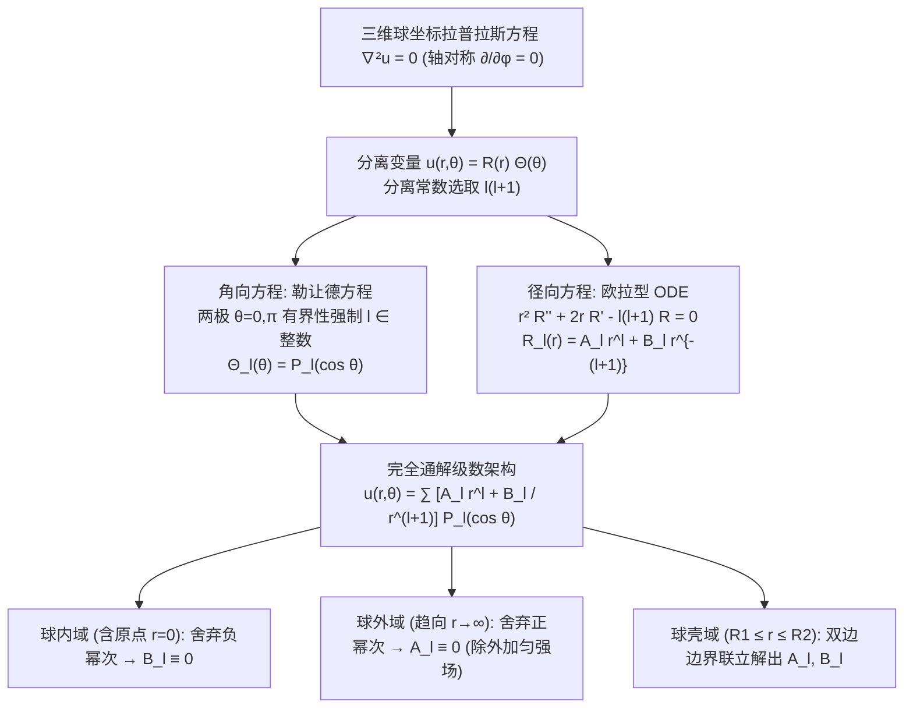

---
tags:
  - 物理/数学物理方法
  - 特殊函数
  - 技术卡
  - 球坐标
  - 拉普拉斯方程
  - 勒让德多项式
  - 导体球极化
aliases:
  - 球坐标下拉普拉斯方程定解规范范式
  - 球坐标拉普拉斯方程
  - 轴对称球谐边值问题
  - 外电场中导体球感应
  - 欧拉径向方程
  - Laplace Equation in Spherical Coordinates and Boundary Value Problems
created: 2026-09-08
updated: 2026-09-08
---

> [!summary] 技术核心论断
> 球坐标系下的拉普拉斯方程是求解空间天体引力势、静电屏蔽、介质球极化及低能粒子散射相移的通用数学模型。在最为常见的**轴对称（无方位角 $\varphi$ 依赖）几何构型**下，极角方程解构为严格收敛于 $[-1, 1]$ 上的勒让德多项式 $P_l(\cos\theta)$，而径向方程退化为极简的欧拉常微分方程，贡献基函数对偶组 $\{r^l, r^{-(l+1)}\}$。整套解题技术的精髓在于**依据物理区域拓扑（内球域、外球域、双球壳）精准施加原点有限性截断与无穷远渐近场匹配**，结合正交投影积分，建立起从边界电荷/电位分布到全空间三维势场的完全解析封闭解。

## 一、推导机理与规范求解工作流

---

### 1.1 轴对称球坐标分离变量推导

在无方位角依赖（$\frac{\partial u}{\partial \varphi} = 0$）的物理系统中，球坐标下拉普拉斯方程展开为：
$$\frac{1}{r^2} \frac{\partial}{\partial r}\left( r^2 \frac{\partial u}{\partial r} \right) + \frac{1}{r^2 \sin\theta} \frac{\partial}{\partial \theta}\left( \sin\theta \frac{\partial u}{\partial \theta} \right) = 0$$
两边同乘 $r^2$，令未知解具有乘积形式：$u(r, \theta) = R(r) \Theta(\theta)$。
代入并除以 $R(r) \Theta(\theta)$：
$$\frac{1}{R(r)} \frac{d}{dr}\left( r^2 \frac{dR}{dr} \right) = -\frac{1}{\Theta(\theta) \sin\theta} \frac{d}{d\theta}\left( \sin\theta \frac{d\Theta}{d\theta} \right)$$
左端仅是 $r$ 的函数，右端仅是 $\theta$ 的函数，两端必恒等于常数。为了使角向解在全极角区间 $\theta \in [0, \pi]$ 保持有界物理多项式，将分离常数设为 $\lambda = l(l + 1)$ ($l = 0, 1, 2, \dots$)：

#### 1. 角向方程求解：
令 $x = \cos\theta$，即得标准勒让德方程：
$$(1 - x^2) \frac{d^2 \Theta}{dx^2} - 2x \frac{d\Theta}{dx} + l(l + 1) \Theta = 0$$
物理条件要求南北两极 $x = \pm 1$ 处位移或电位有限有界，排除第二类发散的勒让德函数 $Q_l(x)$，唯一保留**第一类勒让德多项式**：
$$\boxed{ \Theta_l(\theta) = P_l(\cos\theta) }$$

#### 2. 径向欧拉方程求解：
径向方程为：
$$\frac{d}{dr}\left( r^2 \frac{dR}{dr} \right) - l(l + 1) R = 0 \iff r^2 R''(r) + 2r R'(r) - l(l + 1) R(r) = 0$$
这是典型的**欧拉常微分方程 (Euler ODE)**。
设特解为幂函数 $R(r) = r^k$，代入得指标代数特征方程：
$$k(k - 1) + 2k - l(l + 1) = k^2 + k - l(l + 1) = (k - l)(k + l + 1) = 0$$
解得两个特征根：
$$k_1 = l, \quad k_2 = -(l + 1)$$
因此每个阶数 $l$ 对应的径向通解为两基函数的线性组合：
$$\boxed{ R_l(r) = A_l r^l + \frac{B_l}{r^{l+1}} }$$

#### 3. 轴对称完全解析通解结构：
由线性叠加原理，轴对称空间势场的总通解为：
$$\boxed{ u(r, \theta) = \sum_{l=0}^\infty \left[ A_l r^l + \frac{B_l}{r^{l+1}} \right] P_l(\cos\theta) }$$

---

### 1.2 三大拓扑区域边界条件的筛选法则

| 求解物理几何区域 | 空间拓扑边界 | 奇点排除法则与系数确定 | 最终有效级数展开形式 |
| :--- | :--- | :--- | :--- |
| **球内部区域 (Internal Domain)** | $0 \le r \le R_0$ （包含原点 $r = 0$） | 物理场在原点必须有限有界。因当 $r \to 0$ 时，$\frac{1}{r^{l+1}} \to \infty$ 剧烈发散，**必须令所有 $B_l = 0$**！ | **$u(r, \theta) = \sum_{l=0}^\infty A_l r^l P_l(\cos\theta)$** |
| **球外部区域 (External Domain)** | $R_0 \le r < \infty$ （包含无穷远 $r \to \infty$） | 1. 若外部无外加场（$\lim_{r\to\infty} u = 0$）：$r^l$ 在无穷远发散，**令所有 $A_l = 0$**； 2. 若存在外加匀强场 $\boldsymbol{E}_0 = E_0 \hat{\boldsymbol{z}}$：无穷远电位 $\Phi \to -E_0 r \cos\theta$，故**保留 $A_1 = -E_0$，其余 $A_l = 0$ ($l \neq 1$)**。 | **$u(r, \theta) = -E_0 r P_1 + \sum_{l=0}^\infty \frac{B_l}{r^{l+1}} P_l(\cos\theta)$** |
| **同心球壳区域 (Spherical Shell)** | $R_1 \le r \le R_2$ （原点与无穷远均排除） | 原点与无穷远均不在物理求解域内。$A_l$ 与 $B_l$ 两组常数**全部保留**，由内表面 $r = R_1$ 与外表面 $r = R_2$ 的两组边界条件联立求解。 | **$u(r, \theta) = \sum_{l=0}^\infty \left[ A_l r^l + \frac{B_l}{r^{l+1}} \right] P_l(\cos\theta)$** |

---

### 1.3 边界正交展开求待定系数标准流程

设在球面上 $r = R_0$ 给定电位分布 $u(R_0, \theta) = V(\theta)$。
将 $r = R_0$ 代入通解：
$$\sum_{l=0}^\infty \left[ A_l R_0^l + \frac{B_l}{R_0^{l+1}} \right] P_l(\cos\theta) = V(\theta)$$
利用勒让德多项式的带权正交性 $\int_0^\pi P_l(\cos\theta) P_{l'}(\cos\theta) \sin\theta d\theta = \frac{2}{2l+1}\delta_{ll'}$：
两边同乘 $P_l(\cos\theta) \sin\theta$ 并对 $\theta$ 从 $0$ 到 $\pi$ 积分，正交投影定出组合系数：
$$\boxed{ A_l R_0^l + \frac{B_l}{R_0^{l+1}} = \frac{2l + 1}{2} \int_0^\pi V(\theta) P_l(\cos\theta) \sin\theta d\theta }$$

---

## 二、⚠️ 致命失分陷阱与临界边界

> [!warning] 陷阱 1：外加匀强电场中盲目将所有正幂次项 $A_l$ 强行置零
> 考场最高频失误：
> - 许多考生机械套用“外域解必须在无穷远衰减为零”，从而把所有 $A_l$ 均设为 0；
> - 然而，**外加匀强电场 $\boldsymbol{E}_0$ 本身就是由无穷远处的电源维持的！**
> - 电位在无穷远处的基准渐近场为 $\Phi_\infty = -\boldsymbol{E}_0 \cdot \boldsymbol{r} = -E_0 z = -E_0 r \cos\theta = -E_0 r P_1(\cos\theta)$；
> - 若漏写 $A_1 = -E_0$，体系将丢失外加驱动场，直接退化为无源孤立解！

> [!caution] 陷阱 2：介质球交界面漏写介电常数法向电位移连续条件
> 当研究介质球（介电常数 $\varepsilon_1$）置于介质 2（$\varepsilon_2$）中时：
> - 边界条件有两条：电位自身连续 $u_{\text{in}}|_{R} = u_{\text{out}}|_{R}$；
> - **第二条电位移矢量法向连续**：$\left. \varepsilon_1 \frac{\partial u_{\text{in}}}{\partial r} \right|_{R} = \left. \varepsilon_2 \frac{\partial u_{\text{out}}}{\partial r} \right|_{R}$；
> 常见致命失分是漏写介电常数 $\varepsilon_1, \varepsilon_2$，写成简单的法向导数相等 $\frac{\partial u_{\text{in}}}{\partial r} = \frac{\partial u_{\text{out}}}{\partial r}$，导致极化电荷产生的反极化场被完全抹杀！

> [!danger] 陷阱 3：坐标变换中 $\cos\theta$ 与 $P_l$ 阶数匹配失误
> 遇到给定边界条件如 $V(\theta) = V_0 \cos^2\theta$ 时：
> - 切忌直接拿 $\cos^2\theta$ 去强算；
> - 必须利用勒让德多项式线性分解：$\cos^2\theta = \frac{2 P_2(\cos\theta) + 1}{3} = \frac{2}{3} P_2 + \frac{1}{3} P_0$；
> - 进而直接读出非零系数仅存在于 $l = 0$ 和 $l = 2$，免去一切繁琐的积分！

---

## 三、经典范例手把手演算

### 题目（外加匀强电场中接地金属球的电位分布全解——梁昆淼 §10.4 例 1 原题）：
半径为 $R_0$ 的接地导体球（球心位于原点，导体电位维持为 $\Phi = 0$）置于外加沿 $z$ 轴正向的均匀外电场 $\boldsymbol{E}_0 = E_0 \hat{\boldsymbol{z}}$ 中。
1. 列出导体球外空间静电势满足的定解问题；
2. 完整求出球外区域 $r \ge R_0$ 的电位分布 $\Phi(r, \theta)$；
3. 计算球面上感应电荷面密度 $\sigma(\theta)$ 与整个导体球的等效感应电偶极矩 $\boldsymbol{p}$。

#### 【演算步骤】

**第一步：确立定解问题**
球外空间无自由电荷，静电势满足拉普拉斯方程：
$$\nabla^2 \Phi = 0 \quad (r > R_0)$$
边界条件：
1. **接地导体球表面（$r = R_0$）**：
   $$\left. \Phi(r, \theta) \right|_{r = R_0} = 0$$
2. **无穷远处渐近外场边界（$r \to \infty$）**：
   $$\lim_{r \to \infty} \Phi(r, \theta) = -E_0 z = -E_0 r \cos\theta = -E_0 r P_1(\cos\theta)$$

**第二步：设解结构并代入渐近边界**
球外域轴对称拉普拉斯方程通解为：
$$\Phi(r, \theta) = \sum_{l=0}^\infty \left[ A_l r^l + \frac{B_l}{r^{l+1}} \right] P_l(\cos\theta)$$
当 $r \to \infty$ 时，$\frac{B_l}{r^{l+1}} \to 0$，无穷远渐近场为：
$$\lim_{r \to \infty} \Phi(r, \theta) = \sum_{l=0}^\infty A_l r^l P_l(\cos\theta) = -E_0 r P_1(\cos\theta)$$
对比勒让德多项式的系数（利用正交完备性）：
- 对于 $l = 1$：$A_1 r P_1(\cos\theta) = -E_0 r P_1(\cos\theta) \implies \boxed{ A_1 = -E_0 }$；
- 对于所有 $l \neq 1$：$A_l r^l = 0 \implies \boxed{ A_l = 0 \quad (l \neq 1) }$。

因此电位通解直接急剧收缩为：
$$\Phi(r, \theta) = -E_0 r P_1(\cos\theta) + \sum_{l=0}^\infty \frac{B_l}{r^{l+1}} P_l(\cos\theta)$$

**第三步：代入接地边界条件确定 $B_l$**
在球面上 $r = R_0$：
$$\Phi(R_0, \theta) = -E_0 R_0 P_1(\cos\theta) + \sum_{l=0}^\infty \frac{B_l}{R_0^{l+1}} P_l(\cos\theta) = 0$$
移项整理：
$$\sum_{l=0}^\infty \frac{B_l}{R_0^{l+1}} P_l(\cos\theta) = E_0 R_0 P_1(\cos\theta)$$
再次利用勒让德多项式的线性无关性，逐阶对比系数：
- 对于 $l = 1$：
  $$\frac{B_1}{R_0^2} = E_0 R_0 \implies \boxed{ B_1 = E_0 R_0^3 }$$
- 对于所有 $l \neq 1$：
  $$\frac{B_l}{R_0^{l+1}} = 0 \implies \boxed{ B_l = 0 \quad (l \neq 1) }$$

**第四步：完全解析电位场汇编与物理图像剖析**
将 $A_1, B_1$ 代入，得到球外空间电位的精确封闭解析解：
$$\boxed{ \Phi(r, \theta) = -E_0 r \cos\theta + \frac{E_0 R_0^3}{r^2} \cos\theta = -E_0 \left( 1 - \frac{R_0^3}{r^3} \right) r \cos\theta }$$

**物理深度剖析**：
- 第一项 $-E_0 r \cos\theta$：外加原始恒定匀强电场的电位；
- 第二项 $\frac{E_0 R_0^3}{r^2} \cos\theta$：导体球表面感应电荷在球外激发的附加电位！
  对比点电偶极子在球心产生的电位公式 $\Phi_{\text{dipole}} = \frac{p \cos\theta}{4\pi\varepsilon_0 r^2}$：
  $$\frac{p}{4\pi\varepsilon_0} = E_0 R_0^3 \implies \boxed{ \boldsymbol{p} = 4\pi\varepsilon_0 R_0^3 \boldsymbol{E}_0 }$$
  外电场使接地元导体球发生电荷分离，其在球外等效为一个位于球心的**理想电偶极子**！

**第五步：感应电荷面密度计算**
根据高斯定理（导体表面边界条件）：
$$\sigma(\theta) = -\left. \varepsilon_0 \frac{\partial \Phi}{\partial r} \right|_{r = R_0}$$
对电位求径向偏导数：
$$\frac{\partial \Phi}{\partial r} = -E_0 \cos\theta - 2 \frac{E_0 R_0^3}{r^3} \cos\theta$$
代入 $r = R_0$：
$$\left. \frac{\partial \Phi}{\partial r} \right|_{r = R_0} = -E_0 \cos\theta - 2 E_0 \cos\theta = -3 E_0 \cos\theta$$
因此表面感应电荷分布为：
$$\boxed{ \sigma(\theta) = -\varepsilon_0 (-3 E_0 \cos\theta) = 3\varepsilon_0 E_0 \cos\theta }$$
- 在北极点（$\theta = 0$）：$\sigma = +3\varepsilon_0 E_0$（感应正电荷）；
- 在赤道线（$\theta = \pi/2$）：$\sigma = 0$；
- 在南极点（$\theta = \pi$）：$\sigma = -3\varepsilon_0 E_0$（感应负电荷）；
- 对整个球面积分总感应电量：$Q_{\text{total}} = \iint \sigma dS = 3\varepsilon_0 E_0 R_0^2 (2\pi) \int_0^\pi \cos\theta \sin\theta d\theta = 0$。总感应电荷精确为零，物理推导天衣无缝！

---

## 四、出处与纸质笔记坐标

* **教材出处**：梁昆淼《数学物理方法》（第四版）第十章 §10.4 (P248-P262)
* **纸质活页槽位**：`[活页-LKM-25]`
* **知识全景索引**：[[00_梁昆淼数学物理方法_第三篇全景图]]
