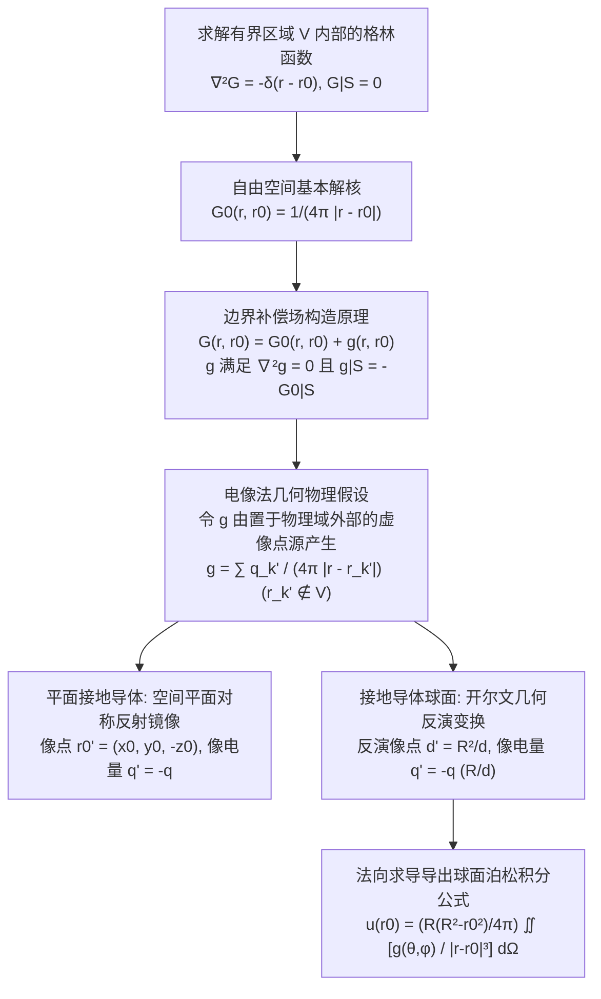

---
tags:
  - 物理/数学物理方法
  - 偏微分方程
  - 技术卡
  - 格林函数
  - 电像法
  - 泊松方程
  - 泊松积分公式
aliases:
  - 电像法构造泊松方程空间格林函数
  - 电像法与镜像电荷
  - 开尔文反演变换
  - 球形域泊松积分公式
  - 半空间平面镜像格林函数
  - Method of Images and Spatial Green Functions
created: 2026-09-08
updated: 2026-09-08
---

> [!summary] 技术核心论断
> 电像法（镜像电荷法，Method of Images）是构造特定对称几何边界（平面、球面、柱面、相交劈尖角）下拉普拉斯/泊松方程空间格林函数最精妙、最优雅的几何物理技术。其核心精髓在于**解析延拓与虚像等效**：在保持物理求解区域内部控制方程与真实点源完全不变的前提下，**在物理区域外部**精巧安放一个或若干个虚拟镜像点源，利用空间对称性或**开尔文反演变换 (Kelvin Inversion)**，使得所有虚像在物理边界曲面上激发的势场恰好与真实点源产生完全反相抵消，从而纯代数化地构造出满足严格齐次边界的完全格林函数。该方法进一步导出的**泊松积分公式**，实现了由边界值直接积分给出全空间场分布的解析闭环。

## 一、推导机理与规范求解工作流

---

### 1.1 自由空间基本解 (Free Space Fundamental Solutions)

在没有边界的无限全空间中，由点源激发的场称为自由空间格林函数（基本解）：
1. **三维全空间点源解**：
   $$\nabla^2 G_0(\boldsymbol{r}, \boldsymbol{r}_0) = -\delta(\boldsymbol{r} - \boldsymbol{r}_0) \implies \boxed{ G_0(\boldsymbol{r}, \boldsymbol{r}_0) = \frac{1}{4\pi |\boldsymbol{r} - \boldsymbol{r}_0|} }$$
2. **二维全空间线源解**：
   $$\nabla^2 G_0(\boldsymbol{r}, \boldsymbol{r}_0) = -\delta(\boldsymbol{r} - \boldsymbol{r}_0) \implies \boxed{ G_0(\boldsymbol{r}, \boldsymbol{r}_0) = -\frac{1}{2\pi} \ln |\boldsymbol{r} - \boldsymbol{r}_0| }$$

---

### 1.2 半无限空间（平面接地导体）的格林函数

考虑上半空间 $z > 0$（边界为无限大接地平面 $z = 0$）：
$$\nabla^2 G = -\delta(\boldsymbol{r} - \boldsymbol{r}_0) \quad (z > 0), \quad \left. G \right|_{z=0} = 0$$
真实点源位于 $\boldsymbol{r}_0 = (x_0, y_0, z_0)$（$z_0 > 0$），电量为 $q = 1$。

#### 1. 镜像点与镜像电量：
根据关于平面 $z = 0$ 的镜像对称性，在物理域外的下半空间点 $\boldsymbol{r}_0' = (x_0, y_0, -z_0)$ 处放置大小相等、符号相反的镜像点电荷 $q' = -1$。
总格林函数直接由两点电荷库仑场叠加生成：
$$\boxed{ G(\boldsymbol{r}, \boldsymbol{r}_0) = \frac{1}{4\pi \sqrt{(x - x_0)^2 + (y - y_0)^2 + (z - z_0)^2}} - \frac{1}{4\pi \sqrt{(x - x_0)^2 + (y - y_0)^2 + (z + z_0)^2}} }$$

#### 2. 边界外法向导数与半空间泊松积分：
在边界平面 $z = 0$ 处，外法向指向物理域外（即沿 $-z$ 方向）：$\frac{\partial}{\partial n} = -\left. \frac{\partial}{\partial z} \right|_{z=0}$。
求偏导：
$$\left. \frac{\partial G}{\partial n} \right|_{z=0} = -\left. \frac{\partial G}{\partial z} \right|_{z=0} = -\frac{1}{4\pi} \left[ \frac{z_0}{R_0^3} - \frac{-z_0}{R_0^3} \right] = -\frac{1}{2\pi} \frac{z_0}{\left[ (x - x_0)^2 + (y - y_0)^2 + z_0^2 \right]^{3/2}}$$
代入解表示公式（Card 29），导出**半无限空间狄利克雷问题的泊松积分公式**：
$$\boxed{ u(x_0, y_0, z_0) = \frac{z_0}{2\pi} \int_{-\infty}^{+\infty} \int_{-\infty}^{+\infty} \frac{g(x, y)}{\left[ (x - x_0)^2 + (y - y_0)^2 + z_0^2 \right]^{3/2}} dx dy }$$

---

### 1.3 接地导体球面的开尔文反演电像法

设导体球半径为 $R$，球心位于坐标原点。求解球内域或球外域第一类格林函数。
以**球外物理域（$r > R$）**为例：真实单位点源 $q = 1$ 位于球外点 $\boldsymbol{r}_0$（距离原点 $d = r_0 > R$）。

#### 1. 开尔文几何反演原理：
在连心线 $O\boldsymbol{r}_0$ 上寻找镜像点 $\boldsymbol{r}_0'$（距离原点 $d'$），放置镜像电荷 $q'$。
取球面上任意观测点 $\boldsymbol{r}$（$|\boldsymbol{r}| = R$）。
点 $\boldsymbol{r}$ 到真实源点与镜像点的距离分别为：
$$D = |\boldsymbol{r} - \boldsymbol{r}_0| = \sqrt{R^2 + d^2 - 2 R d \cos\gamma}$$
$$D' = |\boldsymbol{r} - \boldsymbol{r}_0'| = \sqrt{R^2 + d'^2 - 2 R d' \cos\gamma}$$
其中 $\gamma$ 为 $\boldsymbol{r}$ 与 $\boldsymbol{r}_0$ 的空间夹角。
在球面上要求总电位恒为零：
$$G|_S = \frac{1}{4\pi D} + \frac{q'}{4\pi D'} = 0 \iff \frac{D'}{D} = -q' = \text{常数}$$
利用平面几何相似三角形性质，令：
$$\boxed{ d' = \frac{R^2}{d} = \frac{R^2}{r_0} < R } \quad \text{(反演镜像点严格落在球体内部！)}$$
此时：
$$D' = \sqrt{R^2 + \frac{R^4}{d^2} - 2 R \frac{R^2}{d} \cos\gamma} = \frac{R}{d} \sqrt{d^2 + R^2 - 2 R d \cos\gamma} = \frac{R}{d} D$$
即比值恒为常数 $\frac{D'}{D} \equiv \frac{R}{d}$！
因此只需选取镜像电量为：
$$\boxed{ q' = -\frac{R}{d} = -\frac{R}{r_0} }$$
即可使球面上处处恒等满足 $\frac{1}{D} + \frac{q'}{D'} \equiv 0$！

#### 2. 接地导体球格林函数显式完全结构：
$$\boxed{ G(\boldsymbol{r}, \boldsymbol{r}_0) = \frac{1}{4\pi |\boldsymbol{r} - \boldsymbol{r}_0|} - \frac{R/r_0}{4\pi \left| \boldsymbol{r} - \frac{R^2}{r_0^2} \boldsymbol{r}_0 \right|} }$$

---

### 1.4 球形域狄利克雷问题的泊松积分公式 (Poisson Integral Formula)

对于**球内部物理域（$r_0 < R$）**，真实源点在球内，反演镜像点在球外 $d' = \frac{R^2}{r_0} > R$，像电量仍为 $q' = -R/r_0$。
在球面上外法向微商计算：$\frac{\partial}{\partial n} = \left. \frac{\partial}{\partial r} \right|_{r=R}$。
手把手求导化简可得：
$$\left. \frac{\partial G}{\partial n} \right|_{r = R} = -\frac{1}{4\pi R} \frac{R^2 - r_0^2}{\left( R^2 + r_0^2 - 2 R r_0 \cos\gamma \right)^{3/2}}$$
代入全解表示定理（无内部源 $f=0$），导出经典的**球形域泊松积分公式**：
$$\boxed{ u(\boldsymbol{r}_0) = \frac{R (R^2 - r_0^2)}{4\pi} \iint_{S^2} \frac{g(\theta, \varphi)}{\left( R^2 + r_0^2 - 2 R r_0 \cos\gamma \right)^{3/2}} \sin\theta d\theta d\varphi }$$

> [!tip] 球心调和平均值定理（泊松积分的极值推论）
> 当场点取在球心时（$r_0 = 0$）：
> $$u(0) = \frac{R \cdot R^2}{4\pi} \iint \frac{g}{(R^2)^{3/2}} d\Omega = \frac{1}{4\pi R^2} \iint_{S^2} g dS$$
> **任何调和函数（拉普拉斯方程解）在球心处的值，精确等于其在球面上边界分布的面积球面算术平均值！**

---

## 二、⚠️ 致命失分陷阱与临界边界

> [!warning] 陷阱 1：镜像电荷位置设置在物理求解区域内部
> 电像法成立的绝对公理是：**镜像点必须严格位于物理求解区域外部！**
> - 求解球外场（$r > R$）：物理域是球外，镜像点必须在球内（$d' < R$）；
> - 求解球内场（$r < R$）：物理域是球内，镜像点必须在球外（$d' > R$）；
> 常见致命失误是将球外点源的镜像点又设在球外，导致物理域内部凭空增加了一个虚假奇异源点，彻底摧毁了控制方程的齐次性。

> [!caution] 陷阱 2：像电荷电量量纲与负号遗漏
> 镜像电荷的电量绝对不等于 $-q$（平面镜像是特例 $R \to \infty$）：
> - 球面镜像电荷包含几何缩放因子：$q' = -q \frac{R}{d}$；
> - 考场极其容易漏写 $\frac{R}{d}$，误认为像电荷总是 $-q$，导致势场在球面上根本无法抵消为零。

> [!danger] 陷阱 3：相交导体劈尖（夹角为 $\alpha$）镜像数量公式的适用范围
> 对于夹角为 $\alpha$ 的两个相交半无限接地导体平面：
> - 只有当 $\alpha = \frac{\pi}{n}$（$n$ 为正整数，即 $180^\circ, 90^\circ, 60^\circ, 45^\circ, \dots$）时，镜像电荷数才是有限的 $2n - 1$ 个；
> - 若夹角为任意角（如非整数除数），镜像电荷将无限循环反射产生无穷多个点源，电像法完全失效！此时必须改用保角变换法（Card 33）。

---

## 三、经典范例手把手演算

### 题目（接地导体球外点电荷诱导的总感应电量手把手全解）：
半径为 $R$ 的接地导体球置于原点。在球外点 $\boldsymbol{r}_0 = (0, 0, d)$（$d > R$）处放置电量为 $q$ 的点电荷。
1. 利用电像法写出球外任意点的电位分布 $\Phi(\boldsymbol{r})$；
2. 计算球表面上的感应面电荷密度分布 $\sigma(\theta)$；
3. 对整个球面执行面积分，手把手严格证明：**导体球上的总感应电荷严格等于镜像电荷的电量 $Q_{\text{ind}} = q'$**！

#### 【演算步骤】

**第一步：写出电像法空间电位**
真实点电荷在 $(0, 0, d)$，镜像点电荷位于 $(0, 0, d')$，其中：
$$d' = \frac{R^2}{d}, \quad q' = -q \frac{R}{d}$$
球外任意点 $\boldsymbol{r} = (r, \theta, \varphi)$ 处的电位为：
$$\Phi(r, \theta) = \frac{q}{4\pi\varepsilon_0} \left[ \frac{1}{\sqrt{r^2 + d^2 - 2 r d \cos\theta}} - \frac{R/d}{\sqrt{r^2 + \frac{R^4}{d^2} - 2 r \frac{R^2}{d} \cos\theta}} \right]$$

**第二步：计算导体表面感应面电荷密度 $\sigma(\theta)$**
根据静电学边界条件：$\sigma(\theta) = -\left. \varepsilon_0 \frac{\partial \Phi}{\partial r} \right|_{r = R}$。
对第一项求导（代入 $r = R$）：
$$\left. \frac{\partial}{\partial r} \left( r^2 + d^2 - 2rd \cos\theta \right)^{-1/2} \right|_{r=R} = -\frac{1}{2} (R^2 + d^2 - 2Rd \cos\theta)^{-3/2} (2R - 2d \cos\theta) = -\frac{R - d\cos\theta}{D^3}$$
对第二项求导（注意第二项根号内先提取公因式 $\frac{R}{d}$）：
第二项为 $\frac{R/d}{\frac{R}{d} \sqrt{\frac{d^2}{R^2} r^2 + R^2 - 2rd \cos\theta}} = \left( \frac{d^2}{R^2} r^2 + R^2 - 2rd \cos\theta \right)^{-1/2}$。
对 $r$ 求导代入 $r = R$：
$$-\frac{1}{2} (d^2 + R^2 - 2Rd \cos\theta)^{-3/2} \left( \frac{2d^2 R}{R^2} - 2d \cos\theta \right) = -\frac{\frac{d^2}{R} - d\cos\theta}{D^3}$$
两项相减合并（注意第二项前面有负号）：
$$\left. \frac{\partial \Phi}{\partial r} \right|_{r = R} = \frac{q}{4\pi\varepsilon_0} \left[ -\frac{R - d\cos\theta}{D^3} - \left( -\frac{\frac{d^2}{R} - d\cos\theta}{D^3} \right) \right] = \frac{q}{4\pi\varepsilon_0 D^3} \left[ -R + d\cos\theta + \frac{d^2}{R} - d\cos\theta \right]$$
$$= \frac{q}{4\pi\varepsilon_0} \frac{d^2 - R^2}{R D^3} = \frac{q (d^2 - R^2)}{4\pi\varepsilon_0 R (R^2 + d^2 - 2Rd \cos\theta)^{3/2}}$$
因此球面感应面电荷密度为：
$$\boxed{ \sigma(\theta) = -\varepsilon_0 \left. \frac{\partial \Phi}{\partial r} \right|_{r = R} = -\frac{q (d^2 - R^2)}{4\pi R (R^2 + d^2 - 2Rd \cos\theta)^{3/2}} }$$
由于 $d > R \implies d^2 - R^2 > 0$，故表面电荷处处为负电荷（感应束缚电荷）！

---

**第三步：全球面积分证明总感应电量 $Q_{\text{ind}} = q'$**
计算总电量积分：
$$Q_{\text{ind}} = \iint_S \sigma(\theta) dS = \int_0^{2\pi} d\varphi \int_0^\pi \sigma(\theta) R^2 \sin\theta d\theta = 2\pi R^2 \int_0^\pi \sigma(\theta) \sin\theta d\theta$$
代入 $\sigma(\theta)$：
$$Q_{\text{ind}} = -2\pi R^2 \frac{q(d^2 - R^2)}{4\pi R} \int_0^\pi \frac{\sin\theta d\theta}{(R^2 + d^2 - 2Rd \cos\theta)^{3/2}} = -\frac{q R (d^2 - R^2)}{2} \int_0^\pi \frac{\sin\theta d\theta}{(R^2 + d^2 - 2Rd \cos\theta)^{3/2}}$$
令 $u = R^2 + d^2 - 2Rd \cos\theta$（$du = 2Rd \sin\theta d\theta \implies \sin\theta d\theta = \frac{du}{2Rd}$）：
- 当 $\theta = 0$ 时：$u = R^2 + d^2 - 2Rd = (d - R)^2$；
- 当 $\theta = \pi$ 时：$u = R^2 + d^2 + 2Rd = (d + R)^2$。
积分化为：
$$\int_0^\pi \frac{\sin\theta d\theta}{u^{3/2}} = \frac{1}{2Rd} \int_{(d-R)^2}^{(d+R)^2} u^{-3/2} du = \frac{1}{2Rd} \left[ -2 u^{-1/2} \right]_{(d-R)^2}^{(d+R)^2} = \frac{1}{Rd} \left[ \frac{1}{d - R} - \frac{1}{d + R} \right]$$
通分：
$$\frac{1}{d - R} - \frac{1}{d + R} = \frac{(d + R) - (d - R)}{d^2 - R^2} = \frac{2R}{d^2 - R^2}$$
故定积分结果为：
$$\int_0^\pi \frac{\sin\theta d\theta}{u^{3/2}} = \frac{1}{Rd} \frac{2R}{d^2 - R^2} = \frac{2}{d (d^2 - R^2)}$$
代回总电量表达式：
$$Q_{\text{ind}} = -\frac{q R (d^2 - R^2)}{2} \cdot \left[ \frac{2}{d (d^2 - R^2)} \right] = -\frac{q R}{d} = \boxed{ q' }$$
**物理结论震撼一致**：利用高斯定理从微观面电荷积分算出的总感应电量，严格精确等于开尔文反演构造出的镜像电荷量 $q' = -q \frac{R}{d}$！电像法几何等效原理全线融通。

---

## 四、出处与纸质笔记坐标

* **教材出处**：梁昆淼《数学物理方法》（第四版）第十二章 §12.2 (P310-P320)
* **纸质活页槽位**：`[活页-LKM-30]`
* **知识全景索引**：[[00_梁昆淼数学物理方法_第三篇全景图]]
