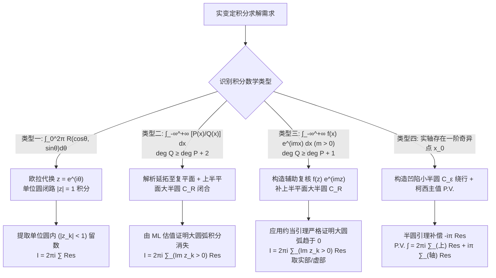
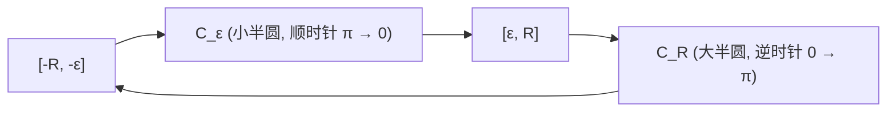

---
tags:
  - 物理/数学物理方法
  - 复变函数
  - 技术卡
  - 留数定理应用
  - 实反常积分
  - 约当引理
  - 柯西主值
aliases:
  - 留数定理计算三类经典实反常积分规范范式
  - 留数计算实定积分
  - 三类实反常积分
  - 约当引理
  - 柯西主值与小半圆绕行
  - Evaluation of Real Integrals by Residues
  - Jordan's Lemma and Cauchy Principal Value
created: 2026-09-07
updated: 2026-09-08
---

> [!summary] 技术核心透视
> 柯西留数定理在理论物理与数学分析中最震撼人心的绝技，是通过**闭合围道复变延拓法**，将实分析中无法求出初等原函数的定积分与无穷反常积分，转化为复平面上半平面极点留数的纯代数加和。本技术卡系统提炼理论物理四大黄金解题范式：$[0, 2\pi]$ 三角有理式单位圆变换、全实轴有理函数大半圆积分、含振荡因子的傅里叶型积分与**约当引理 (Jordan's Lemma)**，以及处理实轴奇异点的**柯西主值 (Cauchy Principal Value) 与小半圆绕行补偿算法**。

---

## 一、技术原理与操作步骤

---

### 1.1 类型一：$[0, 2\pi]$ 三角有理式定积分 (Unit Circle Mapping)

#### 积分标准形式
$$I = \int_0^{2\pi} R(\cos \theta, \sin \theta) d\theta$$
其中分母在积分区间内无零点。

#### 规范变换四步法
1. **复变量参数化**：令 $z = e^{i\theta} \implies dz = i e^{i\theta} d\theta = i z d\theta \implies d\theta = \frac{dz}{iz}$；
2. **三角函数代数化**：
   $$\cos \theta = \frac{e^{i\theta} + e^{-i\theta}}{2} = \frac{z + z^{-1}}{2} = \frac{z^2 + 1}{2z}$$
   $$\sin \theta = \frac{e^{i\theta} - e^{-i\theta}}{2i} = \frac{z - z^{-1}}{2i} = \frac{z^2 - 1}{2iz}$$
3. **闭路重塑**：积分区间 $\theta \in [0, 2\pi]$ 自然转化为沿复平面**单位圆周 $C: |z| = 1$ 的逆时针闭路积分**：
   $$I = \oint_{|z|=1} R\left( \frac{z^2+1}{2z}, \frac{z^2-1}{2iz} \right) \frac{dz}{iz}$$
4. **提取单位圆内极点留数**：
   $$\boxed{I = 2\pi i \sum_{|z_k| < 1} \operatorname{Res}\left[ \frac{R(z)}{iz}, z_k \right]}$$

---

### 1.2 类型二：全实轴有理分式反常积分 (Upper Semicircle Closure)

#### 积分标准形式
$$I = \int_{-\infty}^{+\infty} \frac{P(x)}{Q(x)} dx$$
**收敛判定准则**：$Q(x)$ 在实轴上无实零点，且分母次数比分子次数**至少高 2 阶**（即 $\deg Q \ge \deg P + 2$）。

#### 规范闭合围道与大圆弧估值
构建由实轴线段 $[-R, R]$ 与上半平面大半圆弧 $C_R: z = R e^{i\theta} (\theta \in [0, \pi])$ 围成的闭合围道 $\Gamma$：
$$\oint_\Gamma \frac{P(z)}{Q(z)} dz = \int_{-R}^R \frac{P(x)}{Q(x)} dx + \int_{C_R} \frac{P(z)}{Q(z)} dz$$
- **大圆弧消失证明**：因 $\deg Q \ge \deg P + 2$，当 $R \to \infty$ 时，在 $C_R$ 上 $\left|\frac{P(z)}{Q(z)}\right| \le \frac{M}{R^2}$。
  由 ML 不等式：
  $$\left| \int_{C_R} \frac{P(z)}{Q(z)} dz \right| \le \frac{M}{R^2} \cdot (\pi R) = \frac{\pi M}{R} \to 0 \quad (R \to \infty)$$
- 令 $R \to \infty$，大圆弧积分完全消亡，立即导出：
  $$\boxed{\int_{-\infty}^{+\infty} \frac{P(x)}{Q(x)} dx = 2\pi i \sum_{\operatorname{Im} z_k > 0} \operatorname{Res}\left[ \frac{P(z)}{Q(z)}, z_k \right]}$$
  *(只需计算上半平面的极点留数，下半平面极点完全无需理睬！)*

---

### 1.3 类型三：傅里叶振荡型积分与约当引理 (Jordan's Lemma)

#### 积分标准形式
$$I = \int_{-\infty}^{+\infty} \frac{P(x)}{Q(x)} \cos(mx) dx \quad \text{或} \quad \int_{-\infty}^{+\infty} \frac{P(x)}{Q(x)} \sin(mx) dx \quad (m > 0)$$
**收敛判定准则**：$\deg Q \ge \deg P + 1$（相比类型二，次数要求放宽了 1 阶！因为高频振荡项 $\cos(mx)$ 正负抵消加速了收敛）。

#### 关键技术：构造复指数辅助核
根据欧拉公式 $\cos(mx) = \operatorname{Re}[e^{imx}], \sin(mx) = \operatorname{Im}[e^{imx}]$，构造辅助复变积分：
$$I_{\text{comp}} = \int_{-\infty}^{+\infty} f(x) e^{imx} dx, \quad f(x) = \frac{P(x)}{Q(x)}$$

#### 约当引理 (Jordan's Lemma) 定理内容与证明
若函数 $f(z)$ 在上半平面大圆弧 $C_R: z = R e^{i\theta} (\theta \in [0, \pi])$ 上满足当 $R \to \infty$ 时一致趋于零，即 $M(R) = \max_{z \in C_R} |f(z)| \to 0$，且常数 $m > 0$，则：
$$\lim_{R \to \infty} \int_{C_R} f(z) e^{imz} dz = 0$$

- **严密证明**：在 $C_R$ 上，$z = R(\cos \theta + i\sin \theta)$：
  $$|e^{imz}| = |e^{imR\cos \theta - mR\sin \theta}| = e^{-mR\sin \theta}$$
  由于 $\theta \in [0, \pi]$ 时 $\sin \theta \ge 0$，该指数因子产生**极强的指数衰减压制**！
  由对称性与若当不等式（当 $\theta \in [0, \pi/2]$ 时，$\sin \theta \ge \frac{2}{\pi}\theta$）：
  $$\begin{aligned}
  \left| \int_{C_R} f(z) e^{imz} dz \right| &\le M(R) \int_0^\pi e^{-mR\sin \theta} R d\theta = 2 M(R) R \int_0^{\pi/2} e^{-mR\sin \theta} d\theta \\
  &\le 2 M(R) R \int_0^{\pi/2} e^{-mR \frac{2}{\pi}\theta} d\theta = 2 M(R) R \left[ -\frac{\pi}{2mR} e^{-\frac{2mR}{\pi}\theta} \right]_0^{\pi/2} \\
  &= \frac{\pi M(R)}{m} (1 - e^{-mR}) < \frac{\pi}{m} M(R)
  \end{aligned}$$
  当 $R \to \infty$ 时，$M(R) \to 0$，积分严格收敛为 $0$！证毕。

- **计算公式**：
  $$\boxed{\int_{-\infty}^{+\infty} f(x) e^{imx} dx = 2\pi i \sum_{\operatorname{Im} z_k > 0} \operatorname{Res}\left[ f(z) e^{imz}, z_k \right] \quad (m > 0)}$$
  最后对结果分别取实部或虚部。

---

### 1.4 类型四：实轴奇点与柯西主值小半圆绕行法 (Indented Contour)

若被积函数在实轴某点 $x_0$ 处存在一阶极点，广义反常积分本身发散，但在柯西主值 (P.V.) 意义下存在：
$$\text{P.V.} \int_{-\infty}^{+\infty} f(x) dx \equiv \lim_{\substack{R \to \infty \\ \varepsilon \to 0^+}} \left[ \int_{-R}^{x_0-\varepsilon} f(x) dx + \int_{x_0+\varepsilon}^R f(x) dx \right]$$

#### 小半圆引理 (Fractional Residue Theorem)
若 $z = x_0$ 为一阶极点，沿半径为 $\varepsilon$、跨越张角为 $\alpha$ 的微小圆弧 $C_\varepsilon$ 积分（逆时针）：
$$\lim_{\varepsilon \to 0} \int_{C_\varepsilon} f(z) dz = i \alpha \operatorname{Res}[f(z), x_0]$$
若绕行方向为顺时针（负向）且为半圆（$\alpha = \pi$），则积分值为 $-i\pi \operatorname{Res}[f, x_0]$。

#### 柯西主值统一公式
$$\boxed{\text{P.V.} \int_{-\infty}^{+\infty} f(x) dx = 2\pi i \sum_{\operatorname{Im} z_k > 0} \operatorname{Res}[f, z_k] + i\pi \sum_{\text{实轴一阶极点 } x_j} \operatorname{Res}[f, x_j]}$$

---

## 二、⚠️ 致命失分陷阱与临界边界

> [!warning] 陷阱 1：类型一三角积分误把单位圆外的极点代入留数求和
> 进行 $z = e^{i\theta}$ 欧拉代换后，解出的分母根通常有两个（一个在单位圆内 $|z_1| < 1$，一个在单位圆外 $|z_2| > 1$）。
> 必须时刻警惕：**只有模长 $|z_k| < 1$ 严格落在单位圆内部的极点才能计入留数定理**！将圆外极点代入将直接导致结果错误。

> [!caution] 陷阱 2：约当引理中指数系数 $m < 0$ 时盲目选择上半平面闭合
> 约当引理在上半平面成立的绝对前提是 **$m > 0$**（保证 $e^{-m R \sin \theta}$ 指数衰减）。
> 若积分中包含 $e^{-imx}$（$m > 0$），在向上半平面代换时指数项变为 $e^{+m R \sin \theta}$，大圆弧上函数值呈**指数爆炸性发散**！
> **应对策略**：
> - 方案 A：利用三角函数的奇偶性，将积分转化为 $m > 0$ 的形式；
> - 方案 B：闭路必须**向由下半平面顺时针大半圆弧闭合**，此时闭路为负向，积分前面必须添加负号，并提取 $\operatorname{Im} z_k < 0$ 的极点留数。

> [!danger] 陷阱 3：在含振荡项积分中将实三角函数直接带入复平面大圆弧
> 绝对不能直接对 $\frac{\cos(mz)}{Q(z)}$ 作闭路积分！因为在虚轴上 $z = iy$：
> $\cos(im y) = \cosh(my) = \frac{e^{my} + e^{-my}}{2}$，在虚轴正负方向均发生指数爆炸发散，大圆弧积分根本不为零。必须且只能构造辅助核 $e^{imz}$，算完后再取实部。

---

## 三、经典范例手把手演算与反代验算

### 3.1 经典例题：狄利克雷积分（Dirichlet Integral）的严格围道解算
**题目（梁书第 4 章 §4.2 核心标准例题）**：
利用留数定理与约当引理计算物理学中极其著名的狄利克雷积分：
$$I = \int_0^{+\infty} \frac{\sin x}{x} dx$$

#### 第一步：偶函数对称延拓与复变辅助核构造
由于被积函数 $\frac{\sin x}{x}$ 在全实轴上为偶函数（可去奇点），可延拓至全实轴：
$$I = \frac{1}{2} \int_{-\infty}^{+\infty} \frac{\sin x}{x} dx = \frac{1}{2} \text{P.V.} \int_{-\infty}^{+\infty} \frac{\sin x}{x} dx$$
构造辅助复变函数与复变积分：
$$f(z) = \frac{e^{iz}}{z}$$
目标实积分对应虚部：$I = \frac{1}{2} \operatorname{Im}\left[ \text{P.V.} \int_{-\infty}^{+\infty} \frac{e^{ix}}{x} dx \right]$。

#### 第二步：围道设计（避开实轴奇点）
分析复变函数 $f(z) = \frac{e^{iz}}{z}$：
- 在上半平面（$\operatorname{Im} z > 0$）内**没有任何奇点**；
- 在实轴原点 $z = 0$ 处存在一个 **1 阶极点**。
构造闭合围道 $\Gamma$（逆时针正向）：
1. 实轴正向段：$L_1: x \in [\varepsilon, R]$；
2. 上半平面大圆弧：$C_R: z = R e^{i\theta}, \theta \in [0, \pi]$；
3. 实轴负向段：$L_2: x \in [-R, -\varepsilon]$；
4. 原点避让凹陷小半圆弧：$C_\varepsilon: z = \varepsilon e^{i\theta}, \theta$ 从 $\pi$ 顺时针减小至 $0$。

#### 第三步：应用柯西积分定理
由于闭合围道 $\Gamma$ 内部不包含任何奇点，由柯西积分定理：
$$\oint_\Gamma \frac{e^{iz}}{z} dz = \int_{-R}^{-\varepsilon} \frac{e^{ix}}{x} dx + \int_{C_\varepsilon} \frac{e^{iz}}{z} dz + \int_\varepsilon^R \frac{e^{ix}}{x} dx + \int_{C_R} \frac{e^{iz}}{z} dz = 0$$

#### 第四步：各段极限制约分析
1. **大圆弧 $C_R$ 积分**：因 $f_0(z) = \frac{1}{z}$ 满足当 $R \to \infty$ 时 $|f_0(z)| = \frac{1}{R} \to 0$，且 $m = 1 > 0$。根据约当引理：
   $$\lim_{R \to \infty} \int_{C_R} \frac{e^{iz}}{z} dz = 0$$
2. **小半圆 $C_\varepsilon$ 积分**：在 $z = 0$ 附近展开洛朗级数：
   $$\frac{e^{iz}}{z} = \frac{1 + iz + O(z^2)}{z} = \frac{1}{z} + i + O(z)$$
   留数为 $\operatorname{Res}\left[\frac{e^{iz}}{z}, 0\right] = 1$。
   小半圆弧取顺时针方向（角从 $\pi$ 到 $0$）：
   $$\int_{C_\varepsilon} \frac{e^{iz}}{z} dz = \int_\pi^0 \frac{1}{\varepsilon e^{i\theta}} (i\varepsilon e^{i\theta} d\theta) + O(\varepsilon) = i(0 - \pi) = -i\pi$$
3. **实轴主值段合并**：
   $$\lim_{\substack{R \to \infty \\ \varepsilon \to 0^+}} \left[ \int_{-R}^{-\varepsilon} \frac{e^{ix}}{x} dx + \int_\varepsilon^R \frac{e^{ix}}{x} dx \right] = \text{P.V.} \int_{-\infty}^{+\infty} \frac{e^{ix}}{x} dx$$

#### 第五步：求解与取虚部
代入闭路总方程：
$$\text{P.V.} \int_{-\infty}^{+\infty} \frac{e^{ix}}{x} dx + (-i\pi) + 0 = 0 \implies \text{P.V.} \int_{-\infty}^{+\infty} \frac{e^{ix}}{x} dx = i\pi$$
取虚部并乘以前置因子 $\frac{1}{2}$：
$$I = \frac{1}{2} \operatorname{Im}[i\pi] = \frac{\pi}{2}$$
最终解析解为：
$$\boxed{\int_0^{+\infty} \frac{\sin x}{x} dx = \frac{\pi}{2}}$$

#### 第六步：反代验算（含参变量拉普拉斯变换核验）
考虑含衰减参量的积分 $J(\alpha) = \int_0^{+\infty} e^{-\alpha x} \frac{\sin x}{x} dx$ ($\alpha \ge 0$)：
对参数 $\alpha$ 求导：
$$J'(\alpha) = -\int_0^{+\infty} e^{-\alpha x} \sin x dx = -\mathcal{L}[\sin x](\alpha) = -\frac{1}{\alpha^2 + 1}$$
积分得：
$$J(\alpha) = -\arctan \alpha + C$$
当 $\alpha \to +\infty$ 时，$J(+\infty) = 0 \implies -\frac{\pi}{2} + C = 0 \implies C = \frac{\pi}{2}$。
令 $\alpha = 0$ 即回到目标积分：
$$J(0) = \int_0^{+\infty} \frac{\sin x}{x} dx = -\arctan(0) + \frac{\pi}{2} = \frac{\pi}{2}$$
两套完全独立的物理数学方法得出完全一致的结果，演算自洽闭环！

---

## 四、出处与纸质笔记坐标

- **教材出处**：梁昆淼《数学物理方法》（第四版）
  - 第四章：留数定理
  - §4.2 应用留数定理计算实变函数的定积分（原书 P56-P63）
- **对应 MinerU OCR 语料**：`mineru_output/梁昆淼_数学物理方法/数学物理方法_梁昆淼_第四版/ocr/数学物理方法_梁昆淼_第四版.md` Lines 2620-3014
- **对应全景图**：[[00_梁昆淼数学物理方法_第一篇全景图]]
- **纸质活页定位**：`[活页-LKM-08]`
