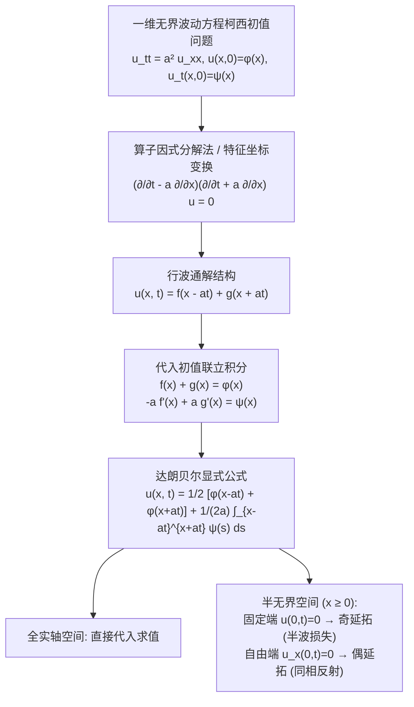

---
tags:
  - 物理/数学物理方法
  - 偏微分方程
  - 技术卡
  - 达朗贝尔公式
  - 波动方程
  - 行波法
  - 奇偶延拓
aliases:
  - 达朗贝尔行波法与一维无界波动解
  - 达朗贝尔公式
  - 行波法求解波动方程
  - 依赖区间与因果光锥
  - 半无界波动与反射延拓
  - D'Alembert Traveling Wave Solution and Boundary Reflection
created: 2026-09-08
updated: 2026-09-08
---

> [!summary] 技术核心论断
> 达朗贝尔行波法揭示了一维双曲型波动方程最纯粹的物理与几何本质：**波动是扰动形态沿相异特征线方向、以有限恒定波速 $a$ 向前与向后刚性平移的无畸变传播过程**。通过一阶微分算子因式分解，无界柯西初值问题被转化为两个互不相干的独立单向波动算子，直接推导出著名的**达朗贝尔公式 (D'Alembert's Formula)**。该公式建立了严格的**时空因果光锥几何（依赖区间、决定区域与影响区域）**。对于半无界或有界空间，结合边界处波的反射机理，运用**奇延拓（固定端反相反射）与偶延拓（自由端同相反射）**，可将复杂的边值约束无缝升维映射为全实轴上的无界行波演化。

## 一、推导机理与规范求解工作流



---

### 1.1 一维无界波动柯西问题的因式分解推导

考虑定义在全实轴 $-\infty < x < +\infty$ 上的齐次波动方程初值问题：
$$\begin{cases} \frac{\partial^2 u}{\partial t^2} = a^2 \frac{\partial^2 u}{\partial x^2} & (-\infty < x < +\infty, t > 0) \\ u(x, 0) = \varphi(x) & (-\infty < x < +\infty) \\ \left. \frac{\partial u}{\partial t}(x, t) \right|_{t=0} = \psi(x) & (-\infty < x < +\infty) \end{cases}$$

#### 1. 微分算子因式分解：
将波动方程写为算子复合形式：
$$\left( \frac{\partial^2}{\partial t^2} - a^2 \frac{\partial^2}{\partial x^2} \right) u = \left( \frac{\partial}{\partial t} - a \frac{\partial}{\partial x} \right) \left( \frac{\partial}{\partial t} + a \frac{\partial}{\partial x} \right) u = 0$$
令辅助函数 $v = \frac{\partial u}{\partial t} + a \frac{\partial u}{\partial x}$，则方程化为一阶单向输运方程：
$$\frac{\partial v}{\partial t} - a \frac{\partial v}{\partial x} = 0 \implies v(x, t) = F_1(x + at)$$
再代回解非齐次一阶方程，即得一维波动方程的**行波通解结构**：
$$\boxed{ u(x, t) = f(x - at) + g(x + at) }$$
- $f(x - at)$：以波速 $a$ 沿 $+x$ 方向正向平移传播的**右行波 (Forward Traveling Wave)**；
- $g(x + at)$：以波速 $a$ 沿 $-x$ 方向反向平移传播的**左行波 (Backward Traveling Wave)**。

---

### 1.2 达朗贝尔公式的严格推导

将通解代入初始条件 $t = 0$：
1. 代入初始位移：
   $$f(x) + g(x) = \varphi(x) \tag{1}$$
2. 对时间求偏导：$\frac{\partial u}{\partial t} = -a f'(x - at) + a g'(x + at)$，代入初始速度：
   $$-a f'(x) + a g'(x) = \psi(x) \implies -f'(x) + g'(x) = \frac{1}{a} \psi(x)$$
   两边对 $x$ 从任一点 $x_0$ 积分至 $x$：
   $$-f(x) + g(x) = \frac{1}{a} \int_{x_0}^x \psi(s) ds + C \tag{2}$$
   其中 $C = -f(x_0) + g(x_0)$。

联立 $(1)$ 式与 $(2)$ 式：
- 两式相加得 $g(x)$：
  $$g(x) = \frac{1}{2} \varphi(x) + \frac{1}{2a} \int_{x_0}^x \psi(s) ds + \frac{C}{2}$$
- 两式相减得 $f(x)$：
  $$f(x) = \frac{1}{2} \varphi(x) - \frac{1}{2a} \int_{x_0}^x \psi(s) ds - \frac{C}{2}$$

现在将 $x - at$ 代入 $f$，将 $x + at$ 代入 $g$，求和：
$$u(x, t) = f(x - at) + g(x + at)$$
$$= \frac{1}{2} \left[ \varphi(x - at) + \varphi(x + at) \right] + \frac{1}{2a} \left[ \int_{x_0}^{x + at} \psi(s) ds - \int_{x_0}^{x - at} \psi(s) ds \right]$$
任意常数 $C$ 严格自然对消！根据定积分可加性：
$$\int_{x_0}^{x + at} - \int_{x_0}^{x - at} = \int_{x - at}^{x + at} \psi(s) ds$$
即导出名垂青史的**达朗贝尔公式 (D'Alembert's Formula)**：
$$\boxed{ u(x, t) = \frac{1}{2} \left[ \varphi(x - at) + \varphi(x + at) \right] + \frac{1}{2a} \int_{x - at}^{x + at} \psi(s) ds }$$

---

### 1.3 时空几何：因果光锥与三大影响区域

波动方程的双曲型特征赋予了时空严格的因果结构：

```
       t
       ^           影响区域 (Domain of Influence)
       |           /                  \
       |          /                    \
(x0,t0)*---------/----------------------\-------
       | \      /                        \
       |  \    /                          \
       |   \  / 依赖区间                   \
-------+----+-------------------------------+----> x
       O  x0-at0  x0                    x0+at0
```

1. **依赖区间 (Interval of Dependence)**：
   时空点 $(x_0, t_0)$ 处的振动状态 $u(x_0, t_0)$，**仅且唯一**由初值在 $x$ 轴上的区间 $[x_0 - at_0, x_0 + at_0]$ 决定。区间之外的任何初始扰动，因传播速度不能超过 $a$，在 $t_0$ 时刻均无法传递到 $x_0$！
2. **决定区域 (Domain of Determinacy)**：
   若已知 $x$ 轴上线段 $[A, B]$ 上的初值，则由特征线 $x - at = A$ 与 $x + at = B$ 在上半时空平面所围成的**特征三角形区域**内部的场，被该初值完全唯一决定。
3. **影响区域 (Domain of Influence)**：
   初时刻位于 $x_0$ 处的局域扰动，在随后的时间演化中，只能扩散至由射线 $x - x_0 = \pm at$ 所夹的**正向特征锥（光锥）内部 $|x - x_0| \le at$**。

---

### 1.4 半无界弦的振动与端点反射（奇偶延拓法）

对于半无界弦 $x \ge 0$，当 $t > \frac{x}{a}$ 时，自变量 $x - at < 0$，落在了原物理区间之外！这代表波已传播到边界并被反射。利用延拓法将其化为全实轴问题：

#### 1. 固定端边界（第一类齐次：$u(0, t) = 0$）—— 奇延拓法
- 边界要求：$u(0, t) = f(-at) + g(at) = 0 \implies f(-\xi) = -g(\xi)$。
- 物理机制：波遇到固定端时，受到刚性约束的反作用力，产生反向应力波，发生**反相反射（相位突变 $\pi$，半波损失）**！
- 延拓构造：将初值函数作**奇延拓 (Odd Extension)**：
  $$\varphi_{\text{odd}}(x) = \begin{cases} \varphi(x) & (x \ge 0) \\ -\varphi(-x) & (x < 0) \end{cases}, \quad \psi_{\text{odd}}(x) = \begin{cases} \psi(x) & (x \ge 0) \\ -\psi(-x) & (x < 0) \end{cases}$$
- 当 $x < at$ 时的显式解（以 $\psi=0$ 为例）：
  $$u(x, t) = \frac{1}{2} [\varphi_{\text{odd}}(x - at) + \varphi_{\text{odd}}(x + at)] = \frac{1}{2} [-\varphi(at - x) + \varphi(x + at)]$$

#### 2. 自由端边界（第二类齐次：$\left. \frac{\partial u}{\partial x} \right|_{x=0} = 0$）—— 偶延拓法
- 边界要求：$u_x(0, t) = f'(-at) + g'(at) = 0 \implies f(-\xi) = g(\xi)$。
- 物理机制：自由滑块端点没有阻碍，波在端点发生**同相反射（波幅原样反射叠加，端点位移加倍）**！
- 延拓构造：将初值函数作**偶延拓 (Even Extension)**：
  $$\varphi_{\text{even}}(x) = \begin{cases} \varphi(x) & (x \ge 0) \\ \varphi(-x) & (x < 0) \end{cases}, \quad \psi_{\text{even}}(x) = \begin{cases} \psi(x) & (x \ge 0) \\ \psi(-x) & (x < 0) \end{cases}$$
- 当 $x < at$ 时的显式解：
  $$u(x, t) = \frac{1}{2} [\varphi(at - x) + \varphi(x + at)]$$

---

## 二、⚠️ 致命失分陷阱与临界边界

> [!warning] 陷阱 1：半无界问题在反射区 $x < at$ 遗漏分段延拓
> 考场最高频失误：直接将 $x - at$ 塞进原初值公式计算！
> - 原初值 $\varphi(x)$ 仅在 $x \ge 0$ 上有物理定义；
> - 当 $t > x/a$ 时，$x - at < 0$，未定义函数的负值直接代入导致无意义或错漏负号；
> - 必须写出规范分段式：
>   $$u(x, t) = \begin{cases} \frac{1}{2}[\varphi(x - at) + \varphi(x + at)] & (x \ge at) \\ \frac{1}{2}[\varphi(x + at) - \varphi(at - x)] & (0 \le x < at, \text{固定端}) \end{cases}$$

> [!caution] 陷阱 2：初始速度积分项遗漏波速系数 $\frac{1}{2a}$
> 达朗贝尔公式中位移项的系数是 $\frac{1}{2}$，而速度积分项的系数是 $\frac{1}{2a}$！
> - 物理量纲核验：$[\varphi] = \text{m}$，因此 $\frac{1}{2}[\varphi + \varphi]$ 量纲是 $\text{m}$；
> - 速度量纲 $[\psi] = \text{m/s}$，积分微元 $[ds] = \text{m}$，故 $\int \psi ds$ 量纲是 $\text{m}^2/\text{s}$；
> - 必须除以波速 $[a] = \text{m/s}$，才能使量纲还原为 $\text{m}$！漏写分母 $a$ 属于毁灭性量纲错误。

> [!danger] 陷阱 3：有界弦振动中盲目套用单次延拓
> 长度为 $l$ 的有限双端固定弦，波在两端会经历无穷多次往复反射！
> - 单次奇延拓只适用于半无界弦；
> - 对于有限区间 $[0, l]$，必须作**奇延拓并以 $2l$ 为周期作周期延拓**；
> - 在考场上，若时间跨度较长（$t > l/a$），有限弦应果断改用**分离变量法（傅里叶级数法）**求解，强行用行波反射法易在多次截断分段中迷失出错！

---

## 三、经典范例手把手演算

### 题目（半无界固定端弦振动的反射波手把手全解）：
一根半无界均匀细弦位于 $x \ge 0$，波速为 $a$。
左端固定在墙上：$u(0, t) = 0$。
初始时刻静止释放（初始速度 $\psi(x) = 0$），初始波形为在 $[h, 2h]$ 内的一个三角形凸起：
$$\varphi(x) = \begin{cases} \frac{x - h}{h} & (h \le x \le 2h) \\ 0 & (\text{其他区间 } x \ge 0) \end{cases}$$
1. 建立奇延拓函数 $\varphi_{\text{odd}}(x)$；
2. 给出在全平面 $(x, t)$ 上的显式解析解（按时空区域严格分段）；
3. 跟踪计算波形在 $t_1 = \frac{h}{2a}$、$t_2 = \frac{3h}{2a}$ 及 $t_3 = \frac{3h}{a}$ 三个典型时刻的波形分布，手把手验算边界反射与相消干涉。

#### 【演算步骤】

**第一步：构造奇延拓初值函数**
根据固定端反射法则，定义在 $(-\infty, +\infty)$ 上的奇延拓函数为：
$$\varphi_{\text{odd}}(x) = \begin{cases} \varphi(x) & (x > 0) \\ 0 & (x = 0) \\ -\varphi(-x) & (x < 0) \end{cases}$$
- 在 $x \in [-2h, -h]$ 负区间内：$-x \in [h, 2h]$：
  $$\varphi_{\text{odd}}(x) = -\varphi(-x) = -\left( \frac{-x - h}{h} \right) = \frac{x + h}{h}$$
  这是一个反向倒立的三角形负脉冲！

**第二步：写出行波分段解析解**
根据达朗贝尔公式（$\psi=0$）：
$$u(x, t) = \frac{1}{2} \left[ \varphi_{\text{odd}}(x - at) + \varphi_{\text{odd}}(x + at) \right]$$
对半无界物理域 $x \ge 0$ 进行时空因果划分：
1. **未到达边界区（$x \ge at$）**：
   此时 $x - at \ge 0$，负反射波尚未传播至此，解完全等于两个原始右行波与左行波的简单叠加：
   $$u(x, t) = \frac{1}{2} \left[ \varphi(x - at) + \varphi(x + at) \right]$$
2. **反射波覆盖区（$0 \le x < at$）**：
   此时 $x - at < 0$，代入奇延拓：$\varphi_{\text{odd}}(x - at) = -\varphi(at - x)$：
   $$\boxed{ u(x, t) = \frac{1}{2} \left[ \varphi(x + at) - \varphi(at - x) \right] }$$

---

**第三步：分时刻手把手跟踪演算**

1. **时刻 $t_1 = \frac{h}{2a}$（波刚分裂，尚未触碰边界）**：
   位移位移量 $at_1 = h/2$。
   - 原始脉冲 $[h, 2h]$ 分裂为两个振幅减半（高度 $0.5$）的正波：
   - 右行波中心移动至：$[h + h/2, 2h + h/2] = [1.5h, 2.5h]$；
   - 左行波中心移动至：$[h - h/2, 2h - h/2] = [0.5h, 1.5h]$；
   - 边界处 $x = 0$ 尚未受到扰动：$u(0, t_1) = 0$。

2. **时刻 $t_2 = \frac{3h}{2a}$（左行波正面撞击固定端并发生反射反相）**：
   位移量 $at_2 = 1.5h$。
   - 右行波已完全传至远处：$[2.5h, 3.5h]$；
   - 考察左侧入射波与反射波的干涉叠加：
     - 左行波本应移至：$[h - 1.5h, 2h - 1.5h] = [-0.5h, 0.5h]$；
     - 奇延拓产生的虚像反射波（倒立三角波）本应从 $[-2h, -h]$ 向右传播至 $[-0.5h, 0.5h]$；
     - 在端点 $x = 0$ 处：
       $$u(0, t_2) = \frac{1}{2} [\varphi(1.5h) - \varphi(1.5h)] = 0$$
       入射波与反射波在端点严格反相对消，端点完全静止固定！

3. **时刻 $t_3 = \frac{3h}{a}$（反射彻底完成，波形完全移出）**：
   位移量 $at_3 = 3h$。
   - 原始右行波已传播至 $[4h, 5h]$，依然为正向三角形；
   - 被边界反射后的波转化为向右传播的**倒立负三角形波**，其几何支撑区间为 $[at_3 - 2h, at_3 - h] = [h, 2h]$，高度为 $-0.5$！
   - 反射前后波形完全倒置，严格验证了**固定端半波损失（相位突变 $\pi$）**的物理实在！

---

## 四、出处与纸质笔记坐标

* **教材出处**：梁昆淼《数学物理方法》（第四版）第七章 §7.4 (P135-P142)
* **纸质活页槽位**：`[活页-LKM-17]`
* **知识全景索引**：[[00_梁昆淼数学物理方法_第二篇全景图]]
