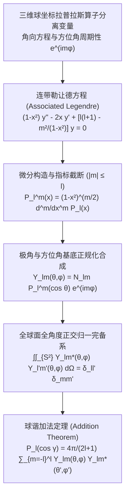

---
tags:
  - 物理/数学物理方法
  - 特殊函数
  - 技术卡
  - 连带勒让德函数
  - 球谐函数
  - 球面调和函数
  - 球谐加法定理
aliases:
  - 连带勒让德函数与正交球面调和函数系
  - 连带勒让德多项式
  - 球谐函数
  - 球面调和函数系
  - 球谐加法定理
  - Associated Legendre Functions and Spherical Harmonics
created: 2026-09-08
updated: 2026-09-08
---

> [!summary] 技术核心论断
> 当物理系统的空间构型脱离轴对称、展现出包含方位角 $\varphi$ 依赖的任意三维球几何构型时（如原子轨道杂化、非中心对称天体引力场、全向辐射天线方向图），角向微分方程由勒让德方程升维演化为**连带勒让德方程**。其有界多项式解为**连带勒让德函数 $P_l^m(x)$**，且由物理周期性与微分阶数内禀限制了阶数截断条件 $|m| \le l$。将极角函数与方位角复指数相乘并经严格能量正规化后，铸就了统治现代量子力学（角动量算符本征态）与电磁多极辐射理论的至高数学工具——**球面调和函数系（球谐函数，$Y_{lm}(\theta, \varphi)$）**。**球谐加法定理**更是将两点相对夹角场与绝对球坐标基底完美解耦，构成了高维格林函数展开的终极法宝。

## 一、推导机理与规范求解工作流

---

### 1.1 连带勒让德微分方程与函数定义

三维球坐标分离变量 $u(r, \theta, \varphi) = R(r) \Theta(\theta) \Phi(\varphi)$ 时，由方位角单值周期性 $\Phi(\varphi + 2\pi) = \Phi(\varphi) \implies \Phi(\varphi) = e^{im\varphi}$ ($m \in \mathbb{Z}$)。
令 $x = \cos\theta \in [-1, 1]$，极角函数 $y(x) = \Theta(\arccos x)$ 遵从**连带勒让德方程 (Associated Legendre Equation)**：
$$\boxed{ (1 - x^2) \frac{d^2 y}{dx^2} - 2x \frac{dy}{dx} + \left[ l(l + 1) - \frac{m^2}{1 - x^2} \right] y = 0 }$$

#### 1. 与标准勒让德方程的微分变换关系：
对标准勒让德方程 $(1 - x^2) P_l'' - 2x P_l' + l(l+1) P_l = 0$ 两边运用莱布尼茨法则求 $m$ 次导数，记 $v(x) = \frac{d^m}{dx^m} P_l(x)$：
$$(1 - x^2) v'' - 2(m + 1) x v' + [l(l + 1) - m(m + 1)] v = 0$$
作因变量函数变换：令 $y(x) = (1 - x^2)^{m/2} v(x)$，代入后微商项奇迹般地完全转化为连带勒让德方程！
由此导出**连带勒让德函数 (Associated Legendre Polynomials)** 的解析定义：
$$\boxed{ P_l^m(x) = (1 - x^2)^{m/2} \frac{d^m}{dx^m} P_l(x) = \frac{(1 - x^2)^{m/2}}{2^l l!} \frac{d^{l+m}}{dx^{l+m}} \left[ (x^2 - 1)^l \right] }$$

#### 2. 指标截断条件与负指标定义：
- **截断规律**：由于 $P_l(x)$ 为 $l$ 次有限多项式，对其求导超过 $l$ 次必定恒为零！
  $$\frac{d^m}{dx^m} P_l(x) \equiv 0 \quad (\text{当 } m > l)$$
  因此要获得非零有界物理多项式解，**参数 $m$ 必须且只能取有限整数**：
  $$\boxed{ 0 \le m \le l }$$
- **负指标推广**：根据微分方程的对称性（方程中只含 $m^2$），负指标 $P_l^{-m}(x)$ 必定与正指标线性相关。标准定义为：
  $$P_l^{-m}(x) = (-1)^m \frac{(l - m)!}{(l + m)!} P_l^m(x)$$

---

### 1.2 连带勒让德函数的正交性与归一化模方

在标准定义下，对固定方位角阶数 $m$，不同阶数 $l, l'$ 的连带勒让德多项式在 $[-1, 1]$ 上关于平凡权函数 $\rho(x) = 1$ 正交：
$$\boxed{ \int_{-1}^1 P_l^m(x) P_{l'}^m(x) dx = \frac{2}{2l + 1} \frac{(l + m)!}{(l - m)!} \delta_{ll'} }$$

> [!important] 模方因子的代数意义
> 当 $m = 0$ 时，$\frac{(l+0)!}{(l-0)!} = 1$，模方自然精确退化为标准勒让德多项式的 $\frac{2}{2l+1}$；
> 当 $m > 0$ 时，模方附带阶乘倍增因子 $\frac{(l+m)!}{(l-m)!}$。

---

### 1.3 球面调和函数系 (Spherical Harmonics, 球谐函数)

#### 1. 标准正规化定义：
将极角正交基 $P_l^m(\cos\theta)$ 与方位角正交基 $e^{im\varphi}$ 乘积复合，并除以双向模方，定义全空间正规化的**球面调和函数 $Y_{lm}(\theta, \varphi)$**（采用理论物理与量子力学通用的 **Condon-Shortley 相位约定**）：
$$\boxed{ Y_{lm}(\theta, \varphi) = (-1)^m \sqrt{\frac{2l + 1}{4\pi} \frac{(l - m)!}{(l + m)!}} P_l^m(\cos\theta) e^{im\varphi} \quad (m \ge 0) }$$
对于负指标 $m < 0$：
$$\boxed{ Y_{l, -m}(\theta, \varphi) = (-1)^m Y_{lm}^*(\theta, \varphi) }$$
其中 $l = 0, 1, 2, \dots$，$m = -l, -l+1, \dots, 0, \dots, l-1, l$（每个 $l$ 对应 $2l + 1$ 个独立态）。

#### 2. 全球面正交归一完备性：
在单位球面上，以立体角微元 $d\Omega = \sin\theta d\theta d\varphi$ 进行双重面积分，球谐函数系构成希尔伯特空间 $L^2(S^2)$ 的**严格正交归一完备基**：
$$\boxed{ \iint_{S^2} Y_{lm}^*(\theta, \varphi) Y_{l'm'}(\theta, \varphi) d\Omega = \int_0^{2\pi} d\varphi \int_0^\pi \sin\theta d\theta Y_{lm}^*(\theta, \varphi) Y_{l'm'}(\theta, \varphi) = \delta_{ll'} \delta_{mm'} }$$

#### 3. 广义球谐级数展开：
单位球面上的任意连续可微物理场分布 $f(\theta, \varphi)$ 均可唯一展开为：
$$f(\theta, \varphi) = \sum_{l=0}^\infty \sum_{m=-l}^l c_{lm} Y_{lm}(\theta, \varphi)$$
展开谱系数由球面正交投影求得：
$$c_{lm} = \iint_{S^2} f(\theta, \varphi) Y_{lm}^*(\theta, \varphi) d\Omega$$

---

### 1.4 球谐加法定理 (Addition Theorem for Spherical Harmonics)

设两空间方向矢量的单位方向分别为 $\hat{\boldsymbol{n}} = (\theta, \varphi)$ 与 $\hat{\boldsymbol{n}}' = (\theta', \varphi')$，两矢量之间的空间夹角为 $\gamma$，由空间立体几何：
$$\cos\gamma = \cos\theta \cos\theta' + \sin\theta \sin\theta' \cos(\varphi - \varphi')$$

> **球谐加法定理**：
> 两方向夹角的 $l$ 阶勒让德多项式 $P_l(\cos\gamma)$，可完美解耦展开为两方向各自球谐函数的双线性对称和：
> $$\boxed{ P_l(\cos\gamma) = \frac{4\pi}{2l + 1} \sum_{m=-l}^l Y_{lm}(\theta, \varphi) Y_{lm}^*(\theta', \varphi') }$$

**物理应用威力**：
将真空库仑点电荷多极势（Card 23）代入加法定理，直接将源点与场点角向依赖完全解耦分离：
$$\boxed{ \frac{1}{|\boldsymbol{r} - \boldsymbol{r}'|} = \sum_{l=0}^\infty \sum_{m=-l}^l \frac{4\pi}{2l + 1} \frac{r_<^l}{r_>^{l+1}} Y_{lm}(\theta, \varphi) Y_{lm}^*(\theta', \varphi') }$$
这是三维非轴对称问题格林函数展开的终极解析表达！

---

## 二、⚠️ 致命失分陷阱与临界边界

> [!warning] 陷阱 1：阶数截断条件 $|m| \le l$ 的遗漏导致虚构非零模态
> 许多推导中常出现双重求和 $\sum_{l=0}^\infty \sum_{m=-\infty}^\infty$：
> - 绝对致命错误：$m$ 的求和界限**严格不能超过当前的 $l$**（即 $|m| \le l$）；
> - 当 $|m| > l$ 时，连带勒让德多项式 $P_l^m(x) \equiv 0$ 恒等于零！
> - 若误保留了 $m > l$ 的项，不仅数学上毫无意义，在量子力学中更会凭空捏造出角动量投影算符本征值大于总角动量的非物理佯谬。

> [!caution] 陷阱 2：Condon-Shortley 相位因子 $(-1)^m$ 的混淆
> 不同学术派别对球谐函数相位有不同约定：
> - 理论物理与量子力学标准约定（Condon-Shortley）：在正指标 $m > 0$ 上附带 $(-1)^m$；
> - 某些经典数学手册不带 $(-1)^m$；
> - 本知识库严格遵循物理学主流标准：$Y_{lm}$ 含 $(-1)^m$，使得升降阶算符矩阵元全为正数。考场计算正交积分或代入加法定理时，务必注意复共轭 $Y_{lm}^*$ 会抵消复指数符号，但实数相位 $(-1)^m$ 保持不变。

> [!danger] 陷阱 3：连带勒让德多项式正规化阶乘比写反
> 正规化系数中是 $\sqrt{\frac{(l-m)!}{(l+m)!}}$，而模方积分为 $\frac{(l+m)!}{(l-m)!}$：
> - 因为 $(l+m)! \ge (l-m)!$，所以模方积分中的阶乘必大于等于 1（在分子）；
> - 归一化系数为了除掉模方，阶乘比**必须是小的在分子、大的在分母**！
> 考场常因紧张将两处的分子分母弄反，导致算出的场强被放大或缩小天文数字倍。

---

## 三、经典范例手把手演算

### 题目（低阶连带勒让德多项式与球谐函数的显式手把手推导）：
1. 利用勒让德多项式 $P_1(x) = x$ 与 $P_2(x) = \frac{1}{2}(3x^2 - 1)$，手把手构造出 $P_1^1(x)$、$P_2^1(x)$ 以及 $P_2^2(x)$ 的显式代数式；
2. 构造对应的标准化球谐函数 $Y_{10}(\theta, \varphi)$、$Y_{1, 1}(\theta, \varphi)$ 以及 $Y_{20}(\theta, \varphi)$；
3. 手把手积分验证 $Y_{10}$ 与 $Y_{11}$ 在球面上的正交归一性。

#### 【演算步骤】

**第一步：构造连带勒让德函数**
根据定义式 $P_l^m(x) = (1 - x^2)^{m/2} \frac{d^m}{dx^m} P_l(x)$：
1. **对于 $l = 1$（$p$ 轨道模态）**：
   - $m = 0$：$P_1^0(x) = P_1(x) = x = \cos\theta$
   - $m = 1$：$P_1^1(x) = (1 - x^2)^{1/2} \frac{d}{dx}(x) = \sqrt{1 - x^2} \cdot 1 = \boxed{ \sin\theta }$
2. **对于 $l = 2$（$d$ 轨道模态）**：
   - $m = 0$：$P_2^0(x) = P_2(x) = \frac{1}{2}(3x^2 - 1) = \frac{1}{2}(3\cos^2\theta - 1)$
   - $m = 1$：$P_2^1(x) = (1 - x^2)^{1/2} \frac{d}{dx}\left[ \frac{1}{2}(3x^2 - 1) \right] = \sqrt{1 - x^2} (3x) = \boxed{ 3\sin\theta \cos\theta }$
   - $m = 2$：$P_2^2(x) = (1 - x^2)^{2/2} \frac{d^2}{dx^2}\left[ \frac{1}{2}(3x^2 - 1) \right] = (1 - x^2) \cdot 3 = \boxed{ 3\sin^2\theta }$

---

**第二步：计算归一化系数并合成球谐函数**
系数公式：$N_{lm} = (-1)^m \sqrt{\frac{2l+1}{4\pi} \frac{(l-m)!}{(l+m)!}}$。
1. **合成 $Y_{10}(\theta, \varphi)$**：
   $l = 1, m = 0 \implies N_{10} = (-1)^0 \sqrt{\frac{3}{4\pi}\frac{1!}{1!}} = \sqrt{\frac{3}{4\pi}}$。
   $$\boxed{ Y_{10}(\theta, \varphi) = \sqrt{\frac{3}{4\pi}} \cos\theta }$$
   （对应量子力学氢原子 $p_z$ 轨道波函数！）。
2. **合成 $Y_{11}(\theta, \varphi)$**：
   $l = 1, m = 1 \implies N_{11} = (-1)^1 \sqrt{\frac{3}{4\pi}\frac{0!}{2!}} = -\sqrt{\frac{3}{8\pi}}$。
   $$\boxed{ Y_{11}(\theta, \varphi) = -\sqrt{\frac{3}{8\pi}} \sin\theta e^{i\varphi} }$$
   （对应量子力学 $p_x + i p_y$ 轨道波函数！）。
3. **合成 $Y_{20}(\theta, \varphi)$**：
   $l = 2, m = 0 \implies N_{20} = \sqrt{\frac{5}{4\pi}\frac{2!}{2!}} = \sqrt{\frac{5}{4\pi}}$。
   $$\boxed{ Y_{20}(\theta, \varphi) = \sqrt{\frac{5}{4\pi}} \frac{1}{2}(3\cos^2\theta - 1) = \sqrt{\frac{5}{16\pi}} (3\cos^2\theta - 1) }$$
   （对应经典的 $d_{z^2}$ 轨道波函数！）。

---

**第三步：全空间正交归一化手把手积实验算**
1. **验证 $Y_{10}$ 自身的归一化**：
   $$\iint_{S^2} |Y_{10}|^2 d\Omega = \int_0^{2\pi} d\varphi \int_0^\pi \sin\theta d\theta \left( \frac{3}{4\pi} \cos^2\theta \right) = (2\pi) \cdot \frac{3}{4\pi} \int_0^\pi \cos^2\theta \sin\theta d\theta$$
   令 $u = \cos\theta$（$du = -\sin\theta d\theta$）：
   $$\int_0^\pi \cos^2\theta \sin\theta d\theta = \int_{-1}^1 u^2 du = \left[ \frac{u^3}{3} \right]_{-1}^1 = \frac{2}{3}$$
   代回乘积：
   $$\iint_{S^2} |Y_{10}|^2 d\Omega = \frac{3}{2} \cdot \frac{2}{3} = 1$$
   归一化严格无误！
2. **验证 $Y_{10}$ 与 $Y_{11}$ 的正交性**：
   $$\iint_{S^2} Y_{10}^* Y_{11} d\Omega = \left( \int_0^{2\pi} e^{i\varphi} d\varphi \right) \cdot \left[ \int_0^\pi \dots \right]$$
   考察方位角 $\varphi$ 的单次积分：
   $$\int_0^{2\pi} e^{i\varphi} d\varphi = \left[ \frac{e^{i\varphi}}{i} \right]_0^{2\pi} = \frac{1 - 1}{i} = 0$$
   由于不同 $m$ 阶数的方位角本征态 $e^{im\varphi}$ 在 $[0, 2\pi]$ 上天然正交为零，整个球面二重积分直接恒等于零！
   正交性验证成功！

---

## 四、出处与纸质笔记坐标

* **教材出处**：梁昆淼《数学物理方法》（第四版）第十章 §10.2-§10.3 (P234-P247)
* **纸质活页槽位**：`[活页-LKM-24]`
* **知识全景索引**：[[00_梁昆淼数学物理方法_第三篇全景图]]
