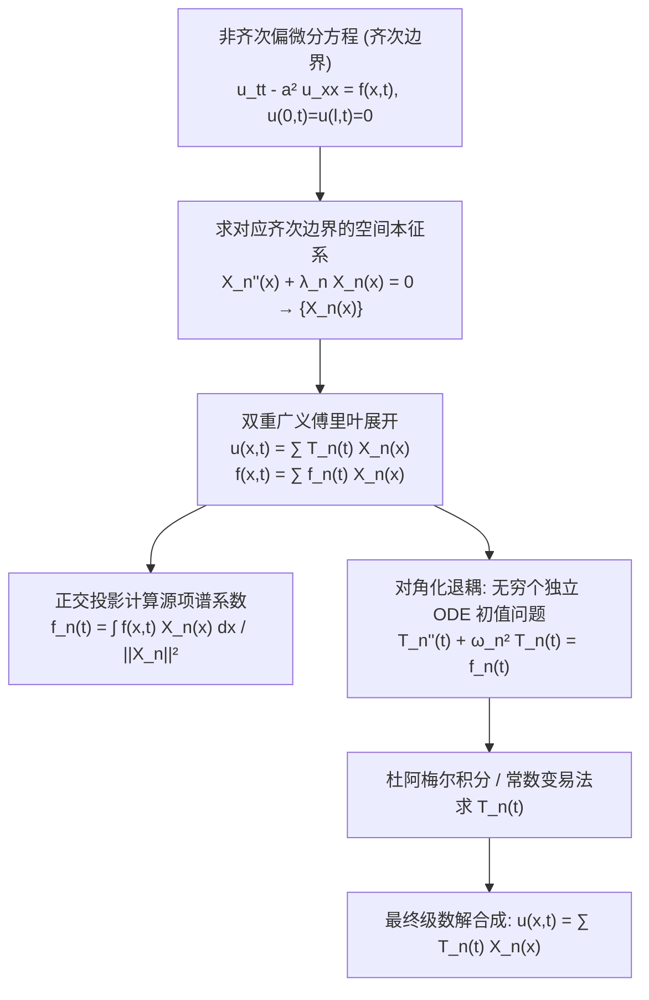

---
tags:
  - 物理/数学物理方法
  - 偏微分方程
  - 技术卡
  - 本征函数展开法
  - 非齐次方程
  - 杜阿梅尔原理
  - 机械共振
aliases:
  - 非齐次振动输运方程与本征函数展开法
  - 本征函数展开法
  - 固有模态展开法
  - 杜阿梅尔原理与冲量定理法
  - 受迫振动与共振
  - Eigenfunction Expansion for Inhomogeneous PDEs
created: 2026-09-08
updated: 2026-09-08
---

> [!summary] 技术核心论断
> 本征函数展开法（又称固有振型法或广义傅里叶投影法）是求解**含外加驱动源项 $f(\boldsymbol{r}, t)$ 的非齐次线性偏微分方程（在齐次边界条件下）**的标准分析方法。其核心数学思想是“**在系统本征基底上实现无限自由度的对角化解耦**”：利用对应齐次几何边值问题所激发的完备正交本征函数族 $\{X_n(\boldsymbol{r})\}$ 作为空间无穷维希尔伯特空间的基底，将未知场量 $u(\boldsymbol{r}, t)$ 与外力源项 $f(\boldsymbol{r}, t)$ 同时向该基底正交投影，从而将高度交织的偏微分方程彻底退耦为无穷组**一维互相独立的常微分方程初值问题**。该方法不仅统一解释了受迫振动与热源输运，还深刻揭示了外激励频率逼近本征频率时振幅随时间线性失稳攀升的**物理共振机理**。

## 一、推导机理与规范求解工作流

---

### 1.1 标准求解推导（以受迫弦振动为例）

考虑带连续分布外力源 $f(x, t)$、边界为齐次固定的非齐次波动方程定解问题：
$$\begin{cases} \frac{\partial^2 u}{\partial t^2} - a^2 \frac{\partial^2 u}{\partial x^2} = f(x, t) & (0 < x < l, t > 0) \\ u(0, t) = 0, \quad u(l, t) = 0 & (t \ge 0) \\ u(x, 0) = \varphi(x), \quad \left. \frac{\partial u}{\partial t} \right|_{t=0} = \psi(x) & (0 \le x \le l) \end{cases}$$

#### 第一步：提取对应齐次边值问题的本征函数系
考察不含外力 $f(x, t)$ 的齐次方程在相同齐次边界下的空间本征值问题：
$$X''(x) + \lambda X(x) = 0, \quad X(0) = 0, \quad X(l) = 0$$
解得本征值 $\lambda_n = \left(\frac{n\pi}{l}\right)^2$，固有频率 $\omega_n = \frac{n\pi a}{l}$，正交完备本征函数基底：
$$X_n(x) = \sin\left( \frac{n\pi x}{l} \right) \quad (n = 1, 2, 3, \dots)$$
其正交模方为：$N_n = \|X_n\|^2 = \int_0^l \sin^2\left(\frac{n\pi x}{l}\right) dx = \frac{l}{2}$。

#### 第二步：解与源项的双重本征正交展开
根据施图姆－刘维尔理论的完备性定理，对任意固定时刻 $t$，物理场 $u(x, t)$ 及外源项 $f(x, t)$ 均可沿空间基底 $\{X_n(x)\}$ 展开：
$$u(x, t) = \sum_{n=1}^\infty T_n(t) X_n(x) = \sum_{n=1}^\infty T_n(t) \sin\left( \frac{n\pi x}{l} \right)$$
$$f(x, t) = \sum_{n=1}^\infty f_n(t) X_n(x) = \sum_{n=1}^\infty f_n(t) \sin\left( \frac{n\pi x}{l} \right)$$
其中外源项展开系数 $f_n(t)$ 由正交投影唯一决定：
$$\boxed{ f_n(t) = \frac{1}{N_n} \int_0^l f(x, t) X_n(x) dx = \frac{2}{l} \int_0^l f(x, t) \sin\left( \frac{n\pi x}{l} \right) dx }$$

同理，将初始条件 $\varphi(x), \psi(x)$ 展开：
$$\varphi(x) = \sum_{n=1}^\infty \varphi_n \sin\left( \frac{n\pi x}{l} \right), \quad \varphi_n = \frac{2}{l} \int_0^l \varphi(x) \sin\left( \frac{n\pi x}{l} \right) dx$$
$$\psi(x) = \sum_{n=1}^\infty \psi_n \sin\left( \frac{n\pi x}{l} \right), \quad \psi_n = \frac{2}{l} \int_0^l \psi(x) \sin\left( \frac{n\pi x}{l} \right) dx$$

#### 第三步：偏微分方程退耦为常微分方程初值问题
将展开式直接代入原偏微分方程：
$$\sum_{n=1}^\infty T_n''(t) X_n(x) - a^2 \sum_{n=1}^\infty T_n(t) X_n''(x) = \sum_{n=1}^\infty f_n(t) X_n(x)$$
由于 $X_n''(x) = -\lambda_n X_n(x)$，且 $a^2 \lambda_n = \omega_n^2$：
$$\sum_{n=1}^\infty \left[ T_n''(t) + \omega_n^2 T_n(t) - f_n(t) \right] X_n(x) = 0$$
由本征函数的线性无关性与正交性，每一项括号内的系数必处处为零！
从而得到关于各模态振幅时间函数 $T_n(t)$ 的**二阶非齐次线性常微分方程初值问题**：
$$\boxed{ \begin{cases} T_n''(t) + \omega_n^2 T_n(t) = f_n(t) \\ T_n(0) = \varphi_n \\ T_n'(0) = \psi_n \end{cases} }$$

---

### 1.2 杜阿梅尔原理 (Duhamel's Principle / 冲量定理法)

对于上述常微分方程，齐次通解为自由振动 $A_n \cos(\omega_n t) + B_n \sin(\omega_n t)$。
非齐次方程的特解可通过**杜阿梅尔原理（瞬时冲量积分法）**求解：
将外力 $f_n(t)$ 视为一系列在 $\tau$ 时刻作用的极短冲量 $f_n(\tau) d\tau$。根据冲量定理，冲量使广义速度发生突变 $\Delta T_n' = f_n(\tau) d\tau$，随后系统以此初速度作自由振动。单位冲量的时域响应函数（格林函数核）为：
$$g_n(t - \tau) = \frac{\sin[\omega_n(t - \tau)]}{\omega_n}$$
对所有历史冲量自 $\tau = 0$ 积分累加至当前时刻 $t$，即得零状态特解：
$$T_{n, \text{特}}(t) = \frac{1}{\omega_n} \int_0^t f_n(\tau) \sin[\omega_n(t - \tau)] d\tau$$
叠加零输入齐次解，给出 $T_n(t)$ 的完全显式通解：
$$\boxed{ T_n(t) = \varphi_n \cos(\omega_n t) + \frac{\psi_n}{\omega_n} \sin(\omega_n t) + \frac{1}{\omega_n} \int_0^t f_n(\tau) \sin[\omega_n(t - \tau)] d\tau }$$

---

### 1.3 共振现象的数理机制 (Resonance Mechanism)

设外力为单频简谐激励：$f(x, t) = F(x) \sin(\omega t) \implies f_n(t) = F_n \sin(\omega t)$。
代入杜阿梅尔积分计算零状态特解：
$$T_{n, \text{特}}(t) = \frac{F_n}{\omega_n} \int_0^t \sin(\omega \tau) \sin[\omega_n(t - \tau)] d\tau$$
利用积化和差公式展开积分：
1. **当 $\omega \neq \omega_n$（非共振情形）**：
   $$T_{n, \text{特}}(t) = \frac{F_n}{\omega_n^2 - \omega^2} \left[ \sin(\omega t) - \frac{\omega}{\omega_n} \sin(\omega_n t) \right]$$
   振动由两种频率叠加而成：外加驱动频率 $\omega$ 的强迫振动与固有频率 $\omega_n$ 的拍频（Beat），振幅保持有界。
2. **当 $\omega \to \omega_n$（发生共振，Resonance）**：
   应用罗必达法则对 $\omega$ 求极限：
   $$\lim_{\omega \to \omega_n} T_{n, \text{特}}(t) = \lim_{\omega \to \omega_n} \frac{F_n \left[ t \cos(\omega t) - \frac{1}{\omega_n}\sin(\omega_n t) \right]}{-2\omega} = \boxed{ -\frac{F_n}{2\omega_n} t \cos(\omega_n t) + \frac{F_n}{2\omega_n^2} \sin(\omega_n t) }$$
   **物理核心特征**：出现正比于时间的项 $t \cos(\omega_n t)$！这表明振幅随时间线性无界增长，外力持续不断向该固有模态泵入能量，导致系统发生灾难性共振破坏。

---

## 二、⚠️ 致命失分陷阱与临界边界

> [!warning] 陷阱 1：边界条件非齐次时强行套用本征函数展开法
> 本征函数展开法成立的数学绝对前提是：**所有边界条件必须严格为齐次！**
> - 因为每一个基函数 $X_n(x)$ 在边界点处均恒等于 0（或其导数为 0）；
> - 若边界是非齐次的（例如 $u(0, t) = \mu_1(t) \neq 0$），而在级数展开式两端令 $x=0$，级数逐项全为 0，公然得到 $0 = \mu_1(t)$ 的矛盾！
> - 若边界非齐次，**必须先执行边界齐次化变换（Card 20）**，剥离出满足非齐次边界的辅助函数后，方可对剩余部分应用本征展开！

> [!caution] 陷阱 2：杜阿梅尔积分上下限与时间核因子的混淆
> 计算杜阿梅尔积分 $\int_0^t f_n(\tau) \sin[\omega_n(t - \tau)] d\tau$ 时：
> - 积分变量是过去的时间 $\tau \in [0, t]$；
> - 许多考生误将核函数写为 $\sin(\omega_n \tau)$，将外面的当前时间 $t$ 漏掉，导致积分完全丧失了时间延迟卷积响应的时序因果性；
> - 对于热传导方程，核函数为指数衰减核 $e^{-a^2 \lambda_n (t - \tau)}$，绝不可写成 $e^{-a^2 \lambda_n t}$。

> [!danger] 陷阱 3：外力与本征函数空间正交导致某些模态不响应
> 若外力分布 $f(x, t)$ 恰好与第 $k$ 阶本征函数正交，即 $\int_0^l f(x, t) X_k(x) dx = 0$：
> - 此时虽然外力频率可能与第 $k$ 阶固有频率 $\omega_k$ 完全重合，但**该阶模态的等效驱动源 $f_k(t) \equiv 0$，系统绝对不会发生共振**！
> - 考场容易只看频率重合就草率断定发生共振，忽略了**空间对称性匹配与节点受力**的物理判据（例如在弦的节点处施加外力无法激发该模态）。

---

## 三、经典范例手把手演算

### 题目（均布交变外力驱动下的受迫弦振动与共振手把手全解）：
长为 $l$ 的弦两端固定：$u(0, t) = u(l, t) = 0$。波速为 $a$。
初始时刻弦处于水平静止平衡状态：$u(x, 0) = 0, u_t(x, 0) = 0$。
自 $t = 0$ 起，弦受到沿全长均匀分布的简谐交变外力作用：
$$f(x, t) = F_0 \sin(\omega t) \quad (F_0 = \text{const})$$
1. 利用本征函数展开法求出振动位移 $u(x, t)$ 的完全显式级数解；
2. 讨论当外驱动频率 $\omega$ 恰好等于基频 $\omega_1 = \frac{\pi a}{l}$ 时的共振解形态。

#### 【演算步骤】

**第一步：求空间本征基底与源项正交投影**
齐次固定边界的本征函数为 $X_n(x) = \sin\left(\frac{n\pi x}{l}\right)$，模方为 $l/2$。
计算源项的傅里叶正弦展开系数 $f_n(t)$：
$$f_n(t) = \frac{2}{l} \int_0^l F_0 \sin(\omega t) \sin\left( \frac{n\pi x}{l} \right) dx = \frac{2 F_0 \sin(\omega t)}{l} \int_0^l \sin\left( \frac{n\pi x}{l} \right) dx$$
积分空间部分：
$$\int_0^l \sin\left( \frac{n\pi x}{l} \right) dx = \left[ -\frac{l}{n\pi} \cos\left( \frac{n\pi x}{l} \right) \right]_0^l = \frac{l}{n\pi} [1 - (-1)^n]$$
- **当 $n$ 为偶数时（$n = 2m$）**：$1 - (-1)^{2m} = 0 \implies \boxed{ f_{2m}(t) \equiv 0 }$；
- **当 $n$ 为奇数时（$n = 2k+1$）**：$1 - (-1)^{2k+1} = 2$：
  $$f_{2k+1}(t) = \frac{2 F_0 \sin(\omega t)}{l} \cdot \frac{2l}{(2k+1)\pi} = \frac{4 F_0}{\pi (2k+1)} \sin(\omega t)$$

**第二步：解每个奇数模态的常微分方程**
初值为零：$T_n(0) = 0, T_n'(0) = 0$。
微分方程为：
$$T_{2k+1}''(t) + \omega_{2k+1}^2 T_{2k+1}(t) = \frac{4 F_0}{\pi (2k+1)} \sin(\omega t)$$
其中 $\omega_{2k+1} = \frac{(2k+1)\pi a}{l}$。
假设外力频率不等于任何奇数固有频率（$\omega \neq \omega_{2k+1}$）。
设常微分方程特解为 $C \sin(\omega t)$，代入：
$$(-\omega^2 + \omega_{2k+1}^2) C \sin(\omega t) = \frac{4 F_0}{\pi (2k+1)} \sin(\omega t) \implies C = \frac{4 F_0}{\pi (2k+1)(\omega_{2k+1}^2 - \omega^2)}$$
通解为：
$$T_{2k+1}(t) = A \cos(\omega_{2k+1} t) + B \sin(\omega_{2k+1} t) + \frac{4 F_0}{\pi (2k+1)(\omega_{2k+1}^2 - \omega^2)} \sin(\omega t)$$
代入初值确定常数：
- $T_{2k+1}(0) = A = 0$；
- $T_{2k+1}'(0) = B \omega_{2k+1} + \frac{4 F_0 \omega}{\pi (2k+1)(\omega_{2k+1}^2 - \omega^2)} = 0 \implies B = -\frac{4 F_0 \omega}{\pi (2k+1) \omega_{2k+1} (\omega_{2k+1}^2 - \omega^2)}$。

故模态振幅演化函数为：
$$\boxed{ T_{2k+1}(t) = \frac{4 F_0}{\pi (2k+1)(\omega_{2k+1}^2 - \omega^2)} \left[ \sin(\omega t) - \frac{\omega}{\omega_{2k+1}} \sin(\omega_{2k+1} t) \right] }$$

**第三步：非共振完全解合成**
所有偶数项为 0，奇数项相加：
$$\boxed{ u(x, t) = \frac{4 F_0}{\pi} \sum_{k=0}^\infty \frac{1}{(2k+1)(\omega_{2k+1}^2 - \omega^2)} \left[ \sin(\omega t) - \frac{\omega}{\omega_{2k+1}} \sin(\omega_{2k+1} t) \right] \sin\left( \frac{(2k+1)\pi x}{l} \right) }$$

**第四步：基频共振极限分析（$\omega \to \omega_1$）**
当驱动频率逼近基频 $\omega \to \omega_1 = \frac{\pi a}{l}$ 时，级数中除 $k=0$ 基频项外，其余高阶项（$k \ge 1$）分母 $\omega_{2k+1}^2 - \omega^2 \to \omega_{2k+1}^2 - \omega_1^2 \neq 0$ 均保持有界正常振荡。
单独考察 $k=0$ 基频项：
$$T_1(t) = \frac{4 F_0}{\pi} \frac{\sin(\omega t) - \frac{\omega}{\omega_1} \sin(\omega_1 t)}{\omega_1^2 - \omega^2}$$
令 $\omega \to \omega_1$，应用罗必达法则对 $\omega$ 求导：
$$\lim_{\omega \to \omega_1} \frac{\frac{\partial}{\partial \omega}\left[ \sin(\omega t) - \frac{\omega}{\omega_1}\sin(\omega_1 t) \right]}{\frac{\partial}{\partial \omega}(\omega_1^2 - \omega^2)} = \lim_{\omega \to \omega_1} \frac{t \cos(\omega t) - \frac{1}{\omega_1}\sin(\omega_1 t)}{-2\omega}$$
$$= \frac{t \cos(\omega_1 t) - \frac{1}{\omega_1}\sin(\omega_1 t)}{-2\omega_1} = -\frac{t}{2\omega_1}\cos(\omega_1 t) + \frac{1}{2\omega_1^2}\sin(\omega_1 t)$$
代回得共振项位移：
$$\boxed{ u_{\text{res}}(x, t) = \frac{2 F_0}{\pi \omega_1} \left[ -t \cos(\omega_1 t) + \frac{1}{\omega_1}\sin(\omega_1 t) \right] \sin\left( \frac{\pi x}{l} \right) }$$
基态模态振幅随时间 $t$ 线性无限制放大，弦发生剧烈的**基频受迫共振**！

---

## 四、出处与纸质笔记坐标

* **教材出处**：梁昆淼《数学物理方法》（第四版）第八章 §8.2 (P162-P171)
* **纸质活页槽位**：`[活页-LKM-19]`
* **知识全景索引**：[[00_梁昆淼数学物理方法_第二篇全景图]]
