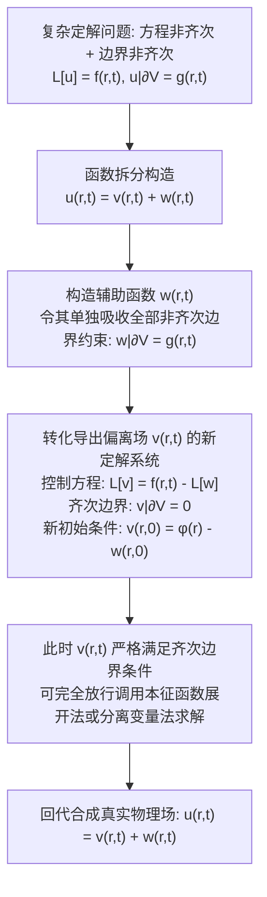

---
tags:
  - 物理/数学物理方法
  - 偏微分方程
  - 技术卡
  - 边界齐次化
  - 非齐次边界
  - 泊松方程
  - 叠加原理
aliases:
  - 非齐次边界条件齐次化与泊松方程处理
  - 非齐次边界条件齐次化
  - 辅助函数构造法
  - 矩形域泊松方程
  - 稳态场解法
  - Homogenization of Boundary Conditions and Poisson Equations
created: 2026-09-08
updated: 2026-09-08
---

> [!summary] 技术核心论断
> 无论是齐次分离变量法还是本征函数展开法，其赖以成立的先决数学前提是**空间边界条件必须严格为齐次**。在工程与物理实际中，若系统边界受外加非零激励约束（如两端维持固定非零温度、端点做迫动位移、边界受热流注入），直接展开将破坏谱基底在端点的完备性。解决该矛盾的通用准则是**函数拆分与边界齐次化技术 (Homogenization of Boundary Conditions)**：将未知解分解为满足非齐次边界的**辅助几何函数 $w(\boldsymbol{r}, t)$** 与满足严格齐次边界的**偏离场 $v(\boldsymbol{r}, t)$** 之和。将非齐次边界的几何刚性约束安全转移为内部等效动载荷或热源项，从而将复杂问题无缝接入标准本征展开流水线。对于多边非齐次的二维泊松方程，结合**线性叠加原理**将边界分步解耦，构成了经典数理方程模块化求解的终极范式。

## 一、推导机理与规范求解工作流

---

### 1.1 一维非齐次边界齐次化规范步骤

考虑非齐次边界定解问题：
$$\begin{cases} \frac{\partial u}{\partial t} = a^2 \frac{\partial^2 u}{\partial x^2} + f(x, t) & (0 < x < l, t > 0) \\ u(0, t) = \mu_1(t), \quad u(l, t) = \mu_2(t) & (t > 0) \\ u(x, 0) = \varphi(x) & (0 \le x \le l) \end{cases}$$

#### 第一步：辅助函数 $w(x, t)$ 的规范线性插值构造
我们需要选取一个最简单、最平滑的二元函数 $w(x, t)$，使得在两个边界端点处精准匹配非齐次给定值：
$$w(0, t) = \mu_1(t), \quad w(l, t) = \mu_2(t)$$
最自然、最通用的构造方法是关于空间坐标 $x$ 的**一次多项式线性插值**：
$$\boxed{ w(x, t) = \mu_1(t) + \frac{x}{l} \left[ \mu_2(t) - \mu_1(t) \right] }$$

> [!tip] 其它两类边界的构造法则：
> - **若两端为第二类非齐次边界**：$\left. u_x \right|_{x=0} = \nu_1(t), \left. u_x \right|_{x=l} = \nu_2(t)$
>   构造关于 $x$ 的二次抛物线：$w(x, t) = \nu_1(t) x + \frac{x^2}{2l} [\nu_2(t) - \nu_1(t)]$；
> - **若一端第一类一端第二类**：$u(0, t) = \mu_1(t), u_x(l, t) = \nu_2(t)$
>   构造线性函数：$w(x, t) = \mu_1(t) + \nu_2(t) x$。

#### 第二步：令未知解作拆分代换
令：
$$u(x, t) = v(x, t) + w(x, t)$$
将其代入原定解系统：
1. **边界条件转换（完全齐次化）**：
   $$v(0, t) = u(0, t) - w(0, t) = \mu_1(t) - \mu_1(t) \equiv 0$$
   $$v(l, t) = u(l, t) - w(l, t) = \mu_2(t) - \mu_2(t) \equiv 0$$
   边界条件已被成功洗刷为严格齐次！
2. **控制方程转换**：
   $$\frac{\partial (v + w)}{\partial t} = a^2 \frac{\partial^2 (v + w)}{\partial x^2} + f(x, t)$$
   $$\frac{\partial v}{\partial t} - a^2 \frac{\partial^2 v}{\partial x^2} = f(x, t) - \left( \frac{\partial w}{\partial t} - a^2 \frac{\partial^2 w}{\partial x^2} \right) \equiv \tilde{f}(x, t)$$
   若 $w(x, t)$ 为线性插值，其空间二次导数 $\frac{\partial^2 w}{\partial x^2} \equiv 0$，新等效源项简化为：
   $$\tilde{f}(x, t) = f(x, t) - \frac{\partial w}{\partial t} = f(x, t) - \left[ \mu_1'(t) + \frac{x}{l}(\mu_2'(t) - \mu_1'(t)) \right]$$
3. **初始条件转换**：
   $$v(x, 0) = u(x, 0) - w(x, 0) = \varphi(x) - w(x, 0) \equiv \tilde{\varphi}(x)$$

通过上述变换，问题完全转化为关于 $v(x, t)$ 的**齐次边界非齐次偏微分方程定解问题**，直接调用 Card 19 的本征函数展开法即可标准求解！

---

### 1.2 矩形域二维泊松方程 $\nabla^2 u = f(x, y)$ 的求解范式

在静电场与二维定常热传导中，矩形区域 $[0, a] \times [0, b]$ 内满足泊松方程：
$$\frac{\partial^2 u}{\partial x^2} + \frac{\partial^2 u}{\partial y^2} = f(x, y)$$

#### 1. 齐次边界下的双重正弦级数展开法 (Double Fourier Series Method)
若四周边缘均接地或保持零温：$\left. u \right|_{\text{四周}} = 0$。
选用完备正交的双重本征基底：
$$X_m(x) Y_n(y) = \sin\left( \frac{m\pi x}{a} \right) \sin\left( \frac{n\pi y}{b} \right) \quad (m, n = 1, 2, 3, \dots)$$
将场量与非齐次源项双重展开：
$$u(x, y) = \sum_{m=1}^\infty \sum_{n=1}^\infty C_{mn} \sin\left( \frac{m\pi x}{a} \right) \sin\left( \frac{n\pi y}{b} \right)$$
$$f(x, y) = \sum_{m=1}^\infty \sum_{n=1}^\infty f_{mn} \sin\left( \frac{m\pi x}{a} \right) \sin\left( \frac{n\pi y}{b} \right)$$
其中系数由二重正交积分确定：
$$f_{mn} = \frac{4}{ab} \int_0^a dx \int_0^b dy f(x, y) \sin\left( \frac{m\pi x}{a} \right) \sin\left( \frac{n\pi y}{b} \right)$$
代入泊松方程直接对角化求出代数解：
$$-\left[ \left(\frac{m\pi}{a}\right)^2 + \left(\frac{n\pi}{b}\right)^2 \right] C_{mn} = f_{mn} \implies \boxed{ C_{mn} = -\frac{f_{mn}}{\left(\frac{m\pi}{a}\right)^2 + \left(\frac{n\pi}{b}\right)^2} }$$

#### 2. 多边界非齐次时的叠加原理分解 (Superposition Principle)
若矩形四条边均有不同的非零边界函数：$u(x, 0) = g_1(x), u(x, b) = g_2(x), u(0, y) = h_1(y), u(a, y) = h_2(y)$。
**绝对不可在一个级数中强行匹配！**
必须利用线性叠加原理，将原问题分解为四个**只有单一单边非齐次、其余三边均为齐次**的子边值问题：
$$u(x, y) = u_1(x, y) + u_2(x, y) + u_3(x, y) + u_4(x, y)$$
对每一个子问题，沿齐次方向分离变量，沿非齐次方向配双曲正余弦函数求解，然后线性相加。

---

## 二、⚠️ 致命失分陷阱与临界边界

> [!warning] 陷阱 1：辅助函数含时变时遗漏惯性项或导热项
> 当边界随时间动态变化时（例如交流调制电位 $\mu_1(t) = V_0 \cos \omega t$）：
> - 辅助函数 $w(x, t)$ 显式含时间 $t$；
> - 将 $u = v + w$ 代入方程时，**千万不可忘记从原方程左边减去 $\frac{\partial w}{\partial t}$（热传导）或 $\frac{\partial^2 w}{\partial t^2}$（波动方程）**；
> - 考场极其容易只把边界置零，而把这部分由时变边界引发的“等效虚拟惯性力/虚拟内热源”彻底漏算，导致物理控制方程严重失真！

> [!caution] 陷阱 2：初始条件转换时漏减初始辅助值 $w(x, 0)$
> 变换后的未知场是 $v(x, t) = u(x, t) - w(x, t)$：
> - 初始时刻必有 $v(x, 0) = \varphi(x) - w(x, 0)$；
> - 初始速度（若是波动方程）必有 $v_t(x, 0) = \psi(x) - w_t(x, 0)$；
> - 考生极易直接把原题初始条件 $\varphi(x)$ 拿去算展开系数，导致新系统的初始状态被错误修改。

> [!danger] 陷阱 3：构造辅助函数未验证相容性导致角点不连续
> 在矩形或柱面区域，如果两个相邻边界在交接角点处给定的值不一致（例如在原点 $(0, 0)$ 处底边要求 $u(x, 0)=1$，而左边要求 $u(0, y)=0$）：
> - 这是**物理角点奇性（不相容边界）**；
> - 构造辅助函数 $w(x, y)$ 在角点处必然产生多值无定义，求导将产生伪无限大源。必须在物理建模阶段校验边界连续性相容条件。

---

## 三、经典范例手把手演算

### 题目（两端非零恒温维持下的金属杆热传导完全解——梁昆淼 §8.3 例 1 原型）：
长为 $l$ 的均匀细金属杆，侧面绝热，热扩散率为 $a^2$。
初始时刻杆具有恒定均匀初始温度 $u(x, 0) = T_0$。
自 $t = 0$ 起，左端 $x = 0$ 强行维持在恒定温度 $T_1$，右端 $x = l$ 维持在恒定温度 $T_2$（$T_1, T_2, T_0$ 为常数且互不相同）。
1. 构造稳态辅助解，执行边界齐次化；
2. 求解偏离场 $v(x, t)$ 的完全显式级数解；
3. 合成原物理场 $u(x, t)$，并严格讨论 $t \to \infty$ 时的渐近物理稳态。

#### 【演算步骤】

**第一步：写出完整定解数学模型**
$$\begin{cases} \frac{\partial u}{\partial t} = a^2 \frac{\partial^2 u}{\partial x^2} & (0 < x < l, t > 0) \\ u(0, t) = T_1, \quad u(l, t) = T_2 & (t > 0) \\ u(x, 0) = T_0 & (0 \le x \le l) \end{cases}$$
由于两端边界值 $T_1, T_2$ 非零，属于典型非齐次第一类边界。

**第二步：构造辅助函数 $w(x)$（稳态解法）**
由于边界值是与时间无关的常数，我们可以直接寻找原方程的**定常稳态解 (Stationary Solution)** 作为辅助函数 $w(x)$：
稳态时不随时间改变：$\frac{\partial w}{\partial t} = 0$，控制方程退化为常微分方程：
$$a^2 \frac{d^2 w}{dx^2} = 0 \implies w(x) = C_1 x + C_2$$
代入非齐次边界：
- $w(0) = C_2 = T_1$；
- $w(l) = C_1 l + T_1 = T_2 \implies C_1 = \frac{T_2 - T_1}{l}$。
故稳态温度分布辅助函数为：
$$\boxed{ w(x) = T_1 + \frac{T_2 - T_1}{l} x }$$
由于 $w(x)$ 是稳态解，它天然满足原齐次偏微分方程：$\frac{\partial w}{\partial t} - a^2 \frac{\partial^2 w}{\partial x^2} = 0 - 0 = 0$！因此**不会在控制方程中引入任何新的等效源项**！

**第三步：建立偏离场 $v(x, t)$ 的齐次定解问题**
设 $u(x, t) = v(x, t) + w(x)$。代入得：
- 控制方程：
  $$\frac{\partial v}{\partial t} = a^2 \frac{\partial^2 v}{\partial x^2} \quad (0 < x < l, t > 0)$$
- 边界条件（严格齐次）：
  $$v(0, t) = u(0, t) - w(0) = T_1 - T_1 = 0$$
  $$v(l, t) = u(l, t) - w(l) = T_2 - T_2 = 0$$
- 新初始条件：
  $$\tilde{\varphi}(x) = u(x, 0) - w(x) = T_0 - \left[ T_1 + \frac{T_2 - T_1}{l} x \right] = (T_0 - T_1) - \frac{T_2 - T_1}{l} x$$

**第四步：分离变量求解 $v(x, t)$**
这是一个标准齐次热传导问题（Card 18）：
空间本征系为 $X_n(x) = \sin\left(\frac{n\pi x}{l}\right)$，时间项为单调指数衰减 $e^{-\left(\frac{n\pi a}{l}\right)^2 t}$。
通解为：
$$v(x, t) = \sum_{n=1}^\infty C_n \sin\left( \frac{n\pi x}{l} \right) e^{-\left(\frac{n\pi a}{l}\right)^2 t}$$
利用正交性计算展开系数 $C_n$：
$$C_n = \frac{2}{l} \int_0^l \left[ (T_0 - T_1) - \frac{T_2 - T_1}{l} x \right] \sin\left( \frac{n\pi x}{l} \right) dx$$
拆为两部分分步积分：
1. 第一项：
   $$\frac{2(T_0 - T_1)}{l} \int_0^l \sin\left( \frac{n\pi x}{l} \right) dx = \frac{2(T_0 - T_1)}{l} \frac{l}{n\pi} [1 - (-1)^n] = \frac{2(T_0 - T_1)}{n\pi} [1 - (-1)^n]$$
2. 第二项：
   $$-\frac{2(T_2 - T_1)}{l^2} \int_0^l x \sin\left( \frac{n\pi x}{l} \right) dx = -\frac{2(T_2 - T_1)}{l^2} \left[ -x \frac{l}{n\pi} \cos\left( \frac{n\pi x}{l} \right) \right]_0^l = \frac{2(T_2 - T_1)}{n\pi} (-1)^n$$
合并通分系数：
$$C_n = \frac{2}{n\pi} \left\{ (T_0 - T_1)[1 - (-1)^n] + (T_2 - T_1)(-1)^n \right\} = \frac{2}{n\pi} \left[ (T_0 - T_1) - (T_0 - T_2)(-1)^n \right]$$

**第五步：原物理场完全解析解汇编与渐近稳态检验**
将 $v(x, t)$ 与稳态辅助解 $w(x)$ 重新拼合：
$$\boxed{ u(x, t) = \underbrace{T_1 + \frac{T_2 - T_1}{l} x}_{w(x)\text{ 渐近线性稳态解}} + \underbrace{\sum_{n=1}^\infty C_n \sin\left( \frac{n\pi x}{l} \right) e^{-\left(\frac{n\pi a}{l}\right)^2 t}}_{v(x, t)\text{ 瞬态偏离耗散解}} }$$

**渐近极限验算（$t \to \infty$）**：
由于对所有 $n \ge 1$，均有指数衰减因子 $e^{-\left(\frac{n\pi a}{l}\right)^2 t} \to 0$：
$$\lim_{t \to \infty} u(x, t) = w(x) = T_1 + \frac{T_2 - T_1}{l} x$$
**物理深刻启示**：初始不均匀温度的记忆随着内部热传导不可逆耗散被完全抹平，物理场最终平稳松弛收敛至由两端边界唯一锚定的**线性稳态温降平衡态**！数学与物理达到完全极致的融会贯通。

---

## 四、出处与纸质笔记坐标

* **教材出处**：梁昆淼《数学物理方法》（第四版）第八章 §8.3-§8.5 (P172-P180)
* **纸质活页槽位**：`[活页-LKM-20]`
* **知识全景索引**：[[00_梁昆淼数学物理方法_第二篇全景图]]
