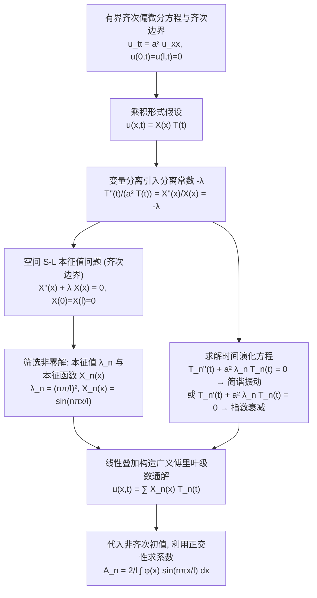

---
tags:
  - 物理/数学物理方法
  - 偏微分方程
  - 技术卡
  - 分离变量法
  - 傅里叶级数
  - 本征值问题
  - 驻波
aliases:
  - 齐次偏微分方程分离变量法规范求解范式
  - 分离变量法
  - 傅里叶分离变量法
  - 空间本征值问题
  - 驻波与谐波叠加
  - Separation of Variables for Homogeneous PDEs
created: 2026-09-08
updated: 2026-09-08
---

> [!summary] 技术核心论断
> 分离变量法（傅里叶级数法）是解析求解**有界几何空间内齐次线性偏微分方程定解问题**最核心、最普适的技术范式。其哲学内核在于**降维解耦与谱展开**：通过假设未知多维物理场为各单一坐标单变量函数的乘积形式，将高维偏微分方程严格分解为若干个互相独立的一维常微分方程。空间坐标在齐次边界条件制约下构成**施图姆－刘维尔 (Sturm-Liouville) 本征值问题**，离散化筛选出离散的固有本征值与完备正交的本征函数基底（对应物理上的**固有振型或驻波模态**）；时间方程则给出各模态随时间的简谐振荡或耗散衰减；最后由**线性叠加原理**与广义傅里叶积分正交投影，由初始条件唯一定出全部展开谱系数。

## 一、推导机理与规范求解工作流

---

### 1.1 标准解题四步流水线 (Four-Step Canonical Pipeline)

以有限长有界弦的自由横振动为例（两端固定）：
$$\begin{cases} \frac{\partial^2 u}{\partial t^2} = a^2 \frac{\partial^2 u}{\partial x^2} & (0 < x < l, t > 0) \\ u(0, t) = 0, \quad u(l, t) = 0 & (t \ge 0) \\ u(x, 0) = \varphi(x), \quad \left. \frac{\partial u}{\partial t} \right|_{t=0} = \psi(x) & (0 \le x \le l) \end{cases}$$

#### 第一步：变量分离与建立常微分方程
设未知解具有乘积形式：$u(x, t) = X(x) T(t)$。
代入波动方程：
$$X(x) T''(t) = a^2 X''(x) T(t)$$
两边同除以 $a^2 X(x) T(t)$：
$$\frac{T''(t)}{a^2 T(t)} = \frac{X''(x)}{X(x)}$$
左端仅依赖于时间 $t$，右端仅依赖于空间位置 $x$。两者要对任意自变量恒等，必须且只能等于同一个**与 $x, t$ 均无关的常数**，记作分离常数 $-\lambda$：
$$\begin{cases} X''(x) + \lambda X(x) = 0 \\ T''(t) + a^2 \lambda T(t) = 0 \end{cases}$$
齐次边界条件代入：
$$u(0, t) = X(0) T(t) = 0 \implies X(0) = 0 \quad (\text{因 } T(t) \not\equiv 0)$$
$$u(l, t) = X(l) T(t) = 0 \implies X(l) = 0$$

#### 第二步：求解空间本征值问题 (Eigenvalue Problem)
空间边值问题为：
$$X''(x) + \lambda X(x) = 0, \quad X(0) = 0, \quad X(l) = 0$$
分类讨论分离常数 $\lambda$ 的取值以排除非物理平凡零解：
1. **当 $\lambda < 0$ 时**：设 $\lambda = -\mu^2$ ($\mu > 0$)。
   方程通解为双曲函数：$X(x) = C_1 \cosh(\mu x) + C_2 \sinh(\mu x)$。
   - $X(0) = C_1 = 0$；
   - $X(l) = C_2 \sinh(\mu l) = 0 \implies$ 由于 $\mu l > 0 \implies \sinh(\mu l) \neq 0 \implies C_2 = 0$。
   仅有无意义的平凡零解 $X(x) \equiv 0$！
2. **当 $\lambda = 0$ 时**：
   方程通解为线性函数：$X(x) = C_1 x + C_2$。
   - $X(0) = C_2 = 0$；
   - $X(l) = C_1 l = 0 \implies C_1 = 0 \implies X(x) \equiv 0$。亦为平凡零解！
3. **当 $\lambda > 0$ 时**：设 $\lambda = k^2$ ($k > 0$)。
   通解为简谐三角函数：$X(x) = C_1 \cos(k x) + C_2 \sin(k x)$。
   - $X(0) = C_1 = 0$；
   - $X(l) = C_2 \sin(k l) = 0$。
   为获得非零物理振动解，必须要求 $C_2 \neq 0$，从而必有 $\sin(k l) = 0$！
   由此解得离散的谱线：
   $$k_n = \frac{n\pi}{l} \quad (n = 1, 2, 3, \dots)$$
   从而确定**本征值 (Eigenvalues)** 与**本征函数 (Eigenfunctions)**：
   $$\boxed{ \lambda_n = \left( \frac{n\pi}{l} \right)^2, \quad X_n(x) = \sin\left( \frac{n\pi x}{l} \right) \quad (n = 1, 2, 3, \dots) }$$

#### 第三步：求解时间演化方程
将本征值 $\lambda_n$ 代入时间方程，记固有圆频率 $\omega_n = a \sqrt{\lambda_n} = \frac{n\pi a}{l}$：
$$T_n''(t) + \omega_n^2 T_n(t) = 0$$
其一般通解为简谐振动：
$$T_n(t) = A_n \cos(\omega_n t) + B_n \sin(\omega_n t)$$
每个分离变量特解 $u_n(x, t) = X_n(x) T_n(t)$ 均表示一个独立的**驻波 (Standing Wave)**：
$$u_n(x, t) = \sin\left( \frac{n\pi x}{l} \right) \left[ A_n \cos(\omega_n t) + B_n \sin(\omega_n t) \right]$$

#### 第四步：线性叠加与正交展开求待定系数
根据线性方程的叠加原理，定解问题的完全通解是所有可能驻波模态的无穷线性叠加：
$$\boxed{ u(x, t) = \sum_{n=1}^\infty \sin\left( \frac{n\pi x}{l} \right) \left[ A_n \cos\left(\frac{n\pi a t}{l}\right) + B_n \sin\left(\frac{n\pi a t}{l}\right) \right] }$$

代入两个初始条件确定展开系数：
1. 代入初始位移 $u(x, 0) = \varphi(x)$：
   $$\sum_{n=1}^\infty A_n \sin\left( \frac{n\pi x}{l} \right) = \varphi(x)$$
   此即 $\varphi(x)$ 在 $[0, l]$ 上的傅里叶正弦级数展开！利用正交性 $\int_0^l \sin\frac{m\pi x}{l}\sin\frac{n\pi x}{l}dx = \frac{l}{2}\delta_{mn}$：
   $$\boxed{ A_n = \frac{2}{l} \int_0^l \varphi(x) \sin\left( \frac{n\pi x}{l} \right) dx }$$
2. 对时间求导后代入初始速度 $\left. \frac{\partial u}{\partial t} \right|_{t=0} = \psi(x)$：
   $$\sum_{n=1}^\infty B_n \omega_n \sin\left( \frac{n\pi x}{l} \right) = \psi(x)$$
   同理正交投影：
   $$\boxed{ B_n = \frac{2}{l \omega_n} \int_0^l \psi(x) \sin\left( \frac{n\pi x}{l} \right) dx = \frac{2}{n\pi a} \int_0^l \psi(x) \sin\left( \frac{n\pi x}{l} \right) dx }$$

---

### 1.2 三大典型边界条件下的空间本征系全貌

| 边界条件类型 | 两端数学约束形式 | 本征值 $\lambda_n$ | 本征函数 $X_n(x)$ | 最低阶基态模态 | 物理场景 |
| :--- | :--- | :--- | :--- | :--- | :--- |
| **双端第一类 (固定－固定)** | $X(0) = 0$ $X(l) = 0$ | $\left( \frac{n\pi}{l} \right)^2$ ($n=1, 2, \dots$) | $\sin\left( \frac{n\pi x}{l} \right)$ | $n=1$ 基频基波 | 琴弦两端刚性系紧、热传导两端冰水固定 |
| **双端第二类 (自由－自由 / 绝热)** | $X'(0) = 0$ $X'(l) = 0$ | $\left( \frac{n\pi}{l} \right)^2$ (**$n=0, 1, 2, \dots$**) | $\cos\left( \frac{n\pi x}{l} \right)$ | **$n=0$ 零模态** $\lambda_0 = 0, X_0 = 1$ | 自由滑块弦（可沿导轨刚体位移）、两端严格绝热杆的平衡温度 |
| **一端固定一端自由 (固定－自由)** | $X(0) = 0$ $X'(l) = 0$ | $\left[ \frac{(2n-1)\pi}{2l} \right]^2$ ($n=1, 2, \dots$) | $\sin\left[ \frac{(2n-1)\pi x}{2l} \right]$ | 四分之一波长奇数谐波 | 单端固定的单簧管管乐器、一端受热一端绝热细杆 |

---

## 二、⚠️ 致命失分陷阱与临界边界

> [!warning] 陷阱 1：双端第二类（绝热/自由）边界求和时漏掉零模态 $n=0$
> 当两端为绝热或自由端时，$\lambda = 0$ 满足本征方程：$X''(x) = 0 \implies X(x) = C_1 x + C_2$。
> - $X'(0) = C_1 = 0 \implies X(x) = C_2$（非零常数函数！）；
> - $X'(l) = 0$ 自然满足！故 $\lambda_0 = 0$ 是合法本征值，本征函数为 $X_0(x) = 1$；
> - 对于热传导方程，对应时间衰减项为 $e^{-a^2 \cdot 0 \cdot t} = 1$（永不衰减的平均温度分量 $\bar{u} = \frac{1}{l} \int_0^l \varphi(x) dx$）；
> - 考场极其容易从 $n=1$ 开始求和，导致热传导解随 $t \to \infty$ 全部衰减为 0，公然违背封闭绝热系统**总能量严格守恒**的铁律！

> [!caution] 陷阱 2：正交展开积分归一化常数模长的混淆
> 傅里叶三角函数的模方积分：
> - 正弦波与余弦波（$n \ge 1$）：$\int_0^l \sin^2\left(\frac{n\pi x}{l}\right) dx = \int_0^l \cos^2\left(\frac{n\pi x}{l}\right) dx = \frac{l}{2}$，正交系数前面乘 $\frac{2}{l}$；
> - 零模态常数项（$n = 0$）：$\int_0^l 1^2 dx = l$！其系数公式为 $A_0 = \frac{1}{l} \int_0^l \varphi(x) dx$；
> 若对零模态机械盲目套用 $\frac{2}{l}$，初始总质量/内能直接被虚假放大 2 倍！

> [!danger] 陷阱 3：初始速度系数 $B_n$ 遗漏除以固有频率 $\omega_n$
> 对驻波表达式求导时：$\left. \frac{d}{dt} \sin(\omega_n t) \right|_{t=0} = \omega_n$。
> - 傅里叶级数展开匹配的是 $\omega_n B_n = \frac{2}{l} \int \psi(x) \sin(\dots) dx$；
> - 许多考生直接把右端积分当作 $B_n$，导致量纲错乱，算出的位移多出时间维度的倒数！

---

## 三、经典范例手把手演算

### 题目（三角初形拨弦振动的完全显式解——梁昆淼 §8.1 例 1 原型）：
长为 $l$ 的均匀弹性弦，两端固定于 $x = 0$ 及 $x = l$。波速为 $a$。
初始时刻在弦的中点 $x = \frac{l}{2}$ 处被垂直提起高 $h$（$h \ll l$），然后自静止状态释放（$\psi(x) = 0$）。
即初始位移为：
$$\varphi(x) = \begin{cases} \frac{2h}{l} x & \left( 0 \le x \le \frac{l}{2} \right) \\ \frac{2h}{l} (l - x) & \left( \frac{l}{2} \le x \le l \right) \end{cases}$$
1. 完整求解弦振动的全时空解析表达式 $u(x, t)$；
2. 剖析级数中各次谐波的振幅特征，解释为什么所有偶数次泛音全部消失。

#### 【演算步骤】

**第一步：确立解的驻波级数形式**
由双端固定齐次边界，本征值为 $\lambda_n = (n\pi/l)^2$，本征函数为 $\sin(n\pi x/l)$。
因为初始速度 $\psi(x) = 0 \implies B_n = 0$。
解的级数展开式简化为：
$$u(x, t) = \sum_{n=1}^\infty A_n \sin\left( \frac{n\pi x}{l} \right) \cos\left( \frac{n\pi a t}{l} \right)$$

**第二步：手把手积分计算傅里叶系数 $A_n$**
根据正交投影公式：
$$A_n = \frac{2}{l} \int_0^l \varphi(x) \sin\left( \frac{n\pi x}{l} \right) dx = \frac{2}{l} \left[ \int_0^{l/2} \frac{2h}{l} x \sin\left( \frac{n\pi x}{l} \right) dx + \int_{l/2}^l \frac{2h}{l} (l - x) \sin\left( \frac{n\pi x}{l} \right) dx \right]$$
提取公因式 $\frac{4h}{l^2}$：
$$A_n = \frac{4h}{l^2} \left[ \underbrace{\int_0^{l/2} x \sin\left( \frac{n\pi x}{l} \right) dx}_{I_1} + \underbrace{\int_{l/2}^l (l - x) \sin\left( \frac{n\pi x}{l} \right) dx}_{I_2} \right]$$

1. **分部积分计算 $I_1$**：
   $$I_1 = \left[ -x \frac{l}{n\pi} \cos\left( \frac{n\pi x}{l} \right) \right]_0^{l/2} + \frac{l}{n\pi} \int_0^{l/2} \cos\left( \frac{n\pi x}{l} \right) dx$$
   $$= -\frac{l^2}{2n\pi} \cos\left( \frac{n\pi}{2} \right) + \left( \frac{l}{n\pi} \right)^2 \sin\left( \frac{n\pi}{2} \right)$$

2. **在 $I_2$ 中作变量代换**：令 $\xi = l - x$（$x$ 从 $l/2 \to l \implies \xi$ 从 $l/2 \to 0$，$dx = -d\xi$）：
   $$\sin\left( \frac{n\pi (l - \xi)}{l} \right) = \sin\left( n\pi - \frac{n\pi \xi}{l} \right) = (-1)^{n-1} \sin\left( \frac{n\pi \xi}{l} \right)$$
   代入得：
   $$I_2 = \int_{l/2}^0 \xi \left[ (-1)^{n-1} \sin\left( \frac{n\pi \xi}{l} \right) \right] (-d\xi) = (-1)^{n-1} \int_0^{l/2} \xi \sin\left( \frac{n\pi \xi}{l} \right) d\xi = (-1)^{n-1} I_1$$

3. **合并 $I_1 + I_2$**：
   $$I_1 + I_2 = [1 + (-1)^{n-1}] I_1$$
   - **当 $n$ 为偶数时（$n = 2m$）**：
     $$1 + (-1)^{2m-1} = 1 - 1 = 0 \implies \boxed{ A_{2m} = 0 }$$
     **所有偶数次泛音严格为零！**
   - **当 $n$ 为奇数时（$n = 2k + 1$）**：
     $$1 + (-1)^{2k} = 2$$
     此时 $\cos\left( \frac{(2k+1)\pi}{2} \right) = 0$，余弦项归零；
     而 $\sin\left( \frac{(2k+1)\pi}{2} \right) = (-1)^k$。
     代入 $I_1$：
     $$I_1 = \left( \frac{l}{(2k+1)\pi} \right)^2 (-1)^k$$
     因此总积分为：
     $$I_1 + I_2 = 2 \left( \frac{l}{(2k+1)\pi} \right)^2 (-1)^k$$

4. **代回计算 $A_{2k+1}$**：
   $$A_{2k+1} = \frac{4h}{l^2} \cdot \left[ 2 \left( \frac{l}{(2k+1)\pi} \right)^2 (-1)^k \right] = \boxed{ \frac{8h}{\pi^2} \frac{(-1)^k}{(2k+1)^2} }$$

**第三步：最终解析解汇编**
将奇数项系数代入级数通解，得：
$$\boxed{ u(x, t) = \frac{8h}{\pi^2} \sum_{k=0}^\infty \frac{(-1)^k}{(2k+1)^2} \sin\left( \frac{(2k+1)\pi x}{l} \right) \cos\left( \frac{(2k+1)\pi a t}{l} \right) }$$

**第四步：物理图像深刻剖析**
1. **高频谐波快速衰减性**：
   级数振幅按 $\frac{1}{(2k+1)^2}$ 快速衰减（基频 : 三倍频 : 五倍频 $= 1 : \frac{1}{9} : \frac{1}{25}$）。基准谐波占据了全波总能量的 $96\%+ $，因此三角拨弦听起来音色圆润饱满，接近纯正弦波。
2. **偶数次谐波消失的对称性机理**：
   偶数次本征函数 $\sin\left(\frac{2m\pi x}{l}\right)$ 在弦中点 $x = l/2$ 处必有节点（零点），是关于中点奇对称的振型；而初始三角脉冲关于中点是**严格偶对称**的！根据正交投影对称性，偶对称初值无法激发任何奇对称振型，偶泛音自然完全禁戒！

---

## 四、出处与纸质笔记坐标

* **教材出处**：梁昆淼《数学物理方法》（第四版）第八章 §8.1 (P143-P161)
* **纸质活页槽位**：`[活页-LKM-18]`
* **知识全景索引**：[[00_梁昆淼数学物理方法_第二篇全景图]]
