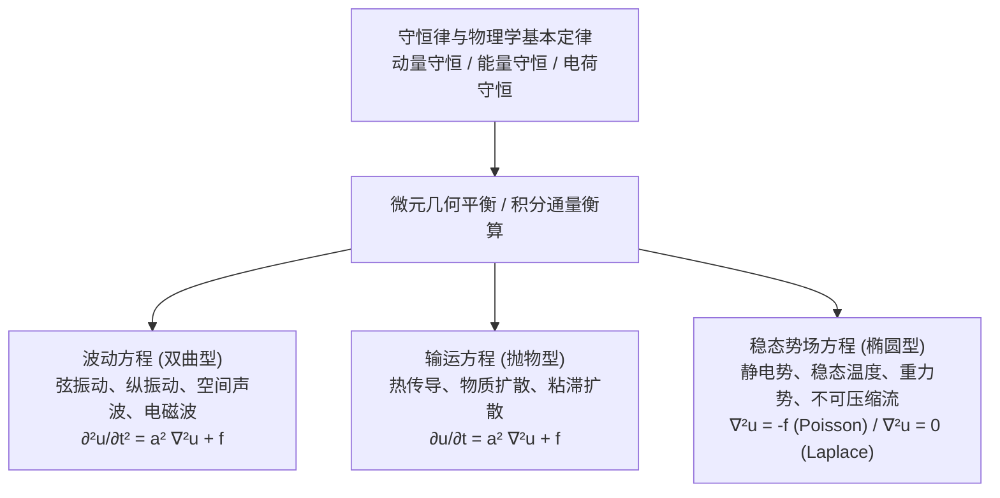

---
tags:
  - 物理/数学物理方法
  - 偏微分方程
  - 概念卡
  - 物理建模
  - 波动方程
  - 热传导方程
  - 泊松方程
aliases:
  - 三类典型数学物理方程导出与物理建模
  - 数学物理方程导出
  - 经典数理方程建模
  - 波动方程与热传导方程
  - 泊松方程与拉普拉斯方程
  - Derivation and Modeling of Classical PDEs
created: 2026-09-08
updated: 2026-09-08
---

> [!summary] 概念核心论断
> 经典数学物理方程是人类运用微积分语言对客观物理世界**守恒律（质量守恒、动量守恒、能量守恒）与本构关系（胡克定律、牛顿第二定律、傅里叶导热定律、高斯电磁定律）**的高度抽象与数学浓缩。宏观连续介质中的物理场演化，在空间局域极限下均可表述为三类最具代表性的二阶偏微分方程：**双曲型波动方程**（描述有界/无界扰动以有限速度传播的动态波动行为）、**抛物型扩散与热传导方程**（描述不可逆耗散与平滑输运的时间单向演化过程）、以及**椭圆型泊松/拉普拉斯方程**（描述时间无关的静态守恒场与势场平衡构型）。深入理解“**微元分析法 (Micro-element Method)**”与“**积分通量发散定理 (Gauss Divergence Principle)**”的双向映射，是跨越物理实在与偏微分方程求解鸿沟的认知基石。

## 一、推导机理与核心物理建模

---

### 1.1 波动方程的物理导出（以弦的微小横振动为例）

#### 1. 物理模型与基本假设：
考虑一根长为 $l$、线密度为 $\rho$ 的完全柔软且均匀的弦。
- **完全柔软**：弦在形变时不抵抗弯曲，任意截面处的内应力方向必严格沿弦的切线方向，此力即为**张力 (Tension)** $T$；
- **小振幅近似**：弦仅在单一垂直平面内作横向微小振动，横向位移记为 $u(x, t)$。弦的倾斜角极小：
  $$\tan \alpha = \frac{\partial u}{\partial x} \ll 1 \implies \sin \alpha \approx \tan \alpha = \frac{\partial u}{\partial x}, \quad \cos \alpha \approx 1$$
- **张力近似常数**：由于振幅极微，弦在振动过程中的伸长极小，由胡克定律，截面张力模值近似为常数：$T(x, t) \approx T = \text{const}$。

#### 2. 微元动量定理（牛顿第二定律）：
在弦上截取 $[x, x + dx]$ 的微小质量段 $dm = \rho dx$：
1. **水平方向受力平衡**：
   $$T(x+dx) \cos \alpha(x+dx) - T(x) \cos \alpha(x) \approx T - T = 0$$
   微元无水平宏观运动。
2. **垂直方向合力与牛顿第二定律**：
   受两端张力的垂直分量及外力密度 $F(x, t)$（单位质量受到的外力）：
   $$dF_y = T \sin \alpha(x+dx) - T \sin \alpha(x) + \rho dx \cdot F(x, t)$$
   利用小角度近似 $\sin \alpha \approx \frac{\partial u}{\partial x}$，结合中值定理：
   $$T \left[ \left. \frac{\partial u}{\partial x} \right|_{x+dx} - \left. \frac{\partial u}{\partial x} \right|_x \right] + \rho F(x, t) dx = T \frac{\partial^2 u}{\partial x^2} dx + \rho F(x, t) dx$$
   由牛顿第二定律 $dF_y = dm \cdot \frac{\partial^2 u}{\partial t^2} = (\rho dx) \frac{\partial^2 u}{\partial t^2}$，两边同除以 $\rho dx$：
   $$\frac{\partial^2 u}{\partial t^2} = \frac{T}{\rho} \frac{\partial^2 u}{\partial x^2} + F(x, t)$$
   定义波速参数 $\boxed{ a = \sqrt{\frac{T}{\rho}} }$（量纲：$[a] = \sqrt{\frac{\text{N}}{\text{kg/m}}} = \text{m/s}$），即得**一维非齐次波动方程**：
   $$\boxed{ \frac{\partial^2 u}{\partial t^2} = a^2 \frac{\partial^2 u}{\partial x^2} + f(x, t) } \quad (f(x, t) = F(x, t))$$

#### 3. 三维高维推广（声波与麦克斯韦电磁波）：
在各向同性介质中，声压扰动 $p$ 或电磁矢量势 $A$ 满足三维波动方程：
$$\boxed{ \frac{\partial^2 u}{\partial t^2} = a^2 \nabla^2 u + f(\boldsymbol{r}, t) }$$
其中 $\nabla^2$ 为拉普拉斯算子，电磁波在真空中的相速度为 $a = c = \frac{1}{\sqrt{\varepsilon_0 \mu_0}}$。

---

### 1.2 热传导与扩散方程的物理导出

#### 1. 物理定律基础：
- **傅里叶导热定律 (Fourier's Law)**：单位时间内通过垂直于截面的热流密度矢量 $\boldsymbol{q}$ 与温度梯度成正比，且方向指向温度下降方向：
  $$\boldsymbol{q} = -\kappa \nabla u$$
  （$\kappa > 0$ 为热导率，负号反映热力学第二定律自发传热的不可逆性）。
- **能量守恒与热容量**：单位体积介质在温度升高 $\Delta u$ 时吸收的热量为 $\Delta Q = \rho c \Delta u$，其中 $\rho$ 为介质质量密度，$c$ 为比热容。

#### 2. 积分衡算与高斯散度定理转化：
在介质内部任取一封闭任意区域 $V$，其边界闭合曲面为 $S$（外法向单位矢量为 $\boldsymbol{n}$）。
1. 在时间区间 $[t_1, t_2]$ 内，经由外边界曲面流出该区域的总热量为：
   $$Q_{\text{out}} = \int_{t_1}^{t_2} dt \iint_S \boldsymbol{q} \cdot \boldsymbol{n} dS = \int_{t_1}^{t_2} dt \iiint_V (\nabla \cdot \boldsymbol{q}) dV = -\int_{t_1}^{t_2} dt \iiint_V \nabla \cdot (\kappa \nabla u) dV$$
2. 内部热源生成的热量（设单位时间单位体积发热率为 $q_v$）：
   $$Q_{\text{gen}} = \int_{t_1}^{t_2} dt \iiint_V q_v dV$$
3. 区域内部系统内能的增量为：
   $$\Delta E = \iiint_V \rho c [u(\boldsymbol{r}, t_2) - u(\boldsymbol{r}, t_1)] dV = \int_{t_1}^{t_2} dt \iiint_V \rho c \frac{\partial u}{\partial t} dV$$
由能量守恒定律 $\Delta E = -Q_{\text{out}} + Q_{\text{gen}}$：
$$\int_{t_1}^{t_2} dt \iiint_V \left[ \rho c \frac{\partial u}{\partial t} - \nabla \cdot (\kappa \nabla u) - q_v \right] dV = 0$$
由于区域 $V$ 与时段 $[t_1, t_2]$ 的任意性，被积函数处处为零。
当介质均匀各向同性（$\kappa, \rho, c$ 为常数）时，定义**导热系数（热扩散率）** $\boxed{ a^2 = \frac{\kappa}{\rho c} }$，源项 $f = \frac{q_v}{\rho c}$，导出**三维热传导方程**：
$$\boxed{ \frac{\partial u}{\partial t} = a^2 \nabla^2 u + f(\boldsymbol{r}, t) }$$

---

### 1.3 稳态场方程（泊松方程与拉普拉斯方程）

当物理系统经过长时间演化进入**定常状态（稳态）**时，物理量不再随时间变化，即 $\frac{\partial u}{\partial t} = 0$ 且 $\frac{\partial^2 u}{\partial t^2} = 0$。

1. **热传导稳态**：热传导方程退化为空间势场方程：
   $$\nabla^2 u = -\frac{q_v}{\kappa}$$
2. **静电学高斯定理与静电势**：
   电场强度 $\boldsymbol{E} = -\nabla \varphi$，根据麦克斯韦第一方程（高斯定律）$\nabla \cdot \boldsymbol{E} = \frac{\rho_e}{\varepsilon_0}$：
   $$\nabla \cdot (-\nabla \varphi) = \frac{\rho_e}{\varepsilon_0} \implies \boxed{ \nabla^2 \varphi = -\frac{\rho_e}{\varepsilon_0} } \quad \text{(Poisson 方程)}$$
   在无电荷空间（$\rho_e = 0$），退化为**拉普拉斯方程 (Laplace's Equation)**：
   $$\boxed{ \nabla^2 \varphi = 0 }$$
3. **万有引力势与流体速度势**：
   质量密度为 $\rho_m$ 的引力势满足 $\nabla^2 \Phi = 4\pi G \rho_m$；不可压缩无旋流体的速度场 $\boldsymbol{v} = \nabla \Phi$ 满足无散条件 $\nabla \cdot \boldsymbol{v} = 0 \implies \nabla^2 \Phi = 0$。

---

### 1.4 常见正交坐标系下拉普拉斯算子 $\nabla^2$ 的结构形态

| 坐标系名称 | 坐标分量 | 拉普拉斯算子 $\nabla^2 u$ 严格展开式 |
| :--- | :--- | :--- |
| **直角坐标系 (Cartesian)** | $(x, y, z)$ | $\frac{\partial^2 u}{\partial x^2} + \frac{\partial^2 u}{\partial y^2} + \frac{\partial^2 u}{\partial z^2}$ |
| **圆柱坐标系 (Cylindrical)** | $(\rho, \varphi, z)$ | $\frac{1}{\rho}\frac{\partial}{\partial \rho}\left( \rho \frac{\partial u}{\partial \rho} \right) + \frac{1}{\rho^2}\frac{\partial^2 u}{\partial \varphi^2} + \frac{\partial^2 u}{\partial z^2}$ |
| **球坐标系 (Spherical)** | $(r, \theta, \varphi)$ | $\frac{1}{r^2}\frac{\partial}{\partial r}\left( r^2 \frac{\partial u}{\partial r} \right) + \frac{1}{r^2 \sin\theta}\frac{\partial}{\partial \theta}\left( \sin\theta \frac{\partial u}{\partial \theta} \right) + \frac{1}{r^2 \sin^2\theta}\frac{\partial^2 u}{\partial \varphi^2}$ |

---

## 二、⚠️ 致命失分陷阱与临界边界

> [!warning] 陷阱 1：傅里叶导热定律中的负号丢失
> 许多推导中常凭直觉写出 $\boldsymbol{q} = \kappa \nabla u$，丢失了极为关键的物理负号：
> - 梯度 $\nabla u$ 是温度升高最快的方向；
> - 热量自发由高温流向低温，故热流矢量必然与梯度方向相反，即 $\boldsymbol{q} = -\kappa \nabla u$！
> 若漏掉负号，结合高斯散度定理时将导致方程出现 $\frac{\partial u}{\partial t} = -a^2 \nabla^2 u$。这是著名的“逆时针热传导（逆扩散）方程”，数学上属于极端严重的**阿达马病态问题 (Ill-posed)**，任何微小的扰动都将在有限时间内发生指数爆炸！

> [!caution] 陷阱 2：混淆微小横振动的几何切线与法线受力平衡
> 在推导弦振动方程时，必须严格说明水平分量平衡 $T \cos\alpha(x+dx) \approx T \cos\alpha(x) \approx T$ 的成立条件是小斜率假设 $\left(\frac{\partial u}{\partial x}\right)^2 \ll 1$：
> 因为 $\cos\alpha = \frac{1}{\sqrt{1 + (\partial u/\partial x)^2}} \approx 1 - \frac{1}{2}\left(\frac{\partial u}{\partial x}\right)^2$。如果横向振幅很大（大变形几何非线性），张力不再是常数，方程将演变为高度复杂的非线性偏微分方程。

> [!danger] 陷阱 3：圆柱坐标与球坐标下拉普拉斯算子径向导数的展开失误
> 考场在分离变量前写拉氏算子时，极易将柱坐标径向项错误写为 $\frac{\partial^2 u}{\partial \rho^2}$，漏掉一阶项 $\frac{1}{\rho}\frac{\partial u}{\partial \rho}$；或者将球坐标径向项写错：
> - 柱坐标径向导数：$\frac{1}{\rho} \frac{\partial}{\partial \rho}\left( \rho \frac{\partial u}{\partial \rho} \right) = \frac{\partial^2 u}{\partial \rho^2} + \frac{1}{\rho}\frac{\partial u}{\partial \rho}$；
> - 球坐标径向导数：$\frac{1}{r^2} \frac{\partial}{\partial r}\left( r^2 \frac{\partial u}{\partial r} \right) = \frac{\partial^2 u}{\partial r^2} + \frac{2}{r}\frac{\partial u}{\partial r}$。
> 若径向项写错，后续贝塞尔方程或勒让德方程的阶数将完全错乱！

---

## 三、经典范例手把手演算

### 题目（弹性杆的一维受迫纵振动方程完整导出）：
考虑一根横截面积为 $S$、静止时密度为 $\rho$、杨氏模量为 $E$ 的均匀细直弹性金属杆。设杆沿 $x$ 轴水平放置。在外界沿轴向的分布外力密度 $F(x, t)$（单位质量受力）作用下，杆截面发生沿 $x$ 轴方向的伸缩位移 $u(x, t)$。
1. 基于微元分析法与胡克定律，推导杆内部轴向应力与应变的关系；
2. 建立该微元的动力学平衡方程，导出细杆纵振动的波动方程；
3. 核验波速 $a = \sqrt{E/\rho}$ 的物理量纲，并与弦横振动波速对比分析。

#### 【演算步骤】

**第一步：几何应变分析**
考察静止时位于 $x$ 处的一小段微元 $[x, x + dx]$，其原始静止长度为 $dx$。
在动态纵向变形发生时：
- $x$ 处的截面发生位移 $u(x, t)$，移动至新坐标 $x + u(x, t)$；
- $x + dx$ 处的截面发生位移 $u(x + dx, t)$，移动至新坐标 $x + dx + u(x + dx, t)$。
因此，微元形变后的新长度为：
$$dx' = [x + dx + u(x + dx, t)] - [x + u(x, t)] = dx + \left[ u(x + dx, t) - u(x, t) \right] = dx + \frac{\partial u}{\partial x} dx$$
微元的相对伸长量（线应变 $\varepsilon$）为：
$$\varepsilon = \frac{dx' - dx}{dx} = \frac{\partial u}{\partial x}$$

**第二步：物理本构关系（胡克定律）**
根据一维固体胡克定律，截面正应力 $\sigma$ 与应变 $\varepsilon$ 成正比，比例系数即杨氏模量 $E$：
$$\sigma(x, t) = E \varepsilon(x, t) = E \frac{\partial u}{\partial x}$$
截面上承受的轴向总内力（拉力）为：
$$N(x, t) = \sigma(x, t) \cdot S = E S \frac{\partial u}{\partial x}$$

**第三步：微元牛顿第二定律列式**
该微元截段质量为 $dm = \rho S dx$。
微元在轴向受左右两端内应力及轴向分布外力：
- 左侧截面受力：$-N(x, t) = -E S \left. \frac{\partial u}{\partial x} \right|_x$；
- 右侧截面受力：$+N(x + dx, t) = E S \left. \frac{\partial u}{\partial x} \right|_{x + dx}$；
- 外力合力：$dF_{\text{ext}} = dm \cdot F(x, t) = (\rho S dx) F(x, t)$。
根据牛顿第二运动定律 $\Sigma F_x = dm \cdot a_x = (\rho S dx) \frac{\partial^2 u}{\partial t^2}$：
$$E S \left[ \left. \frac{\partial u}{\partial x} \right|_{x + dx} - \left. \frac{\partial u}{\partial x} \right|_x \right] + \rho S F(x, t) dx = \rho S dx \frac{\partial^2 u}{\partial t^2}$$
应用微分中值定理：
$$E S \frac{\partial^2 u}{\partial x^2} dx + \rho S F(x, t) dx = \rho S \frac{\partial^2 u}{\partial t^2} dx$$
两边同除以 $\rho S dx$：
$$\frac{\partial^2 u}{\partial t^2} = \frac{E}{\rho} \frac{\partial^2 u}{\partial x^2} + F(x, t)$$
令纵波波速 $\boxed{ a = \sqrt{\frac{E}{\rho}} }$，即导出细杆纵振动波动方程：
$$\boxed{ \frac{\partial^2 u}{\partial t^2} = a^2 \frac{\partial^2 u}{\partial x^2} + f(x, t) }$$

**第四步：量纲核验与物理对偶**
- 杨氏模量 $E$ 的量纲为压强：$[E] = \text{Pa} = \text{N}/\text{m}^2 = \text{kg}/(\text{m} \cdot \text{s}^2)$；
- 体密度 $\rho$ 的量纲：$[\rho] = \text{kg}/\text{m}^3$；
- 则纵波速度量纲为：
  $$[a] = \sqrt{\frac{[E]}{[\rho]}} = \sqrt{\frac{\text{kg}/(\text{m} \cdot \text{s}^2)}{\text{kg}/\text{m}^3}} = \sqrt{\frac{\text{m}^2}{\text{s}^2}} = \text{m}/\text{s}$$
  量纲严格自洽！
- **物理机制对比**：
  - 弦横波：恢复力源于预置的宏观几何张力 $T$，波速由几何力学参数决定 $a = \sqrt{T/\rho_{\text{line}}}$；
  - 杆纵波：恢复力源于微观晶格原子间结合键的微观杨氏弹性模量 $E$，波速是固体的内禀本构属性 $a = \sqrt{E/\rho_{\text{bulk}}}$。两者在宏观数学结构上呈现完全相同的二阶双曲型波动方程！

---

## 四、出处与纸质笔记坐标

* **教材出处**：梁昆淼《数学物理方法》（第四版）第七章 §7.1 (P108-P121)
* **纸质活页槽位**：`[活页-LKM-14]`
* **知识全景索引**：[[00_梁昆淼数学物理方法_第二篇全景图]]
