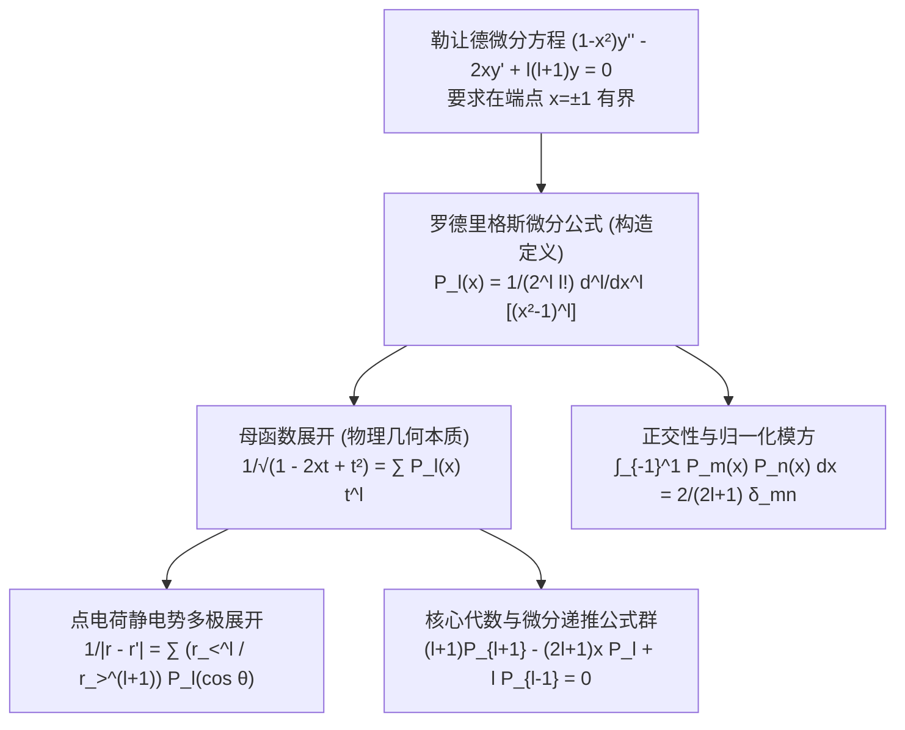

---
tags:
  - 物理/数学物理方法
  - 特殊函数
  - 概念卡
  - 勒让德多项式
  - 母函数
  - 罗德里格斯公式
  - 多极展开
aliases:
  - 勒让德多项式母函数与罗德里格斯公式
  - 勒让德多项式
  - 罗德里格斯微分表示
  - 勒让德母函数
  - 点电荷多极势展开
  - Legendre Polynomials Rodrigues Formula and Generating Function
created: 2026-09-08
updated: 2026-09-08
---

> [!summary] 概念核心论断
> 勒让德多项式 $P_l(x)$ 是三维球对称与轴对称物理系统（电磁学、引力场、量子力学波动力学）中最基础的正交多项式基底。它是勒让德微分方程在区间 $[-1, 1]$ 上要求解满足物理有界性时所唯一筛选出的**有限次解析多项式**。**罗德里格斯 (Rodrigues) 微分公式**赋予了其简洁明确的微分构造算法，而**母函数（生成函数，Generating Function）**则揭示了其在物理学中最为根本的几何本质——**两点间库仑相互作用势的多极展开核**。其具备极其优美的三项代数递推结构与标准正交归一模长，是连接微观微分算子与宏观球对称场分布的枢纽。

## 一、推导机理与核心数学定义

---

### 1.1 罗德里格斯 (Rodrigues) 微分表示公式

为了求解满足有界条件的多项式解，考察辅助多项式 $u(x) = (x^2 - 1)^l$。
对其求一阶导数：
$$u' = 2l x (x^2 - 1)^{l-1} \implies (x^2 - 1) u' - 2l x u = 0$$
对该式两边运用**莱布尼茨求导法则 (Leibniz Formula)** 求 $l + 1$ 次导数：
$$\frac{d^{l+1}}{dx^{l+1}} \left[ (x^2 - 1) u' \right] - 2l \frac{d^{l+1}}{dx^{l+1}} [x u] = 0$$
展开之：
$$\left[ (x^2 - 1) u^{(l+2)} + (l+1) 2x u^{(l+1)} + \frac{(l+1)l}{2} \cdot 2 \cdot u^{(l)} \right] - 2l \left[ x u^{(l+1)} + (l+1) \cdot 1 \cdot u^{(l)} \right] = 0$$
合并同类项：
$$(x^2 - 1) \frac{d^2}{dx^2} [u^{(l)}] + 2x \frac{d}{dx} [u^{(l)}] - l(l+1) [u^{(l)}] = 0$$
两边同乘 $-1$：
$$(1 - x^2) \frac{d^2}{dx^2} [u^{(l)}] - 2x \frac{d}{dx} [u^{(l)}] + l(l+1) [u^{(l)}] = 0$$
这表明，辅助函数的 $l$ 阶导数 $u^{(l)} = \frac{d^l}{dx^l}(x^2 - 1)^l$ **严格满足 $l$ 阶勒让德方程**！

#### 归一化系数确定：
物理学统一约定取 $x = 1$ 时 $P_l(1) = 1$。
在 $x = 1$ 处展开：$(x^2 - 1)^l = (x - 1)^l (x + 1)^l$。
根据莱布尼茨法则求 $l$ 阶导数在 $x = 1$ 处的值，只有将 $l$ 次全求在 $(x - 1)^l$ 上才非零：
$$\left. \frac{d^l}{dx^l} (x^2 - 1)^l \right|_{x=1} = l! \cdot (1 + 1)^l = 2^l l!$$
为了使 $P_l(1) = 1$，必须除以常数 $2^l l!$，从而导出神圣的**罗德里格斯公式**：
$$\boxed{ P_l(x) = \frac{1}{2^l l!} \frac{d^l}{dx^l} \left[ (x^2 - 1)^l \right] \quad (l = 0, 1, 2, \dots) }$$

---

### 1.2 前几阶勒让德多项式显式结构

由罗德里格斯公式可手把手逐阶微商求得：
- $l = 0$：$P_0(x) = 1$
- $l = 1$：$P_1(x) = \frac{1}{2} \frac{d}{dx}(x^2 - 1) = x$
- $l = 2$：$P_2(x) = \frac{1}{8} \frac{d^2}{dx^2}(x^4 - 2x^2 + 1) = \frac{1}{2}(3x^2 - 1)$
- $l = 3$：$P_3(x) = \frac{1}{48} \frac{d^3}{dx^3}(x^6 - 3x^4 + 3x^2 - 1) = \frac{1}{2}(5x^3 - 3x)$
- $l = 4$：$P_4(x) = \frac{1}{8}(35x^4 - 30x^2 + 3)$

#### 核心对称性与端点值：
1. **奇偶性**：$P_l(-x) = (-1)^l P_l(x)$（偶阶多项式只含偶次幂，奇阶多项式只含奇次幂）；
2. **端点值**：$P_l(1) = 1, \quad P_l(-1) = (-1)^l$；
3. **零点原点值**：
   - 当 $l$ 为奇数时：$P_l(0) = 0$；
   - 当 $l$ 为偶数时：$P_{2k}(0) = (-1)^k \frac{(2k - 1)!!}{(2k)!!}$。

---

### 1.3 母函数（生成函数）定义与多极展开物理图像

定义二元生成函数：
$$\boxed{ G(x, t) \equiv \frac{1}{\sqrt{1 - 2xt + t^2}} = \sum_{l=0}^\infty P_l(x) t^l \quad (|t| < 1) }$$

#### 物理图景：真空点电荷静电势的多极展开
考察位置在 $\boldsymbol{r}' = (r', \theta', \varphi')$ 处的点电荷 $q$ 在场点 $\boldsymbol{r} = (r, \theta, \varphi)$ 产生的库仑电位：
$$\Phi(\boldsymbol{r}) = \frac{q}{4\pi\varepsilon_0} \frac{1}{|\boldsymbol{r} - \boldsymbol{r}'|} = \frac{q}{4\pi\varepsilon_0} \frac{1}{\sqrt{r^2 + r'^2 - 2 r r' \cos\gamma}}$$
其中 $\gamma$ 为两矢量之间的夹角，$\cos\gamma = \hat{\boldsymbol{r}} \cdot \hat{\boldsymbol{r}}'$。
1. **若场点在电荷外侧（$r > r'$）**：提取公因式 $\frac{1}{r}$：
   $$\frac{1}{|\boldsymbol{r} - \boldsymbol{r}'|} = \frac{1}{r} \frac{1}{\sqrt{1 - 2 \cos\gamma \left(\frac{r'}{r}\right) + \left(\frac{r'}{r}\right)^2}}$$
   令 $x = \cos\gamma, t = \frac{r'}{r} < 1$，直接代入母函数定义式：
   $$\frac{1}{|\boldsymbol{r} - \boldsymbol{r}'|} = \sum_{l=0}^\infty \frac{r'^l}{r^{l+1}} P_l(\cos\gamma)$$
2. **若场点在电荷内侧（$r < r'$）**：同理提取 $\frac{1}{r'}$，令 $t = \frac{r}{r'} < 1$：
   $$\frac{1}{|\boldsymbol{r} - \boldsymbol{r}'|} = \sum_{l=0}^\infty \frac{r^l}{r'^{l+1}} P_l(\cos\gamma)$$

统一记为理论物理中极其著名的**拉普拉斯多极展开公式**：
$$\boxed{ \frac{1}{|\boldsymbol{r} - \boldsymbol{r}'|} = \sum_{l=0}^\infty \frac{r_<^l}{r_>^{l+1}} P_l(\cos\gamma) }$$
其中 $r_< = \min(r, r'), r_> = \max(r, r')$。
- $l = 0$：单极子势（Monopole, $\sim 1/r$）；
- $l = 1$：偶极子势（Dipole, $\sim 1/r^2$）；
- $l = 2$：四极子势（Quadrupole, $\sim 1/r^3$）；
- $l$ 阶项对应 $2^l$ 极子场！

---

### 1.4 核心递推关系群（由母函数求导严格导出）

对母函数两边分别求偏导数：
1. **对 $t$ 求偏导**：
   $$\frac{\partial G}{\partial t} = -\frac{1}{2}(1 - 2xt + t^2)^{-3/2}(-2x + 2t) = \frac{x - t}{(1 - 2xt + t^2)^{3/2}} = \frac{x - t}{1 - 2xt + t^2} G$$
   即 $(1 - 2xt + t^2) \frac{\partial G}{\partial t} = (x - t) G$。
   代入级数形式：
   $$(1 - 2xt + t^2) \sum_{l=1}^\infty l P_l(x) t^{l-1} = (x - t) \sum_{l=0}^\infty P_l(x) t^l$$
   比较 $t^l$ 的系数，立得**三项纯代数递推公式**：
   $$\boxed{ (l + 1) P_{l+1}(x) - (2l + 1) x P_l(x) + l P_{l-1}(x) = 0 }$$
2. **对 $x$ 求偏导并联立导出的微分递推公式群**：
   - $P_{l+1}'(x) - P_{l-1}'(x) = (2l + 1) P_l(x)$
   - $x P_l'(x) - P_{l-1}'(x) = l P_l(x)$
   - $P_{l+1}'(x) - x P_l'(x) = (l + 1) P_l(x)$
   - $(1 - x^2) P_l'(x) = l P_{l-1}(x) - l x P_l(x)$

---

## 二、⚠️ 致命失分陷阱与临界边界

> [!warning] 陷阱 1：多极展开未按距离大小分段提取导致发散
> 考场最高频失误出现在点电荷在球壳或球界面的电位计算：
> - 母函数收敛绝对要求 $|t| < 1$！
> - 如果在球内（$r < r'$）仍然想当然地写出 $\sum \frac{r'^l}{r^{l+1}} P_l$，由于此时 $r'/r > 1$，级数项随 $l \to \infty$ 发生剧烈几何爆炸发散！
> - 必须牢记口诀：“**小径在分子 $r_<$，大径在分母 $r_>$**”！

> [!caution] 陷阱 2：正交性积分必须严格在区间 $[-1, 1]$ 内
> 勒让德多项式的正交性是全局定义在整圆球角区间 $\theta \in [0, \pi] \iff x = \cos\theta \in [-1, 1]$：
> - $\int_{-1}^1 P_m(x) P_n(x) dx = \frac{2}{2l+1} \delta_{mn}$；
> - 若是在半球空间（$x \in [0, 1]$，即北半球），$P_m(x)$ 与 $P_n(x)$ **绝对不正交**！
> - 考场若遇到半球面问题，切不可直接套用 Kronecker delta $\delta_{mn}$ 抹掉交叉项积分。

> [!danger] 陷阱 3：递推公式用于降阶求导时代数负号记错
> 在计算诸如 $\int x P_l(x) dx$ 或 $\int (1-x^2) P_l'(x) dx$ 时，运用递推公式常将 $(2l+1) x P_l = (l+1)P_{l+1} + l P_{l-1}$ 中的加减号算反，导致正交投影系数完全错位。

---

## 三、经典范例手把手演算

### 题目（罗德里格斯公式严格证明正交性与归一化模方）：
1. 利用罗德里格斯公式与连续分部积分法，严格证明当 $m \neq n$ 时，
   $$\int_{-1}^1 P_m(x) P_n(x) dx = 0$$
2. 手把手计算归一化模方 $\|P_l\|^2 = \int_{-1}^1 [P_l(x)]^2 dx = \frac{2}{2l + 1}$。

#### 【演算步骤】

**第一步：证明当 $m < n$ 时的正交性**
根据罗德里格斯公式：
$$P_n(x) = \frac{1}{2^n n!} \frac{d^n}{dx^n} (x^2 - 1)^n$$
代入正交积分：
$$I_{mn} = \int_{-1}^1 P_m(x) P_n(x) dx = \frac{1}{2^n n!} \int_{-1}^1 P_m(x) \frac{d^n}{dx^n} (x^2 - 1)^n dx$$
执行连续分部积分：
由于辅助函数 $(x^2 - 1)^n = (x-1)^n(x+1)^n$，其低阶导数 $\frac{d^k}{dx^k}(x^2 - 1)^n$ 在 $k < n$ 时在端点 $x = \pm 1$ 处均恒包含因式 $(x^2 - 1)^{n-k}$，因而**在两端点恒等于 0**（无边界输出项！）。
连续分部积分 $n$ 次，将所有导数转移到 $P_m(x)$ 身上：
$$I_{mn} = \frac{(-1)^n}{2^n n!} \int_{-1}^1 \left[ \frac{d^n}{dx^n} P_m(x) \right] (x^2 - 1)^n dx$$
因为 $P_m(x)$ 是 $m$ 次多项式，当 $m < n$ 时，对其求 $n$ 次导数必定**严格恒等于零**！
$$\frac{d^n}{dx^n} P_m(x) \equiv 0 \implies I_{mn} = 0 \quad (m \neq n)$$
由对称性，对所有 $m \neq n$，正交性获证！

---

**第二步：严格手把手计算归一化模方 $I_{ll}$**
当 $m = n = l$ 时：
$$I_{ll} = \int_{-1}^1 [P_l(x)]^2 dx = \frac{(-1)^l}{2^l l!} \int_{-1}^1 \left[ \frac{d^l}{dx^l} P_l(x) \right] (x^2 - 1)^l dx$$
1. **求 $P_l(x)$ 的最高阶导数**：
   由罗德里格斯公式，$(x^2 - 1)^l = x^{2l} + \dots$。
   求 $l$ 阶导数后，首项为：$\frac{(2l)!}{l!} x^l$。
   故 $P_l(x)$ 的首项（最高次项）系数为：
   $$C_l = \frac{1}{2^l l!} \frac{(2l)!}{l!}$$
   对 $P_l(x)$ 再求 $l$ 次导数，低次项全为 0，首项贡献：
   $$\frac{d^l}{dx^l} P_l(x) = C_l \cdot l! = \frac{(2l)!}{2^l l!}$$
2. **代入积分式并消除负号**：
   $$I_{ll} = \frac{(-1)^l}{2^l l!} \frac{(2l)!}{2^l l!} \int_{-1}^1 (x^2 - 1)^l dx = \frac{(2l)!}{(2^l l!)^2} \int_{-1}^1 (1 - x^2)^l dx$$
3. **计算定积分 $J_l = \int_{-1}^1 (1 - x^2)^l dx = 2 \int_0^1 (1 - x^2)^l dx$**：
   作变量代换：令 $x = \sin\theta$（$dx = \cos\theta d\theta$）：
   $$J_l = 2 \int_0^{\pi/2} (\cos^2\theta)^l \cos\theta d\theta = 2 \int_0^{\pi/2} \cos^{2l+1}\theta d\theta$$
   利用著名的**沃利斯公式 (Wallis Formula)**：
   $$\int_0^{\pi/2} \cos^{2l+1}\theta d\theta = \frac{(2l)!!}{(2l + 1)!!}$$
   故：
   $$J_l = 2 \frac{(2l)!!}{(2l + 1)!!} = 2 \frac{2^l l!}{\frac{(2l+1)!}{2^l l!}} = \frac{2 \cdot (2^l l!)^2}{(2l + 1)!}$$
4. **两部分相乘完成最终模方推导**：
   $$I_{ll} = \frac{(2l)!}{(2^l l!)^2} \cdot \left[ \frac{2 \cdot (2^l l!)^2}{(2l + 1)!} \right] = 2 \frac{(2l)!}{(2l + 1)!} = 2 \frac{(2l)!}{(2l + 1)(2l)!} = \boxed{ \frac{2}{2l + 1} }$$
推导过程一步不漏，逻辑完美闭环！

---

## 四、出处与纸质笔记坐标

* **教材出处**：梁昆淼《数学物理方法》（第四版）第十章 §10.1 (P222-P233)
* **纸质活页槽位**：`[活页-LKM-23]`
* **知识全景索引**：[[00_梁昆淼数学物理方法_第三篇全景图]]
