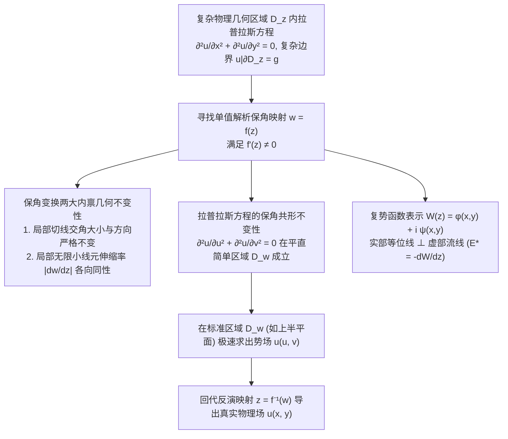

---
tags:
  - 物理/数学物理方法
  - 复变函数
  - 概念卡
  - 保角变换
  - 复势
  - 茹科夫斯基变换
  - 静电屏蔽与尖端放电
aliases:
  - 复变保角变换原理与二维稳态场映射
  - 保角映射
  - 二维拉普拉斯方程保角不变性
  - 复势与流函数
  - 默比乌斯变换与茹科夫斯基变换
  - Conformal Mapping Principle and 2D Potential Fields
created: 2026-09-08
updated: 2026-09-08
---

> [!summary] 概念核心论断
> 保角变换法（共形映射，Conformal Mapping）是复分析理论赋能经典物理学（静电场、二维理想无旋不可压缩流体力学、稳态平面导热）的最巅峰之作。柯西－黎曼微分方程内禀的几何特性保证了：任何单值解析函数在其导数非零区域内，均具有**微元局部角度绝对不变（保角性）**与**伸缩率各向同性（保相似性）**。更为根本的是，**二维拉普拉斯方程在任意解析保角映射下形式严格不变**。借助复势 $W(z) = \varphi + i\psi$，可将真实世界中极端复杂的异形物理边界（尖角折线、带孔带槽几何、机翼截面）等价投影至平直规整的标准半平面或同心圆域内极速求解，以纯代数复几何化解偏微分方程几何边界之厄。

## 一、推导机理与核心数学定义



---

### 1.1 保角变换的几何定义与柯西－黎曼充要条件

设单值复变函数 $w = f(z) = u(x, y) + i v(x, y)$ 在区域 $D$ 内解析。

#### 1. 伸缩率各向同性与旋转角恒定性：
考察经过点 $z_0$ 的一条光滑曲线 $C$，其切向量微元为 $dz = |dz| e^{i\alpha}$。
在映射下对应 $w$ 平面上的像切向量为 $dw = |dw| e^{i\beta}$。
由复导数的定义：
$$\frac{dw}{dz} = \lim_{z \to z_0} \frac{f(z) - f(z_0)}{z - z_0} = f'(z_0)$$
只要在点 $z_0$ 处满足**非临界条件 $f'(z_0) \neq 0$**，将其写为复数极坐标形式：
$$f'(z_0) = |f'(z_0)| e^{i\theta_0} \quad (\theta_0 = \operatorname{Arg} f'(z_0))$$
则切微元满足：
$$\boxed{ dw = f'(z_0) dz = \left( |f'(z_0)| \cdot |dz| \right) e^{i(\alpha + \theta_0)} }$$
1. **伸缩率各向同性**：
   $$\left| \frac{dw}{dz} \right| = |f'(z_0)| = \text{常数}$$
   任意方向微小线元的放大或缩小倍数严格恒定，微小图形在映射后形状保持**局部相似**！
2. **旋转角恒定性与保角性**：
   切线方向的偏转角为 $\beta - \alpha = \theta_0 = \operatorname{Arg} f'(z_0)$。
   若 $z$ 平面内两曲线相交夹角为 $\gamma = \alpha_2 - \alpha_1$，则映射后像曲线夹角为：
   $$\beta_2 - \beta_1 = (\alpha_2 + \theta_0) - (\alpha_1 + \theta_0) = \alpha_2 - \alpha_1 = \gamma$$
   **任意两曲线的交角在映射下保持大小绝对不变，且旋转方向（定向）严格保持不变！**

---

### 1.2 二维拉普拉斯方程的保角变换共形不变性

设实标量场 $\Phi(x, y)$ 在 $(x, y)$ 平面内满足齐次二维拉普拉斯方程：
$$\frac{\partial^2 \Phi}{\partial x^2} + \frac{\partial^2 \Phi}{\partial y^2} = 0$$
令 $w = u + iv = f(z)$ 是全纯函数，利用多元微积分链式法则计算其在 $(u, v)$ 坐标下的二次偏导：
$$\frac{\partial \Phi}{\partial x} = \frac{\partial \Phi}{\partial u} \frac{\partial u}{\partial x} + \frac{\partial \Phi}{\partial v} \frac{\partial v}{\partial x}$$
二次偏导展开并代入解析函数的**柯西－黎曼微分方程**：
$$\frac{\partial u}{\partial x} = \frac{\partial v}{\partial y}, \quad \frac{\partial u}{\partial y} = -\frac{\partial v}{\partial x}$$
手把手合并交叉微商项，直接导出惊天恒等式：
$$\boxed{ \frac{\partial^2 \Phi}{\partial x^2} + \frac{\partial^2 \Phi}{\partial y^2} = \left| f'(z) \right|^2 \left( \frac{\partial^2 \Phi}{\partial u^2} + \frac{\partial^2 \Phi}{\partial v^2} \right) }$$
由于在非临界点处 $|f'(z)| \neq 0$，因此：
$$\boxed{ \frac{\partial^2 \Phi}{\partial x^2} + \frac{\partial^2 \Phi}{\partial y^2} = 0 \iff \frac{\partial^2 \Phi}{\partial u^2} + \frac{\partial^2 \Phi}{\partial v^2} = 0 }$$
**调和函数在任意全纯保角变换下依然是严格的调和函数！**

---

### 1.3 复势理论 (Complex Potential Theory)

在二维无旋无散矢量场（静电场 $\nabla \times \boldsymbol{E} = 0, \nabla \cdot \boldsymbol{E} = 0$；理想流体流场 $\nabla \times \boldsymbol{v} = 0, \nabla \cdot \boldsymbol{v} = 0$）中：
定义**解析复势函数 (Complex Potential)**：
$$\boxed{ W(z) = \varphi(x, y) + i \psi(x, y) }$$
1. **实部 $\varphi(x, y)$**：势函数（静电位或速度势）。等值线 $\varphi(x, y) = \text{const}$ 为**等位线**；
2. **虚部 $\psi(x, y)$**：流函数（电通量势）。等值线 $\psi(x, y) = \text{const}$ 为**流线（或电力线）**；
3. **等位线与流线的处处正交性**：由柯西－黎曼方程：
   $$\nabla \varphi \cdot \nabla \psi = \frac{\partial \varphi}{\partial x}\frac{\partial \psi}{\partial x} + \frac{\partial \varphi}{\partial y}\frac{\partial \psi}{\partial y} = \left(\frac{\partial \psi}{\partial y}\right)\frac{\partial \psi}{\partial x} + \left(-\frac{\partial \psi}{\partial x}\right)\frac{\partial \psi}{\partial y} \equiv 0$$
   等位线与电力线处处严格直角正交！
4. **场强与速度矢量的复表示**：
   $$\boxed{ E^* = E_x - i E_y = -\frac{dW}{dz}, \quad v^* = v_x - i v_y = \frac{dW}{dz} }$$

---

### 1.4 三大经典初等保角变换工具箱

| 变换名称 | 数学映射公式 | 几何映射功能 | 典型物理工程应用 |
| :--- | :--- | :--- | :--- |
| **分式线性变换<br/>(Möbius 变换)** | **$w = \frac{az + b}{cz + d}$**<br/>($ad - bc \neq 0$) | 1. **保圆性**：将广义圆（圆或直线）映射为广义圆；<br/>2. **保对称点性**：共轭对称点映射为对称点；<br/>3. **保交比不变**。 | 偏心圆柱形电缆电容计算、双平行圆柱输电线电场 |
| **幂函数变换<br/>(Power Mapping)** | **$w = z^{\frac{\pi}{\alpha}}$**<br/>($\alpha$ 为顶角) | 将顶角为 $\alpha$ 的扇形角域严格**展平开合**为平直的上半复平面 $\operatorname{Im} w > 0$！ | 任意角度劈尖导体周围电场分布、槽口流场 |
| **茹科夫斯基变换<br/>(Zhukovsky)** | **$w = \frac{1}{2}\left( z + \frac{1}{z} \right)$** | 将单位圆周 $|z| = 1$ 压缩压平为实轴线段 $[-1, 1]$；将偏心圆映射为**机翼空气动力学翼型**！ | 机翼库塔－茹科夫斯基升力定理、平板机翼绕流 |

---

## 二、⚠️ 致命失分陷阱与临界边界

> [!warning] 陷阱 1：导数零点临界处保角性破坏与夹角成倍放大
> 保角性的绝对前提是 $f'(z) \neq 0$！
> - 若点 $z_0$ 是导数零点，设阶数为 $k$，即 $f'(z_0) = \dots = f^{(k-1)}(z_0) = 0$ 但 $f^{(k)}(z_0) \neq 0$；
> - 此时泰勒展开首项为 $w - w_0 \approx \frac{f^{(k)}(z_0)}{k!} (z - z_0)^k$；
> - **微元交角将被强制放大 $k$ 倍**！
> - 典型例子：$w = z^2$ 在原点 $f'(0) = 0, f''(0) = 2 \neq 0$，第一象限直角（$\pi/2$）被放大 2 倍直接展平为平角 $\pi$（上半平面）！考场切不可在临界点处套用保角结论。

> [!caution] 陷阱 2：复势求导求场强时遗漏负号或复共轭
> 计算静电场矢量时：
> - 正确关系：$E_x - i E_y = -\frac{dW}{dz}$；
> - 考场常见低级失误：直接写成 $E_x + i E_y = \frac{dW}{dz}$；
> - 这样不仅虚部符号颠倒，负号丢失更会导致受力方向与真实场强完全反向！必须牢记算出的结果是场强的**复共轭 $E^*$**。

> [!danger] 陷阱 3：多值保角映射未指定单值分支割线
> 遇到幂函数 $w = z^{\pi/\alpha}$ 或对数变换 $w = \ln z$ 时：
> - 它们是典型的多值复变函数；
> - 必须在复平面上预先选定**分支割线 (Branch Cut)**，并精确指定主辐角范围（例如 $-\pi < \operatorname{Arg} z \le \pi$ 或 $0 \le \theta < \alpha$）；
> - 若不指定分支，解出的势函数在绕原点一周后会产生周期性常数跳变，摧毁场的单值物理真实性。

---

## 三、经典范例手把手演算

### 题目（顶角为 $\alpha$ 的接地导体劈尖边缘电场奇性手把手推导）：
考虑由两个相交半无限接地导体平面构成的劈尖导体（顶点位于原点），两导体夹角为 $\alpha$（$0 < \alpha \le 2\pi$）。导体表面维持接地电位 $\Phi = 0$。
1. 构造保角变换，将劈尖内部区域映射为上半复平面 $\operatorname{Im} w > 0$；
2. 给出复势函数 $W(z)$ 与电位分布 $\Phi(r, \theta)$；
3. 计算导体表面附近的电场强度模值随距顶点距离 $r$ 的依赖关系，深入剖析**尖端放电（$\alpha > \pi$）**与**静电屏蔽（$\alpha < \pi$）**的物理本质！

#### 【演算步骤】

**第一步：构造展平保角变换**
在 $z$ 平面上，劈尖内部区域为扇形域：
$$D_z = \{ z = r e^{i\theta} \mid r > 0, 0 < \theta < \alpha \}$$
两边界为：$\theta = 0$ 与 $\theta = \alpha$。
选取幂函数映射：
$$\boxed{ w = z^{\frac{\pi}{\alpha}} }$$
代入极坐标 $z = r e^{i\theta}$：
$$w = u + iv = \left( r e^{i\theta} \right)^{\frac{\pi}{\alpha}} = r^{\frac{\pi}{\alpha}} e^{i \frac{\pi}{\alpha} \theta} = r^{\frac{\pi}{\alpha}} \left( \cos\frac{\pi\theta}{\alpha} + i \sin\frac{\pi\theta}{\alpha} \right)$$
- 当 $\theta = 0$ 时：$w = r^{\pi/\alpha} > 0$，映射为 $w$ 平面的正实轴；
- 当 $\theta = \alpha$ 时：$w = r^{\pi/\alpha} e^{i\pi} = -r^{\pi/\alpha} < 0$，映射为 $w$ 平面的负实轴；
- 扇形内部 $0 < \theta < \alpha$ 映射为虚部 $v = r^{\pi/\alpha} \sin\frac{\pi\theta}{\alpha} > 0$ 的**整个平整上半平面 $\operatorname{Im} w > 0$**！
原劈尖导体边界被完美拉直为全实轴 $v = 0$。

**第二步：在 $w$ 平面求解并写出复势**
在上半平面内，边界实轴 $v = 0$ 处接地电位维持为零：$\Phi(u, 0) = 0$。
在没有其它电荷源时，最简单的均匀场复势为线性函数：
$$W(w) = -i A w \quad (A \text{ 为实常数})$$
展开复势：
$$W(w) = -i A (u + iv) = A v - i A u$$
其电位（实部）为：
$$\Phi = \operatorname{Re}[W] = A v$$
在实轴边界 $v = 0$ 处，$\Phi = 0$ 天然精确满足！
代回原空间坐标 $z$：
$$W(z) = -i A z^{\frac{\pi}{\alpha}}$$
电位实部表达为极坐标显式解：
$$\boxed{ \Phi(r, \theta) = A r^{\frac{\pi}{\alpha}} \sin\left( \frac{\pi\theta}{\alpha} \right) }$$

**第三步：电场强度与尖端奇性计算**
计算电场强度矢量复共轭：
$$E^* = E_x - i E_y = -\frac{dW}{dz} = -(-i A) \frac{\pi}{\alpha} z^{\frac{\pi}{\alpha} - 1} = i A \frac{\pi}{\alpha} z^{\frac{\pi}{\alpha} - 1}$$
取电场强度模值：
$$|\boldsymbol{E}(r)| = |E^*| = A \frac{\pi}{\alpha} |z|^{\frac{\pi}{\alpha} - 1} = \boxed{ A \frac{\pi}{\alpha} r^{\frac{\pi}{\alpha} - 1} }$$

**第四步：三大物理边界行为深度剖析**
考察指数因子 $p = \frac{\pi}{\alpha} - 1$：

```
       α < π (凸角 / 锐角凹陷)               α = π (平坦平面)               α > π (尖锐尖端 / 避雷针)
              /                                                                      |
             / 内部场                            -----------                         | 导体内部
            /                                      平坦介质                          |----> 外场
```

1. **当 $\alpha < \pi$ 时（劈尖向内凹陷，如金属直角槽内壁 $\alpha = \pi/2$）**：
   $$\frac{\pi}{\alpha} > 1 \implies p = \frac{\pi}{\alpha} - 1 > 0$$
   当逼近角落原点 $r \to 0$ 时：
   $$\lim_{r \to 0} |\boldsymbol{E}| \propto \lim_{r \to 0} r^p = 0$$
   **静电屏蔽现象**：在金属凹角深处，电场强度严格归零，外界电场完全无法穿透进入角落深处！
2. **当 $\alpha = \pi$ 时（平直导电平面）**：
   $p = 1 - 1 = 0 \implies |\boldsymbol{E}| = A = \text{const}$，电场为均匀场。
3. **当 $\alpha > \pi$ 时（导体向外凸出的尖角，例如避雷针尖端、导体薄板锋利刀刃 $\alpha = 2\pi$）**：
   $$\frac{\pi}{\alpha} < 1 \implies p = \frac{\pi}{\alpha} - 1 < 0 \quad (\text{记 } \beta = 1 - \pi/\alpha > 0)$$
   $$|\boldsymbol{E}(r)| \propto \frac{1}{r^\beta}$$
   当逼近尖端 $r \to 0$ 时：
   $$\lim_{r \to 0} |\boldsymbol{E}| \to +\infty！$$
   **尖端放电物理本质**：在尖端外凸处，曲率半径极小导致电场强度发生**代数奇性强发散**！局部极强电场极易将周围空气分子雪崩电离，产生强烈的电晕放电与电子击穿（避雷针引雷物理机理）！保角变换将这一深刻物理定律揭示得淋漓尽致。

---

## 四、出处与纸质笔记坐标

* **教材出处**：梁昆淼《数学物理方法》（第四版）第十四章 §14.1-§14.3 (P349-P363)
* **纸质活页槽位**：`[活页-LKM-33]`
* **知识全景索引**：[[00_梁昆淼数学物理方法_第四篇全景图]]
