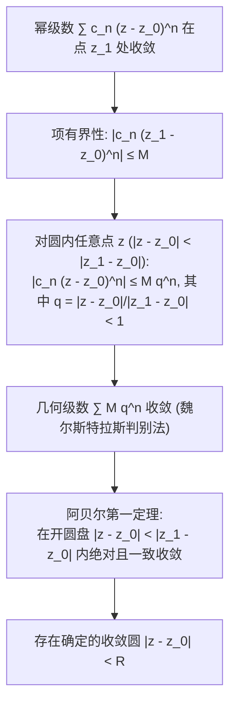

---
tags:
  - 物理/数学物理方法
  - 复变函数
  - 概念卡
  - 泰勒展开
  - 幂级数收敛圆
  - 解析延拓
  - 施瓦茨反射原理
aliases:
  - 复变泰勒展开与解析延拓原理
  - 泰勒展开定理
  - 幂级数与阿贝尔定理
  - 解析延拓
  - 唯一性定理
  - 施瓦茨反射原理
  - Taylor Series in Complex Analysis
  - Analytic Continuation and Schwarz Reflection
created: 2026-09-07
updated: 2026-09-08
---

> [!summary] 核心认知先验
> 复变函数论中的泰勒展开彻底摒弃了实变函数中“高阶导数存在却未必等于其泰勒级数（如柯西病态平坦函数 $e^{-1/x^2}$）”的深刻缺陷：在复平面上，**全纯即可微，可微即解析，解析即等价于其泰勒幂级数**。不仅如此，复幂级数的收敛半径具有极其清晰的几何几何测度——**收敛圆的边界必被离展开中心最近的奇异点所严格卡死**。依托泰勒级数与柯西积分公式，更催生了现代数学物理中最具延展力的思维跃迁——**解析延拓（Analytic Continuation）**与**施瓦茨反射原理（Schwarz Reflection Principle）**，赋予局部物理场信息向全域空间穿透渗透的唯一确定性。

---

## 一、推导机理与核心数学定义

### 1.1 复幂级数收敛性与阿贝尔定理 (Abel's Theorem)

设复变幂级数形式为：
$$\sum_{n=0}^\infty c_n (z - z_0)^n = c_0 + c_1 (z - z_0) + c_2 (z - z_0)^2 + \dots$$

#### 阿贝尔定理陈述
1. 若幂级数在点 $z_1 \ne z_0$ 处收敛，则对于满足 $|z - z_0| < |z_1 - z_0|$ 的**所有点 $z$ 处处绝对收敛**，且在任何闭子圆盘内一致收敛；
2. 若幂级数在点 $z_2$ 处发散，则对于满足 $|z - z_0| > |z_2 - z_0|$ 的**所有点 $z$ 处处发散**。

#### 收敛半径公式 (Cauchy-Hadamard / 比值法)
$$\boxed{R = \lim_{n \to \infty} \left| \frac{c_n}{c_{n+1}} \right| \quad \text{或} \quad R = \frac{1}{\limsup_{n \to \infty} \sqrt[n]{|c_n|}}}$$

---

### 1.2 泰勒展开定理 (Taylor's Expansion Theorem) 严格推导

#### 定理陈述
设函数 $f(z)$ 在以 $z_0$ 为中心的圆盘 $K: |z - z_0| < R$ 内解析，则 $f(z)$ 在该圆盘内必可唯一地展开为收敛的幂级数：

$$\boxed{f(z) = \sum_{n=0}^\infty c_n (z - z_0)^n, \quad c_n = \frac{f^{(n)}(z_0)}{n!} = \frac{1}{2\pi i} \oint_C \frac{f(\zeta)}{(\zeta - z_0)^{n+1}} d\zeta}$$

其中 $C$ 为圆盘内部绕 $z_0$ 的任意正向圆周，收敛半径 $R$ **恰好等于展开中心 $z_0$ 到 $f(z)$ 离它最近的奇点 $z_p$ 之间的欧氏几何距离**：
$$\boxed{R = \operatorname{dist}(z_0, \text{Singularities}) = |z_0 - z_p|}$$

#### 严密推导过程（利用柯西积分公式展开几何级数）
在圆盘内任取一点 $z$（$|z - z_0| = r < R$）。选取正向圆周 $C: |\zeta - z_0| = \rho$，满足 $r < \rho < R$。
由柯西积分公式：
$$f(z) = \frac{1}{2\pi i} \oint_C \frac{f(\zeta)}{\zeta - z} d\zeta$$
将积分核进行分式恒等拆分：
$$\frac{1}{\zeta - z} = \frac{1}{(\zeta - z_0) - (z - z_0)} = \frac{1}{\zeta - z_0} \frac{1}{1 - \frac{z - z_0}{\zeta - z_0}}$$
由于在圆周 $C$ 上，$\left| \frac{z - z_0}{\zeta - z_0} \right| = \frac{r}{\rho} = q < 1$。根据有限项等比数列求和公式：
$$\frac{1}{1 - \frac{z - z_0}{\zeta - z_0}} = \sum_{k=0}^{n-1} \left( \frac{z - z_0}{\zeta - z_0} \right)^k + \frac{\left( \frac{z - z_0}{\zeta - z_0} \right)^n}{1 - \frac{z - z_0}{\zeta - z_0}}$$
代入柯西积分：
$$f(z) = \sum_{k=0}^{n-1} \left[ \frac{1}{2\pi i} \oint_C \frac{f(\zeta)}{(\zeta - z_0)^{k+1}} d\zeta \right] (z - z_0)^k + R_n(z)$$
其中前项系数由高阶导数公式恰为 $c_k = \frac{f^{(k)}(z_0)}{k!}$。
余项估计：
$$R_n(z) = \frac{(z - z_0)^n}{2\pi i} \oint_C \frac{f(\zeta)}{(\zeta - z_0)^n (\zeta - z)} d\zeta$$
设在 $C$ 上 $|f(\zeta)| \le M$。由于 $|\zeta - z| \ge \rho - r > 0$：
$$|R_n(z)| \le \frac{r^n}{2\pi} \frac{M}{\rho^n (\rho - r)} (2\pi \rho) = \frac{M \rho}{\rho - r} \left( \frac{r}{\rho} \right)^n$$
因为 $r < \rho \implies \frac{r}{\rho} < 1$，当 $n \to \infty$ 时，$\left( \frac{r}{\rho} \right)^n \to 0$，故：
$$\lim_{n \to \infty} R_n(z) = 0$$
余项在极限下消亡，定理严格获证！

---

### 1.3 解析函数的零点孤立性与唯一性定理

#### (1) 零点阶数定义
若解析函数在 $z_0$ 处满足：
$$f(z_0) = 0, f'(z_0) = 0, \dots, f^{(m-1)}(z_0) = 0, \quad f^{(m)}(z_0) \ne 0$$
则称 $z_0$ 为 $f(z)$ 的 **$m$ 阶零点**。其局部泰勒展开必可提纯为：
$$f(z) = (z - z_0)^m \varphi(z), \quad \varphi(z_0) \ne 0 \text{ 且 } \varphi(z) \text{ 全纯}$$

#### (2) 唯一性定理 (Identity Theorem)
若函数 $f(z)$ 与 $g(z)$ 在区域 $D$ 内解析，且在 $D$ 内的一个**有聚点的子集（如一段连续曲线或孤立收敛点列）上恒有 $f(z) = g(z)$**，则在整个区域 $D$ 内处处有：
$$\boxed{f(z) \equiv g(z)}$$
**物理意义**：解析函数具有极度严苛的整体刚性。在局部哪怕极其微小的微元上确定了函数值，其在全域的形态便被彻底锁定。

---

### 1.4 解析延拓与施瓦茨反射原理 (Schwarz Reflection Principle)

#### (1) 解析延拓概念
设 $f_1(z)$ 在区域 $D_1$ 内解析，$f_2(z)$ 在区域 $D_2$ 内解析，$D_1$ 与 $D_2$ 拥有一段公共交界边界或公共连通域 $D_{12}$。若在公共部分有 $f_1(z) = f_2(z)$，则称 $f_2(z)$ 为 $f_1(z)$ 越过边界从 $D_1$ 延拓至 $D_2$ 的**解析延拓 (Analytic Continuation)**。由唯一性定理，延拓结果唯一。

#### (2) 施瓦茨对称反射原理
若区域 $D$ 位于上半平面，其边界包含实轴上的一段开区间 $I$。设 $f(z)$ 在 $D$ 内解析，在 $D \cup I$ 上连续，且**在实轴区间 $I$ 上取纯实数值**（即 $\operatorname{Im} f(x) = 0$）：
定义区域 $D^*$ 为 $D$ 关于实轴的几何镜像区域（即 $z \in D^* \iff z^* \in D$）。
则 $f(z)$ 可以唯一解析延拓至全对称域 $D \cup I \cup D^*$，且在对称点处的函数值为：

$$\boxed{f(z^*) = [f(z)]^*}$$

此即理论物理（如量子散射矩阵 $S$ 矩阵单值性、色散关联式）中最常用的复共轭解析延拓对称性。

---

## 二、⚠️ 致命失分陷阱与临界边界

> [!warning] 陷阱 1：脱离最近奇点误判收敛半径
> 考虑实变函数 $f(x) = \frac{1}{1 + x^2}$，在全实轴 $(-\infty, +\infty)$ 上处处无限次可微且平滑。
> 但若在实原点 $x_0 = 0$ 处作泰勒展开：
> $\frac{1}{1+x^2} = 1 - x^2 + x^4 - x^6 + \dots$
> 其收敛区间仅为 $(-1, 1)$，收敛半径仅为 $R = 1$。
> 实变微积分完全无法解释为何实轴上没有任何奇点却在 $x = \pm 1$ 处发散！
> **复变真相**：解析延拓至复平面后，函数奇点为 $z = \pm i$。展开中心 $z_0 = 0$ 到奇点 $\pm i$ 的距离为 $|0 - (\pm i)| = 1$。奇点在虚轴上的存在物理性地**卡死**了实轴上的收敛半径！

> [!caution] 陷阱 2：混淆“展开中心选择”导致的级数形态不同
> 对同一函数，展开中心 $z_0$ 不同，泰勒级数的收敛半径和级数形式完全不同。
> 例如 $f(z) = \frac{1}{z - 2}$：
> - 选 $z_0 = 0$ 时，最近奇点为 $2$，$R = |2 - 0| = 2$；
> - 选 $z_0 = -1$ 时，最近奇点仍为 $2$，但此时 $R = |2 - (-1)| = 3$！

> [!danger] 陷阱 3：在施瓦茨反射原理中忽视“实轴上取实数值”的先决条件
> 若函数在实轴上取虚数值或复数值，直接代入 $f(z^*) = [f(z)]^*$ 将彻底错误！
> 例如 $f(z) = i z$：在实轴上 $f(x) = i x \notin \mathbb{R}$。
> 计算 $[f(z)]^* = [i z]^* = -i z^*$，而 $f(z^*) = i z^* \ne [f(z)]^*$。反射原理前提被破坏。

---

## 三、经典范例手把手演算与反代验算

### 3.1 经典例题：指定中心的泰勒展开与收敛圆精确确定
**题目（梁书第 3 章 §3.2 典型例题）**：
求函数
$$f(z) = \frac{1}{z^2 - 3z + 2}$$
在中心 $z_0 = -1$ 处的泰勒幂级数展开式，并确定其精确的收敛半径 $R$ 与收敛圆区域。

#### 第一步：奇点排查与几何收敛半径预判
因式分解分母：
$$z^2 - 3z + 2 = (z - 1)(z - 2)$$
故 $f(z)$ 的奇点仅为两个简单极点：$z_1 = 1$ 与 $z_2 = 2$。
展开中心给定为 $z_0 = -1$。
计算展开中心到各奇点的几何欧氏距离：
$$d_1 = |z_1 - z_0| = |1 - (-1)| = 2$$
$$d_2 = |z_2 - z_0| = |2 - (-1)| = 3$$
最近奇点为 $z_1 = 1$，距离为 $2$。
因此由几何收敛定理，泰勒级数的收敛半径必定为：
$$\boxed{R = 2}$$
级数的收敛区域为开圆盘 $|z + 1| < 2$。

#### 第二步：部分分式分解
将 $f(z)$ 拆分为一阶简单分式：
$$\frac{1}{(z-1)(z-2)} = \frac{A}{z-1} + \frac{B}{z-2}$$
解得 $A = -1, B = 1$。即：
$$f(z) = -\frac{1}{z - 1} + \frac{1}{z - 2}$$

#### 第三步：围绕基底 $(z + 1)$ 构造等比级数
引入变量基底 $t = z - z_0 = z + 1$：
1. **展开第一项 $-\frac{1}{z-1}$**：
   $$z - 1 = (z + 1) - 2 = t - 2 = -2\left( 1 - \frac{t}{2} \right)$$
   故：
   $$-\frac{1}{z-1} = \frac{1}{2\left( 1 - \frac{t}{2} \right)} = \frac{1}{2} \sum_{n=0}^\infty \left( \frac{t}{2} \right)^n = \sum_{n=0}^\infty \frac{1}{2^{n+1}} (z + 1)^n$$
   收敛条件为 $\left| \frac{t}{2} \right| < 1 \implies |z + 1| < 2$；
2. **展开第二项 $\frac{1}{z-2}$**：
   $$z - 2 = (z + 1) - 3 = t - 3 = -3\left( 1 - \frac{t}{3} \right)$$
   故：
   $$\frac{1}{z-2} = -\frac{1}{3\left( 1 - \frac{t}{3} \right)} = -\frac{1}{3} \sum_{n=0}^\infty \left( \frac{t}{3} \right)^n = -\sum_{n=0}^\infty \frac{1}{3^{n+1}} (z + 1)^n$$
   收敛条件为 $\left| \frac{t}{3} \right| < 1 \implies |z + 1| < 3$。

#### 第四步：线性求和合并项
在两级数共同收敛的交集区域 $|z + 1| < \min(2, 3) = 2$ 内：
$$f(z) = \sum_{n=0}^\infty \left( \frac{1}{2^{n+1}} - \frac{1}{3^{n+1}} \right) (z + 1)^n$$
写出前几项具体系数：
- $n = 0$：$c_0 = \frac{1}{2} - \frac{1}{3} = \frac{1}{6}$；
- $n = 1$：$c_1 = \frac{1}{4} - \frac{1}{9} = \frac{5}{36}$；
- $n = 2$：$c_2 = \frac{1}{8} - \frac{1}{27} = \frac{19}{216}$。
最终泰勒展开通式为：
$$\boxed{f(z) = \sum_{n=0}^\infty \frac{3^{n+1} - 2^{n+1}}{6^{n+1}} (z + 1)^n, \quad (|z + 1| < 2)}$$

#### 第五步：反代自洽性验证
1. **在展开中心 $z = -1$ 处验算初值**：
   直接代入原函数：
   $$f(-1) = \frac{1}{(-1)^2 - 3(-1) + 2} = \frac{1}{1 + 3 + 2} = \frac{1}{6}$$
   级数在 $z = -1$ 处仅存首项 $c_0 = \frac{1}{6}$，两者精确一致！
2. **导数公式验算 $c_1$**：
   对原函数求导：
   $$f'(z) = -\frac{2z - 3}{(z^2 - 3z + 2)^2}$$
   代入 $z = -1$：
   $$f'(-1) = -\frac{2(-1) - 3}{6^2} = -\frac{-5}{36} = \frac{5}{36}$$
   根据泰勒定理 $c_1 = \frac{f'(-1)}{1!} = \frac{5}{36}$，与展开式系数完全吻合！

---

## 四、出处与纸质笔记坐标

- **教材出处**：梁昆淼《数学物理方法》（第四版）
  - 第三章：复变函数的幂级数展开
  - §3.1 复数项级数与幂级数（原书 P32-P36）
  - §3.2 解析函数的泰勒展开（原书 P36-P40）
  - §3.3 零点的孤立性与解析延拓（原书 P40-P42）
- **对应 MinerU OCR 语料**：`mineru_output/梁昆淼_数学物理方法/数学物理方法_梁昆淼_第四版/ocr/数学物理方法_梁昆淼_第四版.md` Lines 1426-1978
- **对应全景图**：[[00_梁昆淼数学物理方法_第一篇全景图]]
- **纸质活页定位**：`[活页-LKM-05]`
