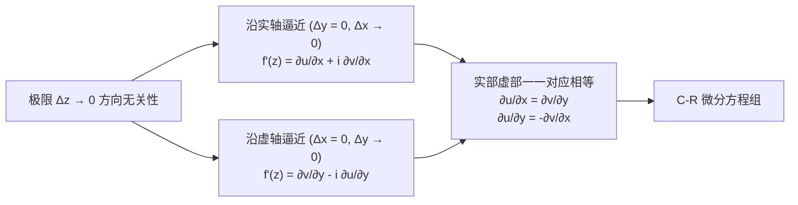

---
tags:
  - 物理/数学物理方法
  - 复变函数
  - 概念卡
  - 柯西黎曼方程
  - 解析函数
  - 调和函数
  - 标量场复势
aliases:
  - 复变解析函数与柯西黎曼微分方程
  - 柯西黎曼微分方程
  - C-R微分方程
  - 解析函数
  - 调和函数与共轭调和场
  - 复势
  - Cauchy-Riemann Equations
  - Analytic Functions and Conjugate Harmonics
created: 2026-09-07
updated: 2026-09-08
---

> [!summary] 核心认知先验
> 复导数远非实微积分导数向多维空间的平凡平移，而是赋予了二维几何变换以苛刻的**各向同性（保角性与旋转伸缩不变性）**。复函数 $w = u + iv$ 在一点可导，要求差商极限在复平面**沿任意方向趋近原点时完全一致**。这一严苛约束直接淬炼出复分析的核心宪法——**柯西－黎曼微分方程 (Cauchy-Riemann Equations, C-R 方程)**。C-R 方程不仅确立了全纯解析函数的充要判据，更在物理上揭示了**调和场（无源无旋场）**实部与虚部的内在孪生关系：静电势、稳态温度场与理想不可压缩无旋流体的流函数，均能通过共轭调和场自然升华为极其强大的**复势 (Complex Potential)** 工具。

---

## 一、推导机理与核心数学定义

### 1.1 复变导数的极限定义与几何各向同性

设函数 $w = f(z) = u(x, y) + i v(x, y)$ 定义于区域 $D$ 内。若极限
$$f'(z) = \lim_{\Delta z \to 0} \frac{\Delta w}{\Delta z} = \lim_{\Delta z \to 0} \frac{f(z + \Delta z) - f(z)}{\Delta z}$$
存在且与 $\Delta z = \Delta x + i\Delta y$ 趋近于 $0$ 的**路径与几何方向无关**，则称 $f(z)$ 在点 $z$ **复可导**。
- **解析函数（全纯函数，Holomorphic）定义**：若 $f(z)$ 在点 $z_0$ 及其**某个邻域内处处可导**，则称 $f(z)$ 在点 $z_0$ 解析。在区域 $D$ 内每一点都解析的函数称为区域 $D$ 内的解析函数。

---

### 1.2 柯西－黎曼微分方程 (C-R 方程) 的严格推导

设 $\Delta z = \Delta x + i \Delta y$。增量比展开为：
$$\frac{\Delta w}{\Delta z} = \frac{[u(x+\Delta x, y+\Delta y) - u(x,y)] + i [v(x+\Delta x, y+\Delta y) - v(x,y)]}{\Delta x + i\Delta y}$$

#### 途径一：沿平行于实轴方向逼近（$\Delta y = 0, \Delta x \to 0$）
$$\frac{\Delta w}{\Delta z} = \frac{u(x+\Delta x, y) - u(x,y)}{\Delta x} + i \frac{v(x+\Delta x, y) - v(x,y)}{\Delta x}$$
取极限得：
$$f'(z) = \frac{\partial u}{\partial x} + i \frac{\partial v}{\partial x}$$

#### 途径二：沿平行于虚轴方向逼近（$\Delta x = 0, \Delta y \to 0$）
$$\frac{\Delta w}{\Delta z} = \frac{[u(x, y+\Delta y) - u(x,y)] + i [v(x, y+\Delta y) - v(x,y)]}{i\Delta y} = \frac{1}{i}\frac{\partial u}{\partial y} + \frac{\partial v}{\partial y} = \frac{\partial v}{\partial y} - i \frac{\partial u}{\partial y}$$

#### 联立实部与虚部
由于极限与方向无关，上述两种极限必须严格相等：
$$\frac{\partial u}{\partial x} + i \frac{\partial v}{\partial x} = \frac{\partial v}{\partial y} - i \frac{\partial u}{\partial y}$$
比较实部与虚部，立即导出直角坐标系下的 **C-R 方程**：

$$\boxed{\begin{cases}
\dfrac{\partial u}{\partial x} = \dfrac{\partial v}{\partial y} \\
\dfrac{\partial u}{\partial y} = -\dfrac{\partial v}{\partial x}
\end{cases}}$$

#### 解析性的充要条件定理
函数 $f(z) = u(x, y) + i v(x, y)$ 在区域 $D$ 内解析的**充要条件**是：
1. $u(x, y)$ 和 $v(x, y)$ 在 $D$ 内具备一阶连续偏导数（即 $u, v \in C^1(D)$）；
2. $u(x, y)$ 和 $v(x, y)$ 在 $D$ 内处处满足柯西－黎曼方程。

此时复导数的计算公式可等价表示为：
$$\boxed{f'(z) = \frac{\partial u}{\partial x} + i \frac{\partial v}{\partial x} = \frac{\partial v}{\partial y} - i \frac{\partial u}{\partial y} = \frac{\partial u}{\partial x} - i \frac{\partial u}{\partial y} = \frac{\partial v}{\partial y} + i \frac{\partial v}{\partial x}}$$

---

### 1.3 极坐标系下的 C-R 微分方程

利用极坐标变量代换 $x = \rho \cos \varphi, y = \rho \sin \varphi$，根据多元函数链式法则：
$$\begin{aligned}
\frac{\partial}{\partial \rho} &= \cos \varphi \frac{\partial}{\partial x} + \sin \varphi \frac{\partial}{\partial y} \\
\frac{\partial}{\partial \varphi} &= -\rho \sin \varphi \frac{\partial}{\partial x} + \rho \cos \varphi \frac{\partial}{\partial y}
\end{aligned}$$
代入直角坐标 C-R 方程整理，得到**极坐标 C-R 方程**：

$$\boxed{\begin{cases}
\dfrac{\partial u}{\partial \rho} = \dfrac{1}{\rho} \dfrac{\partial v}{\partial \varphi} \\
\dfrac{\partial v}{\partial \rho} = -\dfrac{1}{\rho} \dfrac{\partial u}{\partial \varphi}
\end{cases}} \quad (\rho \ne 0)$$

此时复导数在极坐标下的计算公式为：
$$\boxed{f'(z) = e^{-i\varphi} \left( \frac{\partial u}{\partial \rho} + i \frac{\partial v}{\partial \rho} \right) = \frac{e^{-i\varphi}}{\rho} \left( \frac{\partial v}{\partial \varphi} - i \frac{\partial u}{\partial \varphi} \right)}$$

---

### 1.4 调和函数与共轭调和场的重构机制

#### (1) 调和性证明
若 $f(z) = u + iv$ 解析，且 $u, v \in C^2$，对 C-R 方程交叉求偏导：
$$\frac{\partial^2 u}{\partial x^2} = \frac{\partial}{\partial x}\left(\frac{\partial v}{\partial y}\right) = \frac{\partial^2 v}{\partial x \partial y}$$
$$\frac{\partial^2 u}{\partial y^2} = \frac{\partial}{\partial y}\left(-\frac{\partial v}{\partial x}\right) = -\frac{\partial^2 v}{\partial y \partial x}$$
由混合二阶偏导数连续可交换定理 $\frac{\partial^2 v}{\partial x \partial y} = \frac{\partial^2 v}{\partial y \partial x}$，两式相加即得：
$$\nabla^2 u = \frac{\partial^2 u}{\partial x^2} + \frac{\partial^2 u}{\partial y^2} = 0$$
同理可证：
$$\nabla^2 v = \frac{\partial^2 v}{\partial x^2} + \frac{\partial^2 v}{\partial y^2} = 0$$

$$\boxed{\nabla^2 u = 0, \quad \nabla^2 v = 0}$$

满足二维拉普拉斯方程的实函数称为**调和函数 (Harmonic Function)**。满足 C-R 方程的一对调和函数 $u$ 与 $v$ 互为**共轭调和函数 (Conjugate Harmonic Functions)**。

#### (2) 共轭调和函数的全微分重构方法
已知调和函数 $u(x, y)$，由于 $dv = \frac{\partial v}{\partial x} dx + \frac{\partial v}{\partial y} dy$，由 C-R 方程可完全用 $u$ 表达：
$$dv = -\frac{\partial u}{\partial y} dx + \frac{\partial u}{\partial x} dy$$
由于 $\frac{\partial}{\partial y}\left(-\frac{\partial u}{\partial y}\right) - \frac{\partial}{\partial x}\left(\frac{\partial u}{\partial x}\right) = -\nabla^2 u = 0$，上述微分形式为**恰当全微分**！
由曲线积分与路径无关性，取基准点 $(x_0, y_0)$，共轭调和场 $v(x, y)$ 显式积分式为：
$$\boxed{v(x, y) = \int_{(x_0, y_0)}^{(x, y)} \left( -\frac{\partial u}{\partial y} dx + \frac{\partial u}{\partial x} dy \right) + C}$$

---

### 1.5 二维物理场的复势 (Complex Potential)

在二维物理标量场与流体动力学中：
- 设 $u(x, y) = \text{常数}$ 为**等势线 (Equipotential lines)**；
- 其共轭调和函数 $v(x, y) = \text{常数}$ 必为**流线或电力线 (Field lines)**；
- **几何正交性**：
  $$\nabla u \cdot \nabla v = \frac{\partial u}{\partial x}\frac{\partial v}{\partial x} + \frac{\partial u}{\partial y}\frac{\partial v}{\partial y} = \frac{\partial u}{\partial x}\left(-\frac{\partial u}{\partial y}\right) + \frac{\partial u}{\partial y}\left(\frac{\partial u}{\partial x}\right) \equiv 0$$
- 定义**复势函数** $W(z) = u(x, y) + i v(x, y)$：
  - 电场强度矢量：$\mathbf{E} = -\nabla u = -\left(\frac{\partial u}{\partial x}, \frac{\partial u}{\partial y}\right)$；
  - 复场强表达式（复共轭梯度）：
    $$E_x - i E_y = -\frac{\partial u}{\partial x} + i \frac{\partial u}{\partial y} = -f'(z)$$

---

## 二、⚠️ 致命失分陷阱与临界边界

> [!warning] 陷阱 1：仅满足偏导数存在并满足 C-R 方程，未检验“偏导数连续性”
> 许多考题构造病态反例：偏导数在某点存在且代数上满足 C-R 方程，但偏导数在该点**不连续**，导致函数在该点根本**不可导**，更遑论解析！
> **典型反例**：$f(z) = \sqrt{|xy|}$ 在原点 $z = 0$。
> 沿坐标轴：$u(x, 0) = 0, u(0, y) = 0 \implies \frac{\partial u}{\partial x}(0,0) = 0, \frac{\partial u}{\partial y}(0,0) = 0$。
> 虚部 $v \equiv 0$，显然在原点代数上满足 C-R 方程 $\frac{\partial u}{\partial x} = \frac{\partial v}{\partial y} = 0, \frac{\partial u}{\partial y} = -\frac{\partial v}{\partial x} = 0$。
> 但沿直线 $y = kx$（$k > 0$）逼近原点：
> $$\lim_{z \to 0} \frac{f(z) - 0}{z} = \lim_{x \to 0} \frac{\sqrt{k} |x|}{x(1 + ik)}$$
> 当 $x \to 0^+$ 与 $x \to 0^-$ 时极限符号相反，极限不存在！故 $f(z)$ 在原点不可导。

> [!caution] 陷阱 2：共轭复数符号反转导致方向导数与 C-R 方程符号错位
> 若 $u(x, y)$ 是调和函数，则 $v(x, y)$ 是其共轭调和函数；但 **$-u(x, y)$ 才是 $v(x, y)$ 的共轭调和函数**（有负号对换）！
> 即：$f(z) = u + iv$ 解析，但 $g(z) = v + iu$ **通常不解析**，除非 $f(z)$ 为常数。

> [!danger] 陷阱 3：在非单连通域中直接使用全微分积分重构共轭调和函数
> 若区域内存在“洞”（如环状域或被挖掉的原点），全微分线积分可能具有非零环量（如对数势 $u = \ln \sqrt{x^2+y^2}$，其共轭调和函数为多值的辐角 $v = \arctan(y/x) = \arg z$）。盲目认为 $v$ 是全局单值函数会导致严重的物理佯谬。

---

## 三、经典范例手把手演算与反代验算

### 3.1 经典例题：由已知电势重构解析复势与场强分布
**题目（梁书第 1 章 §1.5 经典例题）**：
已知静电场的电势分布为 $u(x, y) = x^3 - 3xy^2 + 2x$。
1. 验证 $u(x, y)$ 是否可以在无源区域表示一个真实的二维静电场（即验证是否为调和函数）；
2. 求解共轭调和函数 $v(x, y)$，满足条件 $v(0, 0) = 1$；
3. 求出对应的全纯复势函数 $f(z) = u + iv$ 显式表达为其复自变量 $z$ 的函数；
4. 给出原点处的电场强度矢量 $\mathbf{E}(0, 0)$。

#### 第一步：验证调和性
计算一阶偏导数：
$$\frac{\partial u}{\partial x} = 3x^2 - 3y^2 + 2, \quad \frac{\partial u}{\partial y} = -6xy$$
计算二阶偏导数：
$$\frac{\partial^2 u}{\partial x^2} = 6x, \quad \frac{\partial^2 u}{\partial y^2} = -6x$$
拉普拉斯算子作用：
$$\nabla^2 u = \frac{\partial^2 u}{\partial x^2} + \frac{\partial^2 u}{\partial y^2} = 6x + (-6x) \equiv 0$$
在全平面处处满足拉普拉斯方程，故 $u(x, y)$ 是全平面的调和函数，可作为无源静电势。

#### 第二步：利用全微分法求解共轭调和函数 $v(x, y)$
由 C-R 微分方程：
$$\frac{\partial v}{\partial y} = \frac{\partial u}{\partial x} = 3x^2 - 3y^2 + 2 \tag{1}$$
$$\frac{\partial v}{\partial x} = -\frac{\partial u}{\partial y} = 6xy \tag{2}$$
对式 (1) 关于 $y$ 积分：
$$v(x, y) = \int (3x^2 - 3y^2 + 2) dy = 3x^2 y - y^3 + 2y + C(x)$$
将上式对 $x$ 求偏导并代入式 (2)：
$$\frac{\partial v}{\partial x} = 6xy + C'(x) = 6xy \implies C'(x) = 0 \implies C(x) = C_0$$
代入初值条件 $v(0, 0) = 1$：
$$v(0, 0) = 0 - 0 + 0 + C_0 = 1 \implies C_0 = 1$$
因此共轭调和函数为：
$$\boxed{v(x, y) = 3x^2 y - y^3 + 2y + 1}$$

#### 第三步：构造解析函数 $f(z)$ 并化为 $z$ 的形式
组合复函数：
$$f(z) = u(x, y) + i v(x, y) = (x^3 - 3xy^2 + 2x) + i (3x^2 y - y^3 + 2y + 1)$$
按实虚部重组为幂次：
$$f(z) = (x^3 + 3i x^2 y - 3xy^2 - i y^3) + 2(x + iy) + i$$
由二项式展开公式 $(x + iy)^3 = x^3 + 3i x^2 y - 3xy^2 - i y^3$，立即识别出：
$$\boxed{f(z) = z^3 + 2z + i}$$

#### 第四步：计算原点电场强度
复导数：
$$f'(z) = 3z^2 + 2$$
在原点 $z = 0$ 处：$f'(0) = 2$。
由复场强公式 $E_x - i E_y = -f'(z) = -2$：
$$E_x = -2, \quad E_y = 0 \implies \mathbf{E}(0, 0) = (-2, 0)$$

#### 第五步：反代验算
1. 验算实部：令 $z = x + iy$，
   $$\operatorname{Re}[z^3 + 2z + i] = \operatorname{Re}[(x+iy)^3 + 2(x+iy) + i] = x^3 - 3xy^2 + 2x$$
   与题目给定的 $u(x, y)$ 完全吻合！
2. 验算虚部：
   $$\operatorname{Im}[z^3 + 2z + i] = \operatorname{Im}[(x+iy)^3 + 2(x+iy) + i] = 3x^2 y - y^3 + 2y + 1$$
   与求得的 $v(x, y)$ 完全吻合！
3. 验算梯度垂直性：在任意点 $(1, 1)$：
   $\nabla u(1, 1) = (3 - 3 + 2, -6) = (2, -6)$
   $\nabla v(1, 1) = (6, 3 - 3 + 2) = (6, 2)$
   $\nabla u \cdot \nabla v = 2 \times 6 + (-6) \times 2 = 12 - 12 = 0$。严格正交自洽！

---

## 四、出处与纸质笔记坐标

- **教材出处**：梁昆淼《数学物理方法》（第四版）
  - 第一章：复变函数
  - §1.3 导数与解析函数（原书 P9-P13）
  - §1.4 柯西－黎曼微分方程（原书 P13-P16）
  - §1.5 平面标量场、调和函数与复势（原书 P16-P19）
- **对应 MinerU OCR 语料**：`mineru_output/梁昆淼_数学物理方法/数学物理方法_梁昆淼_第四版/ocr/数学物理方法_梁昆淼_第四版.md` Lines 348-892
- **对应全景图**：[[00_梁昆淼数学物理方法_第一篇全景图]]
- **纸质活页定位**：`[活页-LKM-02]`
